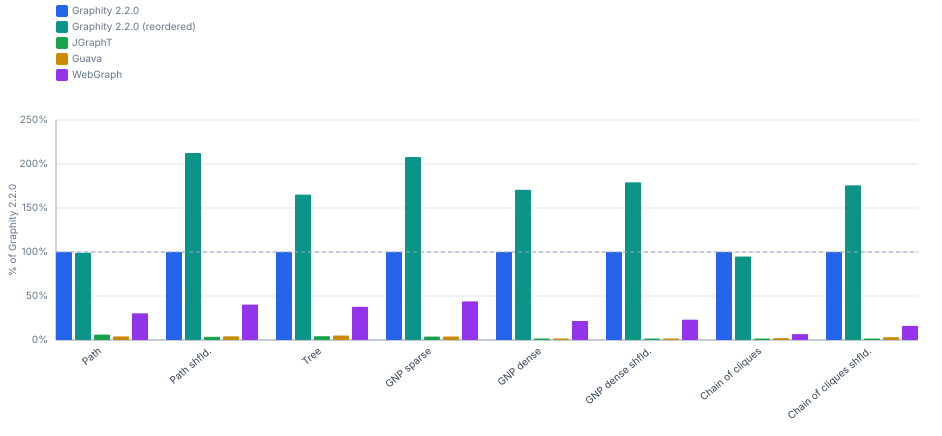

# Graphity

[](https://central.sonatype.com/artifact/com.kobayami/graphity-core)
[](https://kaufco.github.io/graphity/)
[](https://github.com/kaufco/graphity/actions/workflows/ci.yml)
[](LICENSE)
[](https://adoptium.net/temurin/releases/?version=17)

Graphity is a compact, high-performance Java library for analyzing directed and undirected graphs. It is built for compiler and analysis pipelines — abstract syntax trees, control- and data-flow graphs, dependency graphs — and more generally for anywhere you build a graph from your domain model, run analyses on it, and use the results.

Graphity stores graphs in a CSR layout and returns algorithm results as typed, immutable value objects with useful follow-up APIs. On the algorithms covered by [JGraphT](https://jgrapht.org/) and [Guava Graph](https://github.com/google/guava/wiki/GraphsExplained), Graphity is **8×–79× faster** and uses **17×–55× less memory per (node + edge)**. [WebGraph](https://webgraph.di.unimi.it/) (LAW Milano), a specialist for compressed billion-node web crawls, beats Graphity on raw memory compactness (see [Limitations](#limitations)); on runtime, Graphity is faster across all measured shapes and sizes (2.4×–21×).

Speed and footprint come from the same constraint: Graphity models topology only. Nodes are integer IDs, edges are integer pairs, and labels or weights live in arrays you own, indexed by node or edge ID. The graph itself stays a flat `int[]`.

## Installation

### Maven

```xml
<dependency>
    <groupId>com.kobayami</groupId>
    <artifactId>graphity-core</artifactId>
    <version>2.0.0</version>
</dependency>
```

### Gradle (Groovy DSL)

```groovy
dependencies {
    implementation 'com.kobayami:graphity-core:2.0.0'
}
```

### Gradle (Kotlin DSL)

```kotlin
dependencies {
    implementation("com.kobayami:graphity-core:2.0.0")
}
```

Requires JDK 17 or newer.

## Quick Start

```java
import com.kobayami.graphity.GraphBuilder;
import com.kobayami.graphity.Components;
import com.kobayami.graphity.Sccs;
import com.kobayami.graphity.TopOrder;

var builder = new GraphBuilder();
builder.addNodes(4);
builder.addEdge(0, 1);
builder.addEdge(0, 2);
builder.addEdge(1, 3);
builder.addEdge(2, 0);

var graph = builder.build();           // immutable, thread-safe

// Strongly connected components
var sccs = Components.sccsOf(graph);
sccs.groupCount();                     // number of SCCs
sccs.get(0);                           // SCC ID of node 0
sccs.nodesOf(0);                       // sorted view of nodes in SCC 0
sccs.containsCycle(0);                 // does this SCC contain a cycle?
var condensed = sccs.condense();       // condensation DAG

// In-adjacency access (opt-in)
var bi = graph.biAdjacentGraph();
bi.inDegree(3);                        // number of incoming edges at node 3
bi.inNodes(3);                         // sorted view of predecessors

// Topological order on a DAG
var order = TopOrder.of(condensed);
```

The result types are themselves graphs or partitions backed by CSR — they compose, and there are no per-call allocations on hot paths. For a deeper introduction and more examples, see [Documentation](#documentation).

## What Graphity gives you

**Compact, topology-only data model.** Graphs hold nodes as integer IDs and edges as integer pairs. No labels, no weights, no per-node objects. Constant 4 bytes per (node + edge) regardless of topology. Labels and weights live in user-owned parallel arrays indexed by node ID or edge ID:

```java
double[] weights = new double[graph.edgeCount()];
```

**Direction is an interpretation, not a type.** Edges are stored as directed pairs, but nothing commits a graph to one reading. Where the distinction matters, both variants are available — `Components.sccsOf` reads the graph as directed, `Components.ccsOf` as undirected. An AST that is a tree for one analysis and a dependency graph for the next needs no conversion and no second copy. Reading a graph as undirected collapses `a → b` and `b → a` into one edge and ignores self-loops, so a graph that stores its undirected edges symmetrically behaves exactly like one that stores a single direction per edge.

**`BiAdjacentGraph` for O(1) bidirectional access.** Opt-in via `graph.biAdjacentGraph()`. Doubles the storage to 8 B per (node + edge) and gives constant-time access in both directions — useful for Kahn's topological order, which then reads in-degrees in O(nodeCount) instead of scanning every edge, and for anything that walks predecessors, such as bidirectional BFS or ancestry queries. Connectivity is not among them: `Components.wccsOf` and `ccsOf` are Union-Find over the out-edges and need no in-adjacency.

**Algorithm results as first-class typed values.** Where other libraries hand you `Set<Set<V>>` or `Map<V, Integer>` and let you figure out the rest, Graphity returns a domain object with useful follow-ups:

| Algorithm                  | Result          | Useful follow-ups                            |
|----------------------------|-----------------|----------------------------------------------|
| `Components.sccsOf(graph)` | `Sccs`          | `containsCycle()`, `condense()`, `nodesOf()` |
| `Components.wccsOf(graph)` | `NodePartition` | `nodesOf()`, `condense()`                    |
| `Components.biconnectivityOf(graph)` | `Biconnectivity` | `bridges()`, `articulationPoints()`, `blocks()` |
| `EdgeTypes.of(graph)`      | `EdgeTypes`     | `typeOf(edgeIndex)`, `edgesOfType(TREE)`     |
| `BackEdges.of(graph)`      | `Edges`         | `sourceNodes()`, `targetNodes()`             |
| `Ancestry.of(forest)`      | `Ancestry`      | `lowestCommonAncestorOf(a, b)`, `depthOf()`  |
| `PreorderAncestry.of(ancestry)` | `PreorderAncestry` | `isAncestorOf()` in O(1), `subtreeOf(node)`, `subtreeSizeOf()` |
| `NodeMapping.of(...)`      | `NodeMapping`   | `inverse()`, `compose(other)`                |

These types compose. `sccs.condense()` returns a `Graph` plus a `NodeMapping` from original nodes to SCC IDs that you can run further algorithms on; `nodeMapping.compose(other)` chains transformations and applies the result to your own metadata arrays in one step.

**Edge indices as the bridge to user metadata.** Edges have stable CSR positions. You hold edge-attached data in a parallel array of length `graph.edgeCount()`. When a transformation reorders or filters edges (subgraph, condensation, remap, transpose), Graphity returns the corresponding `EdgeMapping` so you can reindex your metadata array in one pass:

```java
Graph transpose = graph.transposed();                            // node IDs kept, edge indices not
EdgeMapping newToOld = Graphs.transposedEdgeMapping(graph);      // one linear pass, total
double[] transposedWeights = new double[transpose.edgeCount()];
for (int e = 0; e < transpose.edgeCount(); e++) {
    transposedWeights[e] = weights[newToOld.get(e)];
}
```

For a single edge instead of a full pass, `BiAdjacentGraph.transposedEdgeIndex(edgeIndex)` answers the same question in the other direction.

**Zero-copy views.** Adjacency lists, partition members, edge lists — wherever the underlying CSR already holds the data in the right form, the API hands back a view, not a copy. No allocation on hot loops.

**A builder that matches how graphs are actually written.** `GraphBuilder` covers the recurring construction patterns directly instead of leaving them as boilerplate — top-down and bottom-up node allocation, fan-out and fan-in batches, paths, and flat edge lists:

```java
var b = new GraphBuilder();
b.ensureEdgeCapacity(1_000_000);        // no reallocation when the size is known
b.strict();                             // reject unknown node IDs eagerly

int entry = b.addNode();
int cond = b.addChild(entry);                       // adds a node, links entry -> it, returns its ID
int firstBranch = b.addChildren(cond, 2);           // two successors at once, ID of the first
b.addPath(firstBranch, firstBranch + 1);            // chains existing nodes
b.addInEdges(entry, firstBranch + 1);               // fan-in, the counterpart of addEdges
```

The fan-out, fan-in and path methods take their node IDs in whichever form you already have them — loose arguments, an `int[]`, or an `IntList`. The last one matters because it is what Graphity itself returns, so a result can go straight back into a builder without a copy:

```java
for (int n = 0; n < source.nodeCount(); n++) {
    b.addEdges(n, source.outNodes(n));  // SortedIntView, no intermediate array
}
b.addPath(TopOrder.of(source));         // any IntList works
```

Node IDs often come from somewhere else — block numbers in a control-flow graph, symbol IDs from a table — and then arrive in arbitrary order, frequently as a flat list of pairs. Every edge-adding method has an `AndNodes` twin that creates what it references, so no caller has to track the highest ID:

```java
b.addEdgeAndNodes(7, 3);                     // 8 nodes now exist
b.addEdgePairs(7, 5, 5, 3);                  // flat pair list: 7 -> 5, 5 -> 3
b.addEdgePairsAndNodes(9, 7, 3, 9);          // 9 -> 7, 3 -> 9; 10 nodes now exist
```

**Immutable graphs, safe to share across threads.** Once built, a `Graph` never changes. The same instance can be passed to multiple algorithms or threads without locking or defensive copying. Mutation happens exclusively through transformations (`subgraph`, `remap`, `condense`) that produce new graphs. The immutability is what makes the zero-copy result types and shared-graph parallelism safe by construction, not by convention.

**Iterative algorithms — no recursion, no stack ceiling.** Every DFS-based algorithm (`Sccs`, `TopOrder`, `BackEdges`, `EdgeTypes`, the shape predicates, node reindexing) runs on an explicit heap-allocated stack, not the JVM call stack. They complete on arbitrarily deep graphs — verified at a DFS depth of 1M — under the default `-Xss`, with zero JVM tuning. This is a real differentiator: JGraphT, Guava, and WebGraph (built for billion-node web crawls) all use recursive DFS. On a 4.8M-node graph like `soc-LiveJournal1`, JGraphT's and WebGraph's SCC overflow the default stack and only complete once `-Xss` is raised to 256–512 MB (WebGraph's own SCC Javadoc advises setting "a large stack size"); on deeper topologies they fail regardless of `-Xss`. Graphity just runs.

## Performance and memory at a glance

Measured on an AMD Ryzen 9 9950X with OpenJDK 25. The parenthesised factor is relative to Graphity.

### SCC (Strongly connected components) on synthetic graphs

#### Times @ 100k nodes (ms/op, lower is better)

| Shape            | Graphity | JGraphT         | Guava           | WebGraph        |
|------------------|---------:|----------------:|----------------:|----------------:|
| Tree             | 2.24 ms  | 42.50 ms (19×)  | 41.79 ms (19×)  | 5.66 ms (2.5×)  |
| GNP sparse       | 4.33 ms  | 109.1 ms (25×)  | 103.4 ms (24×)  | 10.40 ms (2.4×) |
| GNP dense        | 7.39 ms  | 493.6 ms (67×)  | 428.8 ms (58×)  | 35.66 ms (4.8×) |
| Chain of cliques | 2.62 ms  | 185.5 ms (71×)  | 112.8 ms (43×)  | 36.60 ms (14×)  |

#### Throughput @ 100k nodes (higher is better)



### SCC on real-world graphs (SNAP datasets)

#### Times (ms/op, lower is better)

| Dataset                                  | Graphity | JGraphT          | Guava            | WebGraph        |
|------------------------------------------|---------:|-----------------:|-----------------:|----------------:|
| web-Google (875k nodes, 5.1M edges)      | 41.0 ms  | 1265 ms (31×)    | 796 ms (19×)     | 235 ms (5.7×)   |
| wiki-Talk (2.4M nodes, 5M edges)         | 59.8 ms  | 1539 ms (26×)    | 1556 ms (26×)    | 162 ms (2.7×)   |
| soc-LiveJournal1 (4.8M nodes, 69M edges) | 1021 ms  | 23 907 ms (23×)  | 16 502 ms (16×)  | 4033 ms (4.0×)  |

#### Throughput (higher is better)


### Memory — bytes per node + edge (lower is better)

| Shape      | Graphity | JGraphT          | Guava            | WebGraph         |
|------------|---------:|-----------------:|-----------------:|-----------------:|
| GNP sparse | 4.00 B   | 212.40 B (53×)   | 120.65 B (30×)   | 2.38 B (0.60×)   |
| GNP dense  | 4.00 B   | 219.51 B (55×)   | 108.63 B (27×)   | 2.07 B (0.52×)   |
| Tree       | 4.00 B   | 208.34 B (52×)   | 137.73 B (34×)   | 1.86 B (0.47×)   |

For full results — all algorithms (`Build`, `Sccs`, `Wccs`, `Ccs`, `TopOrder`, `TopOrderAndLevels`, `BackEdges`, `EdgeTypes`), graph sizes from 10k to 100M nodes, allocation counts, shuffled variants, and confidence-interval analysis — see the benchmark reports:

- **Synthetic:** [`graphity-benchmarks/reports/summary/synthetic-ubuntu-ryzen-9950x-peers.md`](graphity-benchmarks/reports/summary/synthetic-ubuntu-ryzen-9950x-peers.md)
- **Real-world (SNAP datasets):** [`graphity-benchmarks/reports/summary/realworld-ubuntu-ryzen-9950x-peers.md`](graphity-benchmarks/reports/summary/realworld-ubuntu-ryzen-9950x-peers.md)

How the numbers developed across Graphity releases is a separate report per machine, `…-history.md` next to the two above.

## Algorithms

Graphity ships the following algorithms out of the box. All of them return typed result values; entry points live on the algorithm class itself, not on the graph.

| Algorithm                                                       | Entry point                   |
|-----------------------------------------------------------------|-------------------------------|
| Strongly connected components (Tarjan)                          | `Components.sccsOf(graph)`    |
| Weakly connected components                                     | `Components.wccsOf(graph)`    |
| Connected components (undirected interpretation)                | `Components.ccsOf(graph)`     |
| Bridges, articulation points, biconnected components            | `Components.biconnectivityOf(graph)` |
| Topological order (DFS reverse postorder)                       | `TopOrder.of(graph)`          |
| Topological order with levels (Kahn's)                          | `TopOrderAndLevels.of(graph)` |
| DFS edge classification (TREE / BACK / FORWARD / CROSS)         | `EdgeTypes.of(graph)`         |
| Back edges                                                      | `BackEdges.of(graph)`         |
| Lowest common ancestor (trees and forests)                      | `Ancestry.of(forest)`         |
| Constant-time ancestor test and subtree views (trees and forests) | `PreorderAncestry.of(ancestry)` |
| Shape predicates (`isDag`, `isForest`, `isTree`, `isPath`)      | `Graphs.isDag(graph)`         |
| Shape predicates, undirected interpretation (`isBipartite`, `isUndirectedTree`, `isUndirectedForest`, `isWeaklyConnected`) | `Graphs.isBipartite(graph)` |
| Condensation DAG                                                | `sccs.condense()`             |
| Subgraph extraction and node remapping                          | `Graphs.remapped(...)`        |

For custom traversals, subclass `IterativeDfsTraverser` (or `BiAdjacentDfsTraverser` for combined in/out access) — it keeps its DFS stack on the heap, so it handles arbitrarily deep graphs without any `-Xss` tuning. Override `enterNode(int)` for preorder and `leaveNode(int)` for postorder; return `false` from `enterNode` to prune a subtree. For edge-centric algorithms that must inspect back edges directly (e.g. a custom variant of Tarjan), use the recursive `DfsTraverser` instead. Multiple `run()` calls accumulate visited state, so two-phase walks compose without external bookkeeping.

## Limitations

**Scope: structural analysis, not weighted optimization.** Graphity works on pure topology — components, ordering, edge classification, condensation, remapping. Weights and capacities are deliberately outside the data model, and with them the optimization domains built on top: flows and cuts, matching and assignment, TSP, colouring. For those, JGraphT is the right tool and a good one.

**Memory compactness: WebGraph uses less memory.** Graphity stores 4 B per (node + edge) — constant regardless of topology. WebGraph's compressed BVGraph format achieves 0.9–2.4 B per element by exploiting locality and delta coding. On memory-limited machines with very large graphs, that difference matters. Graphity does not target this corner; its CSR layout is optimised for fast random access, not compression.

## Documentation

This README is the primary user-facing documentation. The API reference is a Javadoc site.

- **API reference (Javadoc):** [kaufco.github.io/graphity](https://kaufco.github.io/graphity/). Tracks `main`; every release tag republishes it.
- **Synthetic benchmark report:** [`graphity-benchmarks/reports/summary/synthetic-ubuntu-ryzen-9950x-peers.md`](graphity-benchmarks/reports/summary/synthetic-ubuntu-ryzen-9950x-peers.md) — per-shape, per-algorithm timings and throughput against JGraphT, Guava and WebGraph, plus memory and allocation chapters, with bar charts.
- **Real-world benchmark report:** [`graphity-benchmarks/reports/summary/realworld-ubuntu-ryzen-9950x-peers.md`](graphity-benchmarks/reports/summary/realworld-ubuntu-ryzen-9950x-peers.md) — SCC, BackEdges, EdgeTypes and weakly connected components across five SNAP datasets up to 4.8M nodes, plus topological levelling on the one acyclic dataset among them.
- **Version history:** [`graphity-benchmarks/reports/summary/synthetic-ubuntu-ryzen-9950x-history.md`](graphity-benchmarks/reports/summary/synthetic-ubuntu-ryzen-9950x-history.md) — the same measurements with one column per released version instead of the peer libraries.
- **Changelog:** [CHANGELOG.md](CHANGELOG.md)

## Building, testing, and benchmarking from source

Most users do not need to build from source — the published artifact (see [Installation](#installation)) is the recommended way to consume Graphity. The instructions below are for contributors who want to fork or extend the library.

The project is a multi-module Maven build: `graphity-core` is the library and the only artifact published to Maven Central; `graphity-benchmarks` is a development module containing the JMH benchmark suite and is not part of the release.

### Build and test

From the repository root:

```bash
mvn verify
```

Compiles both modules and runs unit and fuzz tests for `graphity-core`. For tests only, without packaging:

```bash
mvn test
```

### Benchmarks

The benchmark runner is a single script with a three-step workflow: **clean → run → report**. All commands are subcommands of `run-benchmarks.sh`; run `./run-benchmarks.sh --help` for the full reference.

```bash
mvn package -DskipTests
cd graphity-benchmarks

# 1 — clear scratch output from previous runs
./run-benchmarks.sh clean

# 2 — run the benchmarks (synthetic and/or real-world).
#     Pass a single library or 'all'. Running one library at a time means a
#     slow or crashing peer can never block the whole run.
./run-benchmarks.sh synthetic all          # all libraries, synthetic graphs
./run-benchmarks.sh realworld all          # all libraries, real-world graphs
./run-benchmarks.sh synthetic graphity     # graphity only, synthetic graphs

#     To run all benchmarks (~3 h total):
./run-benchmarks.sh bench

# 3 — report measured results into the versioned reports/ folder
./run-benchmarks.sh report                 # report as current graphity version
./run-benchmarks.sh report 2.1.0           # report as a specific version
```

`synthetic` and `realworld` accept a library (`graphity`, `graphity-reordered`, `graphity-biadjacent`, `jgrapht`, `guava`, `webgraph`) or `all`. Each run writes JSON artifacts to `graphity-benchmarks/measurements/` (gitignored); `report` merges them, promotes to `reports/versions/<version>-<kind>-<machine>.md`, and regenerates the summary views.

**Profiles.** By default `synthetic` uses the `full` matrix (n = 10k and 100k, all libraries; hours-scale) and `realworld` uses `realworld`. Override with `--profile`:

```bash
./run-benchmarks.sh synthetic all --profile quick           # minute-scale dev loop
./run-benchmarks.sh synthetic all --profile big             # n = 1M, 10M, 100M (sparse)
./run-benchmarks.sh realworld all --profile realworld-quick # web-Google only, smoke run
```

- **`big`** covers n = 1M, 10M and (sparse-only) 100M and is **Graphity-only**: at n ≥ 1M the generalist peers' object graphs and WebGraph's in-RAM build path run out of memory or overflow the stack, whereas Graphity's algorithm cores are iterative.
- Each traversal algorithm is additionally run on a DFS-preorder reordered copy of the graph — reported as the **`Graphity (reordered)`** column — and the one-time reorder cost is captured by the graphity-only `reorder` algorithm. Kahn's algorithm also runs on a bi-adjacent graph, where it reads in-degrees without scanning the edges, as the **`Graphity (bi-adjacent)`** column; `biadjacency` prices that structure, and `symmetrize` the symmetric graph WebGraph's connected components require.

**Real-world datasets** are not versioned in git; fetch them once before the first `realworld` run:

```bash
./datasets/download-datasets.sh   # web-Google, wiki-Talk, soc-LiveJournal1, …
```

**Reports.** Promoted results land in `reports/versions/` as `<version>-<kind>-<machine>.md` source files. Two summary views are regenerated from all source files present: `reports/summary/<kind>-<machine>-peers.md` puts the newest measured version against the peer libraries, and `…-history.md` puts the measured versions against each other. Historical data from previous versions is never lost. Both reports and chart SVGs are committed to the repository.

For JMH parameters, dataset support and the matrix schema, see [`graphity-benchmarks/README.md`](graphity-benchmarks/README.md).

## License

Graphity is licensed under the [Apache License, Version 2.0](LICENSE).

Copyright 2025–2026 Marco Kaufmann.

Forks and modifications are welcome under the terms of the license. The name "Graphity" refers to the original project at https://github.com/kaufco/graphity; please pick a different name for any redistributed version. See [`NOTICE`](NOTICE).
