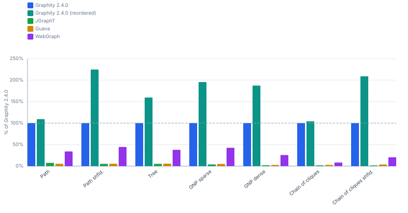
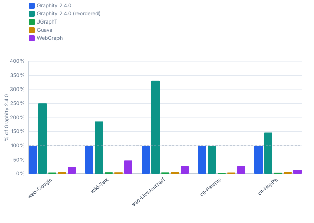

# Graphity

[](https://central.sonatype.com/artifact/com.kobayami/graphity-core)
[](https://kaufco.github.io/graphity/)
[](https://kaufco.github.io/graphity-doc/?lang=java)
[](https://github.com/kaufco/graphity/actions/workflows/ci.yml)
[](LICENSE)
[](https://adoptium.net/temurin/releases/?version=17)

Graphity is a Java graph library which keeps graphs in a compact, immutable form and provides algorithms on top of it, such as strongly and weakly connected components, bridges and articulation points, topological order and levels, cycle detection and edge classification, breadth-first distances and reachability, lowest common ancestors, dominators, loop nesting and condensed graphs. The core stays lean: the analyses of control flow and the writers for DOT (the language of Graphviz) and for Mermaid flowcharts are modules of their own, which you add when you need them.

It is built for code analysis and compiler pipelines, with graphs such as abstract syntax trees, control-flow and data-flow graphs, and dependency graphs. More generally, it is built for anywhere you build a graph from your domain model, run analyses on it, and use the results. Every algorithm returns a typed, immutable result with follow-up queries, and runs without recursion, so deep graphs do not overflow the call stack.

On the algorithms covered by [JGraphT](https://jgrapht.org/) and [Guava Graph](https://github.com/google/guava/wiki/GraphsExplained), Graphity is **typically 20 times faster**, and 6 to 360 times across all algorithms on graphs of 100,000 nodes and more. It needs **17 to 55 times less memory** per node and edge. [WebGraph](https://webgraph.di.unimi.it/) is a specialist for compressed web crawls of billions of nodes. It beats Graphity on raw memory compactness; on runtime, Graphity is faster across all measured shapes and sizes: **typically 8 times**, and 2.3 to 350 times on graphs of 100,000 nodes and more.

Data on nodes and edges stays in your own arrays, indexed by node ID or edge index, and every transformation tells you how to carry them along. The graph itself stores only structure: 4 bytes per node and per edge, in a compressed sparse row (CSR) layout, which is where speed and footprint come from.

**The same library exists for Rust, TypeScript and C#**, with the same API and the same binary format: a graph written in Java can be read in any of them. See [One library, four languages](#one-library-four-languages).

## Contents

1. [Installation](#installation)
2. [Getting started](#getting-started)
3. [Where to find what](#where-to-find-what)
4. [Data on nodes and edges](#data-on-nodes-and-edges)
5. [One library, four languages](#one-library-four-languages)
6. [Graphity, Guava and JGraphT](#graphity-guava-and-jgrapht)
7. [Performance and memory at a glance](#performance-and-memory-at-a-glance)
8. [Documentation](#documentation)
9. [Building, testing, and benchmarking from source](#building-testing-and-benchmarking-from-source)
10. [License](#license)

## Installation

`graphity` brings in every module of Graphity:

### Maven

```xml
<dependency>
    <groupId>com.kobayami</groupId>
    <artifactId>graphity</artifactId>
    <version>3.0.0</version>
</dependency>
```

### Gradle (Groovy DSL)

```groovy
dependencies {
    implementation 'com.kobayami:graphity:3.0.0'
}
```

### Gradle (Kotlin DSL)

```kotlin
dependencies {
    implementation("com.kobayami:graphity:3.0.0")
}
```

### Modules

To take only what you need, depend on the modules themselves instead of `graphity`, the same way and at the same version:

| Module | What it adds |
|---|---|
| `graphity-core` | The graph, the builder, and every algorithm that applies to any directed graph, dominators included |
| `graphity-controlflow` | The analyses of control flow: loops, dominance frontiers, control dependence and the placement of phi-nodes |
| `graphity-dot` | A writer for DOT (the language of Graphviz) |
| `graphity-mermaid` | A writer for Mermaid flowcharts, which render in Markdown |
| `graphity-bom` | A BOM (bill of materials): import it to keep the modules you take at one version |
| `graphity` | All of the above |

`graphity-core` depends on [fastutil](https://fastutil.di.unimi.it/), whose lists of `int` appear in the API, and on the [JSpecify](https://jspecify.dev/) annotations. Graphity requires JDK 17 or newer. No parameter, return value or element in the API is `null` unless its type is annotated `@Nullable`, which Kotlin and nullness checkers read from the signatures.

## Getting started

A `Graph` holds nothing but its structure: its nodes are the `int` IDs `0..nodeCount()-1`, its edges are numbered by edge index, and it takes 4 bytes per node and per edge. Names, weights and any other data on nodes and edges stay in arrays you own, indexed by node ID or edge index.

The algorithms are classes of their own: each takes a graph and returns a typed result with follow-up queries. Graphs and results are immutable and safe to share between threads, and no algorithm recurses, so a deep graph does not overflow the call stack.

The following example is a complete class with a `main` method, ready to run. It builds a graph of the dependencies between the packages of a small Java program. These dependencies contain a cycle:

<!-- example: GettingStarted.java#program -->
```java
import com.kobayami.graphity.Graph;
import com.kobayami.graphity.GraphBuilder;
import com.kobayami.graphity.Graphs;
import it.unimi.dsi.fastutil.ints.IntList;

public class GettingStarted {

  public static void main(String[] args) {
    // The packages are the nodes 0..7, and uses[p] lists the packages that package p
    // uses.
    String[] names = {"app", "cli", "ui", "service", "model", "storage", "json", "util"};
    int[][] uses = {{1, 2, 3}, {7}, {3, 4, 7}, {4, 5}, {5}, {4, 6, 7}, {7}, {}};

    // Build the graph: an edge p -> q for every package q that p uses.
    var builder = new GraphBuilder();
    builder.addNodes(uses.length);
    for (int pkg = 0; pkg < uses.length; pkg++) {
      builder.addOutEdges(pkg, uses[pkg]);
    }
    Graph dependencies = builder.build();

    // Find a cycle.
    IntList cycle = Graphs.findCycle(dependencies);
    // cycle: [4, 5] - model and storage use each other

    // Print the cycle with the names of its packages.
    System.out.println(cycle.intStream().mapToObj(pkg -> names[pkg]).toList());
    // [model, storage]
  }
}
```

The next two examples continue its `main` method. Every further question is a call on the same graph. `Components.sccsOf` puts `model` and `storage` into one SCC (strongly connected component) and orders the SCCs so that each package comes after the packages it uses, which can serve as a build order:

<!-- example: Connectivity.java#sccsOf -->
```java
import com.kobayami.graphity.Components;
import com.kobayami.graphity.Sccs;
import java.util.ArrayList;
import java.util.List;

// The SCCs in reverse topological order, each as the names of its packages.
Sccs sccs = Components.sccsOf(dependencies);
List<List<String>> buildOrder = new ArrayList<>();
for (int scc = 0; scc < sccs.sccCount(); scc++) {
  buildOrder.add(
      sccs.nodesOf(scc).intStream().mapToObj(node -> names[node]).toList());
}
// buildOrder: [[util], [cli], [json], [model, storage], [service], [ui], [app]]
```

Which packages does a change to `model` affect? `BiAdjacentGraph.of` adds the in-nodes of every node, so that a search can follow the edges against their direction:

<!-- example: Transposing.java#transposed -->
```java
import com.kobayami.graphity.BiAdjacentGraph;
import com.kobayami.graphity.SortedIntView;

int model = 4;
BiAdjacentGraph usedBy = BiAdjacentGraph.of(dependencies).transposed();
SortedIntView affected = Graphs.reachableFrom(usedBy, model);
// affected: [0, 2, 3, 4, 5] - app, ui, service, model and storage
```

The [guide](https://kaufco.github.io/graphity-doc/?lang=java) goes on from here, one problem per page, on topics such as building graphs, cycles and orders, reachability, trees, dominance and control flow, transforming graphs with their data, and searches of your own.

## Where to find what

The guide [Solving Graph Problems with Graphity](https://kaufco.github.io/graphity-doc/?lang=java) shows how to solve graph problems with Graphity: one page per problem, with pictures of the graph, tested code and its results. It shows every example in Java, Rust, TypeScript and C#.

These are the questions that Graphity answers, with the algorithms and the entry points that answer them:

- **How do I build a graph?** `GraphBuilder` from edges in any order, or `Graph.of` from the two arrays of a CSR layout.
- **Which parts belong together?** Strongly connected components (Tarjan's algorithm), weakly connected components, and the connected components of the graph read as undirected; bridges, articulation points and biconnected components (Hopcroft and Tarjan); strong bridges and strong articulation points (Italiano, Laura and Santaroni). All in `Components`.
- **In which order, and where are the cycles?** A topological order (topological sort) by depth-first search (`TopOrder`), and one with a level per node by Kahn's algorithm (`TopOrderAndLevels`); whether a graph has a cycle, and one of its cycles (`Graphs.isDag`, `Graphs.findCycle`); the tree, back, forward and cross edges of a depth-first search (`EdgeTypes`, `BackEdges`).
- **What is reachable, and how far?** The nodes reachable from one or several nodes (`Graphs.reachableFrom`); distances and shortest paths by breadth-first search (`BfsDistances`); transitive closure and, for a DAG (directed acyclic graph), transitive reduction, both in `Graphs`.
- **Who is the ancestor of whom in a tree?** Parent, depth and LCA (lowest common ancestor) in a forest (`Ancestry`); the ancestor test in O(1) and the nodes of each subtree (`PreorderAncestry`); shape checks such as `Graphs.isTree`, `Graphs.isPath` and `Graphs.isBipartite`.
- **Which node dominates which?** Dominators from one or several entries, and post-dominators on the transposed graph (`Dominators`, by the algorithm of Lengauer and Tarjan); the dominator tree (`Graphs.dominatorTree`).
- **Where are the loops, where do phi-nodes go, what controls what?** (`graphity-controlflow`) The loop nesting forest, irreducible loops included (`Loops`, by Havlak's algorithm); the blocks where SSA (static single assignment) form places phi-nodes (`IteratedDominanceFrontier`, by the algorithm of Sreedhar and Gao); dominance frontiers and control dependence (`ControlFlow`).
- **How do I condense, filter or renumber a graph?** The condensed graph of a partition of your choosing (`NodePartition.condense`); subgraphs and renumbered graphs (`Graphs.remapped` with a `NodeMapping`); the transposed graph, without copying (`BiAdjacentGraph.transposed`).
- **How does my data follow a transformation?** `NodeMapping` for data on nodes; `Graphs.edgeMapping`, `Graphs.transposedEdgeMapping` and `Graphs.edgePartition` for data on edges.
- **How do I store, load and compare graphs?** `Graph.writeTo` and `Graph.readFrom`, as the two arrays of the CSR layout in little-endian byte order; a 64-bit hash of the nodes and edges (`Graphs.topologyHash`); the edges added and removed between two versions of a graph (`Graphs.diff`).
- **How do I look at a graph?** (`graphity-dot`, `graphity-mermaid`) `DotWriter` and `MermaidWriter`, with labels, attributes, shapes and clusters from your own arrays; `Graphs.adjacencyListOf` for a whole graph as text.
- **How do I write a search of my own?** The base classes of depth-first and breadth-first searches, without recursion (`DfsTraverser`, `DfsEdgeTraverser`, `FrontierTraverser`); `Csr` hands the arrays of a graph to loops of your own.

The [Javadoc](https://kaufco.github.io/graphity/) opens on the same questions; the documentation of each package lists its entry points by topic, and every method states its contract: what it returns and throws, and its cost in time and memory. The guide has an [index of all entry points](https://kaufco.github.io/graphity-doc/api-index/?lang=java), each with the problems that use it.

## Data on nodes and edges

Graphity keeps no data on nodes or edges. You keep it in arrays of your own, one array per attribute. An array is indexed by node ID `0..nodeCount()-1` or by edge index `0..edgeCount()-1` - like a column of a table whose rows are the nodes or the edges. An array can hold primitives or objects, and a graph can have as many arrays as you need.

Here, `calls` holds the calls between the methods of the small program, and `callSites` the places in the source where one method calls another. The nodes carry a record per method, and the edges the number of call sites:

<!-- example: DataOnNodesAndEdges.java#columns -->
```java
record Method(String name, String pkg) {}
Method[] methods = {                           // methods[node]
    new Method("main", "app"), new Method("parseArgs", "cli"),
    new Method("run", "app"), new Method("load", "service"),
    new Method("save", "service"), new Method("show", "ui"),
    new Method("parse", "model"), new Method("format", "model"),
    new Method("read", "storage"), new Method("write", "storage")};

int[] siteCount = new int[calls.edgeCount()];  // siteCount[edgeIndex]
for (CallSite site : callSites) {
  siteCount[calls.edgeIndexOf(site.caller(), site.callee())]++;
}
// siteCount: 2 for run -> show and for parse -> parse, 1 for every other call
```

A transformation that renumbers nodes or merges them comes with the mapping or partition that carries the arrays along, each array on its own: you take the columns you still need and leave the others behind. Here, the subgraph of the methods that `load` reaches takes both arrays:

<!-- example: DataOnNodesAndEdges.java#carryAlong -->
```java
import com.kobayami.graphity.NodeMapping;

NodeMapping newToOld = NodeMapping.forSubgraph(Graphs.reachableFrom(calls, load));
Graph loading = Graphs.remapped(calls, newToOld);
// loading: load -> parse, load -> read, parse -> parse

Method[] loadingMethods = new Method[loading.nodeCount()];
newToOld.gather(methods, loadingMethods);
// loadingMethods: load, parse, read

int[] loadingSiteCount =
    Graphs.edgeMapping(loading, calls, newToOld).gather(siteCount);
// loadingSiteCount: 1 for load -> parse and for load -> read, 2 for parse -> parse
```

A renumbering in depth-first order (`NodeMapping.reindex`) and the transposed graph (`Graphs.transposedEdgeMapping`) work the same way. A condensed graph merges edges, and `EdgePartition.reduce` aggregates their data, such as the call sites behind each call between two packages. The [guide](https://kaufco.github.io/graphity-doc/transforming/reduce-data/?lang=java) shows how.

## One library, four languages

Graphity exists for [Java](https://github.com/kaufco/graphity), [Rust](https://github.com/kaufco/graphity-rust), [TypeScript](https://github.com/kaufco/graphity-ts) and [C#](https://github.com/kaufco/graphity-csharp). This matters where a system spans several languages, for example with a producer in Java and a consumer in TypeScript:

- **The same API.** Every public type and method of the Java library has its counterpart in the other languages, in the names of each language. So there is nothing new to learn, and neither side lacks a feature that the other has.
- **The same data.** All implementations read and write the same binary format, so a graph written in Java can be read in TypeScript, and the other way round. A graph also has the same hash in every language.
- **The same results.** Orders, IDs and the text of the writers are the same, bit for bit, wherever the API fixes them.

| Language | Repository | Dependency |
|---|---|---|
| Java | [kaufco/graphity](https://github.com/kaufco/graphity) | `com.kobayami:graphity` |
| Rust | [kaufco/graphity-rust](https://github.com/kaufco/graphity-rust) | `graphity-all` |
| TypeScript | [kaufco/graphity-ts](https://github.com/kaufco/graphity-ts) | `@kobayami/graphity` |
| C# | [kaufco/graphity-csharp](https://github.com/kaufco/graphity-csharp) | `Graphity.All` |

Each of these dependencies brings the whole library. The README of each repository lists the single modules.

## Graphity, Guava and JGraphT

The three libraries solve overlapping but different problems.

| | Graphity | JGraphT | Guava Graph |
|---|---|---|---|
| Primary job | Fast analysis of large, static structure graphs | A broad toolbox of graph theory and algorithms | A common, generic way to model graph-shaped domain data |
| Data model | Nodes are `int` IDs, edges `int` pairs, data in your arrays | Arbitrary vertex and edge objects, weights, many graph kinds | Arbitrary node objects; `Graph`, `ValueGraph`, `Network` |
| Algorithms | Focused: components, connectivity, order, cycles, distances, ancestry, dominators, loops, condensed graphs | Very broad: paths, flows, matching, coloring, clustering, isomorphism, planarity, the traveling salesman problem and more | Deliberately small: traversal, cycle check, reachability, transitive closure, transposed graph, induced subgraph |
| Best fit | Compiler and analysis pipelines, dependency graphs, syntax trees and control-flow graphs, repeated analyses, deep graphs | Research, optimization, routing, networks, combinatorial problems | Application models with object identity and simple graph operations |

**Deep graphs: Graphity runs where the others need tuning.** JGraphT, Guava and WebGraph use recursive depth-first search. On `soc-LiveJournal1` (4.8M nodes), SCC on WebGraph and on Guava overflows the default stack and completes only with `-Xss` raised to 256 to 512 MB; on deeper topologies all three fail regardless. Every Graphity algorithm keeps its stack on the heap and runs under the default `-Xss`, verified at a depth of 1M.

## Performance and memory at a glance

The numbers were measured on an AMD Ryzen 9 9950X with OpenJDK 25. The factor in parentheses is relative to Graphity. The synthetic shapes are trees, sparse and dense random directed graphs after Erdős and Rényi (GNP), and chains of cliques.

In the charts and reports, **reordered** means the same graph with its nodes numbered anew in depth-first order (`NodeMapping.reindex` and `Graphs.remapped`). This speeds up later searches, at a one-time cost that pays off if you use the graph several times.

### SCC on synthetic graphs

#### Times @ 100k nodes (ms/op, lower is better)

| Shape            | Graphity | JGraphT         | Guava           | WebGraph        |
|------------------|---------:|----------------:|----------------:|----------------:|
| Tree             | 2.074 ms | 41.51 ms (20×)  | 38.09 ms (18×)  | 5.712 ms (2.8×) |
| GNP sparse       | 4.378 ms | 109.6 ms (25×)  | 87.01 ms (20×)  | 10.30 ms (2.4×) |
| GNP dense        | 7.713 ms | 446.5 ms (58×)  | 333.1 ms (43×)  | 36.12 ms (4.7×) |
| Chain of cliques | 3.001 ms | 166.0 ms (55×)  | 108.0 ms (36×)  | 37.02 ms (12×)  |

#### Throughput @ 100k nodes (higher is better)



### SCC on real-world graphs (SNAP datasets)

The graphs come from SNAP (Stanford Network Analysis Project).

#### Times (ms/op, lower is better)

| Dataset                                  | Graphity | JGraphT          | Guava            | WebGraph        |
|------------------------------------------|---------:|-----------------:|-----------------:|----------------:|
| web-Google (875k nodes, 5.1M edges)      | 42.05 ms | 1236.6 ms (29×)  | 793.0 ms (19×)   | 233.7 ms (5.6×) |
| wiki-Talk (2.4M nodes, 5M edges)         | 62.74 ms | 1288.2 ms (21×)  | 1502.9 ms (24×)  | 151.0 ms (2.4×) |
| soc-LiveJournal1 (4.8M nodes, 69M edges) | 1049.9 ms | 22560 ms (21×)   | 16286 ms (16×)   | 3931.3 ms (3.7×) |

#### Throughput (higher is better)



### Memory: bytes per node and edge (lower is better)

| Shape      | Graphity | JGraphT          | Guava            | WebGraph         |
|------------|---------:|-----------------:|-----------------:|-----------------:|
| GNP sparse | 4.00 B   | 212.40 B (53×)   | 120.65 B (30×)   | 2.38 B (0.60×)   |
| GNP dense  | 4.00 B   | 219.51 B (55×)   | 108.63 B (27×)   | 2.07 B (0.52×)   |
| Tree       | 4.00 B   | 208.34 B (52×)   | 137.73 B (34×)   | 1.86 B (0.47×)   |

For the full results - all algorithms (`Build`, `Sccs`, `Wccs`, `Ccs`, `TopOrder`, `TopOrderAndLevels`, `BackEdges`, `EdgeTypes`), graph sizes from 10k to 100M nodes, allocation counts, shuffled variants and confidence intervals - see the benchmark reports:

- **Synthetic:** [`graphity-benchmarks/reports/summary/synthetic-ubuntu-ryzen-9950x-peers.md`](graphity-benchmarks/reports/summary/synthetic-ubuntu-ryzen-9950x-peers.md)
- **Real-world (SNAP datasets):** [`graphity-benchmarks/reports/summary/realworld-ubuntu-ryzen-9950x-peers.md`](graphity-benchmarks/reports/summary/realworld-ubuntu-ryzen-9950x-peers.md)

A separate report per machine shows how the numbers developed across Graphity releases. It is called `…-history.md` and sits next to the two above.

## Documentation

This README is the overview; the guide goes into depth, and the Javadoc is the contract.

- **Guide:** [kaufco.github.io/graphity-doc](https://kaufco.github.io/graphity-doc/?lang=java) - one page per problem, from building a graph to control-flow analysis: the problem, the graph before and after, and tested code, with an index by API and a glossary.
- **API reference (Javadoc):** [kaufco.github.io/graphity](https://kaufco.github.io/graphity/) - the contract of every class and method.
- **Synthetic benchmark report:** [`graphity-benchmarks/reports/summary/synthetic-ubuntu-ryzen-9950x-peers.md`](graphity-benchmarks/reports/summary/synthetic-ubuntu-ryzen-9950x-peers.md) - timings and throughput per shape and algorithm against JGraphT, Guava and WebGraph, plus chapters on memory and allocation, with bar charts.
- **Real-world benchmark report:** [`graphity-benchmarks/reports/summary/realworld-ubuntu-ryzen-9950x-peers.md`](graphity-benchmarks/reports/summary/realworld-ubuntu-ryzen-9950x-peers.md) - SCC, BackEdges, EdgeTypes and weakly connected components across five SNAP datasets up to 4.8M nodes, plus topological levels on the one acyclic dataset among them.
- **Version history:** [`graphity-benchmarks/reports/summary/synthetic-ubuntu-ryzen-9950x-history.md`](graphity-benchmarks/reports/summary/synthetic-ubuntu-ryzen-9950x-history.md) - the same measurements with one column per released version instead of the peer libraries.
- **Changelog:** [CHANGELOG.md](CHANGELOG.md)

## Building, testing, and benchmarking from source

To use Graphity, take the published artifacts (see [Installation](#installation)). The instructions below are for contributors who want to fork or extend the library.

The project is a multi-module Maven build.

### Build and test

From the repository root:

```bash
mvn verify
```

Compiles all modules and runs all tests. Building needs JDK 25; the library itself runs on Java 17 and newer. For tests only, without packaging:

```bash
mvn test
```

### Benchmarks

The benchmarks use JMH (Java Microbenchmark Harness). The runner is a single script with a three-step workflow: **clean, run, report**. All commands are subcommands of `run-benchmarks.sh`; run `./run-benchmarks.sh --help` for the full reference.

```bash
mvn package -DskipTests
cd graphity-benchmarks

# 1 - clear scratch output from previous runs
./run-benchmarks.sh clean

# 2 - run the benchmarks (synthetic and/or real-world).
#     Pass a single library or 'all'. Running one library at a time means a
#     slow or crashing peer can never block the whole run.
./run-benchmarks.sh synthetic all          # all libraries, synthetic graphs
./run-benchmarks.sh realworld all          # all libraries, real-world graphs
./run-benchmarks.sh synthetic graphity     # graphity only, synthetic graphs

#     To run all benchmarks (~3 h total):
./run-benchmarks.sh bench

# 3 - report measured results into the versioned reports/ folder
./run-benchmarks.sh report                 # report as current graphity version
./run-benchmarks.sh report 2.1.0           # report as a specific version
```

`synthetic` and `realworld` accept a library (`graphity`, `graphity-reordered`, `graphity-biadjacent`, `jgrapht`, `guava`, `webgraph`) or `all`. Each run writes JSON artifacts to `graphity-benchmarks/measurements/` (gitignored); `report` merges them, promotes them to `reports/versions/<version>-<kind>-<machine>.md`, and regenerates the summary views.

**Profiles.** By default `synthetic` uses the `full` matrix (n = 10k and 100k, all libraries; hours-scale) and `realworld` uses `realworld`. Override with `--profile`:

```bash
./run-benchmarks.sh synthetic all --profile quick           # minute-scale dev loop
./run-benchmarks.sh synthetic all --profile big             # n = 1M, 10M, 100M (sparse)
./run-benchmarks.sh realworld all --profile realworld-quick # mainly web-Google, smoke run
```

- **`big`** covers n = 1M, 10M and (sparse only) 100M and is **Graphity-only**: from n = 1M on, the object graphs of the generalist peers and the in-memory build path of WebGraph run out of memory or overflow the stack, whereas the algorithm cores of Graphity are iterative.
- Each traversal algorithm is additionally run on a copy of the graph renumbered in depth-first preorder, reported as the **`Graphity (reordered)`** column; the one-time cost of the renumbering is captured by the graphity-only `reorder` algorithm. Kahn's algorithm also runs on a bi-adjacent graph, where it reads in-degrees without scanning the edges. That run is reported as the **`Graphity (bi-adjacent)`** column; `biadjacency` prices that structure, and `symmetrize` the symmetric graph that the connected components of WebGraph require.

**Real-world datasets** are not versioned in git; fetch them once before the first `realworld` run:

```bash
./datasets/download-datasets.sh   # web-Google, wiki-Talk, soc-LiveJournal1, …
```

**Reports.** Promoted results land in `reports/versions/` as `<version>-<kind>-<machine>.md` source files. Two summary views are regenerated from all source files present: `reports/summary/<kind>-<machine>-peers.md` puts the newest measured version against the peer libraries, and `…-history.md` puts the measured versions against each other. Historical data from previous versions is never lost. Both reports and chart SVGs are committed to the repository.

For JMH parameters, dataset support and the matrix schema, see [`graphity-benchmarks/README.md`](graphity-benchmarks/README.md).

## License

Graphity is licensed under the [Apache License, Version 2.0](LICENSE).

Copyright 2025–2026 Marco Kaufmann.

Forks and modifications are welcome under the terms of the license. The name "Graphity" refers to the original project at https://github.com/kaufco/graphity; please pick a different name for any redistributed version. See [`NOTICE`](NOTICE).
