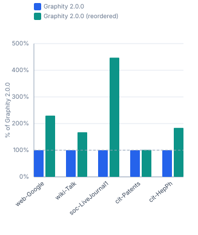
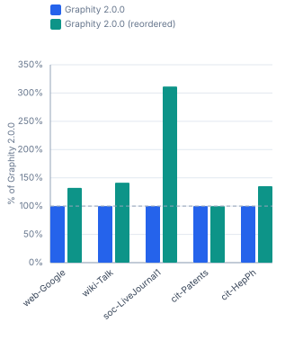
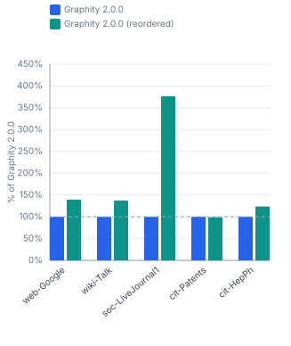

# Graphity Version History — realworld / macos-m5

Benchmarked versions: `2.0.0`. Peer libraries are left out on purpose: they are re-measured per run, so a moving peer column would say nothing about Graphity. For the comparison against them see [`realworld-macos-m5-peers.md`](realworld-macos-m5-peers.md).

```
Profile:      realworld
Timestamp:    2026-07-25 00:25:47
JDK:          OpenJDK 64-Bit Server VM 21.0.11 (Amazon.com Inc.)
OS:           Mac OS X 26.5 (aarch64)
CPU:          Apple M5 Pro (18 logical cores)
RAM:          48.0 GiB
```

## Contents

- [1 Performance](#1-performance)
  - [1.1 SCC — real-world graphs](#11-scc-real-world-graphs)
  - [1.2 BackEdges — real-world graphs](#12-backedges-real-world-graphs)
  - [1.3 EdgeTypes — real-world graphs](#13-edgetypes-real-world-graphs)
  - [1.4 Reorder (DFS-preorder) cost — real-world graphs](#14-reorder-dfs-preorder-cost-real-world-graphs)

## 1 Performance

Times (ms/op, lower is better) and throughput (op/s, higher is better) for each algorithm and graph size. Non-baseline cells show the factor relative to **Graphity 2.0.0**, or the newest version present in a table it is missing from (= 100% in the throughput table).

### 1.1 SCC — real-world graphs

#### Times (ms/op, lower is better)

| Dataset | Graphity 2.0.0 | Graphity 2.0.0<br>(reordered) |
|---|---:|---:|
| web-Google<br><sub>875.7k nodes, 5.1M edges</sub> | 45.86 ms | 19.96 ms (0.4×) |
| wiki-Talk<br><sub>2.4M nodes, 5M edges</sub> | 51.10 ms | 30.53 ms (0.6×) |
| soc-LiveJournal1<br><sub>4.8M nodes, 69M edges</sub> | 874.2 ms | 195.5 ms (0.2×) |
| cit-Patents<br><sub>3.8M nodes, 16.5M edges</sub> | 69.28 ms | 68.49 ms (1.0×) |
| cit-HepPh<br><sub>34.5k nodes, 421.6k edges</sub> | 1.577 ms | 0.858 ms (0.5×) |

#### Throughput (op/s, higher is better)

| Dataset | Graphity 2.0.0 | Graphity 2.0.0<br>(reordered) |
|---|---:|---:|
| web-Google<br><sub>875.7k nodes, 5.1M edges</sub> | 21.81 op/s | 50.10 op/s (230%) |
| wiki-Talk<br><sub>2.4M nodes, 5M edges</sub> | 19.57 op/s | 32.76 op/s (167%) |
| soc-LiveJournal1<br><sub>4.8M nodes, 69M edges</sub> | 1.144 op/s | 5.115 op/s (447%) |
| cit-Patents<br><sub>3.8M nodes, 16.5M edges</sub> | 14.43 op/s | 14.60 op/s (101%) |
| cit-HepPh<br><sub>34.5k nodes, 421.6k edges</sub> | 634.1 op/s | 1 166 op/s (184%) |



### 1.2 BackEdges — real-world graphs

#### Times (ms/op, lower is better)

| Dataset | Graphity 2.0.0 | Graphity 2.0.0<br>(reordered) |
|---|---:|---:|
| web-Google<br><sub>875.7k nodes, 5.1M edges</sub> | 34.20 ms | 25.85 ms (0.8×) |
| wiki-Talk<br><sub>2.4M nodes, 5M edges</sub> | 41.81 ms | 29.55 ms (0.7×) |
| soc-LiveJournal1<br><sub>4.8M nodes, 69M edges</sub> | 672.6 ms | 215.9 ms (0.3×) |
| cit-Patents<br><sub>3.8M nodes, 16.5M edges</sub> | 40.92 ms | 40.99 ms (1.0×) |
| cit-HepPh<br><sub>34.5k nodes, 421.6k edges</sub> | 1.047 ms | 0.774 ms (0.7×) |

#### Throughput (op/s, higher is better)

| Dataset | Graphity 2.0.0 | Graphity 2.0.0<br>(reordered) |
|---|---:|---:|
| web-Google<br><sub>875.7k nodes, 5.1M edges</sub> | 29.24 op/s | 38.68 op/s (132%) |
| wiki-Talk<br><sub>2.4M nodes, 5M edges</sub> | 23.92 op/s | 33.84 op/s (141%) |
| soc-LiveJournal1<br><sub>4.8M nodes, 69M edges</sub> | 1.487 op/s | 4.632 op/s (312%) |
| cit-Patents<br><sub>3.8M nodes, 16.5M edges</sub> | 24.44 op/s | 24.40 op/s (99.8%) |
| cit-HepPh<br><sub>34.5k nodes, 421.6k edges</sub> | 955.1 op/s | 1 292 op/s (135%) |



### 1.3 EdgeTypes — real-world graphs

#### Times (ms/op, lower is better)

| Dataset | Graphity 2.0.0 | Graphity 2.0.0<br>(reordered) |
|---|---:|---:|
| web-Google<br><sub>875.7k nodes, 5.1M edges</sub> | 27.47 ms | 19.69 ms (0.7×) |
| wiki-Talk<br><sub>2.4M nodes, 5M edges</sub> | 37.36 ms | 27.19 ms (0.7×) |
| soc-LiveJournal1<br><sub>4.8M nodes, 69M edges</sub> | 625.0 ms | 166.0 ms (0.3×) |
| cit-Patents<br><sub>3.8M nodes, 16.5M edges</sub> | 52.02 ms | 52.59 ms (1.0×) |
| cit-HepPh<br><sub>34.5k nodes, 421.6k edges</sub> | 0.787 ms | 0.636 ms (0.8×) |

#### Throughput (op/s, higher is better)

| Dataset | Graphity 2.0.0 | Graphity 2.0.0<br>(reordered) |
|---|---:|---:|
| web-Google<br><sub>875.7k nodes, 5.1M edges</sub> | 36.41 op/s | 50.79 op/s (140%) |
| wiki-Talk<br><sub>2.4M nodes, 5M edges</sub> | 26.77 op/s | 36.77 op/s (137%) |
| soc-LiveJournal1<br><sub>4.8M nodes, 69M edges</sub> | 1.600 op/s | 6.024 op/s (377%) |
| cit-Patents<br><sub>3.8M nodes, 16.5M edges</sub> | 19.22 op/s | 19.01 op/s (98.9%) |
| cit-HepPh<br><sub>34.5k nodes, 421.6k edges</sub> | 1 271 op/s | 1 572 op/s (124%) |



### 1.4 Reorder (DFS-preorder) cost — real-world graphs

#### Times (ms/op, lower is better)

| Dataset | Graphity 2.0.0 |
|---|---:|
| web-Google<br><sub>875.7k nodes, 5.1M edges</sub> | 61.93 ms |
| wiki-Talk<br><sub>2.4M nodes, 5M edges</sub> | 108.0 ms |
| soc-LiveJournal1<br><sub>4.8M nodes, 69M edges</sub> | 1590.6 ms |
| cit-Patents<br><sub>3.8M nodes, 16.5M edges</sub> | 136.2 ms |
| cit-HepPh<br><sub>34.5k nodes, 421.6k edges</sub> | 4.654 ms |

#### Throughput (op/s, higher is better)

| Dataset | Graphity 2.0.0 |
|---|---:|
| web-Google<br><sub>875.7k nodes, 5.1M edges</sub> | 16.15 op/s |
| wiki-Talk<br><sub>2.4M nodes, 5M edges</sub> | 9.259 op/s |
| soc-LiveJournal1<br><sub>4.8M nodes, 69M edges</sub> | 0.629 op/s |
| cit-Patents<br><sub>3.8M nodes, 16.5M edges</sub> | 7.342 op/s |
| cit-HepPh<br><sub>34.5k nodes, 421.6k edges</sub> | 214.9 op/s |
