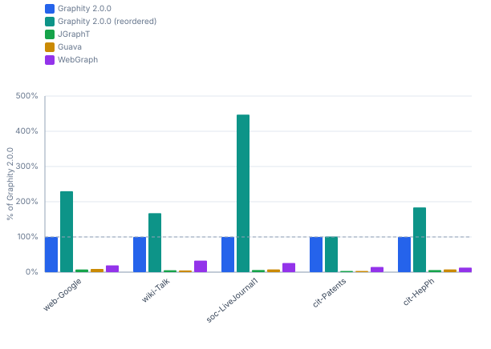
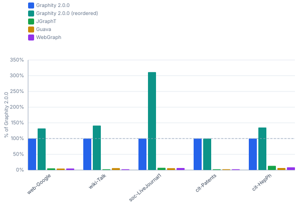
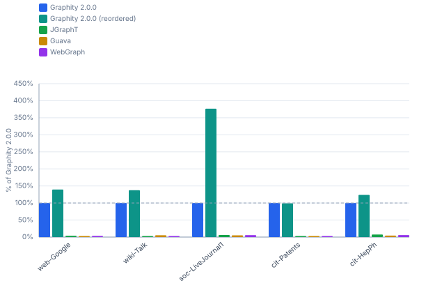
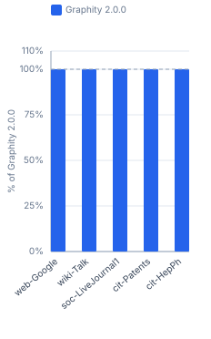

# Graphity Benchmark Comparison — realworld / macos-m5

Benchmarked versions: `2.0.0`

```
Profile:      realworld
Timestamp:    2026-07-25 00:25:47
JDK:          OpenJDK 64-Bit Server VM 21.0.11 (Amazon.com Inc.)
OS:           Mac OS X 26.5 (aarch64)
CPU:          Apple M5 Pro (18 logical cores)
RAM:          48.0 GiB
```

## Contents

- [1 Performance](#1-performance)
  - [1.1 SCC — real-world graphs](#11-scc-real-world-graphs)
  - [1.2 BackEdges — real-world graphs](#12-backedges-real-world-graphs)
  - [1.3 EdgeTypes — real-world graphs](#13-edgetypes-real-world-graphs)
  - [1.4 Reorder (DFS-preorder) cost — real-world graphs](#14-reorder-dfs-preorder-cost-real-world-graphs)

## 1 Performance

Times (ms/op, lower is better) and throughput (op/s, higher is better) for each algorithm and graph size. Non-baseline cells show the factor relative to **Graphity 2.0.0** (= 100% in the throughput table).

### 1.1 SCC — real-world graphs

#### Times (ms/op, lower is better)

| Dataset | Graphity 2.0.0 | Graphity 2.0.0<br>(reordered) | JGraphT | Guava | WebGraph |
|---|---:|---:|---:|---:|---:|
| web-Google<br><sub>875.7k nodes, 5.1M edges</sub> | 45.86 ms | 19.96 ms (0.4×) | 609.3 ms (13×) | 508.6 ms (11×) | 236.4 ms (5.2×) |
| wiki-Talk<br><sub>2.4M nodes, 5M edges</sub> | 51.10 ms | 30.53 ms (0.6×) | 936.9 ms (18×) | 1066.8 ms (21×) | 156.5 ms (3.1×) |
| soc-LiveJournal1<br><sub>4.8M nodes, 69M edges</sub> | 874.2 ms | 195.5 ms (0.2×) | 14459 ms (17×) | 11475 ms (13×) | 3369.3 ms (3.9×) |
| cit-Patents<br><sub>3.8M nodes, 16.5M edges</sub> | 69.28 ms | 68.49 ms (1.0×) | 4001.1 ms (58×) | 2381.2 ms (34×) | 472.1 ms (6.8×) |
| cit-HepPh<br><sub>34.5k nodes, 421.6k edges</sub> | 1.577 ms | 0.858 ms (0.5×) | 26.58 ms (17×) | 20.69 ms (13×) | 12.21 ms (7.7×) |

#### Throughput (op/s, higher is better)

| Dataset | Graphity 2.0.0 | Graphity 2.0.0<br>(reordered) | JGraphT | Guava | WebGraph |
|---|---:|---:|---:|---:|---:|
| web-Google<br><sub>875.7k nodes, 5.1M edges</sub> | 21.81 op/s | 50.10 op/s (230%) | 1.641 op/s (7.5%) | 1.966 op/s (9.0%) | 4.230 op/s (19.4%) |
| wiki-Talk<br><sub>2.4M nodes, 5M edges</sub> | 19.57 op/s | 32.76 op/s (167%) | 1.067 op/s (5.5%) | 0.937 op/s (4.8%) | 6.390 op/s (32.7%) |
| soc-LiveJournal1<br><sub>4.8M nodes, 69M edges</sub> | 1.144 op/s | 5.115 op/s (447%) | 0.069 op/s (6.0%) | 0.087 op/s (7.6%) | 0.297 op/s (25.9%) |
| cit-Patents<br><sub>3.8M nodes, 16.5M edges</sub> | 14.43 op/s | 14.60 op/s (101%) | 0.250 op/s (1.7%) | 0.420 op/s (2.9%) | 2.118 op/s (14.7%) |
| cit-HepPh<br><sub>34.5k nodes, 421.6k edges</sub> | 634.1 op/s | 1 166 op/s (184%) | 37.63 op/s (5.9%) | 48.34 op/s (7.6%) | 81.89 op/s (12.9%) |



### 1.2 BackEdges — real-world graphs

#### Times (ms/op, lower is better)

| Dataset | Graphity 2.0.0 | Graphity 2.0.0<br>(reordered) | JGraphT | Guava | WebGraph |
|---|---:|---:|---:|---:|---:|
| web-Google<br><sub>875.7k nodes, 5.1M edges</sub> | 34.20 ms | 25.85 ms (0.8×) | 646.4 ms (19×) | 736.7 ms (22×) | 720.1 ms (21×) |
| wiki-Talk<br><sub>2.4M nodes, 5M edges</sub> | 41.81 ms | 29.55 ms (0.7×) | 1866.1 ms (45×) | 683.2 ms (16×) | 2071.1 ms (50×) |
| soc-LiveJournal1<br><sub>4.8M nodes, 69M edges</sub> | 672.6 ms | 215.9 ms (0.3×) | 9557.5 ms (14×) | 11518 ms (17×) | 10634 ms (16×) |
| cit-Patents<br><sub>3.8M nodes, 16.5M edges</sub> | 40.92 ms | 40.99 ms (1.0×) | 19150 ms (468×) | 19343 ms (473×) | 18078 ms (442×) |
| cit-HepPh<br><sub>34.5k nodes, 421.6k edges</sub> | 1.047 ms | 0.774 ms (0.7×) | 7.884 ms (7.5×) | 16.43 ms (16×) | 12.13 ms (12×) |

#### Throughput (op/s, higher is better)

| Dataset | Graphity 2.0.0 | Graphity 2.0.0<br>(reordered) | JGraphT | Guava | WebGraph |
|---|---:|---:|---:|---:|---:|
| web-Google<br><sub>875.7k nodes, 5.1M edges</sub> | 29.24 op/s | 38.68 op/s (132%) | 1.547 op/s (5.3%) | 1.357 op/s (4.6%) | 1.389 op/s (4.7%) |
| wiki-Talk<br><sub>2.4M nodes, 5M edges</sub> | 23.92 op/s | 33.84 op/s (141%) | 0.536 op/s (2.2%) | 1.464 op/s (6.1%) | 0.483 op/s (2.0%) |
| soc-LiveJournal1<br><sub>4.8M nodes, 69M edges</sub> | 1.487 op/s | 4.632 op/s (312%) | 0.105 op/s (7.0%) | 0.087 op/s (5.8%) | 0.094 op/s (6.3%) |
| cit-Patents<br><sub>3.8M nodes, 16.5M edges</sub> | 24.44 op/s | 24.40 op/s (99.8%) | 0.052 op/s (0.2%) | 0.052 op/s (0.2%) | 0.055 op/s (0.2%) |
| cit-HepPh<br><sub>34.5k nodes, 421.6k edges</sub> | 955.1 op/s | 1 292 op/s (135%) | 126.8 op/s (13.3%) | 60.85 op/s (6.4%) | 82.43 op/s (8.6%) |



### 1.3 EdgeTypes — real-world graphs

#### Times (ms/op, lower is better)

| Dataset | Graphity 2.0.0 | Graphity 2.0.0<br>(reordered) | JGraphT | Guava | WebGraph |
|---|---:|---:|---:|---:|---:|
| web-Google<br><sub>875.7k nodes, 5.1M edges</sub> | 27.47 ms | 19.69 ms (0.7×) | 704.7 ms (26×) | 925.9 ms (34×) | 804.5 ms (29×) |
| wiki-Talk<br><sub>2.4M nodes, 5M edges</sub> | 37.36 ms | 27.19 ms (0.7×) | 1882.9 ms (50×) | 710.3 ms (19×) | 1808.4 ms (48×) |
| soc-LiveJournal1<br><sub>4.8M nodes, 69M edges</sub> | 625.0 ms | 166.0 ms (0.3×) | 10309 ms (16×) | 12184 ms (19×) | 10962 ms (18×) |
| cit-Patents<br><sub>3.8M nodes, 16.5M edges</sub> | 52.02 ms | 52.59 ms (1.0×) | 19539 ms (376×) | 19894 ms (382×) | 18357 ms (353×) |
| cit-HepPh<br><sub>34.5k nodes, 421.6k edges</sub> | 0.787 ms | 0.636 ms (0.8×) | 10.29 ms (13×) | 17.91 ms (23×) | 13.33 ms (17×) |

#### Throughput (op/s, higher is better)

| Dataset | Graphity 2.0.0 | Graphity 2.0.0<br>(reordered) | JGraphT | Guava | WebGraph |
|---|---:|---:|---:|---:|---:|
| web-Google<br><sub>875.7k nodes, 5.1M edges</sub> | 36.41 op/s | 50.79 op/s (140%) | 1.419 op/s (3.9%) | 1.080 op/s (3.0%) | 1.243 op/s (3.4%) |
| wiki-Talk<br><sub>2.4M nodes, 5M edges</sub> | 26.77 op/s | 36.77 op/s (137%) | 0.531 op/s (2.0%) | 1.408 op/s (5.3%) | 0.553 op/s (2.1%) |
| soc-LiveJournal1<br><sub>4.8M nodes, 69M edges</sub> | 1.600 op/s | 6.024 op/s (377%) | 0.097 op/s (6.1%) | 0.082 op/s (5.1%) | 0.091 op/s (5.7%) |
| cit-Patents<br><sub>3.8M nodes, 16.5M edges</sub> | 19.22 op/s | 19.01 op/s (98.9%) | 0.051 op/s (0.3%) | 0.050 op/s (0.3%) | 0.054 op/s (0.3%) |
| cit-HepPh<br><sub>34.5k nodes, 421.6k edges</sub> | 1 271 op/s | 1 572 op/s (124%) | 97.18 op/s (7.6%) | 55.82 op/s (4.4%) | 75.04 op/s (5.9%) |



### 1.4 Reorder (DFS-preorder) cost — real-world graphs

#### Times (ms/op, lower is better)

| Dataset | Graphity 2.0.0 |
|---|---:|
| web-Google<br><sub>875.7k nodes, 5.1M edges</sub> | 61.93 ms |
| wiki-Talk<br><sub>2.4M nodes, 5M edges</sub> | 108.0 ms |
| soc-LiveJournal1<br><sub>4.8M nodes, 69M edges</sub> | 1590.6 ms |
| cit-Patents<br><sub>3.8M nodes, 16.5M edges</sub> | 136.2 ms |
| cit-HepPh<br><sub>34.5k nodes, 421.6k edges</sub> | 4.654 ms |

#### Throughput (op/s, higher is better)

| Dataset | Graphity 2.0.0 |
|---|---:|
| web-Google<br><sub>875.7k nodes, 5.1M edges</sub> | 16.15 op/s |
| wiki-Talk<br><sub>2.4M nodes, 5M edges</sub> | 9.259 op/s |
| soc-LiveJournal1<br><sub>4.8M nodes, 69M edges</sub> | 0.629 op/s |
| cit-Patents<br><sub>3.8M nodes, 16.5M edges</sub> | 7.342 op/s |
| cit-HepPh<br><sub>34.5k nodes, 421.6k edges</sub> | 214.9 op/s |


