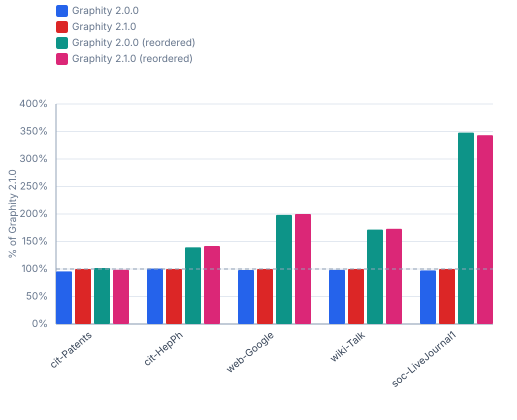
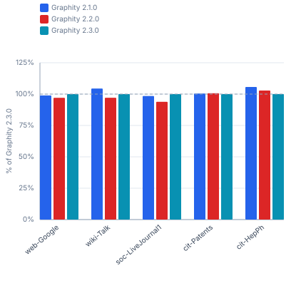
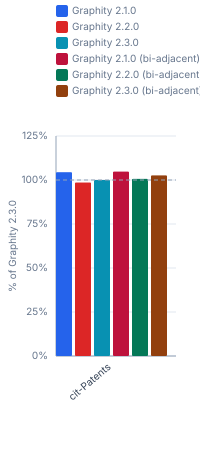
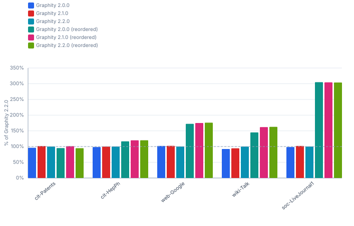
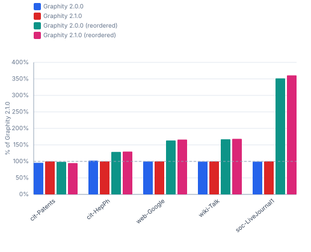
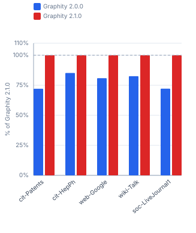
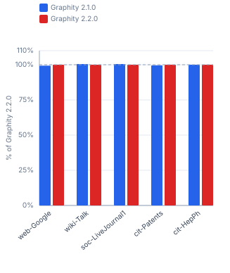

# Graphity Version History — realworld / ubuntu-ryzen-9950x

Benchmarked versions: `2.0.0`, `2.1.0`, `2.2.0`, `2.3.0`. Peer libraries are left out on purpose: they are re-measured per run, so a moving peer column would say nothing about Graphity. For the comparison against them see [`realworld-ubuntu-ryzen-9950x-peers.md`](realworld-ubuntu-ryzen-9950x-peers.md).

Versions `2.0.0`, `2.1.0`, `2.2.0` report the mean over all measurement windows; the later ones a near-best window (`Estimate` below), which comes out a few percent faster for unchanged code.

```
Profile:      realworld
Timestamp:    2026-10-16 04:51:31
JDK:          OpenJDK 64-Bit Server VM 25.0.2 (Amazon.com Inc.)
OS:           Ubuntu 25.10, kernel 6.17.0-41-generic (amd64)
CPU:          AMD Ryzen 9 9950X 16-Core Processor (32 logical cores)
RAM:          89.7 GiB
Estimate:     near-best window - 3rd-fastest of 15 or more, 2nd-fastest of 5 or more
Revision:     303d801d508b + uncommitted changes b4b1cd1fe72e "Prepare 2.3.0 release"
```

## Contents

- [1 Performance](#1-performance)
  - [1.1 SCC — real-world graphs](#11-scc-real-world-graphs)
  - [1.2 WCC — real-world graphs](#12-wcc-real-world-graphs)
  - [1.3 TopOrderAndLevels — real-world graphs](#13-toporderandlevels-real-world-graphs)
  - [1.4 BackEdges — real-world graphs](#14-backedges-real-world-graphs)
  - [1.5 EdgeTypes — real-world graphs](#15-edgetypes-real-world-graphs)
  - [1.6 Reorder (DFS-preorder) cost — real-world graphs](#16-reorder-dfs-preorder-cost-real-world-graphs)
  - [1.7 BiAdjacency (in-adjacency) cost — real-world graphs](#17-biadjacency-in-adjacency-cost-real-world-graphs)

## 1 Performance

Times (ms/op, lower is better) and throughput (op/s, higher is better) for each algorithm and graph size. Non-baseline cells show the factor relative to **Graphity 2.3.0**, or the newest version present in a table it is missing from (= 100% in the throughput table).

### 1.1 SCC — real-world graphs

#### Times (ms/op, lower is better)

| Dataset | Graphity 2.0.0 | Graphity 2.1.0 | Graphity 2.2.0 | Graphity 2.3.0 | Graphity 2.0.0<br>(reordered) | Graphity 2.1.0<br>(reordered) | Graphity 2.2.0<br>(reordered) | Graphity 2.3.0<br>(reordered) |
|---|---:|---:|---:|---:|---:|---:|---:|---:|
| cit-Patents<br><sub>3.8M nodes, 16.5M edges</sub> | 92.50 ms (1.0×) | 88.53 ms (1.0×) | 106.4 ms (1.2×) | 91.56 ms | 86.90 ms (0.9×) | 89.83 ms (1.0×) | 94.13 ms (1.0×) | 87.57 ms (1.0×) |
| cit-HepPh<br><sub>34.5k nodes, 421.6k edges</sub> | 1.601 ms (1.0×) | 1.612 ms (1.0×) | 1.602 ms (1.0×) | 1.620 ms | 1.156 ms (0.7×) | 1.137 ms (0.7×) | 1.149 ms (0.7×) | 1.150 ms (0.7×) |
| web-Google<br><sub>875.7k nodes, 5.1M edges</sub> | 41.54 ms (0.9×) | 40.75 ms (0.9×) | 44.45 ms (1.0×) | 45.19 ms | 20.55 ms (0.5×) | 20.38 ms (0.5×) | 20.51 ms (0.5×) | 20.56 ms (0.5×) |
| wiki-Talk<br><sub>2.4M nodes, 5M edges</sub> | 61.01 ms (1.0×) | 60.01 ms (1.0×) | 62.68 ms (1.0×) | 61.57 ms | 34.95 ms (0.6×) | 34.66 ms (0.6×) | 35.38 ms (0.6×) | 34.39 ms (0.6×) |
| soc-LiveJournal1<br><sub>4.8M nodes, 69M edges</sub> | 1043.8 ms (1.1×) | 1017.2 ms (1.0×) | 1063.4 ms (1.1×) | 993.9 ms | 292.3 ms (0.3×) | 296.3 ms (0.3×) | 297.1 ms (0.3×) | 287.2 ms (0.3×) |

#### Throughput (op/s, higher is better)

| Dataset | Graphity 2.0.0 | Graphity 2.1.0 | Graphity 2.2.0 | Graphity 2.3.0 | Graphity 2.0.0<br>(reordered) | Graphity 2.1.0<br>(reordered) | Graphity 2.2.0<br>(reordered) | Graphity 2.3.0<br>(reordered) |
|---|---:|---:|---:|---:|---:|---:|---:|---:|
| cit-Patents<br><sub>3.8M nodes, 16.5M edges</sub> | 10.81 op/s (99.0%) | 11.30 op/s (103%) | 9.398 op/s (86.1%) | 10.92 op/s | 11.51 op/s (105%) | 11.13 op/s (102%) | 10.62 op/s (97.3%) | 11.42 op/s (105%) |
| cit-HepPh<br><sub>34.5k nodes, 421.6k edges</sub> | 624.6 op/s (101%) | 620.3 op/s (100%) | 624.2 op/s (101%) | 617.3 op/s | 865.1 op/s (140%) | 879.5 op/s (142%) | 870.3 op/s (141%) | 869.6 op/s (141%) |
| web-Google<br><sub>875.7k nodes, 5.1M edges</sub> | 24.07 op/s (109%) | 24.54 op/s (111%) | 22.50 op/s (102%) | 22.13 op/s | 48.65 op/s (220%) | 49.07 op/s (222%) | 48.77 op/s (220%) | 48.63 op/s (220%) |
| wiki-Talk<br><sub>2.4M nodes, 5M edges</sub> | 16.39 op/s (101%) | 16.66 op/s (103%) | 15.95 op/s (98.2%) | 16.24 op/s | 28.61 op/s (176%) | 28.85 op/s (178%) | 28.27 op/s (174%) | 29.08 op/s (179%) |
| soc-LiveJournal1<br><sub>4.8M nodes, 69M edges</sub> | 0.958 op/s (95.2%) | 0.983 op/s (97.7%) | 0.940 op/s (93.5%) | 1.006 op/s | 3.421 op/s (340%) | 3.375 op/s (335%) | 3.366 op/s (335%) | 3.482 op/s (346%) |



### 1.2 WCC — real-world graphs

#### Times (ms/op, lower is better)

| Dataset | Graphity 2.1.0 | Graphity 2.2.0 | Graphity 2.3.0 |
|---|---:|---:|---:|
| web-Google<br><sub>875.7k nodes, 5.1M edges</sub> | 17.36 ms (1.0×) | 17.69 ms (1.0×) | 17.17 ms |
| wiki-Talk<br><sub>2.4M nodes, 5M edges</sub> | 18.86 ms (1.0×) | 20.29 ms (1.0×) | 19.70 ms |
| soc-LiveJournal1<br><sub>4.8M nodes, 69M edges</sub> | 246.1 ms (1.0×) | 258.1 ms (1.1×) | 242.3 ms |
| cit-Patents<br><sub>3.8M nodes, 16.5M edges</sub> | 65.73 ms (1.0×) | 65.57 ms (1.0×) | 66.03 ms |
| cit-HepPh<br><sub>34.5k nodes, 421.6k edges</sub> | 1.024 ms (0.9×) | 1.052 ms (1.0×) | 1.082 ms |

#### Throughput (op/s, higher is better)

| Dataset | Graphity 2.1.0 | Graphity 2.2.0 | Graphity 2.3.0 |
|---|---:|---:|---:|
| web-Google<br><sub>875.7k nodes, 5.1M edges</sub> | 57.60 op/s (98.9%) | 56.52 op/s (97.0%) | 58.24 op/s |
| wiki-Talk<br><sub>2.4M nodes, 5M edges</sub> | 53.01 op/s (104%) | 49.29 op/s (97.1%) | 50.77 op/s |
| soc-LiveJournal1<br><sub>4.8M nodes, 69M edges</sub> | 4.063 op/s (98.5%) | 3.874 op/s (93.9%) | 4.127 op/s |
| cit-Patents<br><sub>3.8M nodes, 16.5M edges</sub> | 15.21 op/s (100%) | 15.25 op/s (101%) | 15.15 op/s |
| cit-HepPh<br><sub>34.5k nodes, 421.6k edges</sub> | 976.6 op/s (106%) | 950.6 op/s (103%) | 924.2 op/s |



### 1.3 TopOrderAndLevels — real-world graphs

#### Times (ms/op, lower is better)

| Dataset | Graphity 2.1.0 | Graphity 2.2.0 | Graphity 2.3.0 | Graphity 2.1.0<br>(bi-adjacent) | Graphity 2.2.0<br>(bi-adjacent) | Graphity 2.3.0<br>(bi-adjacent) |
|---|---:|---:|---:|---:|---:|---:|
| cit-Patents<br><sub>3.8M nodes, 16.5M edges</sub> | 218.1 ms (1.0×) | 231.1 ms (1.0×) | 227.8 ms | 217.4 ms (1.0×) | 226.4 ms (1.0×) | 222.0 ms (1.0×) |

#### Throughput (op/s, higher is better)

| Dataset | Graphity 2.1.0 | Graphity 2.2.0 | Graphity 2.3.0 | Graphity 2.1.0<br>(bi-adjacent) | Graphity 2.2.0<br>(bi-adjacent) | Graphity 2.3.0<br>(bi-adjacent) |
|---|---:|---:|---:|---:|---:|---:|
| cit-Patents<br><sub>3.8M nodes, 16.5M edges</sub> | 4.585 op/s (104%) | 4.327 op/s (98.6%) | 4.390 op/s | 4.600 op/s (105%) | 4.417 op/s (101%) | 4.505 op/s (103%) |



Self-loops are dropped for this algorithm: it requires a DAG, and a self-loop is a cycle.
Every library in a row reads that same graph; the other tables measure each file unmodified.

For cit-Patents that is one edge of 16,518,948 — patent 5489070 cites itself, and that loop is the graph's only cycle.

### 1.4 BackEdges — real-world graphs

#### Times (ms/op, lower is better)

| Dataset | Graphity 2.0.0 | Graphity 2.1.0 | Graphity 2.2.0 | Graphity 2.3.0 | Graphity 2.0.0<br>(reordered) | Graphity 2.1.0<br>(reordered) | Graphity 2.2.0<br>(reordered) | Graphity 2.3.0<br>(reordered) |
|---|---:|---:|---:|---:|---:|---:|---:|---:|
| cit-Patents<br><sub>3.8M nodes, 16.5M edges</sub> | 42.84 ms (0.9×) | 40.55 ms (0.9×) | 41.24 ms (0.9×) | 45.36 ms | 43.32 ms (1.0×) | 40.70 ms (0.9×) | 43.52 ms (1.0×) | 42.56 ms (0.9×) |
| cit-HepPh<br><sub>34.5k nodes, 421.6k edges</sub> | 0.916 ms (1.0×) | 0.903 ms (1.0×) | 0.902 ms (1.0×) | 0.923 ms | 0.773 ms (0.8×) | 0.752 ms (0.8×) | 0.751 ms (0.8×) | 0.774 ms (0.8×) |
| web-Google<br><sub>875.7k nodes, 5.1M edges</sub> | 38.04 ms (0.9×) | 37.93 ms (0.9×) | 38.81 ms (0.9×) | 41.03 ms | 22.52 ms (0.5×) | 22.17 ms (0.5×) | 22.03 ms (0.5×) | 21.94 ms (0.5×) |
| wiki-Talk<br><sub>2.4M nodes, 5M edges</sub> | 31.30 ms (0.9×) | 30.56 ms (0.9×) | 28.86 ms (0.9×) | 33.18 ms | 19.88 ms (0.6×) | 17.82 ms (0.5×) | 17.73 ms (0.5×) | 18.98 ms (0.6×) |
| soc-LiveJournal1<br><sub>4.8M nodes, 69M edges</sub> | 865.3 ms (1.0×) | 835.5 ms (1.0×) | 851.8 ms (1.0×) | 836.3 ms | 279.3 ms (0.3×) | 279.9 ms (0.3×) | 280.3 ms (0.3×) | 281.4 ms (0.3×) |

#### Throughput (op/s, higher is better)

| Dataset | Graphity 2.0.0 | Graphity 2.1.0 | Graphity 2.2.0 | Graphity 2.3.0 | Graphity 2.0.0<br>(reordered) | Graphity 2.1.0<br>(reordered) | Graphity 2.2.0<br>(reordered) | Graphity 2.3.0<br>(reordered) |
|---|---:|---:|---:|---:|---:|---:|---:|---:|
| cit-Patents<br><sub>3.8M nodes, 16.5M edges</sub> | 23.34 op/s (106%) | 24.66 op/s (112%) | 24.25 op/s (110%) | 22.05 op/s | 23.08 op/s (105%) | 24.57 op/s (111%) | 22.98 op/s (104%) | 23.50 op/s (107%) |
| cit-HepPh<br><sub>34.5k nodes, 421.6k edges</sub> | 1 092 op/s (101%) | 1 107 op/s (102%) | 1 109 op/s (102%) | 1 083 op/s | 1 294 op/s (119%) | 1 330 op/s (123%) | 1 332 op/s (123%) | 1 292 op/s (119%) |
| web-Google<br><sub>875.7k nodes, 5.1M edges</sub> | 26.29 op/s (108%) | 26.36 op/s (108%) | 25.77 op/s (106%) | 24.37 op/s | 44.41 op/s (182%) | 45.10 op/s (185%) | 45.38 op/s (186%) | 45.57 op/s (187%) |
| wiki-Talk<br><sub>2.4M nodes, 5M edges</sub> | 31.95 op/s (106%) | 32.72 op/s (109%) | 34.65 op/s (115%) | 30.14 op/s | 50.29 op/s (167%) | 56.13 op/s (186%) | 56.40 op/s (187%) | 52.70 op/s (175%) |
| soc-LiveJournal1<br><sub>4.8M nodes, 69M edges</sub> | 1.156 op/s (96.6%) | 1.197 op/s (100%) | 1.174 op/s (98.2%) | 1.196 op/s | 3.580 op/s (299%) | 3.573 op/s (299%) | 3.568 op/s (298%) | 3.554 op/s (297%) |



### 1.5 EdgeTypes — real-world graphs

#### Times (ms/op, lower is better)

| Dataset | Graphity 2.0.0 | Graphity 2.1.0 | Graphity 2.2.0 | Graphity 2.3.0 | Graphity 2.0.0<br>(reordered) | Graphity 2.1.0<br>(reordered) | Graphity 2.2.0<br>(reordered) | Graphity 2.3.0<br>(reordered) |
|---|---:|---:|---:|---:|---:|---:|---:|---:|
| cit-Patents<br><sub>3.8M nodes, 16.5M edges</sub> | 66.97 ms (1.0×) | 64.11 ms (0.9×) | 66.14 ms (1.0×) | 67.67 ms | 65.10 ms (1.0×) | 67.50 ms (1.0×) | 62.51 ms (0.9×) | 65.93 ms (1.0×) |
| cit-HepPh<br><sub>34.5k nodes, 421.6k edges</sub> | 1.207 ms (1.0×) | 1.235 ms (1.0×) | 1.202 ms (1.0×) | 1.218 ms | 0.960 ms (0.8×) | 0.951 ms (0.8×) | 0.956 ms (0.8×) | 0.943 ms (0.8×) |
| web-Google<br><sub>875.7k nodes, 5.1M edges</sub> | 30.93 ms (0.9×) | 30.89 ms (0.9×) | 31.89 ms (0.9×) | 34.55 ms | 18.91 ms (0.5×) | 18.59 ms (0.5×) | 18.39 ms (0.5×) | 18.47 ms (0.5×) |
| wiki-Talk<br><sub>2.4M nodes, 5M edges</sub> | 34.31 ms (0.9×) | 34.14 ms (0.9×) | 34.82 ms (0.9×) | 37.63 ms | 20.44 ms (0.5×) | 20.29 ms (0.5×) | 20.50 ms (0.5×) | 19.78 ms (0.5×) |
| soc-LiveJournal1<br><sub>4.8M nodes, 69M edges</sub> | 885.6 ms (1.0×) | 879.6 ms (1.0×) | 894.1 ms (1.0×) | 882.1 ms | 250.2 ms (0.3×) | 243.9 ms (0.3×) | 247.4 ms (0.3×) | 248.4 ms (0.3×) |

#### Throughput (op/s, higher is better)

| Dataset | Graphity 2.0.0 | Graphity 2.1.0 | Graphity 2.2.0 | Graphity 2.3.0 | Graphity 2.0.0<br>(reordered) | Graphity 2.1.0<br>(reordered) | Graphity 2.2.0<br>(reordered) | Graphity 2.3.0<br>(reordered) |
|---|---:|---:|---:|---:|---:|---:|---:|---:|
| cit-Patents<br><sub>3.8M nodes, 16.5M edges</sub> | 14.93 op/s (101%) | 15.60 op/s (106%) | 15.12 op/s (102%) | 14.78 op/s | 15.36 op/s (104%) | 14.82 op/s (100%) | 16.00 op/s (108%) | 15.17 op/s (103%) |
| cit-HepPh<br><sub>34.5k nodes, 421.6k edges</sub> | 828.5 op/s (101%) | 809.7 op/s (98.6%) | 831.9 op/s (101%) | 821.0 op/s | 1 042 op/s (127%) | 1 052 op/s (128%) | 1 046 op/s (127%) | 1 060 op/s (129%) |
| web-Google<br><sub>875.7k nodes, 5.1M edges</sub> | 32.33 op/s (112%) | 32.37 op/s (112%) | 31.36 op/s (108%) | 28.95 op/s | 52.89 op/s (183%) | 53.79 op/s (186%) | 54.37 op/s (188%) | 54.15 op/s (187%) |
| wiki-Talk<br><sub>2.4M nodes, 5M edges</sub> | 29.15 op/s (110%) | 29.29 op/s (110%) | 28.72 op/s (108%) | 26.57 op/s | 48.92 op/s (184%) | 49.29 op/s (185%) | 48.79 op/s (184%) | 50.56 op/s (190%) |
| soc-LiveJournal1<br><sub>4.8M nodes, 69M edges</sub> | 1.129 op/s (99.6%) | 1.137 op/s (100%) | 1.118 op/s (98.7%) | 1.134 op/s | 3.997 op/s (353%) | 4.100 op/s (362%) | 4.042 op/s (357%) | 4.026 op/s (355%) |



### 1.6 Reorder (DFS-preorder) cost — real-world graphs

#### Times (ms/op, lower is better)

| Dataset | Graphity 2.0.0 | Graphity 2.1.0 | Graphity 2.2.0 | Graphity 2.3.0 |
|---|---:|---:|---:|---:|
| cit-Patents<br><sub>3.8M nodes, 16.5M edges</sub> | 151.0 ms (1.4×) | 108.9 ms (1.0×) | 115.9 ms (1.1×) | 107.0 ms |
| cit-HepPh<br><sub>34.5k nodes, 421.6k edges</sub> | 3.348 ms (1.2×) | 2.854 ms (1.0×) | 2.844 ms (1.0×) | 2.843 ms |
| web-Google<br><sub>875.7k nodes, 5.1M edges</sub> | 61.88 ms (1.1×) | 50.07 ms (0.9×) | 50.77 ms (0.9×) | 54.63 ms |
| wiki-Talk<br><sub>2.4M nodes, 5M edges</sub> | 79.96 ms (1.1×) | 66.02 ms (0.9×) | 65.97 ms (0.9×) | 73.47 ms |
| soc-LiveJournal1<br><sub>4.8M nodes, 69M edges</sub> | 1850.1 ms (1.4×) | 1335.1 ms (1.0×) | 1388.8 ms (1.1×) | 1305.9 ms |

#### Throughput (op/s, higher is better)

| Dataset | Graphity 2.0.0 | Graphity 2.1.0 | Graphity 2.2.0 | Graphity 2.3.0 |
|---|---:|---:|---:|---:|
| cit-Patents<br><sub>3.8M nodes, 16.5M edges</sub> | 6.623 op/s (70.9%) | 9.183 op/s (98.3%) | 8.628 op/s (92.3%) | 9.346 op/s |
| cit-HepPh<br><sub>34.5k nodes, 421.6k edges</sub> | 298.7 op/s (84.9%) | 350.4 op/s (99.6%) | 351.6 op/s (100.0%) | 351.7 op/s |
| web-Google<br><sub>875.7k nodes, 5.1M edges</sub> | 16.16 op/s (88.3%) | 19.97 op/s (109%) | 19.70 op/s (108%) | 18.31 op/s |
| wiki-Talk<br><sub>2.4M nodes, 5M edges</sub> | 12.51 op/s (91.9%) | 15.15 op/s (111%) | 15.16 op/s (111%) | 13.61 op/s |
| soc-LiveJournal1<br><sub>4.8M nodes, 69M edges</sub> | 0.541 op/s (70.6%) | 0.749 op/s (97.8%) | 0.720 op/s (94.0%) | 0.766 op/s |



### 1.7 BiAdjacency (in-adjacency) cost — real-world graphs

#### Times (ms/op, lower is better)

| Dataset | Graphity 2.1.0 | Graphity 2.2.0 | Graphity 2.3.0 |
|---|---:|---:|---:|
| web-Google<br><sub>875.7k nodes, 5.1M edges</sub> | 14.62 ms (1.0×) | 14.53 ms (0.9×) | 15.33 ms |
| wiki-Talk<br><sub>2.4M nodes, 5M edges</sub> | 16.17 ms (0.9×) | 16.25 ms (0.9×) | 17.13 ms |
| soc-LiveJournal1<br><sub>4.8M nodes, 69M edges</sub> | 406.0 ms (1.1×) | 408.0 ms (1.1×) | 381.5 ms |
| cit-Patents<br><sub>3.8M nodes, 16.5M edges</sub> | 106.9 ms (1.0×) | 106.4 ms (1.0×) | 108.0 ms |
| cit-HepPh<br><sub>34.5k nodes, 421.6k edges</sub> | 0.558 ms (1.0×) | 0.558 ms (1.0×) | 0.557 ms |

#### Throughput (op/s, higher is better)

| Dataset | Graphity 2.1.0 | Graphity 2.2.0 | Graphity 2.3.0 |
|---|---:|---:|---:|
| web-Google<br><sub>875.7k nodes, 5.1M edges</sub> | 68.38 op/s (105%) | 68.82 op/s (105%) | 65.24 op/s |
| wiki-Talk<br><sub>2.4M nodes, 5M edges</sub> | 61.84 op/s (106%) | 61.54 op/s (105%) | 58.37 op/s |
| soc-LiveJournal1<br><sub>4.8M nodes, 69M edges</sub> | 2.463 op/s (94.0%) | 2.451 op/s (93.5%) | 2.621 op/s |
| cit-Patents<br><sub>3.8M nodes, 16.5M edges</sub> | 9.355 op/s (101%) | 9.398 op/s (102%) | 9.259 op/s |
| cit-HepPh<br><sub>34.5k nodes, 421.6k edges</sub> | 1 792 op/s (99.8%) | 1 792 op/s (99.8%) | 1 795 op/s |


