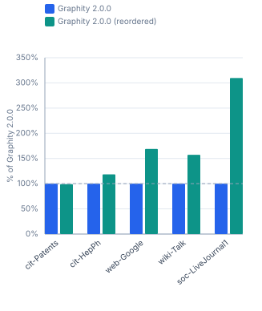
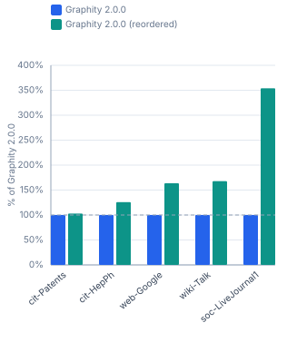

# Graphity Version History — realworld / ubuntu-ryzen-9950x

Benchmarked versions: `2.0.0`. Peer libraries are left out on purpose: they are re-measured per run, so a moving peer column would say nothing about Graphity. For the comparison against them see [`realworld-ubuntu-ryzen-9950x-peers.md`](realworld-ubuntu-ryzen-9950x-peers.md).

```
Profile:      realworld
Timestamp:    2026-07-25 00:23:49
JDK:          OpenJDK 64-Bit Server VM 25.0.2 (Amazon.com Inc.)
OS:           Ubuntu 25.10, kernel 6.17.0-41-generic (amd64)
CPU:          AMD Ryzen 9 9950X 16-Core Processor (32 logical cores)
RAM:          89.7 GiB
```

## Contents

- [1 Performance](#1-performance)
  - [1.1 SCC — real-world graphs](#11-scc-real-world-graphs)
  - [1.2 BackEdges — real-world graphs](#12-backedges-real-world-graphs)
  - [1.3 EdgeTypes — real-world graphs](#13-edgetypes-real-world-graphs)
  - [1.4 Reorder (DFS-preorder) cost — real-world graphs](#14-reorder-dfs-preorder-cost-real-world-graphs)

## 1 Performance

Times (ms/op, lower is better) and throughput (op/s, higher is better) for each algorithm and graph size. Non-baseline cells show the factor relative to **Graphity 2.0.0**, or the newest version present in a table it is missing from (= 100% in the throughput table).

### 1.1 SCC — real-world graphs

#### Times (ms/op, lower is better)

| Dataset | Graphity 2.0.0 | Graphity 2.0.0<br>(reordered) |
|---|---:|---:|
| cit-Patents<br><sub>3.8M nodes, 16.5M edges</sub> | 92.50 ms | 86.90 ms (0.9×) |
| cit-HepPh<br><sub>34.5k nodes, 421.6k edges</sub> | 1.601 ms | 1.156 ms (0.7×) |
| web-Google<br><sub>875.7k nodes, 5.1M edges</sub> | 41.54 ms | 20.55 ms (0.5×) |
| wiki-Talk<br><sub>2.4M nodes, 5M edges</sub> | 61.01 ms | 34.95 ms (0.6×) |
| soc-LiveJournal1<br><sub>4.8M nodes, 69M edges</sub> | 1043.8 ms | 292.3 ms (0.3×) |

#### Throughput (op/s, higher is better)

| Dataset | Graphity 2.0.0 | Graphity 2.0.0<br>(reordered) |
|---|---:|---:|
| cit-Patents<br><sub>3.8M nodes, 16.5M edges</sub> | 10.81 op/s | 11.51 op/s (106%) |
| cit-HepPh<br><sub>34.5k nodes, 421.6k edges</sub> | 624.6 op/s | 865.1 op/s (138%) |
| web-Google<br><sub>875.7k nodes, 5.1M edges</sub> | 24.07 op/s | 48.65 op/s (202%) |
| wiki-Talk<br><sub>2.4M nodes, 5M edges</sub> | 16.39 op/s | 28.61 op/s (175%) |
| soc-LiveJournal1<br><sub>4.8M nodes, 69M edges</sub> | 0.958 op/s | 3.421 op/s (357%) |


### 1.2 BackEdges — real-world graphs

#### Times (ms/op, lower is better)

| Dataset | Graphity 2.0.0 | Graphity 2.0.0<br>(reordered) |
|---|---:|---:|
| cit-Patents<br><sub>3.8M nodes, 16.5M edges</sub> | 42.84 ms | 43.32 ms (1.0×) |
| cit-HepPh<br><sub>34.5k nodes, 421.6k edges</sub> | 0.916 ms | 0.773 ms (0.8×) |
| web-Google<br><sub>875.7k nodes, 5.1M edges</sub> | 38.04 ms | 22.52 ms (0.6×) |
| wiki-Talk<br><sub>2.4M nodes, 5M edges</sub> | 31.30 ms | 19.88 ms (0.6×) |
| soc-LiveJournal1<br><sub>4.8M nodes, 69M edges</sub> | 865.3 ms | 279.3 ms (0.3×) |

#### Throughput (op/s, higher is better)

| Dataset | Graphity 2.0.0 | Graphity 2.0.0<br>(reordered) |
|---|---:|---:|
| cit-Patents<br><sub>3.8M nodes, 16.5M edges</sub> | 23.34 op/s | 23.08 op/s (98.9%) |
| cit-HepPh<br><sub>34.5k nodes, 421.6k edges</sub> | 1 092 op/s | 1 294 op/s (118%) |
| web-Google<br><sub>875.7k nodes, 5.1M edges</sub> | 26.29 op/s | 44.41 op/s (169%) |
| wiki-Talk<br><sub>2.4M nodes, 5M edges</sub> | 31.95 op/s | 50.29 op/s (157%) |
| soc-LiveJournal1<br><sub>4.8M nodes, 69M edges</sub> | 1.156 op/s | 3.580 op/s (310%) |



### 1.3 EdgeTypes — real-world graphs

#### Times (ms/op, lower is better)

| Dataset | Graphity 2.0.0 | Graphity 2.0.0<br>(reordered) |
|---|---:|---:|
| cit-Patents<br><sub>3.8M nodes, 16.5M edges</sub> | 66.97 ms | 65.10 ms (1.0×) |
| cit-HepPh<br><sub>34.5k nodes, 421.6k edges</sub> | 1.207 ms | 0.960 ms (0.8×) |
| web-Google<br><sub>875.7k nodes, 5.1M edges</sub> | 30.93 ms | 18.91 ms (0.6×) |
| wiki-Talk<br><sub>2.4M nodes, 5M edges</sub> | 34.31 ms | 20.44 ms (0.6×) |
| soc-LiveJournal1<br><sub>4.8M nodes, 69M edges</sub> | 885.6 ms | 250.2 ms (0.3×) |

#### Throughput (op/s, higher is better)

| Dataset | Graphity 2.0.0 | Graphity 2.0.0<br>(reordered) |
|---|---:|---:|
| cit-Patents<br><sub>3.8M nodes, 16.5M edges</sub> | 14.93 op/s | 15.36 op/s (103%) |
| cit-HepPh<br><sub>34.5k nodes, 421.6k edges</sub> | 828.5 op/s | 1 042 op/s (126%) |
| web-Google<br><sub>875.7k nodes, 5.1M edges</sub> | 32.33 op/s | 52.89 op/s (164%) |
| wiki-Talk<br><sub>2.4M nodes, 5M edges</sub> | 29.15 op/s | 48.92 op/s (168%) |
| soc-LiveJournal1<br><sub>4.8M nodes, 69M edges</sub> | 1.129 op/s | 3.997 op/s (354%) |



### 1.4 Reorder (DFS-preorder) cost — real-world graphs

#### Times (ms/op, lower is better)

| Dataset | Graphity 2.0.0 |
|---|---:|
| cit-Patents<br><sub>3.8M nodes, 16.5M edges</sub> | 151.0 ms |
| cit-HepPh<br><sub>34.5k nodes, 421.6k edges</sub> | 3.348 ms |
| web-Google<br><sub>875.7k nodes, 5.1M edges</sub> | 61.88 ms |
| wiki-Talk<br><sub>2.4M nodes, 5M edges</sub> | 79.96 ms |
| soc-LiveJournal1<br><sub>4.8M nodes, 69M edges</sub> | 1850.1 ms |

#### Throughput (op/s, higher is better)

| Dataset | Graphity 2.0.0 |
|---|---:|
| cit-Patents<br><sub>3.8M nodes, 16.5M edges</sub> | 6.623 op/s |
| cit-HepPh<br><sub>34.5k nodes, 421.6k edges</sub> | 298.7 op/s |
| web-Google<br><sub>875.7k nodes, 5.1M edges</sub> | 16.16 op/s |
| wiki-Talk<br><sub>2.4M nodes, 5M edges</sub> | 12.51 op/s |
| soc-LiveJournal1<br><sub>4.8M nodes, 69M edges</sub> | 0.541 op/s |
