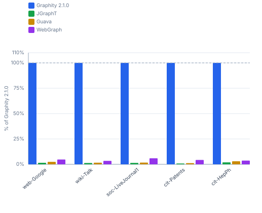
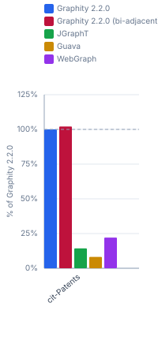
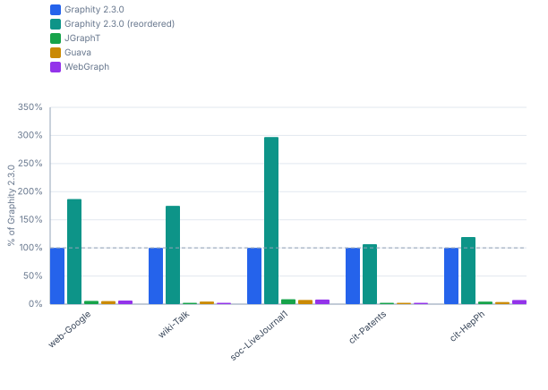
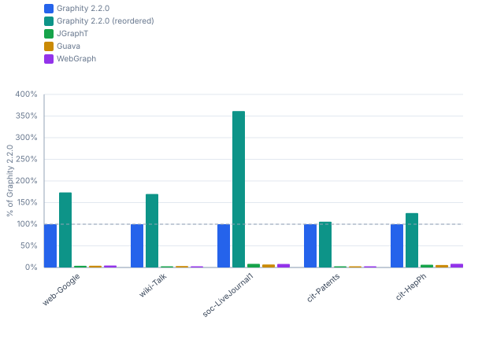

# Graphity vs. JGraphT, Guava and WebGraph — realworld / ubuntu-ryzen-9950x

Graphity `2.1.0` against the peer libraries. Peer numbers come from the newest run that measured them, which need not be the run of the newest Graphity version; every column states the version it belongs to. Blocks without a peer column are Graphity-only benchmarks or graph sizes beyond the peers' reach — for the comparison across Graphity versions see [`realworld-ubuntu-ryzen-9950x-history.md`](realworld-ubuntu-ryzen-9950x-history.md).

```
Profile:      realworld
Timestamp:    2026-08-17 01:30:48
JDK:          OpenJDK 64-Bit Server VM 25.0.2 (Amazon.com Inc.)
OS:           Ubuntu 25.10, kernel 6.17.0-41-generic (amd64)
CPU:          AMD Ryzen 9 9950X 16-Core Processor (32 logical cores)
RAM:          89.7 GiB
```

## Contents

- [1 Performance](#1-performance)
  - [1.1 SCC — real-world graphs](#11-scc-real-world-graphs)
  - [1.2 WCC — real-world graphs](#12-wcc-real-world-graphs)
  - [1.3 TopOrderAndLevels — real-world graphs](#13-toporderandlevels-real-world-graphs)
  - [1.4 BackEdges — real-world graphs](#14-backedges-real-world-graphs)
  - [1.5 EdgeTypes — real-world graphs](#15-edgetypes-real-world-graphs)
  - [1.6 Reorder (DFS-preorder) cost — real-world graphs](#16-reorder-dfs-preorder-cost-real-world-graphs)
  - [1.7 BiAdjacency (in-adjacency) cost — real-world graphs](#17-biadjacency-in-adjacency-cost-real-world-graphs)
  - [1.8 Symmetrize (WebGraph) cost — real-world graphs](#18-symmetrize-webgraph-cost-real-world-graphs)

## 1 Performance

Times (ms/op, lower is better) and throughput (op/s, higher is better) for each algorithm and graph size. Non-baseline cells show the factor relative to **Graphity 2.1.0**, or the newest version present in a table it is missing from (= 100% in the throughput table).

### 1.1 SCC — real-world graphs

#### Times (ms/op, lower is better)

| Dataset | Graphity 2.1.0 | Graphity 2.1.0<br>(reordered) | JGraphT | Guava | WebGraph |
|---|---:|---:|---:|---:|---:|
| web-Google<br><sub>875.7k nodes, 5.1M edges</sub> | 40.75 ms | 20.38 ms (0.5×) | 1211.8 ms (30×) | 793.2 ms (19×) | 236.1 ms (5.8×) |
| wiki-Talk<br><sub>2.4M nodes, 5M edges</sub> | 60.01 ms | 34.66 ms (0.6×) | 1571.7 ms (26×) | 1542.4 ms (26×) | 152.9 ms (2.5×) |
| soc-LiveJournal1<br><sub>4.8M nodes, 69M edges</sub> | 1017.2 ms | 296.3 ms (0.3×) | 23216 ms (23×) | 16895 ms (17×) | 3857.1 ms (3.8×) |
| cit-Patents<br><sub>3.8M nodes, 16.5M edges</sub> | 88.53 ms | 89.83 ms (1.0×) | 6061.8 ms (68×) | 4135.3 ms (47×) | 467.2 ms (5.3×) |
| cit-HepPh<br><sub>34.5k nodes, 421.6k edges</sub> | 1.612 ms | 1.137 ms (0.7×) | 41.36 ms (26×) | 27.43 ms (17×) | 12.18 ms (7.6×) |

#### Throughput (op/s, higher is better)

| Dataset | Graphity 2.1.0 | Graphity 2.1.0<br>(reordered) | JGraphT | Guava | WebGraph |
|---|---:|---:|---:|---:|---:|
| web-Google<br><sub>875.7k nodes, 5.1M edges</sub> | 24.54 op/s | 49.07 op/s (200%) | 0.825 op/s (3.4%) | 1.261 op/s (5.1%) | 4.235 op/s (17.3%) |
| wiki-Talk<br><sub>2.4M nodes, 5M edges</sub> | 16.66 op/s | 28.85 op/s (173%) | 0.636 op/s (3.8%) | 0.648 op/s (3.9%) | 6.540 op/s (39.2%) |
| soc-LiveJournal1<br><sub>4.8M nodes, 69M edges</sub> | 0.983 op/s | 3.375 op/s (343%) | 0.043 op/s (4.4%) | 0.059 op/s (6.0%) | 0.259 op/s (26.4%) |
| cit-Patents<br><sub>3.8M nodes, 16.5M edges</sub> | 11.30 op/s | 11.13 op/s (98.6%) | 0.165 op/s (1.5%) | 0.242 op/s (2.1%) | 2.140 op/s (18.9%) |
| cit-HepPh<br><sub>34.5k nodes, 421.6k edges</sub> | 620.3 op/s | 879.5 op/s (142%) | 24.18 op/s (3.9%) | 36.46 op/s (5.9%) | 82.10 op/s (13.2%) |


### 1.2 WCC — real-world graphs

#### Times (ms/op, lower is better)

| Dataset | Graphity 2.1.0 | JGraphT | Guava | WebGraph |
|---|---:|---:|---:|---:|
| web-Google<br><sub>875.7k nodes, 5.1M edges</sub> | 17.36 ms | 1169.6 ms (67×) | 707.3 ms (41×) | 366.2 ms (21×) |
| wiki-Talk<br><sub>2.4M nodes, 5M edges</sub> | 18.86 ms | 1453.3 ms (77×) | 1187.7 ms (63×) | 556.4 ms (29×) |
| soc-LiveJournal1<br><sub>4.8M nodes, 69M edges</sub> | 246.1 ms | 17858 ms (73×) | 14406 ms (59×) | 4147.7 ms (17×) |
| cit-Patents<br><sub>3.8M nodes, 16.5M edges</sub> | 65.73 ms | 7969.6 ms (121×) | 5600.5 ms (85×) | 1521.9 ms (23×) |
| cit-HepPh<br><sub>34.5k nodes, 421.6k edges</sub> | 1.024 ms | 53.06 ms (52×) | 33.90 ms (33×) | 27.93 ms (27×) |

#### Throughput (op/s, higher is better)

| Dataset | Graphity 2.1.0 | JGraphT | Guava | WebGraph |
|---|---:|---:|---:|---:|
| web-Google<br><sub>875.7k nodes, 5.1M edges</sub> | 57.60 op/s | 0.855 op/s (1.5%) | 1.414 op/s (2.5%) | 2.731 op/s (4.7%) |
| wiki-Talk<br><sub>2.4M nodes, 5M edges</sub> | 53.01 op/s | 0.688 op/s (1.3%) | 0.842 op/s (1.6%) | 1.797 op/s (3.4%) |
| soc-LiveJournal1<br><sub>4.8M nodes, 69M edges</sub> | 4.063 op/s | 0.056 op/s (1.4%) | 0.069 op/s (1.7%) | 0.241 op/s (5.9%) |
| cit-Patents<br><sub>3.8M nodes, 16.5M edges</sub> | 15.21 op/s | 0.125 op/s (0.8%) | 0.179 op/s (1.2%) | 0.657 op/s (4.3%) |
| cit-HepPh<br><sub>34.5k nodes, 421.6k edges</sub> | 976.6 op/s | 18.84 op/s (1.9%) | 29.50 op/s (3.0%) | 35.80 op/s (3.7%) |



### 1.3 TopOrderAndLevels — real-world graphs

#### Times (ms/op, lower is better)

| Dataset | Graphity 2.1.0 | Graphity 2.1.0<br>(bi-adjacent) | JGraphT | Guava | WebGraph |
|---|---:|---:|---:|---:|---:|
| cit-Patents<br><sub>3.8M nodes, 16.5M edges</sub> | 218.1 ms | 217.4 ms (1.0×) | 1671.0 ms (7.7×) | 2833.3 ms (13×) | 1157.7 ms (5.3×) |

#### Throughput (op/s, higher is better)

| Dataset | Graphity 2.1.0 | Graphity 2.1.0<br>(bi-adjacent) | JGraphT | Guava | WebGraph |
|---|---:|---:|---:|---:|---:|
| cit-Patents<br><sub>3.8M nodes, 16.5M edges</sub> | 4.585 op/s | 4.600 op/s (100%) | 0.598 op/s (13.1%) | 0.353 op/s (7.7%) | 0.864 op/s (18.8%) |



Self-loops are dropped for this algorithm: it requires a DAG, and a self-loop is a cycle.
Every library in a row reads that same graph; the other tables measure each file unmodified.

For cit-Patents that is one edge of 16,518,948 — patent 5489070 cites itself, and that loop is the graph's only cycle.

### 1.4 BackEdges — real-world graphs

#### Times (ms/op, lower is better)

| Dataset | Graphity 2.1.0 | Graphity 2.1.0<br>(reordered) | JGraphT | Guava | WebGraph |
|---|---:|---:|---:|---:|---:|
| web-Google<br><sub>875.7k nodes, 5.1M edges</sub> | 37.93 ms | 22.17 ms (0.6×) | 766.5 ms (20×) | 845.3 ms (22×) | 685.1 ms (18×) |
| wiki-Talk<br><sub>2.4M nodes, 5M edges</sub> | 30.56 ms | 17.82 ms (0.6×) | 1689.2 ms (55×) | 762.3 ms (25×) | 1989.1 ms (65×) |
| soc-LiveJournal1<br><sub>4.8M nodes, 69M edges</sub> | 835.5 ms | 279.9 ms (0.3×) | 9685.7 ms (12×) | 11111 ms (13×) | 11141 ms (13×) |
| cit-Patents<br><sub>3.8M nodes, 16.5M edges</sub> | 40.55 ms | 40.70 ms (1.0×) | 23172 ms (571×) | 17125 ms (422×) | 15358 ms (379×) |
| cit-HepPh<br><sub>34.5k nodes, 421.6k edges</sub> | 0.903 ms | 0.752 ms (0.8×) | 17.79 ms (20×) | 23.07 ms (26×) | 12.89 ms (14×) |

#### Throughput (op/s, higher is better)

| Dataset | Graphity 2.1.0 | Graphity 2.1.0<br>(reordered) | JGraphT | Guava | WebGraph |
|---|---:|---:|---:|---:|---:|
| web-Google<br><sub>875.7k nodes, 5.1M edges</sub> | 26.36 op/s | 45.10 op/s (171%) | 1.305 op/s (4.9%) | 1.183 op/s (4.5%) | 1.460 op/s (5.5%) |
| wiki-Talk<br><sub>2.4M nodes, 5M edges</sub> | 32.72 op/s | 56.13 op/s (172%) | 0.592 op/s (1.8%) | 1.312 op/s (4.0%) | 0.503 op/s (1.5%) |
| soc-LiveJournal1<br><sub>4.8M nodes, 69M edges</sub> | 1.197 op/s | 3.573 op/s (298%) | 0.103 op/s (8.6%) | 0.090 op/s (7.5%) | 0.090 op/s (7.5%) |
| cit-Patents<br><sub>3.8M nodes, 16.5M edges</sub> | 24.66 op/s | 24.57 op/s (99.6%) | 0.043 op/s (0.2%) | 0.058 op/s (0.2%) | 0.065 op/s (0.3%) |
| cit-HepPh<br><sub>34.5k nodes, 421.6k edges</sub> | 1 107 op/s | 1 330 op/s (120%) | 56.21 op/s (5.1%) | 43.35 op/s (3.9%) | 77.59 op/s (7.0%) |



### 1.5 EdgeTypes — real-world graphs

#### Times (ms/op, lower is better)

| Dataset | Graphity 2.1.0 | Graphity 2.1.0<br>(reordered) | JGraphT | Guava | WebGraph |
|---|---:|---:|---:|---:|---:|
| web-Google<br><sub>875.7k nodes, 5.1M edges</sub> | 30.89 ms | 18.59 ms (0.6×) | 757.8 ms (25×) | 977.8 ms (32×) | 693.6 ms (22×) |
| wiki-Talk<br><sub>2.4M nodes, 5M edges</sub> | 34.14 ms | 20.29 ms (0.6×) | 1705.4 ms (50×) | 1027.4 ms (30×) | 2115.1 ms (62×) |
| soc-LiveJournal1<br><sub>4.8M nodes, 69M edges</sub> | 879.6 ms | 243.9 ms (0.3×) | 10480 ms (12×) | 13139 ms (15×) | 15118 ms (17×) |
| cit-Patents<br><sub>3.8M nodes, 16.5M edges</sub> | 64.11 ms | 67.50 ms (1.1×) | 16082 ms (251×) | 24174 ms (377×) | 27139 ms (423×) |
| cit-HepPh<br><sub>34.5k nodes, 421.6k edges</sub> | 1.235 ms | 0.951 ms (0.8×) | 18.00 ms (15×) | 21.18 ms (17×) | 14.10 ms (11×) |

#### Throughput (op/s, higher is better)

| Dataset | Graphity 2.1.0 | Graphity 2.1.0<br>(reordered) | JGraphT | Guava | WebGraph |
|---|---:|---:|---:|---:|---:|
| web-Google<br><sub>875.7k nodes, 5.1M edges</sub> | 32.37 op/s | 53.79 op/s (166%) | 1.320 op/s (4.1%) | 1.023 op/s (3.2%) | 1.442 op/s (4.5%) |
| wiki-Talk<br><sub>2.4M nodes, 5M edges</sub> | 29.29 op/s | 49.29 op/s (168%) | 0.586 op/s (2.0%) | 0.973 op/s (3.3%) | 0.473 op/s (1.6%) |
| soc-LiveJournal1<br><sub>4.8M nodes, 69M edges</sub> | 1.137 op/s | 4.100 op/s (361%) | 0.095 op/s (8.4%) | 0.076 op/s (6.7%) | 0.066 op/s (5.8%) |
| cit-Patents<br><sub>3.8M nodes, 16.5M edges</sub> | 15.60 op/s | 14.82 op/s (95.0%) | 0.062 op/s (0.4%) | 0.041 op/s (0.3%) | 0.037 op/s (0.2%) |
| cit-HepPh<br><sub>34.5k nodes, 421.6k edges</sub> | 809.7 op/s | 1 052 op/s (130%) | 55.55 op/s (6.9%) | 47.21 op/s (5.8%) | 70.94 op/s (8.8%) |



### 1.6 Reorder (DFS-preorder) cost — real-world graphs

#### Times (ms/op, lower is better)

| Dataset | Graphity 2.1.0 |
|---|---:|
| web-Google<br><sub>875.7k nodes, 5.1M edges</sub> | 50.07 ms |
| wiki-Talk<br><sub>2.4M nodes, 5M edges</sub> | 66.02 ms |
| soc-LiveJournal1<br><sub>4.8M nodes, 69M edges</sub> | 1335.1 ms |
| cit-Patents<br><sub>3.8M nodes, 16.5M edges</sub> | 108.9 ms |
| cit-HepPh<br><sub>34.5k nodes, 421.6k edges</sub> | 2.854 ms |

#### Throughput (op/s, higher is better)

| Dataset | Graphity 2.1.0 |
|---|---:|
| web-Google<br><sub>875.7k nodes, 5.1M edges</sub> | 19.97 op/s |
| wiki-Talk<br><sub>2.4M nodes, 5M edges</sub> | 15.15 op/s |
| soc-LiveJournal1<br><sub>4.8M nodes, 69M edges</sub> | 0.749 op/s |
| cit-Patents<br><sub>3.8M nodes, 16.5M edges</sub> | 9.183 op/s |
| cit-HepPh<br><sub>34.5k nodes, 421.6k edges</sub> | 350.4 op/s |

### 1.7 BiAdjacency (in-adjacency) cost — real-world graphs

#### Times (ms/op, lower is better)

| Dataset | Graphity 2.1.0 |
|---|---:|
| web-Google<br><sub>875.7k nodes, 5.1M edges</sub> | 14.62 ms |
| wiki-Talk<br><sub>2.4M nodes, 5M edges</sub> | 16.17 ms |
| soc-LiveJournal1<br><sub>4.8M nodes, 69M edges</sub> | 406.0 ms |
| cit-Patents<br><sub>3.8M nodes, 16.5M edges</sub> | 106.9 ms |
| cit-HepPh<br><sub>34.5k nodes, 421.6k edges</sub> | 0.558 ms |

#### Throughput (op/s, higher is better)

| Dataset | Graphity 2.1.0 |
|---|---:|
| web-Google<br><sub>875.7k nodes, 5.1M edges</sub> | 68.38 op/s |
| wiki-Talk<br><sub>2.4M nodes, 5M edges</sub> | 61.84 op/s |
| soc-LiveJournal1<br><sub>4.8M nodes, 69M edges</sub> | 2.463 op/s |
| cit-Patents<br><sub>3.8M nodes, 16.5M edges</sub> | 9.355 op/s |
| cit-HepPh<br><sub>34.5k nodes, 421.6k edges</sub> | 1 792 op/s |

### 1.8 Symmetrize (WebGraph) cost — real-world graphs

#### Times (ms/op, lower is better)

| Dataset | WebGraph |
|---|---:|
| web-Google<br><sub>875.7k nodes, 5.1M edges</sub> | 687.2 ms |
| wiki-Talk<br><sub>2.4M nodes, 5M edges</sub> | 832.0 ms |
| soc-LiveJournal1<br><sub>4.8M nodes, 69M edges</sub> | 7329.7 ms |
| cit-Patents<br><sub>3.8M nodes, 16.5M edges</sub> | 2109.0 ms |
| cit-HepPh<br><sub>34.5k nodes, 421.6k edges</sub> | 149.1 ms |

#### Throughput (op/s, higher is better)

| Dataset | WebGraph |
|---|---:|
| web-Google<br><sub>875.7k nodes, 5.1M edges</sub> | 1.455 op/s |
| wiki-Talk<br><sub>2.4M nodes, 5M edges</sub> | 1.202 op/s |
| soc-LiveJournal1<br><sub>4.8M nodes, 69M edges</sub> | 0.136 op/s |
| cit-Patents<br><sub>3.8M nodes, 16.5M edges</sub> | 0.474 op/s |
| cit-HepPh<br><sub>34.5k nodes, 421.6k edges</sub> | 6.707 op/s |
