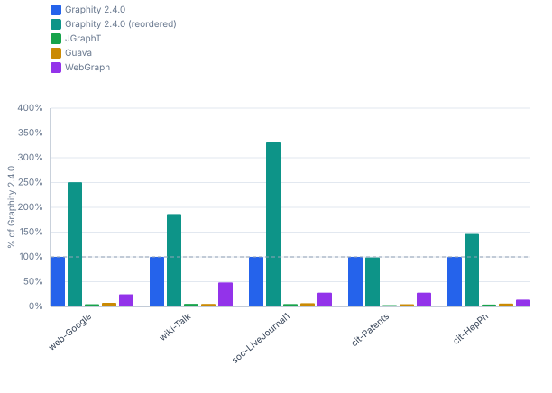
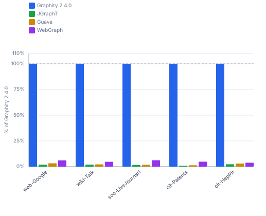
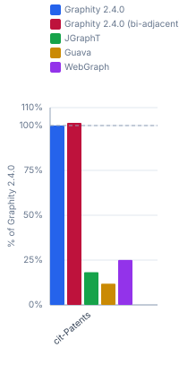
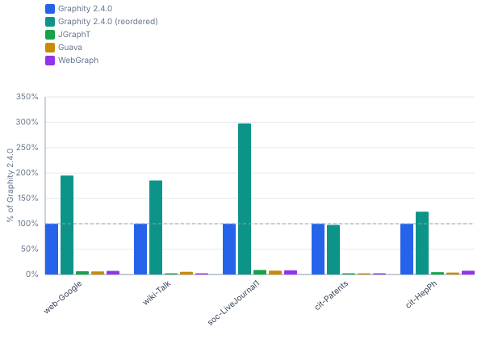
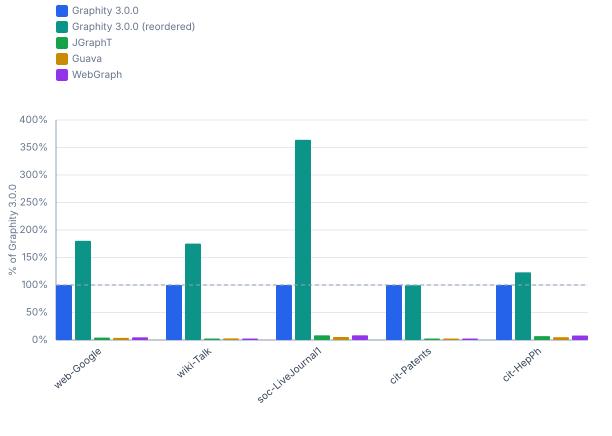

# Graphity vs. JGraphT, Guava and WebGraph — realworld / ubuntu-ryzen-9950x

Graphity `3.0.0` against the peer libraries. Peer numbers come from the newest run that measured them, which need not be the run of the newest Graphity version; every column states the version it belongs to. Blocks without a peer column are Graphity-only benchmarks or graph sizes beyond the peers' reach — for the comparison across Graphity versions see [`realworld-ubuntu-ryzen-9950x-history.md`](realworld-ubuntu-ryzen-9950x-history.md).

```
Profile:      realworld
Timestamp:    2026-10-31 05:43:55
JDK:          OpenJDK 64-Bit Server VM 25.0.2 (Amazon.com Inc.)
OS:           Ubuntu 25.10, kernel 6.17.0-41-generic (amd64)
CPU:          AMD Ryzen 9 9950X 16-Core Processor (32 logical cores)
RAM:          89.7 GiB
Estimate:     near-best window - 3rd-fastest of 15 or more, 2nd-fastest of 5 or more
Revision:     3.0.0
```

## Contents

- [1 Performance](#1-performance)
  - [1.1 SCC — real-world graphs](#11-scc--real-world-graphs)
  - [1.2 WCC — real-world graphs](#12-wcc--real-world-graphs)
  - [1.3 TopOrderAndLevels — real-world graphs](#13-toporderandlevels--real-world-graphs)
  - [1.4 BackEdges — real-world graphs](#14-backedges--real-world-graphs)
  - [1.5 EdgeTypes — real-world graphs](#15-edgetypes--real-world-graphs)
  - [1.6 Reorder (DFS-preorder) cost — real-world graphs](#16-reorder-dfs-preorder-cost--real-world-graphs)
  - [1.7 BiAdjacency (in-adjacency) cost — real-world graphs](#17-biadjacency-in-adjacency-cost--real-world-graphs)
  - [1.8 Symmetrize (WebGraph) cost — real-world graphs](#18-symmetrize-webgraph-cost--real-world-graphs)

## 1 Performance

Times (ms/op, lower is better) and throughput (op/s, higher is better) for each algorithm and graph size. Non-baseline cells show the factor relative to **Graphity 3.0.0**, or the newest version present in a table it is missing from (= 100% in the throughput table).

### 1.1 SCC — real-world graphs

#### Times (ms/op, lower is better)

| Dataset | Graphity 3.0.0 | Graphity 3.0.0<br>(reordered) | JGraphT | Guava | WebGraph |
|---|---:|---:|---:|---:|---:|
| web-Google<br><sub>875.7k nodes, 5.1M edges</sub> | 42.05 ms | 20.39 ms (0.5×) | 1236.6 ms (29×) | 793.0 ms (19×) | 233.7 ms (5.6×) |
| wiki-Talk<br><sub>2.4M nodes, 5M edges</sub> | 62.74 ms | 35.82 ms (0.6×) | 1288.2 ms (21×) | 1502.9 ms (24×) | 151.0 ms (2.4×) |
| soc-LiveJournal1<br><sub>4.8M nodes, 69M edges</sub> | 1049.9 ms | 294.4 ms (0.3×) | 22560 ms (21×) | 16286 ms (16×) | 3931.3 ms (3.7×) |
| cit-Patents<br><sub>3.8M nodes, 16.5M edges</sub> | 92.95 ms | 91.46 ms (1.0×) | 5941.2 ms (64×) | 2865.4 ms (31×) | 457.8 ms (4.9×) |
| cit-HepPh<br><sub>34.5k nodes, 421.6k edges</sub> | 1.618 ms | 1.141 ms (0.7×) | 40.40 ms (25×) | 27.51 ms (17×) | 11.97 ms (7.4×) |

#### Throughput (op/s, higher is better)

| Dataset | Graphity 3.0.0 | Graphity 3.0.0<br>(reordered) | JGraphT | Guava | WebGraph |
|---|---:|---:|---:|---:|---:|
| web-Google<br><sub>875.7k nodes, 5.1M edges</sub> | 23.78 op/s | 49.05 op/s (206%) | 0.809 op/s (3.4%) | 1.261 op/s (5.3%) | 4.279 op/s (18.0%) |
| wiki-Talk<br><sub>2.4M nodes, 5M edges</sub> | 15.94 op/s | 27.92 op/s (175%) | 0.776 op/s (4.9%) | 0.665 op/s (4.2%) | 6.623 op/s (41.5%) |
| soc-LiveJournal1<br><sub>4.8M nodes, 69M edges</sub> | 0.952 op/s | 3.397 op/s (357%) | 0.044 op/s (4.7%) | 0.061 op/s (6.4%) | 0.254 op/s (26.7%) |
| cit-Patents<br><sub>3.8M nodes, 16.5M edges</sub> | 10.76 op/s | 10.93 op/s (102%) | 0.168 op/s (1.6%) | 0.349 op/s (3.2%) | 2.184 op/s (20.3%) |
| cit-HepPh<br><sub>34.5k nodes, 421.6k edges</sub> | 618.0 op/s | 876.4 op/s (142%) | 24.75 op/s (4.0%) | 36.35 op/s (5.9%) | 83.51 op/s (13.5%) |



### 1.2 WCC — real-world graphs

#### Times (ms/op, lower is better)

| Dataset | Graphity 3.0.0 | JGraphT | Guava | WebGraph |
|---|---:|---:|---:|---:|
| web-Google<br><sub>875.7k nodes, 5.1M edges</sub> | 17.06 ms | 1088.9 ms (64×) | 659.4 ms (39×) | 345.1 ms (20×) |
| wiki-Talk<br><sub>2.4M nodes, 5M edges</sub> | 18.81 ms | 1293.9 ms (69×) | 1177.9 ms (63×) | 538.5 ms (29×) |
| soc-LiveJournal1<br><sub>4.8M nodes, 69M edges</sub> | 225.8 ms | 16158 ms (72×) | 14302 ms (63×) | 4089.6 ms (18×) |
| cit-Patents<br><sub>3.8M nodes, 16.5M edges</sub> | 60.30 ms | 8079.9 ms (134×) | 5323.8 ms (88×) | 1434.5 ms (24×) |
| cit-HepPh<br><sub>34.5k nodes, 421.6k edges</sub> | 0.945 ms | 47.19 ms (50×) | 34.14 ms (36×) | 28.60 ms (30×) |

#### Throughput (op/s, higher is better)

| Dataset | Graphity 3.0.0 | JGraphT | Guava | WebGraph |
|---|---:|---:|---:|---:|
| web-Google<br><sub>875.7k nodes, 5.1M edges</sub> | 58.63 op/s | 0.918 op/s (1.6%) | 1.517 op/s (2.6%) | 2.898 op/s (4.9%) |
| wiki-Talk<br><sub>2.4M nodes, 5M edges</sub> | 53.16 op/s | 0.773 op/s (1.5%) | 0.849 op/s (1.6%) | 1.857 op/s (3.5%) |
| soc-LiveJournal1<br><sub>4.8M nodes, 69M edges</sub> | 4.429 op/s | 0.062 op/s (1.4%) | 0.070 op/s (1.6%) | 0.245 op/s (5.5%) |
| cit-Patents<br><sub>3.8M nodes, 16.5M edges</sub> | 16.58 op/s | 0.124 op/s (0.7%) | 0.188 op/s (1.1%) | 0.697 op/s (4.2%) |
| cit-HepPh<br><sub>34.5k nodes, 421.6k edges</sub> | 1 058 op/s | 21.19 op/s (2.0%) | 29.29 op/s (2.8%) | 34.97 op/s (3.3%) |



### 1.3 TopOrderAndLevels — real-world graphs

#### Times (ms/op, lower is better)

| Dataset | Graphity 3.0.0 | Graphity 3.0.0<br>(bi-adjacent) | JGraphT | Guava | WebGraph |
|---|---:|---:|---:|---:|---:|
| cit-Patents<br><sub>3.8M nodes, 16.5M edges</sub> | 222.7 ms | 215.3 ms (1.0×) | 1335.3 ms (6.0×) | 1947.2 ms (8.7×) | 1015.0 ms (4.6×) |

#### Throughput (op/s, higher is better)

| Dataset | Graphity 3.0.0 | Graphity 3.0.0<br>(bi-adjacent) | JGraphT | Guava | WebGraph |
|---|---:|---:|---:|---:|---:|
| cit-Patents<br><sub>3.8M nodes, 16.5M edges</sub> | 4.490 op/s | 4.645 op/s (103%) | 0.749 op/s (16.7%) | 0.514 op/s (11.4%) | 0.985 op/s (21.9%) |



Self-loops are dropped for this algorithm: it requires a DAG, and a self-loop is a cycle.
Every library in a row reads that same graph; the other tables measure each file unmodified.

For cit-Patents that is one edge of 16,518,948 — patent 5489070 cites itself, and that loop is the graph's only cycle.

### 1.4 BackEdges — real-world graphs

#### Times (ms/op, lower is better)

| Dataset | Graphity 3.0.0 | Graphity 3.0.0<br>(reordered) | JGraphT | Guava | WebGraph |
|---|---:|---:|---:|---:|---:|
| web-Google<br><sub>875.7k nodes, 5.1M edges</sub> | 50.42 ms | 25.11 ms (0.5×) | 1006.2 ms (20×) | 759.8 ms (15×) | 652.0 ms (13×) |
| wiki-Talk<br><sub>2.4M nodes, 5M edges</sub> | 34.22 ms | 21.47 ms (0.6×) | 1741.7 ms (51×) | 751.8 ms (22×) | 1922.5 ms (56×) |
| soc-LiveJournal1<br><sub>4.8M nodes, 69M edges</sub> | 922.7 ms | 366.4 ms (0.4×) | 13473 ms (15×) | 11032 ms (12×) | 10246 ms (11×) |
| cit-Patents<br><sub>3.8M nodes, 16.5M edges</sub> | 44.33 ms | 41.42 ms (0.9×) | 15280 ms (345×) | 16035 ms (362×) | 15391 ms (347×) |
| cit-HepPh<br><sub>34.5k nodes, 421.6k edges</sub> | 0.879 ms | 0.716 ms (0.8×) | 17.15 ms (20×) | 26.65 ms (30×) | 12.87 ms (15×) |

#### Throughput (op/s, higher is better)

| Dataset | Graphity 3.0.0 | Graphity 3.0.0<br>(reordered) | JGraphT | Guava | WebGraph |
|---|---:|---:|---:|---:|---:|
| web-Google<br><sub>875.7k nodes, 5.1M edges</sub> | 19.83 op/s | 39.82 op/s (201%) | 0.994 op/s (5.0%) | 1.316 op/s (6.6%) | 1.534 op/s (7.7%) |
| wiki-Talk<br><sub>2.4M nodes, 5M edges</sub> | 29.23 op/s | 46.58 op/s (159%) | 0.574 op/s (2.0%) | 1.330 op/s (4.6%) | 0.520 op/s (1.8%) |
| soc-LiveJournal1<br><sub>4.8M nodes, 69M edges</sub> | 1.084 op/s | 2.729 op/s (252%) | 0.074 op/s (6.8%) | 0.091 op/s (8.4%) | 0.098 op/s (9.0%) |
| cit-Patents<br><sub>3.8M nodes, 16.5M edges</sub> | 22.56 op/s | 24.14 op/s (107%) | 0.065 op/s (0.3%) | 0.062 op/s (0.3%) | 0.065 op/s (0.3%) |
| cit-HepPh<br><sub>34.5k nodes, 421.6k edges</sub> | 1 138 op/s | 1 397 op/s (123%) | 58.30 op/s (5.1%) | 37.52 op/s (3.3%) | 77.71 op/s (6.8%) |



### 1.5 EdgeTypes — real-world graphs

#### Times (ms/op, lower is better)

| Dataset | Graphity 3.0.0 | Graphity 3.0.0<br>(reordered) | JGraphT | Guava | WebGraph |
|---|---:|---:|---:|---:|---:|
| web-Google<br><sub>875.7k nodes, 5.1M edges</sub> | 32.47 ms | 17.99 ms (0.6×) | 742.6 ms (23×) | 851.8 ms (26×) | 671.2 ms (21×) |
| wiki-Talk<br><sub>2.4M nodes, 5M edges</sub> | 32.63 ms | 18.61 ms (0.6×) | 2109.6 ms (65×) | 1091.4 ms (33×) | 2068.0 ms (63×) |
| soc-LiveJournal1<br><sub>4.8M nodes, 69M edges</sub> | 876.1 ms | 240.7 ms (0.3×) | 10244 ms (12×) | 16004 ms (18×) | 10242 ms (12×) |
| cit-Patents<br><sub>3.8M nodes, 16.5M edges</sub> | 65.29 ms | 65.48 ms (1.0×) | 15610 ms (239×) | 18286 ms (280×) | 16992 ms (260×) |
| cit-HepPh<br><sub>34.5k nodes, 421.6k edges</sub> | 1.188 ms | 0.965 ms (0.8×) | 16.84 ms (14×) | 23.25 ms (20×) | 14.42 ms (12×) |

#### Throughput (op/s, higher is better)

| Dataset | Graphity 3.0.0 | Graphity 3.0.0<br>(reordered) | JGraphT | Guava | WebGraph |
|---|---:|---:|---:|---:|---:|
| web-Google<br><sub>875.7k nodes, 5.1M edges</sub> | 30.80 op/s | 55.58 op/s (180%) | 1.347 op/s (4.4%) | 1.174 op/s (3.8%) | 1.490 op/s (4.8%) |
| wiki-Talk<br><sub>2.4M nodes, 5M edges</sub> | 30.64 op/s | 53.72 op/s (175%) | 0.474 op/s (1.5%) | 0.916 op/s (3.0%) | 0.484 op/s (1.6%) |
| soc-LiveJournal1<br><sub>4.8M nodes, 69M edges</sub> | 1.141 op/s | 4.155 op/s (364%) | 0.098 op/s (8.6%) | 0.062 op/s (5.5%) | 0.098 op/s (8.6%) |
| cit-Patents<br><sub>3.8M nodes, 16.5M edges</sub> | 15.32 op/s | 15.27 op/s (99.7%) | 0.064 op/s (0.4%) | 0.055 op/s (0.4%) | 0.059 op/s (0.4%) |
| cit-HepPh<br><sub>34.5k nodes, 421.6k edges</sub> | 841.8 op/s | 1 036 op/s (123%) | 59.37 op/s (7.1%) | 43.00 op/s (5.1%) | 69.36 op/s (8.2%) |



### 1.6 Reorder (DFS-preorder) cost — real-world graphs

#### Times (ms/op, lower is better)

| Dataset | Graphity 3.0.0 |
|---|---:|
| web-Google<br><sub>875.7k nodes, 5.1M edges</sub> | 49.41 ms |
| wiki-Talk<br><sub>2.4M nodes, 5M edges</sub> | 69.56 ms |
| soc-LiveJournal1<br><sub>4.8M nodes, 69M edges</sub> | 1312.9 ms |
| cit-Patents<br><sub>3.8M nodes, 16.5M edges</sub> | 104.9 ms |
| cit-HepPh<br><sub>34.5k nodes, 421.6k edges</sub> | 2.838 ms |

#### Throughput (op/s, higher is better)

| Dataset | Graphity 3.0.0 |
|---|---:|
| web-Google<br><sub>875.7k nodes, 5.1M edges</sub> | 20.24 op/s |
| wiki-Talk<br><sub>2.4M nodes, 5M edges</sub> | 14.38 op/s |
| soc-LiveJournal1<br><sub>4.8M nodes, 69M edges</sub> | 0.762 op/s |
| cit-Patents<br><sub>3.8M nodes, 16.5M edges</sub> | 9.533 op/s |
| cit-HepPh<br><sub>34.5k nodes, 421.6k edges</sub> | 352.4 op/s |

### 1.7 BiAdjacency (in-adjacency) cost — real-world graphs

#### Times (ms/op, lower is better)

| Dataset | Graphity 3.0.0 |
|---|---:|
| web-Google<br><sub>875.7k nodes, 5.1M edges</sub> | 18.67 ms |
| wiki-Talk<br><sub>2.4M nodes, 5M edges</sub> | 15.34 ms |
| soc-LiveJournal1<br><sub>4.8M nodes, 69M edges</sub> | 441.5 ms |
| cit-Patents<br><sub>3.8M nodes, 16.5M edges</sub> | 102.4 ms |
| cit-HepPh<br><sub>34.5k nodes, 421.6k edges</sub> | 0.766 ms |

#### Throughput (op/s, higher is better)

| Dataset | Graphity 3.0.0 |
|---|---:|
| web-Google<br><sub>875.7k nodes, 5.1M edges</sub> | 53.57 op/s |
| wiki-Talk<br><sub>2.4M nodes, 5M edges</sub> | 65.19 op/s |
| soc-LiveJournal1<br><sub>4.8M nodes, 69M edges</sub> | 2.265 op/s |
| cit-Patents<br><sub>3.8M nodes, 16.5M edges</sub> | 9.766 op/s |
| cit-HepPh<br><sub>34.5k nodes, 421.6k edges</sub> | 1 305 op/s |

### 1.8 Symmetrize (WebGraph) cost — real-world graphs

#### Times (ms/op, lower is better)

| Dataset | WebGraph |
|---|---:|
| web-Google<br><sub>875.7k nodes, 5.1M edges</sub> | 692.5 ms |
| wiki-Talk<br><sub>2.4M nodes, 5M edges</sub> | 929.9 ms |
| soc-LiveJournal1<br><sub>4.8M nodes, 69M edges</sub> | 9003.7 ms |
| cit-Patents<br><sub>3.8M nodes, 16.5M edges</sub> | 2382.1 ms |
| cit-HepPh<br><sub>34.5k nodes, 421.6k edges</sub> | 149.6 ms |

#### Throughput (op/s, higher is better)

| Dataset | WebGraph |
|---|---:|
| web-Google<br><sub>875.7k nodes, 5.1M edges</sub> | 1.444 op/s |
| wiki-Talk<br><sub>2.4M nodes, 5M edges</sub> | 1.075 op/s |
| soc-LiveJournal1<br><sub>4.8M nodes, 69M edges</sub> | 0.111 op/s |
| cit-Patents<br><sub>3.8M nodes, 16.5M edges</sub> | 0.420 op/s |
| cit-HepPh<br><sub>34.5k nodes, 421.6k edges</sub> | 6.684 op/s |
