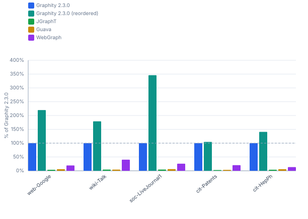
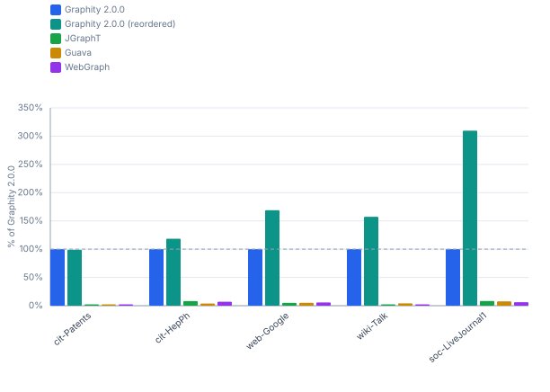
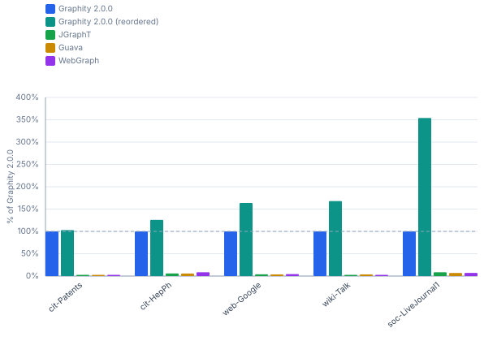

# Graphity vs. JGraphT, Guava and WebGraph — realworld / ubuntu-ryzen-9950x

Graphity `2.0.0` against the peer libraries. Peer numbers come from the newest run that measured them, which need not be the run of the newest Graphity version; every column states the version it belongs to. Blocks without a peer column are Graphity-only benchmarks or graph sizes beyond the peers' reach — for the comparison across Graphity versions see [`realworld-ubuntu-ryzen-9950x-history.md`](realworld-ubuntu-ryzen-9950x-history.md).

```
Profile:      realworld
Timestamp:    2026-07-25 00:23:49
JDK:          OpenJDK 64-Bit Server VM 25.0.2 (Amazon.com Inc.)
OS:           Ubuntu 25.10, kernel 6.17.0-41-generic (amd64)
CPU:          AMD Ryzen 9 9950X 16-Core Processor (32 logical cores)
RAM:          89.7 GiB
```

## Contents

- [1 Performance](#1-performance)
  - [1.1 SCC — real-world graphs](#11-scc-real-world-graphs)
  - [1.2 BackEdges — real-world graphs](#12-backedges-real-world-graphs)
  - [1.3 EdgeTypes — real-world graphs](#13-edgetypes-real-world-graphs)
  - [1.4 Reorder (DFS-preorder) cost — real-world graphs](#14-reorder-dfs-preorder-cost-real-world-graphs)

## 1 Performance

Times (ms/op, lower is better) and throughput (op/s, higher is better) for each algorithm and graph size. Non-baseline cells show the factor relative to **Graphity 2.0.0**, or the newest version present in a table it is missing from (= 100% in the throughput table).

### 1.1 SCC — real-world graphs

#### Times (ms/op, lower is better)

| Dataset | Graphity 2.0.0 | Graphity 2.0.0<br>(reordered) | JGraphT | Guava | WebGraph |
|---|---:|---:|---:|---:|---:|
| cit-Patents<br><sub>3.8M nodes, 16.5M edges</sub> | 92.50 ms | 86.90 ms (0.9×) | 6105.6 ms (66×) | 3921.1 ms (42×) | 490.4 ms (5.3×) |
| cit-HepPh<br><sub>34.5k nodes, 421.6k edges</sub> | 1.601 ms | 1.156 ms (0.7×) | 41.42 ms (26×) | 27.88 ms (17×) | 12.13 ms (7.6×) |
| web-Google<br><sub>875.7k nodes, 5.1M edges</sub> | 41.54 ms | 20.55 ms (0.5×) | 1295.9 ms (31×) | 788.9 ms (19×) | 247.9 ms (6.0×) |
| wiki-Talk<br><sub>2.4M nodes, 5M edges</sub> | 61.01 ms | 34.95 ms (0.6×) | 1572.0 ms (26×) | 1578.6 ms (26×) | 158.2 ms (2.6×) |
| soc-LiveJournal1<br><sub>4.8M nodes, 69M edges</sub> | 1043.8 ms | 292.3 ms (0.3×) | 23565 ms (23×) | 16754 ms (16×) | 3977.3 ms (3.8×) |

#### Throughput (op/s, higher is better)

| Dataset | Graphity 2.0.0 | Graphity 2.0.0<br>(reordered) | JGraphT | Guava | WebGraph |
|---|---:|---:|---:|---:|---:|
| cit-Patents<br><sub>3.8M nodes, 16.5M edges</sub> | 10.81 op/s | 11.51 op/s (106%) | 0.164 op/s (1.5%) | 0.255 op/s (2.4%) | 2.039 op/s (18.9%) |
| cit-HepPh<br><sub>34.5k nodes, 421.6k edges</sub> | 624.6 op/s | 865.1 op/s (138%) | 24.14 op/s (3.9%) | 35.87 op/s (5.7%) | 82.43 op/s (13.2%) |
| web-Google<br><sub>875.7k nodes, 5.1M edges</sub> | 24.07 op/s | 48.65 op/s (202%) | 0.772 op/s (3.2%) | 1.268 op/s (5.3%) | 4.034 op/s (16.8%) |
| wiki-Talk<br><sub>2.4M nodes, 5M edges</sub> | 16.39 op/s | 28.61 op/s (175%) | 0.636 op/s (3.9%) | 0.633 op/s (3.9%) | 6.321 op/s (38.6%) |
| soc-LiveJournal1<br><sub>4.8M nodes, 69M edges</sub> | 0.958 op/s | 3.421 op/s (357%) | 0.042 op/s (4.4%) | 0.060 op/s (6.2%) | 0.251 op/s (26.2%) |



### 1.2 BackEdges — real-world graphs

#### Times (ms/op, lower is better)

| Dataset | Graphity 2.0.0 | Graphity 2.0.0<br>(reordered) | JGraphT | Guava | WebGraph |
|---|---:|---:|---:|---:|---:|
| cit-Patents<br><sub>3.8M nodes, 16.5M edges</sub> | 42.84 ms | 43.32 ms (1.0×) | 15486 ms (361×) | 17435 ms (407×) | 15490 ms (362×) |
| cit-HepPh<br><sub>34.5k nodes, 421.6k edges</sub> | 0.916 ms | 0.773 ms (0.8×) | 11.24 ms (12×) | 23.74 ms (26×) | 13.00 ms (14×) |
| web-Google<br><sub>875.7k nodes, 5.1M edges</sub> | 38.04 ms | 22.52 ms (0.6×) | 775.0 ms (20×) | 736.3 ms (19×) | 658.8 ms (17×) |
| wiki-Talk<br><sub>2.4M nodes, 5M edges</sub> | 31.30 ms | 19.88 ms (0.6×) | 1704.7 ms (54×) | 767.7 ms (25×) | 1971.1 ms (63×) |
| soc-LiveJournal1<br><sub>4.8M nodes, 69M edges</sub> | 865.3 ms | 279.3 ms (0.3×) | 10419 ms (12×) | 11226 ms (13×) | 13984 ms (16×) |

#### Throughput (op/s, higher is better)

| Dataset | Graphity 2.0.0 | Graphity 2.0.0<br>(reordered) | JGraphT | Guava | WebGraph |
|---|---:|---:|---:|---:|---:|
| cit-Patents<br><sub>3.8M nodes, 16.5M edges</sub> | 23.34 op/s | 23.08 op/s (98.9%) | 0.065 op/s (0.3%) | 0.057 op/s (0.2%) | 0.065 op/s (0.3%) |
| cit-HepPh<br><sub>34.5k nodes, 421.6k edges</sub> | 1 092 op/s | 1 294 op/s (118%) | 88.99 op/s (8.2%) | 42.12 op/s (3.9%) | 76.93 op/s (7.0%) |
| web-Google<br><sub>875.7k nodes, 5.1M edges</sub> | 26.29 op/s | 44.41 op/s (169%) | 1.290 op/s (4.9%) | 1.358 op/s (5.2%) | 1.518 op/s (5.8%) |
| wiki-Talk<br><sub>2.4M nodes, 5M edges</sub> | 31.95 op/s | 50.29 op/s (157%) | 0.587 op/s (1.8%) | 1.303 op/s (4.1%) | 0.507 op/s (1.6%) |
| soc-LiveJournal1<br><sub>4.8M nodes, 69M edges</sub> | 1.156 op/s | 3.580 op/s (310%) | 0.096 op/s (8.3%) | 0.089 op/s (7.7%) | 0.072 op/s (6.2%) |



### 1.3 EdgeTypes — real-world graphs

#### Times (ms/op, lower is better)

| Dataset | Graphity 2.0.0 | Graphity 2.0.0<br>(reordered) | JGraphT | Guava | WebGraph |
|---|---:|---:|---:|---:|---:|
| cit-Patents<br><sub>3.8M nodes, 16.5M edges</sub> | 66.97 ms | 65.10 ms (1.0×) | 15829 ms (236×) | 24176 ms (361×) | 27204 ms (406×) |
| cit-HepPh<br><sub>34.5k nodes, 421.6k edges</sub> | 1.207 ms | 0.960 ms (0.8×) | 20.79 ms (17×) | 21.37 ms (18×) | 14.11 ms (12×) |
| web-Google<br><sub>875.7k nodes, 5.1M edges</sub> | 30.93 ms | 18.91 ms (0.6×) | 826.3 ms (27×) | 835.8 ms (27×) | 708.9 ms (23×) |
| wiki-Talk<br><sub>2.4M nodes, 5M edges</sub> | 34.31 ms | 20.44 ms (0.6×) | 2165.6 ms (63×) | 966.8 ms (28×) | 2121.7 ms (62×) |
| soc-LiveJournal1<br><sub>4.8M nodes, 69M edges</sub> | 885.6 ms | 250.2 ms (0.3×) | 10446 ms (12×) | 12938 ms (15×) | 12568 ms (14×) |

#### Throughput (op/s, higher is better)

| Dataset | Graphity 2.0.0 | Graphity 2.0.0<br>(reordered) | JGraphT | Guava | WebGraph |
|---|---:|---:|---:|---:|---:|
| cit-Patents<br><sub>3.8M nodes, 16.5M edges</sub> | 14.93 op/s | 15.36 op/s (103%) | 0.063 op/s (0.4%) | 0.041 op/s (0.3%) | 0.037 op/s (0.2%) |
| cit-HepPh<br><sub>34.5k nodes, 421.6k edges</sub> | 828.5 op/s | 1 042 op/s (126%) | 48.11 op/s (5.8%) | 46.79 op/s (5.6%) | 70.88 op/s (8.6%) |
| web-Google<br><sub>875.7k nodes, 5.1M edges</sub> | 32.33 op/s | 52.89 op/s (164%) | 1.210 op/s (3.7%) | 1.196 op/s (3.7%) | 1.411 op/s (4.4%) |
| wiki-Talk<br><sub>2.4M nodes, 5M edges</sub> | 29.15 op/s | 48.92 op/s (168%) | 0.462 op/s (1.6%) | 1.034 op/s (3.5%) | 0.471 op/s (1.6%) |
| soc-LiveJournal1<br><sub>4.8M nodes, 69M edges</sub> | 1.129 op/s | 3.997 op/s (354%) | 0.096 op/s (8.5%) | 0.077 op/s (6.8%) | 0.080 op/s (7.0%) |



### 1.4 Reorder (DFS-preorder) cost — real-world graphs

#### Times (ms/op, lower is better)

| Dataset | Graphity 2.0.0 |
|---|---:|
| cit-Patents<br><sub>3.8M nodes, 16.5M edges</sub> | 151.0 ms |
| cit-HepPh<br><sub>34.5k nodes, 421.6k edges</sub> | 3.348 ms |
| web-Google<br><sub>875.7k nodes, 5.1M edges</sub> | 61.88 ms |
| wiki-Talk<br><sub>2.4M nodes, 5M edges</sub> | 79.96 ms |
| soc-LiveJournal1<br><sub>4.8M nodes, 69M edges</sub> | 1850.1 ms |

#### Throughput (op/s, higher is better)

| Dataset | Graphity 2.0.0 |
|---|---:|
| cit-Patents<br><sub>3.8M nodes, 16.5M edges</sub> | 6.623 op/s |
| cit-HepPh<br><sub>34.5k nodes, 421.6k edges</sub> | 298.7 op/s |
| web-Google<br><sub>875.7k nodes, 5.1M edges</sub> | 16.16 op/s |
| wiki-Talk<br><sub>2.4M nodes, 5M edges</sub> | 12.51 op/s |
| soc-LiveJournal1<br><sub>4.8M nodes, 69M edges</sub> | 0.541 op/s |
