# Graphity Benchmark Comparison — synthetic / macos-m5

Benchmarked versions: `1.0`, `2.0.0`

```
Profile:      synthetic
Timestamp:    2026-07-22 22:34:26
JDK:          OpenJDK 64-Bit Server VM 21.0.11 (Amazon.com Inc.)
OS:           Mac OS X 26.5 (aarch64)
CPU:          Apple M5 Pro (18 logical cores)
RAM:          48.0 GiB
```

## Contents

- [1 Performance](#1-performance)
  - [1.1 Build](#11-build)
  - [1.2 SCC](#12-scc)
  - [1.3 WCC](#13-wcc)
  - [1.4 CCs](#14-ccs)
  - [1.5 TopOrder](#15-toporder)
  - [1.6 TopOrderAndLevels](#16-toporderandlevels)
  - [1.7 BackEdges](#17-backedges)
  - [1.8 EdgeTypes](#18-edgetypes)
  - [1.9 Reorder (DFS-preorder) cost](#19-reorder-dfs-preorder-cost)
- [2 Memory Footprint](#2-memory-footprint)
  - [2.1 Total Graph Size](#21-total-graph-size)
  - [2.2 Bytes per Element  `totalBytes / (Nodes + Edges)`](#22-bytes-per-element-totalbytes-nodes-edges)
- [3 Allocations](#3-allocations)
  - [3.1 Build](#31-build)
  - [3.2 SCC](#32-scc)
  - [3.3 WCC](#33-wcc)
  - [3.4 CCs](#34-ccs)
  - [3.5 TopOrder](#35-toporder)
  - [3.6 TopOrderAndLevels](#36-toporderandlevels)
  - [3.7 BackEdges](#37-backedges)
  - [3.8 EdgeTypes](#38-edgetypes)

## 1 Performance

Times (ms/op, lower is better) and throughput (op/s, higher is better) for each algorithm and graph size. Non-baseline cells show the factor relative to **Graphity 2.0.0** (= 100% in the throughput table).

### 1.1 Build

#### Times @ 10k nodes (ms/op, lower is better)

| Shape | Graphity 1.0 | Graphity 2.0.0 | JGraphT | Guava | WebGraph |
|---|---:|---:|---:|---:|---:|
| Path<br><sub>10k nodes, 10k edges</sub> | 0.058 ms (1.1×) | 0.053 ms | 1.279 ms (24×) | 0.348 ms (6.6×) | 2.568 ms (48×) |
| Path shfld.<br><sub>10k nodes, 10k edges</sub> | 0.057 ms (1.0×) | 0.057 ms | 1.297 ms (23×) | 0.608 ms (11×) | 3.148 ms (55×) |
| Tree<br><sub>10k nodes, 10k edges</sub> | 0.075 ms (1.0×) | 0.072 ms | 1.374 ms (19×) | 0.532 ms (7.4×) | 2.874 ms (40×) |
| GNP sparse<br><sub>10k nodes, 30k edges</sub> | 0.220 ms (1.3×) | 0.174 ms | 5.076 ms (29×) | 2.198 ms (13×) | 7.546 ms (43×) |
| GNP dense<br><sub>10k nodes, 299.6k edges</sub> | 1.769 ms (1.1×) | 1.670 ms | 63.95 ms (38×) | 33.58 ms (20×) | 37.34 ms (22×) |
| GNP dense shfld.<br><sub>10k nodes, 299.6k edges</sub> | 1.758 ms (1.0×) | 1.679 ms | 63.85 ms (38×) | 34.20 ms (20×) | 41.91 ms (25×) |
| Chain of cliques<br><sub>10k nodes, 310.8k edges</sub> | 1.794 ms (1.0×) | 1.728 ms | 46.41 ms (27×) | 7.966 ms (4.6×) | 6.769 ms (3.9×) |
| Chain of cliques shfld.<br><sub>10k nodes, 310.8k edges</sub> | 1.826 ms (1.0×) | 1.777 ms | 57.95 ms (33×) | 20.78 ms (12×) | 43.56 ms (25×) |

#### Throughput @ 10k nodes (op/s, higher is better)

| Shape | Graphity 1.0 | Graphity 2.0.0 | JGraphT | Guava | WebGraph |
|---|---:|---:|---:|---:|---:|
| Path<br><sub>10k nodes, 10k edges</sub> | 17 241 op/s (91.4%) | 18 868 op/s | 781.9 op/s (4.1%) | 2 874 op/s (15.2%) | 389.4 op/s (2.1%) |
| Path shfld.<br><sub>10k nodes, 10k edges</sub> | 17 544 op/s (100%) | 17 544 op/s | 771.0 op/s (4.4%) | 1 645 op/s (9.4%) | 317.7 op/s (1.8%) |
| Tree<br><sub>10k nodes, 10k edges</sub> | 13 333 op/s (96.0%) | 13 889 op/s | 727.8 op/s (5.2%) | 1 880 op/s (13.5%) | 347.9 op/s (2.5%) |
| GNP sparse<br><sub>10k nodes, 30k edges</sub> | 4 545 op/s (79.1%) | 5 747 op/s | 197.0 op/s (3.4%) | 455.0 op/s (7.9%) | 132.5 op/s (2.3%) |
| GNP dense<br><sub>10k nodes, 299.6k edges</sub> | 565.3 op/s (94.4%) | 598.8 op/s | 15.64 op/s (2.6%) | 29.78 op/s (5.0%) | 26.78 op/s (4.5%) |
| GNP dense shfld.<br><sub>10k nodes, 299.6k edges</sub> | 568.8 op/s (95.5%) | 595.6 op/s | 15.66 op/s (2.6%) | 29.24 op/s (4.9%) | 23.86 op/s (4.0%) |
| Chain of cliques<br><sub>10k nodes, 310.8k edges</sub> | 557.4 op/s (96.3%) | 578.7 op/s | 21.55 op/s (3.7%) | 125.5 op/s (21.7%) | 147.7 op/s (25.5%) |
| Chain of cliques shfld.<br><sub>10k nodes, 310.8k edges</sub> | 547.6 op/s (97.3%) | 562.7 op/s | 17.26 op/s (3.1%) | 48.13 op/s (8.6%) | 22.95 op/s (4.1%) |

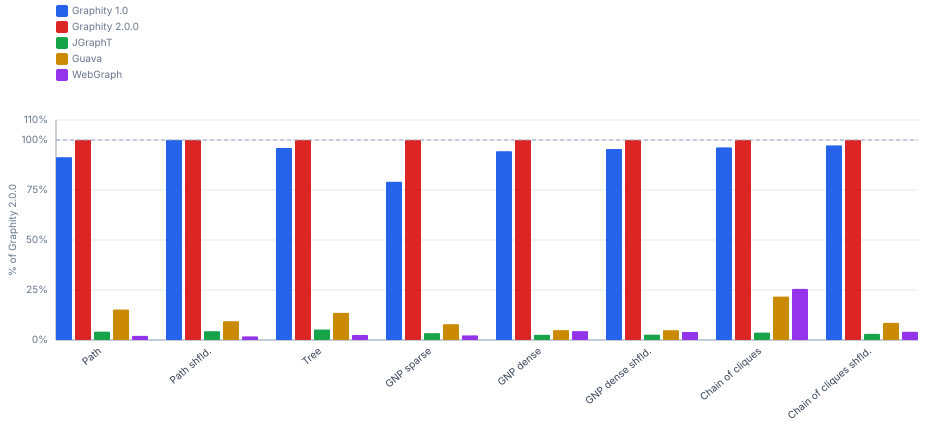

#### Times @ 100k nodes (ms/op, lower is better)

| Shape | Graphity 1.0 | Graphity 2.0.0 | JGraphT | Guava | WebGraph |
|---|---:|---:|---:|---:|---:|
| Path<br><sub>100k nodes, 100k edges</sub> | 0.594 ms (1.0×) | 0.580 ms | 16.04 ms (28×) | 4.077 ms (7.0×) | 17.69 ms (30×) |
| Path shfld.<br><sub>100k nodes, 100k edges</sub> | 0.596 ms (1.0×) | 0.574 ms | 29.95 ms (52×) | 14.17 ms (25×) | 23.26 ms (41×) |
| Tree<br><sub>100k nodes, 100k edges</sub> | 0.936 ms (1.1×) | 0.849 ms | 29.17 ms (34×) | 12.05 ms (14×) | 28.55 ms (34×) |
| GNP sparse<br><sub>100k nodes, 300k edges</sub> | 2.287 ms (1.0×) | 2.198 ms | 96.45 ms (44×) | 55.56 ms (25×) | 74.12 ms (34×) |
| GNP dense<br><sub>100k nodes, 3M edges</sub> | 22.09 ms (1.0×) | 21.33 ms | 1230.4 ms (58×) | 811.9 ms (38×) | 519.3 ms (24×) |
| GNP dense shfld.<br><sub>100k nodes, 3M edges</sub> | 21.90 ms (1.0×) | 21.45 ms | 1304.3 ms (61×) | 836.4 ms (39×) | 493.7 ms (23×) |
| Chain of cliques<br><sub>100k nodes, 3.1M edges</sub> | 23.08 ms (1.0×) | 22.09 ms | 832.2 ms (38×) | 103.6 ms (4.7×) | 67.84 ms (3.1×) |
| Chain of cliques shfld.<br><sub>100k nodes, 3.1M edges</sub> | 23.05 ms (1.0×) | 22.31 ms | 1152.3 ms (52×) | 603.2 ms (27×) | 506.3 ms (23×) |

#### Throughput @ 100k nodes (op/s, higher is better)

| Shape | Graphity 1.0 | Graphity 2.0.0 | JGraphT | Guava | WebGraph |
|---|---:|---:|---:|---:|---:|
| Path<br><sub>100k nodes, 100k edges</sub> | 1 684 op/s (97.6%) | 1 724 op/s | 62.36 op/s (3.6%) | 245.3 op/s (14.2%) | 56.54 op/s (3.3%) |
| Path shfld.<br><sub>100k nodes, 100k edges</sub> | 1 678 op/s (96.3%) | 1 742 op/s | 33.38 op/s (1.9%) | 70.59 op/s (4.1%) | 42.99 op/s (2.5%) |
| Tree<br><sub>100k nodes, 100k edges</sub> | 1 068 op/s (90.7%) | 1 178 op/s | 34.28 op/s (2.9%) | 82.95 op/s (7.0%) | 35.03 op/s (3.0%) |
| GNP sparse<br><sub>100k nodes, 300k edges</sub> | 437.3 op/s (96.1%) | 455.0 op/s | 10.37 op/s (2.3%) | 18.00 op/s (4.0%) | 13.49 op/s (3.0%) |
| GNP dense<br><sub>100k nodes, 3M edges</sub> | 45.26 op/s (96.5%) | 46.89 op/s | 0.813 op/s (1.7%) | 1.232 op/s (2.6%) | 1.926 op/s (4.1%) |
| GNP dense shfld.<br><sub>100k nodes, 3M edges</sub> | 45.66 op/s (97.9%) | 46.63 op/s | 0.767 op/s (1.6%) | 1.196 op/s (2.6%) | 2.026 op/s (4.3%) |
| Chain of cliques<br><sub>100k nodes, 3.1M edges</sub> | 43.33 op/s (95.7%) | 45.27 op/s | 1.202 op/s (2.7%) | 9.653 op/s (21.3%) | 14.74 op/s (32.6%) |
| Chain of cliques shfld.<br><sub>100k nodes, 3.1M edges</sub> | 43.39 op/s (96.8%) | 44.82 op/s | 0.868 op/s (1.9%) | 1.658 op/s (3.7%) | 1.975 op/s (4.4%) |

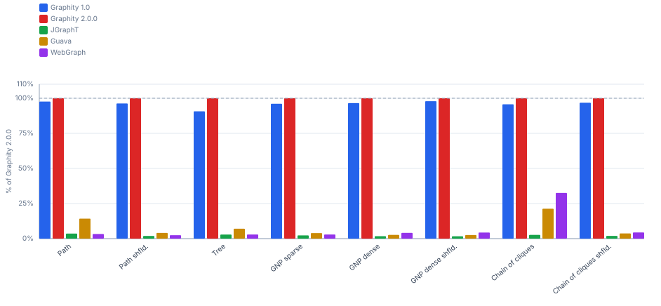

#### Times @ 1M nodes (ms/op, lower is better)

| Shape | Graphity 2.0.0 |
|---|---:|
| GNP sparse<br><sub>1M nodes, 3M edges</sub> | 24.04 ms |
| GNP dense<br><sub>1M nodes, 30M edges</sub> | 187.2 ms |
| GNP dense shfld.<br><sub>1M nodes, 30M edges</sub> | 187.0 ms |
| Chain of cliques<br><sub>1M nodes, 31.1M edges</sub> | 190.1 ms |

#### Throughput @ 1M nodes (op/s, higher is better)

| Shape | Graphity 2.0.0 |
|---|---:|
| GNP sparse<br><sub>1M nodes, 3M edges</sub> | 41.60 op/s |
| GNP dense<br><sub>1M nodes, 30M edges</sub> | 5.342 op/s |
| GNP dense shfld.<br><sub>1M nodes, 30M edges</sub> | 5.348 op/s |
| Chain of cliques<br><sub>1M nodes, 31.1M edges</sub> | 5.260 op/s |


#### Times @ 10M nodes (ms/op, lower is better)

| Shape | Graphity 2.0.0 |
|---|---:|
| GNP sparse<br><sub>10M nodes, 30M edges</sub> | 244.9 ms |
| GNP dense<br><sub>10M nodes, 299.6M edges</sub> | 1961.6 ms |
| GNP dense shfld.<br><sub>10M nodes, 299.6M edges</sub> | 1911.4 ms |
| Chain of cliques<br><sub>10M nodes, 310.8M edges</sub> | 2326.0 ms |

#### Throughput @ 10M nodes (op/s, higher is better)

| Shape | Graphity 2.0.0 |
|---|---:|
| GNP sparse<br><sub>10M nodes, 30M edges</sub> | 4.083 op/s |
| GNP dense<br><sub>10M nodes, 299.6M edges</sub> | 0.510 op/s |
| GNP dense shfld.<br><sub>10M nodes, 299.6M edges</sub> | 0.523 op/s |
| Chain of cliques<br><sub>10M nodes, 310.8M edges</sub> | 0.430 op/s |

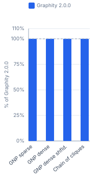

#### Times @ 100M nodes (ms/op, lower is better)

| Shape | Graphity 2.0.0 |
|---|---:|
| GNP sparse<br><sub>100M nodes, 300M edges</sub> | 3128.3 ms |

#### Throughput @ 100M nodes (op/s, higher is better)

| Shape | Graphity 2.0.0 |
|---|---:|
| GNP sparse<br><sub>100M nodes, 300M edges</sub> | 0.320 op/s |


### 1.2 SCC

#### Times @ 10k nodes (ms/op, lower is better)

| Shape | Graphity 1.0 | Graphity 2.0.0 | Graphity 2.0.0<br>(reordered) | JGraphT | Guava | WebGraph |
|---|---:|---:|---:|---:|---:|---:|
| Path<br><sub>10k nodes, 10k edges</sub> | 0.114 ms (1.0×) | 0.114 ms | 0.111 ms (1.0×) | 1.020 ms (8.9×) | 0.788 ms (6.9×) | 0.419 ms (3.7×) |
| Path shfld.<br><sub>10k nodes, 10k edges</sub> | 0.151 ms (1.1×) | 0.139 ms | 0.135 ms (1.0×) | 1.476 ms (11×) | 1.233 ms (8.9×) | 0.473 ms (3.4×) |
| Tree<br><sub>10k nodes, 10k edges</sub> | 0.261 ms (2.5×) | 0.105 ms | 0.077 ms (0.7×) | 1.488 ms (14×) | 1.202 ms (11×) | 0.458 ms (4.4×) |
| GNP sparse<br><sub>10k nodes, 30k edges</sub> | 0.320 ms (1.1×) | 0.294 ms | 0.116 ms (0.4×) | 2.522 ms (8.6×) | 2.322 ms (7.9×) | 0.905 ms (3.1×) |
| GNP dense<br><sub>10k nodes, 299.6k edges</sub> | 0.796 ms (1.7×) | 0.474 ms | 0.274 ms (0.6×) | 12.02 ms (25×) | 16.88 ms (36×) | 2.662 ms (5.6×) |
| GNP dense shfld.<br><sub>10k nodes, 299.6k edges</sub> | 1.020 ms (2.1×) | 0.478 ms | 0.277 ms (0.6×) | 12.77 ms (27×) | 15.97 ms (33×) | 2.820 ms (5.9×) |
| Chain of cliques<br><sub>10k nodes, 310.8k edges</sub> | 0.619 ms (1.9×) | 0.321 ms | 0.321 ms (1.0×) | 6.244 ms (19×) | 5.713 ms (18×) | 4.473 ms (14×) |
| Chain of cliques shfld.<br><sub>10k nodes, 310.8k edges</sub> | 0.659 ms (1.7×) | 0.390 ms | 0.313 ms (0.8×) | 11.02 ms (28×) | 8.435 ms (22×) | 2.339 ms (6.0×) |

#### Throughput @ 10k nodes (op/s, higher is better)

| Shape | Graphity 1.0 | Graphity 2.0.0 | Graphity 2.0.0<br>(reordered) | JGraphT | Guava | WebGraph |
|---|---:|---:|---:|---:|---:|---:|
| Path<br><sub>10k nodes, 10k edges</sub> | 8 772 op/s (100%) | 8 772 op/s | 9 009 op/s (103%) | 980.4 op/s (11.2%) | 1 269 op/s (14.5%) | 2 387 op/s (27.2%) |
| Path shfld.<br><sub>10k nodes, 10k edges</sub> | 6 623 op/s (92.1%) | 7 194 op/s | 7 407 op/s (103%) | 677.5 op/s (9.4%) | 811.0 op/s (11.3%) | 2 114 op/s (29.4%) |
| Tree<br><sub>10k nodes, 10k edges</sub> | 3 831 op/s (40.2%) | 9 524 op/s | 12 987 op/s (136%) | 672.0 op/s (7.1%) | 831.9 op/s (8.7%) | 2 183 op/s (22.9%) |
| GNP sparse<br><sub>10k nodes, 30k edges</sub> | 3 125 op/s (91.9%) | 3 401 op/s | 8 621 op/s (253%) | 396.5 op/s (11.7%) | 430.7 op/s (12.7%) | 1 105 op/s (32.5%) |
| GNP dense<br><sub>10k nodes, 299.6k edges</sub> | 1 256 op/s (59.5%) | 2 110 op/s | 3 650 op/s (173%) | 83.17 op/s (3.9%) | 59.23 op/s (2.8%) | 375.7 op/s (17.8%) |
| GNP dense shfld.<br><sub>10k nodes, 299.6k edges</sub> | 980.4 op/s (46.9%) | 2 092 op/s | 3 610 op/s (173%) | 78.31 op/s (3.7%) | 62.63 op/s (3.0%) | 354.6 op/s (17.0%) |
| Chain of cliques<br><sub>10k nodes, 310.8k edges</sub> | 1 616 op/s (51.9%) | 3 115 op/s | 3 115 op/s (100%) | 160.2 op/s (5.1%) | 175.0 op/s (5.6%) | 223.6 op/s (7.2%) |
| Chain of cliques shfld.<br><sub>10k nodes, 310.8k edges</sub> | 1 517 op/s (59.2%) | 2 564 op/s | 3 195 op/s (125%) | 90.74 op/s (3.5%) | 118.6 op/s (4.6%) | 427.5 op/s (16.7%) |

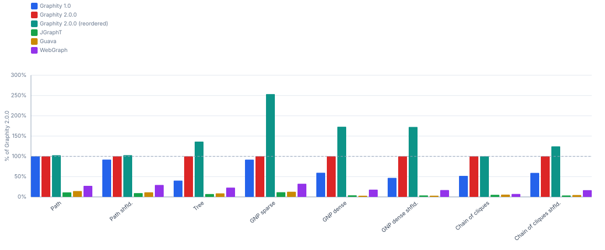

#### Times @ 100k nodes (ms/op, lower is better)

| Shape | Graphity 1.0 | Graphity 2.0.0 | Graphity 2.0.0<br>(reordered) | JGraphT | Guava | WebGraph |
|---|---:|---:|---:|---:|---:|---:|
| Path<br><sub>100k nodes, 100k edges</sub> | 1.190 ms (1.0×) | 1.205 ms | 1.147 ms (1.0×) | 9.835 ms (8.2×) | 9.431 ms (7.8×) | 3.928 ms (3.3×) |
| Path shfld.<br><sub>100k nodes, 100k edges</sub> | 2.018 ms (1.0×) | 1.990 ms | 1.392 ms (0.7×) | 43.66 ms (22×) | 37.88 ms (19×) | 6.434 ms (3.2×) |
| Tree<br><sub>100k nodes, 100k edges</sub> | 13.95 ms (8.2×) | 1.695 ms | 1.198 ms (0.7×) | 38.66 ms (23×) | 35.45 ms (21×) | 7.146 ms (4.2×) |
| GNP sparse<br><sub>100k nodes, 300k edges</sub> | 7.413 ms (1.2×) | 6.243 ms | 1.948 ms (0.3×) | 87.18 ms (14×) | 74.19 ms (12×) | 13.30 ms (2.1×) |
| GNP dense<br><sub>100k nodes, 3M edges</sub> | 11.95 ms (1.3×) | 9.339 ms | 4.404 ms (0.5×) | 288.7 ms (31×) | 389.3 ms (42×) | 45.14 ms (4.8×) |
| GNP dense shfld.<br><sub>100k nodes, 3M edges</sub> | 11.11 ms (1.2×) | 9.355 ms | 4.334 ms (0.5×) | 284.1 ms (30×) | 371.4 ms (40×) | 42.01 ms (4.5×) |
| Chain of cliques<br><sub>100k nodes, 3.1M edges</sub> | 6.169 ms (1.9×) | 3.190 ms | 3.259 ms (1.0×) | 88.45 ms (28×) | 56.06 ms (18×) | 42.98 ms (13×) |
| Chain of cliques shfld.<br><sub>100k nodes, 3.1M edges</sub> | 8.714 ms (1.8×) | 4.941 ms | 3.120 ms (0.6×) | 194.1 ms (39×) | 168.3 ms (34×) | 37.80 ms (7.7×) |

#### Throughput @ 100k nodes (op/s, higher is better)

| Shape | Graphity 1.0 | Graphity 2.0.0 | Graphity 2.0.0<br>(reordered) | JGraphT | Guava | WebGraph |
|---|---:|---:|---:|---:|---:|---:|
| Path<br><sub>100k nodes, 100k edges</sub> | 840.3 op/s (101%) | 829.9 op/s | 871.8 op/s (105%) | 101.7 op/s (12.3%) | 106.0 op/s (12.8%) | 254.6 op/s (30.7%) |
| Path shfld.<br><sub>100k nodes, 100k edges</sub> | 495.5 op/s (98.6%) | 502.5 op/s | 718.4 op/s (143%) | 22.91 op/s (4.6%) | 26.40 op/s (5.3%) | 155.4 op/s (30.9%) |
| Tree<br><sub>100k nodes, 100k edges</sub> | 71.70 op/s (12.2%) | 590.0 op/s | 834.7 op/s (141%) | 25.87 op/s (4.4%) | 28.21 op/s (4.8%) | 139.9 op/s (23.7%) |
| GNP sparse<br><sub>100k nodes, 300k edges</sub> | 134.9 op/s (84.2%) | 160.2 op/s | 513.3 op/s (320%) | 11.47 op/s (7.2%) | 13.48 op/s (8.4%) | 75.18 op/s (46.9%) |
| GNP dense<br><sub>100k nodes, 3M edges</sub> | 83.65 op/s (78.1%) | 107.1 op/s | 227.1 op/s (212%) | 3.464 op/s (3.2%) | 2.569 op/s (2.4%) | 22.15 op/s (20.7%) |
| GNP dense shfld.<br><sub>100k nodes, 3M edges</sub> | 90.01 op/s (84.2%) | 106.9 op/s | 230.7 op/s (216%) | 3.520 op/s (3.3%) | 2.693 op/s (2.5%) | 23.81 op/s (22.3%) |
| Chain of cliques<br><sub>100k nodes, 3.1M edges</sub> | 162.1 op/s (51.7%) | 313.5 op/s | 306.8 op/s (97.9%) | 11.31 op/s (3.6%) | 17.84 op/s (5.7%) | 23.27 op/s (7.4%) |
| Chain of cliques shfld.<br><sub>100k nodes, 3.1M edges</sub> | 114.8 op/s (56.7%) | 202.4 op/s | 320.5 op/s (158%) | 5.152 op/s (2.5%) | 5.942 op/s (2.9%) | 26.45 op/s (13.1%) |

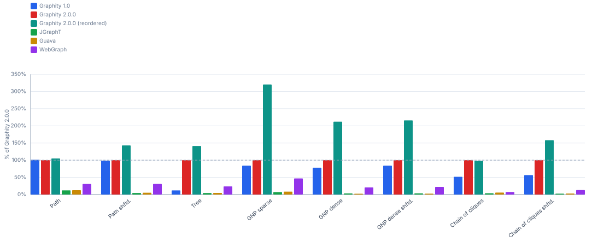

#### Times @ 1M nodes (ms/op, lower is better)

| Shape | Graphity 2.0.0 | Graphity 2.0.0<br>(reordered) |
|---|---:|---:|
| GNP sparse<br><sub>1M nodes, 3M edges</sub> | 118.6 ms | 23.81 ms (0.2×) |
| GNP dense<br><sub>1M nodes, 30M edges</sub> | 241.2 ms | — |
| GNP dense shfld.<br><sub>1M nodes, 30M edges</sub> | 236.7 ms | 49.44 ms (0.2×) |
| Chain of cliques<br><sub>1M nodes, 31.1M edges</sub> | 32.37 ms | — |

#### Throughput @ 1M nodes (op/s, higher is better)

| Shape | Graphity 2.0.0 | Graphity 2.0.0<br>(reordered) |
|---|---:|---:|
| GNP sparse<br><sub>1M nodes, 3M edges</sub> | 8.432 op/s | 41.99 op/s (498%) |
| GNP dense<br><sub>1M nodes, 30M edges</sub> | 4.146 op/s | — |
| GNP dense shfld.<br><sub>1M nodes, 30M edges</sub> | 4.225 op/s | 20.23 op/s (479%) |
| Chain of cliques<br><sub>1M nodes, 31.1M edges</sub> | 30.90 op/s | — |

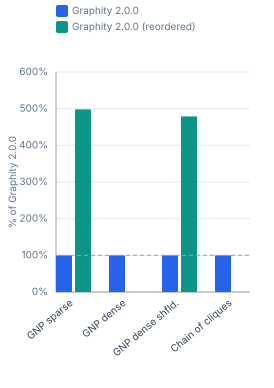

#### Times @ 10M nodes (ms/op, lower is better)

| Shape | Graphity 2.0.0 | Graphity 2.0.0<br>(reordered) |
|---|---:|---:|
| GNP sparse<br><sub>10M nodes, 30M edges</sub> | 2995.7 ms | 451.4 ms (0.2×) |
| GNP dense<br><sub>10M nodes, 299.6M edges</sub> | 4877.3 ms | — |
| GNP dense shfld.<br><sub>10M nodes, 299.6M edges</sub> | 4854.1 ms | 1401.1 ms (0.3×) |
| Chain of cliques<br><sub>10M nodes, 310.8M edges</sub> | 336.0 ms | — |

#### Throughput @ 10M nodes (op/s, higher is better)

| Shape | Graphity 2.0.0 | Graphity 2.0.0<br>(reordered) |
|---|---:|---:|
| GNP sparse<br><sub>10M nodes, 30M edges</sub> | 0.334 op/s | 2.215 op/s (664%) |
| GNP dense<br><sub>10M nodes, 299.6M edges</sub> | 0.205 op/s | — |
| GNP dense shfld.<br><sub>10M nodes, 299.6M edges</sub> | 0.206 op/s | 0.714 op/s (346%) |
| Chain of cliques<br><sub>10M nodes, 310.8M edges</sub> | 2.976 op/s | — |

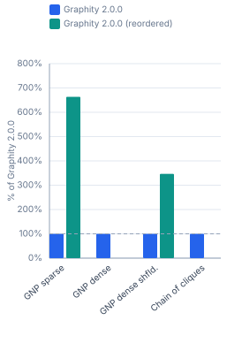

#### Times @ 100M nodes (ms/op, lower is better)

| Shape | Graphity 2.0.0 | Graphity 2.0.0<br>(reordered) |
|---|---:|---:|
| GNP sparse<br><sub>100M nodes, 300M edges</sub> | 34666 ms | 6774.6 ms (0.2×) |

#### Throughput @ 100M nodes (op/s, higher is better)

| Shape | Graphity 2.0.0 | Graphity 2.0.0<br>(reordered) |
|---|---:|---:|
| GNP sparse<br><sub>100M nodes, 300M edges</sub> | 0.029 op/s | 0.148 op/s (512%) |

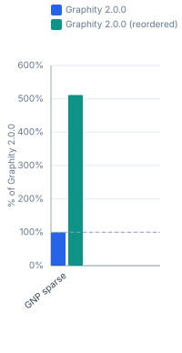

### 1.3 WCC

#### Times @ 10k nodes (ms/op, lower is better)

| Shape | Graphity 1.0 | Graphity 2.0.0 | Graphity 2.0.0<br>(reordered) |
|---|---:|---:|---:|
| Path<br><sub>10k nodes, 10k edges</sub> | 0.047 ms (1.0×) | 0.047 ms | 0.047 ms (1.0×) |
| Path shfld.<br><sub>10k nodes, 10k edges</sub> | 0.071 ms (1.2×) | 0.057 ms | 0.049 ms (0.9×) |
| Tree<br><sub>10k nodes, 10k edges</sub> | 0.051 ms (1.0×) | 0.053 ms | 0.053 ms (1.0×) |
| GNP sparse<br><sub>10k nodes, 30k edges</sub> | 0.129 ms (1.1×) | 0.113 ms | 0.106 ms (0.9×) |
| GNP dense<br><sub>10k nodes, 299.6k edges</sub> | 0.557 ms (1.0×) | 0.558 ms | 0.548 ms (1.0×) |
| GNP dense shfld.<br><sub>10k nodes, 299.6k edges</sub> | 0.560 ms (1.1×) | 0.492 ms | 0.593 ms (1.2×) |
| Chain of cliques<br><sub>10k nodes, 310.8k edges</sub> | 0.495 ms (1.0×) | 0.479 ms | 0.546 ms (1.1×) |
| Chain of cliques shfld.<br><sub>10k nodes, 310.8k edges</sub> | 0.687 ms (1.0×) | 0.660 ms | 0.478 ms (0.7×) |

#### Throughput @ 10k nodes (op/s, higher is better)

| Shape | Graphity 1.0 | Graphity 2.0.0 | Graphity 2.0.0<br>(reordered) |
|---|---:|---:|---:|
| Path<br><sub>10k nodes, 10k edges</sub> | 21 277 op/s (100%) | 21 277 op/s | 21 277 op/s (100%) |
| Path shfld.<br><sub>10k nodes, 10k edges</sub> | 14 085 op/s (80.3%) | 17 544 op/s | 20 408 op/s (116%) |
| Tree<br><sub>10k nodes, 10k edges</sub> | 19 608 op/s (104%) | 18 868 op/s | 18 868 op/s (100%) |
| GNP sparse<br><sub>10k nodes, 30k edges</sub> | 7 752 op/s (87.6%) | 8 850 op/s | 9 434 op/s (107%) |
| GNP dense<br><sub>10k nodes, 299.6k edges</sub> | 1 795 op/s (100%) | 1 792 op/s | 1 825 op/s (102%) |
| GNP dense shfld.<br><sub>10k nodes, 299.6k edges</sub> | 1 786 op/s (87.9%) | 2 033 op/s | 1 686 op/s (83.0%) |
| Chain of cliques<br><sub>10k nodes, 310.8k edges</sub> | 2 020 op/s (96.8%) | 2 088 op/s | 1 832 op/s (87.7%) |
| Chain of cliques shfld.<br><sub>10k nodes, 310.8k edges</sub> | 1 456 op/s (96.1%) | 1 515 op/s | 2 092 op/s (138%) |

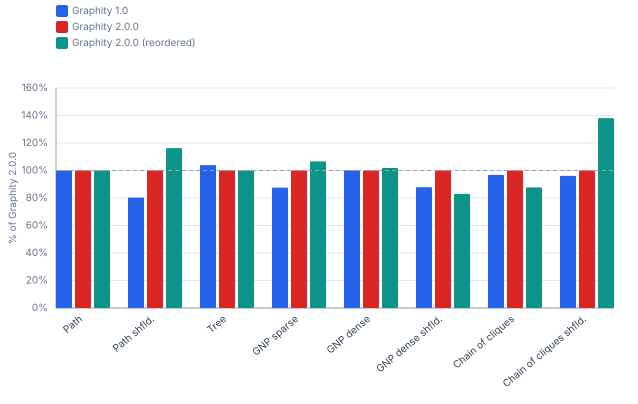

#### Times @ 100k nodes (ms/op, lower is better)

| Shape | Graphity 1.0 | Graphity 2.0.0 | Graphity 2.0.0<br>(reordered) |
|---|---:|---:|---:|
| Path<br><sub>100k nodes, 100k edges</sub> | 0.502 ms (0.9×) | 0.543 ms | 0.500 ms (0.9×) |
| Path shfld.<br><sub>100k nodes, 100k edges</sub> | 1.072 ms (1.0×) | 1.076 ms | 0.515 ms (0.5×) |
| Tree<br><sub>100k nodes, 100k edges</sub> | 0.643 ms (1.0×) | 0.613 ms | 0.602 ms (1.0×) |
| GNP sparse<br><sub>100k nodes, 300k edges</sub> | 1.838 ms (1.0×) | 1.813 ms | 1.334 ms (0.7×) |
| GNP dense<br><sub>100k nodes, 3M edges</sub> | 6.023 ms (1.0×) | 5.795 ms | 5.668 ms (1.0×) |
| GNP dense shfld.<br><sub>100k nodes, 3M edges</sub> | 5.889 ms (0.9×) | 6.612 ms | 6.608 ms (1.0×) |
| Chain of cliques<br><sub>100k nodes, 3.1M edges</sub> | 5.643 ms (1.0×) | 5.448 ms | 5.533 ms (1.0×) |
| Chain of cliques shfld.<br><sub>100k nodes, 3.1M edges</sub> | 7.330 ms (1.0×) | 7.335 ms | 4.756 ms (0.6×) |

#### Throughput @ 100k nodes (op/s, higher is better)

| Shape | Graphity 1.0 | Graphity 2.0.0 | Graphity 2.0.0<br>(reordered) |
|---|---:|---:|---:|
| Path<br><sub>100k nodes, 100k edges</sub> | 1 992 op/s (108%) | 1 842 op/s | 2 000 op/s (109%) |
| Path shfld.<br><sub>100k nodes, 100k edges</sub> | 932.8 op/s (100%) | 929.4 op/s | 1 942 op/s (209%) |
| Tree<br><sub>100k nodes, 100k edges</sub> | 1 555 op/s (95.3%) | 1 631 op/s | 1 661 op/s (102%) |
| GNP sparse<br><sub>100k nodes, 300k edges</sub> | 544.1 op/s (98.6%) | 551.6 op/s | 749.6 op/s (136%) |
| GNP dense<br><sub>100k nodes, 3M edges</sub> | 166.0 op/s (96.2%) | 172.6 op/s | 176.4 op/s (102%) |
| GNP dense shfld.<br><sub>100k nodes, 3M edges</sub> | 169.8 op/s (112%) | 151.2 op/s | 151.3 op/s (100%) |
| Chain of cliques<br><sub>100k nodes, 3.1M edges</sub> | 177.2 op/s (96.5%) | 183.6 op/s | 180.7 op/s (98.5%) |
| Chain of cliques shfld.<br><sub>100k nodes, 3.1M edges</sub> | 136.4 op/s (100%) | 136.3 op/s | 210.3 op/s (154%) |

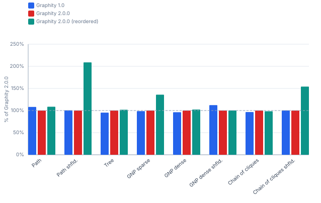

#### Times @ 1M nodes (ms/op, lower is better)

| Shape | Graphity 2.0.0 | Graphity 2.0.0<br>(reordered) |
|---|---:|---:|
| GNP sparse<br><sub>1M nodes, 3M edges</sub> | 21.82 ms | 16.33 ms (0.7×) |
| GNP dense<br><sub>1M nodes, 30M edges</sub> | 64.34 ms | — |
| GNP dense shfld.<br><sub>1M nodes, 30M edges</sub> | 64.85 ms | 61.79 ms (1.0×) |
| Chain of cliques<br><sub>1M nodes, 31.1M edges</sub> | 46.14 ms | — |

#### Throughput @ 1M nodes (op/s, higher is better)

| Shape | Graphity 2.0.0 | Graphity 2.0.0<br>(reordered) |
|---|---:|---:|
| GNP sparse<br><sub>1M nodes, 3M edges</sub> | 45.83 op/s | 61.24 op/s (134%) |
| GNP dense<br><sub>1M nodes, 30M edges</sub> | 15.54 op/s | — |
| GNP dense shfld.<br><sub>1M nodes, 30M edges</sub> | 15.42 op/s | 16.18 op/s (105%) |
| Chain of cliques<br><sub>1M nodes, 31.1M edges</sub> | 21.67 op/s | — |

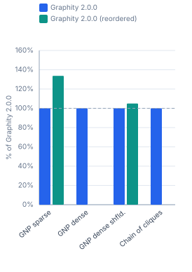

#### Times @ 10M nodes (ms/op, lower is better)

| Shape | Graphity 2.0.0 | Graphity 2.0.0<br>(reordered) |
|---|---:|---:|
| GNP sparse<br><sub>10M nodes, 30M edges</sub> | 460.9 ms | 320.9 ms (0.7×) |
| GNP dense<br><sub>10M nodes, 299.6M edges</sub> | 2850.6 ms | — |
| GNP dense shfld.<br><sub>10M nodes, 299.6M edges</sub> | 2652.5 ms | 2673.6 ms (1.0×) |
| Chain of cliques<br><sub>10M nodes, 310.8M edges</sub> | 468.6 ms | — |

#### Throughput @ 10M nodes (op/s, higher is better)

| Shape | Graphity 2.0.0 | Graphity 2.0.0<br>(reordered) |
|---|---:|---:|
| GNP sparse<br><sub>10M nodes, 30M edges</sub> | 2.170 op/s | 3.116 op/s (144%) |
| GNP dense<br><sub>10M nodes, 299.6M edges</sub> | 0.351 op/s | — |
| GNP dense shfld.<br><sub>10M nodes, 299.6M edges</sub> | 0.377 op/s | 0.374 op/s (99.2%) |
| Chain of cliques<br><sub>10M nodes, 310.8M edges</sub> | 2.134 op/s | — |

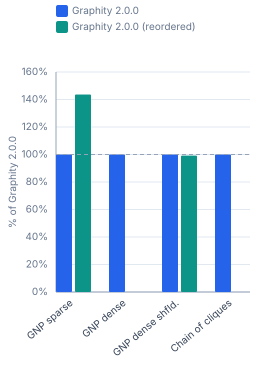

#### Times @ 100M nodes (ms/op, lower is better)

| Shape | Graphity 2.0.0 | Graphity 2.0.0<br>(reordered) |
|---|---:|---:|
| GNP sparse<br><sub>100M nodes, 300M edges</sub> | 6242.1 ms | 4529.3 ms (0.7×) |

#### Throughput @ 100M nodes (op/s, higher is better)

| Shape | Graphity 2.0.0 | Graphity 2.0.0<br>(reordered) |
|---|---:|---:|
| GNP sparse<br><sub>100M nodes, 300M edges</sub> | 0.160 op/s | 0.221 op/s (138%) |

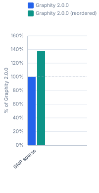

### 1.4 CCs

#### Times @ 10k nodes (ms/op, lower is better)

| Shape | Graphity 1.0 | Graphity 2.0.0 | Graphity 2.0.0<br>(reordered) |
|---|---:|---:|---:|
| Path<br><sub>10k nodes, 10k edges</sub> | 0.050 ms (1.0×) | 0.050 ms | 0.054 ms (1.1×) |
| Path shfld.<br><sub>10k nodes, 10k edges</sub> | 0.055 ms (1.0×) | 0.056 ms | 0.049 ms (0.9×) |
| Tree<br><sub>10k nodes, 10k edges</sub> | 0.052 ms (1.0×) | 0.054 ms | 0.054 ms (1.0×) |
| GNP sparse<br><sub>10k nodes, 30k edges</sub> | 0.116 ms (1.0×) | 0.113 ms | 0.107 ms (0.9×) |
| GNP dense<br><sub>10k nodes, 299.6k edges</sub> | 0.559 ms (1.0×) | 0.559 ms | 0.553 ms (1.0×) |
| GNP dense shfld.<br><sub>10k nodes, 299.6k edges</sub> | 0.559 ms (1.0×) | 0.551 ms | 0.548 ms (1.0×) |
| Chain of cliques<br><sub>10k nodes, 310.8k edges</sub> | 0.550 ms (1.1×) | 0.484 ms | 0.547 ms (1.1×) |
| Chain of cliques shfld.<br><sub>10k nodes, 310.8k edges</sub> | 0.676 ms (1.0×) | 0.645 ms | 0.472 ms (0.7×) |

#### Throughput @ 10k nodes (op/s, higher is better)

| Shape | Graphity 1.0 | Graphity 2.0.0 | Graphity 2.0.0<br>(reordered) |
|---|---:|---:|---:|
| Path<br><sub>10k nodes, 10k edges</sub> | 20 000 op/s (100%) | 20 000 op/s | 18 519 op/s (92.6%) |
| Path shfld.<br><sub>10k nodes, 10k edges</sub> | 18 182 op/s (102%) | 17 857 op/s | 20 408 op/s (114%) |
| Tree<br><sub>10k nodes, 10k edges</sub> | 19 231 op/s (104%) | 18 519 op/s | 18 519 op/s (100%) |
| GNP sparse<br><sub>10k nodes, 30k edges</sub> | 8 621 op/s (97.4%) | 8 850 op/s | 9 346 op/s (106%) |
| GNP dense<br><sub>10k nodes, 299.6k edges</sub> | 1 789 op/s (100%) | 1 789 op/s | 1 808 op/s (101%) |
| GNP dense shfld.<br><sub>10k nodes, 299.6k edges</sub> | 1 789 op/s (98.6%) | 1 815 op/s | 1 825 op/s (101%) |
| Chain of cliques<br><sub>10k nodes, 310.8k edges</sub> | 1 818 op/s (88.0%) | 2 066 op/s | 1 828 op/s (88.5%) |
| Chain of cliques shfld.<br><sub>10k nodes, 310.8k edges</sub> | 1 479 op/s (95.4%) | 1 550 op/s | 2 119 op/s (137%) |

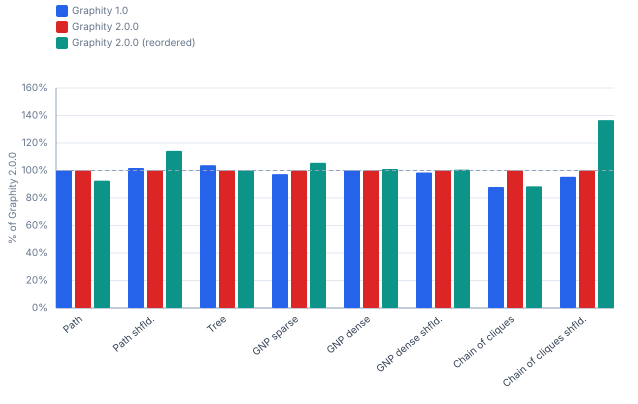

#### Times @ 100k nodes (ms/op, lower is better)

| Shape | Graphity 1.0 | Graphity 2.0.0 | Graphity 2.0.0<br>(reordered) |
|---|---:|---:|---:|
| Path<br><sub>100k nodes, 100k edges</sub> | 0.544 ms (1.1×) | 0.490 ms | 0.499 ms (1.0×) |
| Path shfld.<br><sub>100k nodes, 100k edges</sub> | 1.082 ms (1.0×) | 1.064 ms | 0.555 ms (0.5×) |
| Tree<br><sub>100k nodes, 100k edges</sub> | 0.562 ms (0.9×) | 0.613 ms | 0.638 ms (1.0×) |
| GNP sparse<br><sub>100k nodes, 300k edges</sub> | 1.796 ms (1.0×) | 1.816 ms | 1.322 ms (0.7×) |
| GNP dense<br><sub>100k nodes, 3M edges</sub> | 5.835 ms (0.9×) | 6.633 ms | 5.725 ms (0.9×) |
| GNP dense shfld.<br><sub>100k nodes, 3M edges</sub> | 6.659 ms (1.0×) | 6.621 ms | 6.658 ms (1.0×) |
| Chain of cliques<br><sub>100k nodes, 3.1M edges</sub> | 5.440 ms (1.2×) | 4.722 ms | 5.579 ms (1.2×) |
| Chain of cliques shfld.<br><sub>100k nodes, 3.1M edges</sub> | 7.274 ms (1.0×) | 7.040 ms | 4.759 ms (0.7×) |

#### Throughput @ 100k nodes (op/s, higher is better)

| Shape | Graphity 1.0 | Graphity 2.0.0 | Graphity 2.0.0<br>(reordered) |
|---|---:|---:|---:|
| Path<br><sub>100k nodes, 100k edges</sub> | 1 838 op/s (90.1%) | 2 041 op/s | 2 004 op/s (98.2%) |
| Path shfld.<br><sub>100k nodes, 100k edges</sub> | 924.2 op/s (98.3%) | 939.8 op/s | 1 802 op/s (192%) |
| Tree<br><sub>100k nodes, 100k edges</sub> | 1 779 op/s (109%) | 1 631 op/s | 1 567 op/s (96.1%) |
| GNP sparse<br><sub>100k nodes, 300k edges</sub> | 556.8 op/s (101%) | 550.7 op/s | 756.4 op/s (137%) |
| GNP dense<br><sub>100k nodes, 3M edges</sub> | 171.4 op/s (114%) | 150.8 op/s | 174.7 op/s (116%) |
| GNP dense shfld.<br><sub>100k nodes, 3M edges</sub> | 150.2 op/s (99.4%) | 151.0 op/s | 150.2 op/s (99.4%) |
| Chain of cliques<br><sub>100k nodes, 3.1M edges</sub> | 183.8 op/s (86.8%) | 211.8 op/s | 179.2 op/s (84.6%) |
| Chain of cliques shfld.<br><sub>100k nodes, 3.1M edges</sub> | 137.5 op/s (96.8%) | 142.0 op/s | 210.1 op/s (148%) |

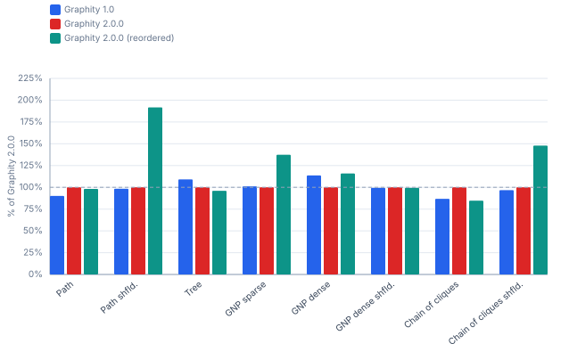

#### Times @ 1M nodes (ms/op, lower is better)

| Shape | Graphity 2.0.0 | Graphity 2.0.0<br>(reordered) |
|---|---:|---:|
| GNP sparse<br><sub>1M nodes, 3M edges</sub> | 21.82 ms | 16.28 ms (0.7×) |
| GNP dense<br><sub>1M nodes, 30M edges</sub> | 64.77 ms | — |
| GNP dense shfld.<br><sub>1M nodes, 30M edges</sub> | 65.24 ms | 61.57 ms (0.9×) |
| Chain of cliques<br><sub>1M nodes, 31.1M edges</sub> | 46.38 ms | — |

#### Throughput @ 1M nodes (op/s, higher is better)

| Shape | Graphity 2.0.0 | Graphity 2.0.0<br>(reordered) |
|---|---:|---:|
| GNP sparse<br><sub>1M nodes, 3M edges</sub> | 45.84 op/s | 61.41 op/s (134%) |
| GNP dense<br><sub>1M nodes, 30M edges</sub> | 15.44 op/s | — |
| GNP dense shfld.<br><sub>1M nodes, 30M edges</sub> | 15.33 op/s | 16.24 op/s (106%) |
| Chain of cliques<br><sub>1M nodes, 31.1M edges</sub> | 21.56 op/s | — |

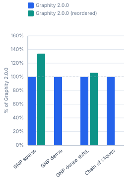

#### Times @ 10M nodes (ms/op, lower is better)

| Shape | Graphity 2.0.0 | Graphity 2.0.0<br>(reordered) |
|---|---:|---:|
| GNP sparse<br><sub>10M nodes, 30M edges</sub> | 459.0 ms | 322.0 ms (0.7×) |
| GNP dense<br><sub>10M nodes, 299.6M edges</sub> | 2860.0 ms | — |
| GNP dense shfld.<br><sub>10M nodes, 299.6M edges</sub> | 2939.3 ms | 2692.8 ms (0.9×) |
| Chain of cliques<br><sub>10M nodes, 310.8M edges</sub> | 477.6 ms | — |

#### Throughput @ 10M nodes (op/s, higher is better)

| Shape | Graphity 2.0.0 | Graphity 2.0.0<br>(reordered) |
|---|---:|---:|
| GNP sparse<br><sub>10M nodes, 30M edges</sub> | 2.179 op/s | 3.106 op/s (143%) |
| GNP dense<br><sub>10M nodes, 299.6M edges</sub> | 0.350 op/s | — |
| GNP dense shfld.<br><sub>10M nodes, 299.6M edges</sub> | 0.340 op/s | 0.371 op/s (109%) |
| Chain of cliques<br><sub>10M nodes, 310.8M edges</sub> | 2.094 op/s | — |

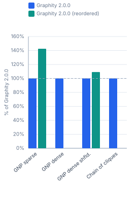

#### Times @ 100M nodes (ms/op, lower is better)

| Shape | Graphity 2.0.0 | Graphity 2.0.0<br>(reordered) |
|---|---:|---:|
| GNP sparse<br><sub>100M nodes, 300M edges</sub> | 6275.3 ms | 4278.9 ms (0.7×) |

#### Throughput @ 100M nodes (op/s, higher is better)

| Shape | Graphity 2.0.0 | Graphity 2.0.0<br>(reordered) |
|---|---:|---:|
| GNP sparse<br><sub>100M nodes, 300M edges</sub> | 0.159 op/s | 0.234 op/s (147%) |

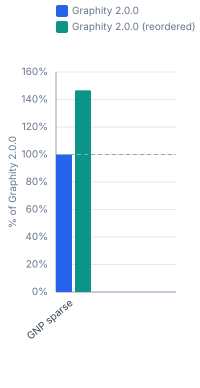

### 1.5 TopOrder

#### Times @ 10k nodes (ms/op, lower is better)

| Shape | Graphity 1.0 | Graphity 2.0.0 | Graphity 2.0.0<br>(reordered) | JGraphT | Guava | WebGraph |
|---|---:|---:|---:|---:|---:|---:|
| Path<br><sub>10k nodes, 10k edges</sub> | 0.089 ms (1.0×) | 0.092 ms | 0.089 ms (1.0×) | 0.489 ms (5.3×) | 0.526 ms (5.7×) | 0.579 ms (6.3×) |
| Path shfld.<br><sub>10k nodes, 10k edges</sub> | 0.102 ms (1.0×) | 0.105 ms | 0.106 ms (1.0×) | 0.788 ms (7.5×) | 0.804 ms (7.7×) | 0.440 ms (4.2×) |
| Tree<br><sub>10k nodes, 10k edges</sub> | 0.215 ms (5.1×) | 0.042 ms | 0.044 ms (1.0×) | 0.725 ms (17×) | 0.779 ms (19×) | 0.574 ms (14×) |
| Tree shfld. | 0.090 ms (1.6×) | 0.055 ms | 0.053 ms (1.0×) | 0.749 ms (14×) | 0.770 ms (14×) | 0.392 ms (7.1×) |
| DAG GNP sparse | 0.216 ms (3.4×) | 0.064 ms | 0.060 ms (0.9×) | 1.365 ms (21×) | 1.367 ms (21×) | 0.768 ms (12×) |
| DAG GNP dense | 0.408 ms (1.6×) | 0.258 ms | 0.250 ms (1.0×) | 7.300 ms (28×) | 11.05 ms (43×) | 2.410 ms (9.3×) |
| DAG GNP dense shfld. | 0.473 ms (1.9×) | 0.254 ms | 0.221 ms (0.9×) | 9.742 ms (38×) | 12.78 ms (50×) | 2.738 ms (11×) |

#### Throughput @ 10k nodes (op/s, higher is better)

| Shape | Graphity 1.0 | Graphity 2.0.0 | Graphity 2.0.0<br>(reordered) | JGraphT | Guava | WebGraph |
|---|---:|---:|---:|---:|---:|---:|
| Path<br><sub>10k nodes, 10k edges</sub> | 11 236 op/s (103%) | 10 870 op/s | 11 236 op/s (103%) | 2 045 op/s (18.8%) | 1 901 op/s (17.5%) | 1 727 op/s (15.9%) |
| Path shfld.<br><sub>10k nodes, 10k edges</sub> | 9 804 op/s (103%) | 9 524 op/s | 9 434 op/s (99.1%) | 1 269 op/s (13.3%) | 1 244 op/s (13.1%) | 2 273 op/s (23.9%) |
| Tree<br><sub>10k nodes, 10k edges</sub> | 4 651 op/s (19.5%) | 23 810 op/s | 22 727 op/s (95.5%) | 1 379 op/s (5.8%) | 1 284 op/s (5.4%) | 1 742 op/s (7.3%) |
| Tree shfld. | 11 111 op/s (61.1%) | 18 182 op/s | 18 868 op/s (104%) | 1 335 op/s (7.3%) | 1 299 op/s (7.1%) | 2 551 op/s (14.0%) |
| DAG GNP sparse | 4 630 op/s (29.6%) | 15 625 op/s | 16 667 op/s (107%) | 732.6 op/s (4.7%) | 731.5 op/s (4.7%) | 1 302 op/s (8.3%) |
| DAG GNP dense | 2 451 op/s (63.2%) | 3 876 op/s | 4 000 op/s (103%) | 137.0 op/s (3.5%) | 90.52 op/s (2.3%) | 414.9 op/s (10.7%) |
| DAG GNP dense shfld. | 2 114 op/s (53.7%) | 3 937 op/s | 4 525 op/s (115%) | 102.6 op/s (2.6%) | 78.24 op/s (2.0%) | 365.2 op/s (9.3%) |

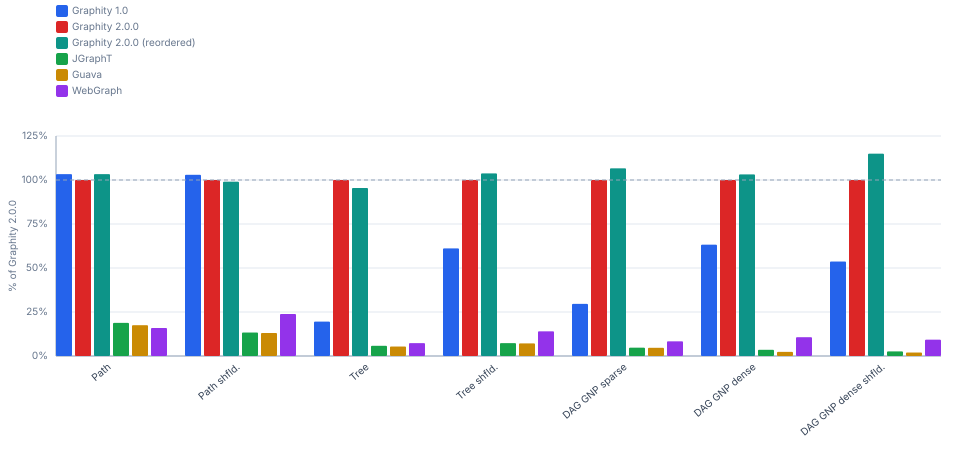

#### Times @ 100k nodes (ms/op, lower is better)

| Shape | Graphity 1.0 | Graphity 2.0.0 | Graphity 2.0.0<br>(reordered) | JGraphT | Guava | WebGraph |
|---|---:|---:|---:|---:|---:|---:|
| Path<br><sub>100k nodes, 100k edges</sub> | 0.909 ms (1.0×) | 0.877 ms | 0.678 ms (0.8×) | 5.294 ms (6.0×) | 6.399 ms (7.3×) | 3.436 ms (3.9×) |
| Path shfld.<br><sub>100k nodes, 100k edges</sub> | 1.545 ms (1.0×) | 1.494 ms | 1.045 ms (0.7×) | 26.46 ms (18×) | 24.35 ms (16×) | 5.545 ms (3.7×) |
| Tree<br><sub>100k nodes, 100k edges</sub> | 12.33 ms (14×) | 0.898 ms | 0.792 ms (0.9×) | 22.48 ms (25×) | 21.09 ms (23×) | 18.27 ms (20×) |
| Tree shfld. | 5.887 ms (5.5×) | 1.074 ms | 0.829 ms (0.8×) | 23.06 ms (21×) | 19.44 ms (18×) | 11.86 ms (11×) |
| DAG GNP sparse | 11.14 ms (6.0×) | 1.862 ms | 1.375 ms (0.7×) | 47.30 ms (25×) | 40.50 ms (22×) | 19.73 ms (11×) |
| DAG GNP dense | 6.691 ms (1.8×) | 3.642 ms | 2.632 ms (0.7×) | 177.5 ms (49×) | 195.9 ms (54×) | 29.38 ms (8.1×) |
| DAG GNP dense shfld. | 8.588 ms (2.2×) | 3.993 ms | 2.657 ms (0.7×) | 205.7 ms (52×) | 223.1 ms (56×) | 36.73 ms (9.2×) |

#### Throughput @ 100k nodes (op/s, higher is better)

| Shape | Graphity 1.0 | Graphity 2.0.0 | Graphity 2.0.0<br>(reordered) | JGraphT | Guava | WebGraph |
|---|---:|---:|---:|---:|---:|---:|
| Path<br><sub>100k nodes, 100k edges</sub> | 1 100 op/s (96.5%) | 1 140 op/s | 1 475 op/s (129%) | 188.9 op/s (16.6%) | 156.3 op/s (13.7%) | 291.0 op/s (25.5%) |
| Path shfld.<br><sub>100k nodes, 100k edges</sub> | 647.2 op/s (96.7%) | 669.3 op/s | 956.9 op/s (143%) | 37.79 op/s (5.6%) | 41.07 op/s (6.1%) | 180.3 op/s (26.9%) |
| Tree<br><sub>100k nodes, 100k edges</sub> | 81.11 op/s (7.3%) | 1 114 op/s | 1 263 op/s (113%) | 44.47 op/s (4.0%) | 47.42 op/s (4.3%) | 54.75 op/s (4.9%) |
| Tree shfld. | 169.9 op/s (18.2%) | 931.1 op/s | 1 206 op/s (130%) | 43.37 op/s (4.7%) | 51.45 op/s (5.5%) | 84.34 op/s (9.1%) |
| DAG GNP sparse | 89.77 op/s (16.7%) | 537.1 op/s | 727.3 op/s (135%) | 21.14 op/s (3.9%) | 24.69 op/s (4.6%) | 50.69 op/s (9.4%) |
| DAG GNP dense | 149.5 op/s (54.4%) | 274.6 op/s | 379.9 op/s (138%) | 5.634 op/s (2.1%) | 5.105 op/s (1.9%) | 34.04 op/s (12.4%) |
| DAG GNP dense shfld. | 116.4 op/s (46.5%) | 250.4 op/s | 376.4 op/s (150%) | 4.861 op/s (1.9%) | 4.482 op/s (1.8%) | 27.23 op/s (10.9%) |

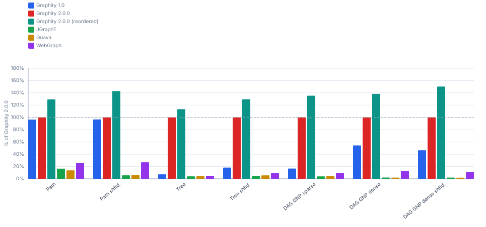

#### Times @ 1M nodes (ms/op, lower is better)

| Shape | Graphity 2.0.0 | Graphity 2.0.0<br>(reordered) |
|---|---:|---:|
| DAG GNP sparse | 28.87 ms | 14.53 ms (0.5×) |
| DAG GNP dense | 79.93 ms | — |
| DAG GNP dense shfld. | 123.6 ms | 29.90 ms (0.2×) |

#### Throughput @ 1M nodes (op/s, higher is better)

| Shape | Graphity 2.0.0 | Graphity 2.0.0<br>(reordered) |
|---|---:|---:|
| DAG GNP sparse | 34.64 op/s | 68.81 op/s (199%) |
| DAG GNP dense | 12.51 op/s | — |
| DAG GNP dense shfld. | 8.091 op/s | 33.44 op/s (413%) |

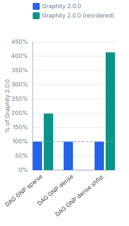

#### Times @ 10M nodes (ms/op, lower is better)

| Shape | Graphity 2.0.0 | Graphity 2.0.0<br>(reordered) |
|---|---:|---:|
| DAG GNP sparse | 871.4 ms | 151.5 ms (0.2×) |
| DAG GNP dense | 1394.1 ms | — |
| DAG GNP dense shfld. | 2111.1 ms | 328.4 ms (0.2×) |

#### Throughput @ 10M nodes (op/s, higher is better)

| Shape | Graphity 2.0.0 | Graphity 2.0.0<br>(reordered) |
|---|---:|---:|
| DAG GNP sparse | 1.148 op/s | 6.601 op/s (575%) |
| DAG GNP dense | 0.717 op/s | — |
| DAG GNP dense shfld. | 0.474 op/s | 3.045 op/s (643%) |

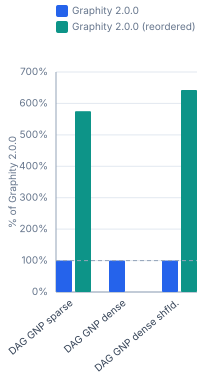

#### Times @ 100M nodes (ms/op, lower is better)

| Shape | Graphity 2.0.0 | Graphity 2.0.0<br>(reordered) |
|---|---:|---:|
| DAG GNP sparse | 11911 ms | 1775.0 ms (0.1×) |

#### Throughput @ 100M nodes (op/s, higher is better)

| Shape | Graphity 2.0.0 | Graphity 2.0.0<br>(reordered) |
|---|---:|---:|
| DAG GNP sparse | 0.084 op/s | 0.563 op/s (671%) |

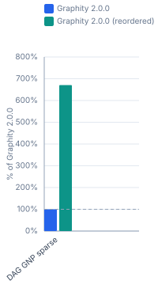

### 1.6 TopOrderAndLevels

#### Times @ 10k nodes (ms/op, lower is better)

| Shape | Graphity 1.0 | Graphity 2.0.0 | Graphity 2.0.0<br>(reordered) |
|---|---:|---:|---:|
| Path<br><sub>10k nodes, 10k edges</sub> | 0.033 ms (1.0×) | 0.032 ms | 0.033 ms (1.0×) |
| Path shfld.<br><sub>10k nodes, 10k edges</sub> | 0.047 ms (1.0×) | 0.048 ms | 0.038 ms (0.8×) |
| Tree<br><sub>10k nodes, 10k edges</sub> | 0.025 ms (1.0×) | 0.025 ms | 0.024 ms (1.0×) |
| Tree shfld. | 0.025 ms (1.1×) | 0.023 ms | 0.022 ms (1.0×) |
| DAG GNP sparse | 0.049 ms (0.9×) | 0.057 ms | 0.054 ms (0.9×) |
| DAG GNP dense | 0.236 ms (1.0×) | 0.236 ms | 0.220 ms (0.9×) |
| DAG GNP dense shfld. | 0.236 ms (0.7×) | 0.321 ms | 0.230 ms (0.7×) |

#### Throughput @ 10k nodes (op/s, higher is better)

| Shape | Graphity 1.0 | Graphity 2.0.0 | Graphity 2.0.0<br>(reordered) |
|---|---:|---:|---:|
| Path<br><sub>10k nodes, 10k edges</sub> | 30 303 op/s (97.0%) | 31 250 op/s | 30 303 op/s (97.0%) |
| Path shfld.<br><sub>10k nodes, 10k edges</sub> | 21 277 op/s (102%) | 20 833 op/s | 26 316 op/s (126%) |
| Tree<br><sub>10k nodes, 10k edges</sub> | 40 000 op/s (100%) | 40 000 op/s | 41 667 op/s (104%) |
| Tree shfld. | 40 000 op/s (92.0%) | 43 478 op/s | 45 455 op/s (105%) |
| DAG GNP sparse | 20 408 op/s (116%) | 17 544 op/s | 18 519 op/s (106%) |
| DAG GNP dense | 4 237 op/s (100%) | 4 237 op/s | 4 545 op/s (107%) |
| DAG GNP dense shfld. | 4 237 op/s (136%) | 3 115 op/s | 4 348 op/s (140%) |

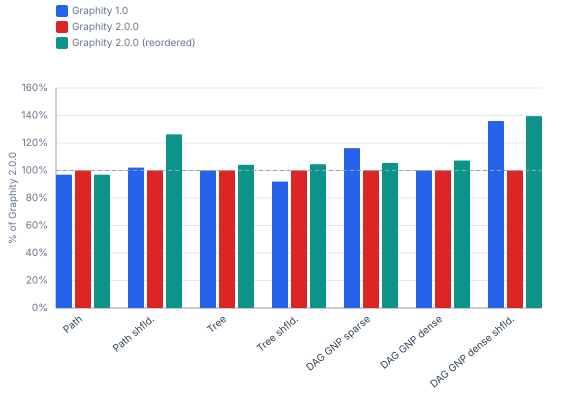

#### Times @ 100k nodes (ms/op, lower is better)

| Shape | Graphity 1.0 | Graphity 2.0.0 | Graphity 2.0.0<br>(reordered) |
|---|---:|---:|---:|
| Path<br><sub>100k nodes, 100k edges</sub> | 0.366 ms (1.0×) | 0.372 ms | 0.379 ms (1.0×) |
| Path shfld.<br><sub>100k nodes, 100k edges</sub> | 1.100 ms (1.0×) | 1.074 ms | 0.456 ms (0.4×) |
| Tree<br><sub>100k nodes, 100k edges</sub> | 0.741 ms (1.6×) | 0.463 ms | 0.375 ms (0.8×) |
| Tree shfld. | 0.694 ms (1.1×) | 0.629 ms | 0.580 ms (0.9×) |
| DAG GNP sparse | 1.698 ms (1.2×) | 1.476 ms | 1.369 ms (0.9×) |
| DAG GNP dense | 4.683 ms (1.0×) | 4.714 ms | 4.225 ms (0.9×) |
| DAG GNP dense shfld. | 5.837 ms (1.1×) | 5.113 ms | 4.215 ms (0.8×) |

#### Throughput @ 100k nodes (op/s, higher is better)

| Shape | Graphity 1.0 | Graphity 2.0.0 | Graphity 2.0.0<br>(reordered) |
|---|---:|---:|---:|
| Path<br><sub>100k nodes, 100k edges</sub> | 2 732 op/s (102%) | 2 688 op/s | 2 639 op/s (98.2%) |
| Path shfld.<br><sub>100k nodes, 100k edges</sub> | 909.1 op/s (97.6%) | 931.1 op/s | 2 193 op/s (236%) |
| Tree<br><sub>100k nodes, 100k edges</sub> | 1 350 op/s (62.5%) | 2 160 op/s | 2 667 op/s (123%) |
| Tree shfld. | 1 441 op/s (90.6%) | 1 590 op/s | 1 724 op/s (108%) |
| DAG GNP sparse | 588.9 op/s (86.9%) | 677.5 op/s | 730.5 op/s (108%) |
| DAG GNP dense | 213.5 op/s (101%) | 212.1 op/s | 236.7 op/s (112%) |
| DAG GNP dense shfld. | 171.3 op/s (87.6%) | 195.6 op/s | 237.2 op/s (121%) |

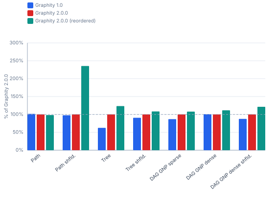

#### Times @ 1M nodes (ms/op, lower is better)

| Shape | Graphity 2.0.0 | Graphity 2.0.0<br>(reordered) |
|---|---:|---:|
| DAG GNP sparse | 26.08 ms | 22.37 ms (0.9×) |
| DAG GNP dense | 99.34 ms | — |
| DAG GNP dense shfld. | 132.9 ms | 87.88 ms (0.7×) |

#### Throughput @ 1M nodes (op/s, higher is better)

| Shape | Graphity 2.0.0 | Graphity 2.0.0<br>(reordered) |
|---|---:|---:|
| DAG GNP sparse | 38.35 op/s | 44.70 op/s (117%) |
| DAG GNP dense | 10.07 op/s | — |
| DAG GNP dense shfld. | 7.524 op/s | 11.38 op/s (151%) |

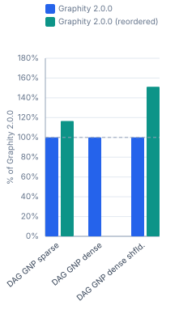

#### Times @ 10M nodes (ms/op, lower is better)

| Shape | Graphity 2.0.0 | Graphity 2.0.0<br>(reordered) |
|---|---:|---:|
| DAG GNP sparse | 604.8 ms | 470.0 ms (0.8×) |
| DAG GNP dense | 2299.8 ms | — |
| DAG GNP dense shfld. | 2836.4 ms | 1944.8 ms (0.7×) |

#### Throughput @ 10M nodes (op/s, higher is better)

| Shape | Graphity 2.0.0 | Graphity 2.0.0<br>(reordered) |
|---|---:|---:|
| DAG GNP sparse | 1.653 op/s | 2.128 op/s (129%) |
| DAG GNP dense | 0.435 op/s | — |
| DAG GNP dense shfld. | 0.353 op/s | 0.514 op/s (146%) |

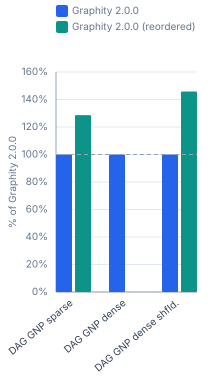

#### Times @ 100M nodes (ms/op, lower is better)

| Shape | Graphity 2.0.0 | Graphity 2.0.0<br>(reordered) |
|---|---:|---:|
| DAG GNP sparse | 8088.3 ms | 5557.6 ms (0.7×) |

#### Throughput @ 100M nodes (op/s, higher is better)

| Shape | Graphity 2.0.0 | Graphity 2.0.0<br>(reordered) |
|---|---:|---:|
| DAG GNP sparse | 0.124 op/s | 0.180 op/s (146%) |

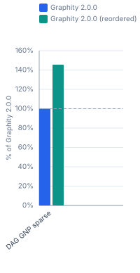

### 1.7 BackEdges

#### Times @ 10k nodes (ms/op, lower is better)

| Shape | Graphity 1.0 | Graphity 2.0.0 | Graphity 2.0.0<br>(reordered) | JGraphT | Guava | WebGraph |
|---|---:|---:|---:|---:|---:|---:|
| Path<br><sub>10k nodes, 10k edges</sub> | 0.073 ms (1.1×) | 0.065 ms | 0.083 ms (1.3×) | 0.244 ms (3.8×) | 0.356 ms (5.5×) | 0.617 ms (9.5×) |
| Path shfld.<br><sub>10k nodes, 10k edges</sub> | 0.082 ms (0.8×) | 0.103 ms | 0.096 ms (0.9×) | 0.456 ms (4.4×) | 0.515 ms (5.0×) | 0.432 ms (4.2×) |
| Tree<br><sub>10k nodes, 10k edges</sub> | 0.203 ms (4.7×) | 0.043 ms | 0.041 ms (1.0×) | 0.517 ms (12×) | 0.660 ms (15×) | 0.559 ms (13×) |
| GNP sparse<br><sub>10k nodes, 30k edges</sub> | 0.130 ms (0.9×) | 0.140 ms | 0.131 ms (0.9×) | 0.555 ms (4.0×) | 1.213 ms (8.7×) | 0.643 ms (4.6×) |
| GNP dense<br><sub>10k nodes, 299.6k edges</sub> | 0.635 ms (1.0×) | 0.647 ms | 0.579 ms (0.9×) | 3.276 ms (5.1×) | 11.96 ms (18×) | 2.629 ms (4.1×) |
| GNP dense shfld.<br><sub>10k nodes, 299.6k edges</sub> | 0.607 ms (0.9×) | 0.641 ms | 0.619 ms (1.0×) | 2.753 ms (4.3×) | 12.58 ms (20×) | 2.647 ms (4.1×) |
| Chain of cliques<br><sub>10k nodes, 310.8k edges</sub> | 0.552 ms (1.0×) | 0.573 ms | 0.573 ms (1.0×) | 1.861 ms (3.2×) | 2.947 ms (5.1×) | 4.316 ms (7.5×) |
| Chain of cliques shfld.<br><sub>10k nodes, 310.8k edges</sub> | 0.598 ms (0.5×) | 1.214 ms | 0.634 ms (0.5×) | 3.935 ms (3.2×) | 4.961 ms (4.1×) | 2.845 ms (2.3×) |

#### Throughput @ 10k nodes (op/s, higher is better)

| Shape | Graphity 1.0 | Graphity 2.0.0 | Graphity 2.0.0<br>(reordered) | JGraphT | Guava | WebGraph |
|---|---:|---:|---:|---:|---:|---:|
| Path<br><sub>10k nodes, 10k edges</sub> | 13 699 op/s (89.0%) | 15 385 op/s | 12 048 op/s (78.3%) | 4 098 op/s (26.6%) | 2 809 op/s (18.3%) | 1 621 op/s (10.5%) |
| Path shfld.<br><sub>10k nodes, 10k edges</sub> | 12 195 op/s (126%) | 9 709 op/s | 10 417 op/s (107%) | 2 193 op/s (22.6%) | 1 942 op/s (20.0%) | 2 315 op/s (23.8%) |
| Tree<br><sub>10k nodes, 10k edges</sub> | 4 926 op/s (21.2%) | 23 256 op/s | 24 390 op/s (105%) | 1 934 op/s (8.3%) | 1 515 op/s (6.5%) | 1 789 op/s (7.7%) |
| GNP sparse<br><sub>10k nodes, 30k edges</sub> | 7 692 op/s (108%) | 7 143 op/s | 7 634 op/s (107%) | 1 802 op/s (25.2%) | 824.4 op/s (11.5%) | 1 555 op/s (21.8%) |
| GNP dense<br><sub>10k nodes, 299.6k edges</sub> | 1 575 op/s (102%) | 1 546 op/s | 1 727 op/s (112%) | 305.3 op/s (19.7%) | 83.63 op/s (5.4%) | 380.4 op/s (24.6%) |
| GNP dense shfld.<br><sub>10k nodes, 299.6k edges</sub> | 1 647 op/s (106%) | 1 560 op/s | 1 616 op/s (104%) | 363.2 op/s (23.3%) | 79.47 op/s (5.1%) | 377.8 op/s (24.2%) |
| Chain of cliques<br><sub>10k nodes, 310.8k edges</sub> | 1 812 op/s (104%) | 1 745 op/s | 1 745 op/s (100%) | 537.3 op/s (30.8%) | 339.3 op/s (19.4%) | 231.7 op/s (13.3%) |
| Chain of cliques shfld.<br><sub>10k nodes, 310.8k edges</sub> | 1 672 op/s (203%) | 823.7 op/s | 1 577 op/s (191%) | 254.1 op/s (30.9%) | 201.6 op/s (24.5%) | 351.5 op/s (42.7%) |

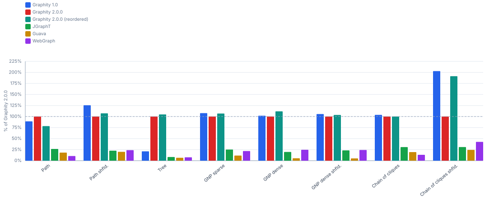

#### Times @ 100k nodes (ms/op, lower is better)

| Shape | Graphity 1.0 | Graphity 2.0.0 | Graphity 2.0.0<br>(reordered) | JGraphT | Guava | WebGraph |
|---|---:|---:|---:|---:|---:|---:|
| Path<br><sub>100k nodes, 100k edges</sub> | 0.732 ms (0.9×) | 0.814 ms | 0.666 ms (0.8×) | 2.717 ms (3.3×) | 4.011 ms (4.9×) | 3.865 ms (4.7×) |
| Path shfld.<br><sub>100k nodes, 100k edges</sub> | 1.388 ms (0.9×) | 1.555 ms | 0.675 ms (0.4×) | 13.46 ms (8.7×) | 14.88 ms (9.6×) | 5.524 ms (3.6×) |
| Tree<br><sub>100k nodes, 100k edges</sub> | 12.66 ms (14×) | 0.897 ms | 0.720 ms (0.8×) | 25.95 ms (29×) | 31.00 ms (35×) | 18.11 ms (20×) |
| GNP sparse<br><sub>100k nodes, 300k edges</sub> | 4.953 ms (1.5×) | 3.396 ms | 2.662 ms (0.8×) | 29.62 ms (8.7×) | 42.00 ms (12×) | 12.48 ms (3.7×) |
| GNP dense<br><sub>100k nodes, 3M edges</sub> | 9.025 ms (1.1×) | 8.523 ms | 6.837 ms (0.8×) | 85.98 ms (10×) | 217.3 ms (25×) | 43.98 ms (5.2×) |
| GNP dense shfld.<br><sub>100k nodes, 3M edges</sub> | 8.863 ms (1.0×) | 8.686 ms | 7.129 ms (0.8×) | 86.94 ms (10×) | 221.9 ms (26×) | 43.76 ms (5.0×) |
| Chain of cliques<br><sub>100k nodes, 3.1M edges</sub> | 6.624 ms (1.1×) | 5.846 ms | 6.945 ms (1.2×) | 30.67 ms (5.2×) | 37.13 ms (6.4×) | 47.81 ms (8.2×) |
| Chain of cliques shfld.<br><sub>100k nodes, 3.1M edges</sub> | 7.519 ms (0.6×) | 12.37 ms | 11.44 ms (0.9×) | 90.84 ms (7.3×) | 115.6 ms (9.3×) | 39.15 ms (3.2×) |

#### Throughput @ 100k nodes (op/s, higher is better)

| Shape | Graphity 1.0 | Graphity 2.0.0 | Graphity 2.0.0<br>(reordered) | JGraphT | Guava | WebGraph |
|---|---:|---:|---:|---:|---:|---:|
| Path<br><sub>100k nodes, 100k edges</sub> | 1 366 op/s (111%) | 1 229 op/s | 1 502 op/s (122%) | 368.1 op/s (30.0%) | 249.3 op/s (20.3%) | 258.7 op/s (21.1%) |
| Path shfld.<br><sub>100k nodes, 100k edges</sub> | 720.5 op/s (112%) | 643.1 op/s | 1 481 op/s (230%) | 74.32 op/s (11.6%) | 67.20 op/s (10.4%) | 181.0 op/s (28.1%) |
| Tree<br><sub>100k nodes, 100k edges</sub> | 78.97 op/s (7.1%) | 1 115 op/s | 1 389 op/s (125%) | 38.53 op/s (3.5%) | 32.26 op/s (2.9%) | 55.22 op/s (5.0%) |
| GNP sparse<br><sub>100k nodes, 300k edges</sub> | 201.9 op/s (68.6%) | 294.5 op/s | 375.7 op/s (128%) | 33.76 op/s (11.5%) | 23.81 op/s (8.1%) | 80.10 op/s (27.2%) |
| GNP dense<br><sub>100k nodes, 3M edges</sub> | 110.8 op/s (94.4%) | 117.3 op/s | 146.3 op/s (125%) | 11.63 op/s (9.9%) | 4.602 op/s (3.9%) | 22.74 op/s (19.4%) |
| GNP dense shfld.<br><sub>100k nodes, 3M edges</sub> | 112.8 op/s (98.0%) | 115.1 op/s | 140.3 op/s (122%) | 11.50 op/s (10.0%) | 4.507 op/s (3.9%) | 22.85 op/s (19.8%) |
| Chain of cliques<br><sub>100k nodes, 3.1M edges</sub> | 151.0 op/s (88.3%) | 171.1 op/s | 144.0 op/s (84.2%) | 32.61 op/s (19.1%) | 26.93 op/s (15.7%) | 20.91 op/s (12.2%) |
| Chain of cliques shfld.<br><sub>100k nodes, 3.1M edges</sub> | 133.0 op/s (164%) | 80.87 op/s | 87.43 op/s (108%) | 11.01 op/s (13.6%) | 8.651 op/s (10.7%) | 25.55 op/s (31.6%) |

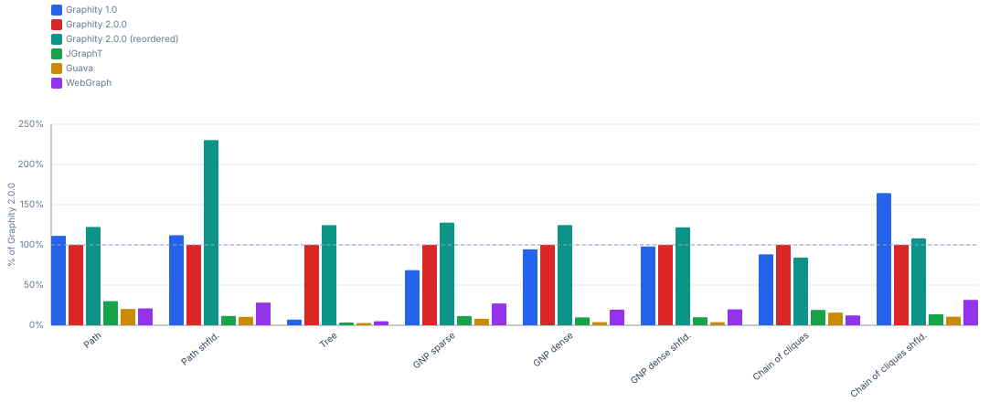

#### Times @ 1M nodes (ms/op, lower is better)

| Shape | Graphity 2.0.0 | Graphity 2.0.0<br>(reordered) |
|---|---:|---:|
| GNP sparse<br><sub>1M nodes, 3M edges</sub> | 50.35 ms | 26.30 ms (0.5×) |
| GNP dense<br><sub>1M nodes, 30M edges</sub> | 194.7 ms | — |
| GNP dense shfld.<br><sub>1M nodes, 30M edges</sub> | 198.3 ms | 73.58 ms (0.4×) |
| Chain of cliques<br><sub>1M nodes, 31.1M edges</sub> | 56.09 ms | — |

#### Throughput @ 1M nodes (op/s, higher is better)

| Shape | Graphity 2.0.0 | Graphity 2.0.0<br>(reordered) |
|---|---:|---:|
| GNP sparse<br><sub>1M nodes, 3M edges</sub> | 19.86 op/s | 38.02 op/s (191%) |
| GNP dense<br><sub>1M nodes, 30M edges</sub> | 5.136 op/s | — |
| GNP dense shfld.<br><sub>1M nodes, 30M edges</sub> | 5.043 op/s | 13.59 op/s (270%) |
| Chain of cliques<br><sub>1M nodes, 31.1M edges</sub> | 17.83 op/s | — |

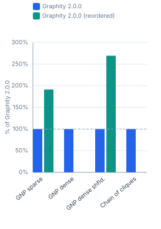

#### Times @ 10M nodes (ms/op, lower is better)

| Shape | Graphity 2.0.0 | Graphity 2.0.0<br>(reordered) |
|---|---:|---:|
| GNP sparse<br><sub>10M nodes, 30M edges</sub> | 1917.7 ms | 268.2 ms (0.1×) |
| GNP dense<br><sub>10M nodes, 299.6M edges</sub> | 3171.1 ms | — |
| GNP dense shfld.<br><sub>10M nodes, 299.6M edges</sub> | 3063.1 ms | 844.4 ms (0.3×) |
| Chain of cliques<br><sub>10M nodes, 310.8M edges</sub> | 600.4 ms | — |

#### Throughput @ 10M nodes (op/s, higher is better)

| Shape | Graphity 2.0.0 | Graphity 2.0.0<br>(reordered) |
|---|---:|---:|
| GNP sparse<br><sub>10M nodes, 30M edges</sub> | 0.521 op/s | 3.729 op/s (715%) |
| GNP dense<br><sub>10M nodes, 299.6M edges</sub> | 0.315 op/s | — |
| GNP dense shfld.<br><sub>10M nodes, 299.6M edges</sub> | 0.326 op/s | 1.184 op/s (363%) |
| Chain of cliques<br><sub>10M nodes, 310.8M edges</sub> | 1.666 op/s | — |

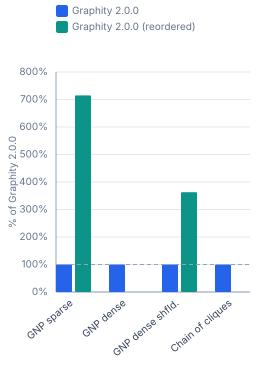

#### Times @ 100M nodes (ms/op, lower is better)

| Shape | Graphity 2.0.0 | Graphity 2.0.0<br>(reordered) |
|---|---:|---:|
| GNP sparse<br><sub>100M nodes, 300M edges</sub> | 25965 ms | 3189.7 ms (0.1×) |

#### Throughput @ 100M nodes (op/s, higher is better)

| Shape | Graphity 2.0.0 | Graphity 2.0.0<br>(reordered) |
|---|---:|---:|
| GNP sparse<br><sub>100M nodes, 300M edges</sub> | 0.039 op/s | 0.314 op/s (814%) |

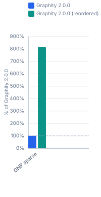

### 1.8 EdgeTypes

#### Times @ 10k nodes (ms/op, lower is better)

| Shape | Graphity 1.0 | Graphity 2.0.0 | Graphity 2.0.0<br>(reordered) | JGraphT | Guava | WebGraph |
|---|---:|---:|---:|---:|---:|---:|
| Path<br><sub>10k nodes, 10k edges</sub> | 0.089 ms (0.9×) | 0.096 ms | 0.110 ms (1.1×) | 0.309 ms (3.2×) | 0.382 ms (4.0×) | 0.642 ms (6.7×) |
| Path shfld.<br><sub>10k nodes, 10k edges</sub> | 0.127 ms (1.2×) | 0.103 ms | 0.140 ms (1.4×) | 0.480 ms (4.7×) | 0.537 ms (5.2×) | 0.485 ms (4.7×) |
| Tree<br><sub>10k nodes, 10k edges</sub> | 0.198 ms (4.0×) | 0.050 ms | 0.049 ms (1.0×) | 0.548 ms (11×) | 0.768 ms (15×) | 0.614 ms (12×) |
| GNP sparse<br><sub>10k nodes, 30k edges</sub> | 0.174 ms (1.4×) | 0.125 ms | 0.101 ms (0.8×) | 0.648 ms (5.2×) | 1.342 ms (11×) | 0.724 ms (5.8×) |
| GNP dense<br><sub>10k nodes, 299.6k edges</sub> | 0.630 ms (1.5×) | 0.420 ms | 0.355 ms (0.8×) | 3.968 ms (9.4×) | 12.89 ms (31×) | 3.159 ms (7.5×) |
| GNP dense shfld.<br><sub>10k nodes, 299.6k edges</sub> | 0.665 ms (1.4×) | 0.478 ms | 0.368 ms (0.8×) | 4.415 ms (9.2×) | 12.91 ms (27×) | 3.350 ms (7.0×) |
| Chain of cliques<br><sub>10k nodes, 310.8k edges</sub> | 0.495 ms (1.5×) | 0.332 ms | 0.330 ms (1.0×) | 2.528 ms (7.6×) | 3.397 ms (10×) | 5.178 ms (16×) |
| Chain of cliques shfld.<br><sub>10k nodes, 310.8k edges</sub> | 0.548 ms (1.4×) | 0.391 ms | 0.317 ms (0.8×) | 4.717 ms (12×) | 6.147 ms (16×) | 3.176 ms (8.1×) |

#### Throughput @ 10k nodes (op/s, higher is better)

| Shape | Graphity 1.0 | Graphity 2.0.0 | Graphity 2.0.0<br>(reordered) | JGraphT | Guava | WebGraph |
|---|---:|---:|---:|---:|---:|---:|
| Path<br><sub>10k nodes, 10k edges</sub> | 11 236 op/s (108%) | 10 417 op/s | 9 091 op/s (87.3%) | 3 236 op/s (31.1%) | 2 618 op/s (25.1%) | 1 558 op/s (15.0%) |
| Path shfld.<br><sub>10k nodes, 10k edges</sub> | 7 874 op/s (81.1%) | 9 709 op/s | 7 143 op/s (73.6%) | 2 083 op/s (21.5%) | 1 862 op/s (19.2%) | 2 062 op/s (21.2%) |
| Tree<br><sub>10k nodes, 10k edges</sub> | 5 051 op/s (25.3%) | 20 000 op/s | 20 408 op/s (102%) | 1 825 op/s (9.1%) | 1 302 op/s (6.5%) | 1 629 op/s (8.1%) |
| GNP sparse<br><sub>10k nodes, 30k edges</sub> | 5 747 op/s (71.8%) | 8 000 op/s | 9 901 op/s (124%) | 1 543 op/s (19.3%) | 745.2 op/s (9.3%) | 1 381 op/s (17.3%) |
| GNP dense<br><sub>10k nodes, 299.6k edges</sub> | 1 587 op/s (66.7%) | 2 381 op/s | 2 817 op/s (118%) | 252.0 op/s (10.6%) | 77.60 op/s (3.3%) | 316.6 op/s (13.3%) |
| GNP dense shfld.<br><sub>10k nodes, 299.6k edges</sub> | 1 504 op/s (71.9%) | 2 092 op/s | 2 717 op/s (130%) | 226.5 op/s (10.8%) | 77.47 op/s (3.7%) | 298.5 op/s (14.3%) |
| Chain of cliques<br><sub>10k nodes, 310.8k edges</sub> | 2 020 op/s (67.1%) | 3 012 op/s | 3 030 op/s (101%) | 395.6 op/s (13.1%) | 294.4 op/s (9.8%) | 193.1 op/s (6.4%) |
| Chain of cliques shfld.<br><sub>10k nodes, 310.8k edges</sub> | 1 825 op/s (71.4%) | 2 558 op/s | 3 155 op/s (123%) | 212.0 op/s (8.3%) | 162.7 op/s (6.4%) | 314.9 op/s (12.3%) |

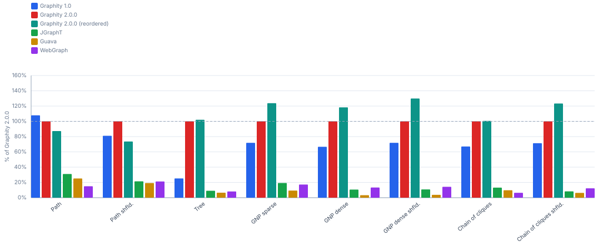

#### Times @ 100k nodes (ms/op, lower is better)

| Shape | Graphity 1.0 | Graphity 2.0.0 | Graphity 2.0.0<br>(reordered) | JGraphT | Guava | WebGraph |
|---|---:|---:|---:|---:|---:|---:|
| Path<br><sub>100k nodes, 100k edges</sub> | 1.064 ms (1.4×) | 0.751 ms | 0.749 ms (1.0×) | 2.999 ms (4.0×) | 4.499 ms (6.0×) | 3.982 ms (5.3×) |
| Path shfld.<br><sub>100k nodes, 100k edges</sub> | 1.850 ms (1.1×) | 1.614 ms | 0.913 ms (0.6×) | 15.02 ms (9.3×) | 16.06 ms (9.9×) | 6.582 ms (4.1×) |
| Tree<br><sub>100k nodes, 100k edges</sub> | 13.58 ms (14×) | 0.997 ms | 0.764 ms (0.8×) | 26.48 ms (27×) | 30.82 ms (31×) | 18.12 ms (18×) |
| GNP sparse<br><sub>100k nodes, 300k edges</sub> | 4.911 ms (1.5×) | 3.258 ms | 1.991 ms (0.6×) | 33.94 ms (10×) | 40.27 ms (12×) | 14.13 ms (4.3×) |
| GNP dense<br><sub>100k nodes, 3M edges</sub> | 8.522 ms (1.3×) | 6.693 ms | 4.441 ms (0.7×) | 101.6 ms (15×) | 229.8 ms (34×) | 51.88 ms (7.8×) |
| GNP dense shfld.<br><sub>100k nodes, 3M edges</sub> | 8.135 ms (1.2×) | 6.698 ms | 4.337 ms (0.6×) | 101.2 ms (15×) | 227.7 ms (34×) | 52.62 ms (7.9×) |
| Chain of cliques<br><sub>100k nodes, 3.1M edges</sub> | 5.212 ms (1.6×) | 3.357 ms | 3.284 ms (1.0×) | 36.18 ms (11×) | 48.16 ms (14×) | 53.31 ms (16×) |
| Chain of cliques shfld.<br><sub>100k nodes, 3.1M edges</sub> | 15.65 ms (3.0×) | 5.265 ms | 3.238 ms (0.6×) | 108.1 ms (21×) | 128.4 ms (24×) | 49.36 ms (9.4×) |

#### Throughput @ 100k nodes (op/s, higher is better)

| Shape | Graphity 1.0 | Graphity 2.0.0 | Graphity 2.0.0<br>(reordered) | JGraphT | Guava | WebGraph |
|---|---:|---:|---:|---:|---:|---:|
| Path<br><sub>100k nodes, 100k edges</sub> | 939.8 op/s (70.6%) | 1 332 op/s | 1 335 op/s (100%) | 333.4 op/s (25.0%) | 222.3 op/s (16.7%) | 251.1 op/s (18.9%) |
| Path shfld.<br><sub>100k nodes, 100k edges</sub> | 540.5 op/s (87.2%) | 619.6 op/s | 1 095 op/s (177%) | 66.57 op/s (10.7%) | 62.28 op/s (10.1%) | 151.9 op/s (24.5%) |
| Tree<br><sub>100k nodes, 100k edges</sub> | 73.65 op/s (7.3%) | 1 003 op/s | 1 309 op/s (130%) | 37.77 op/s (3.8%) | 32.45 op/s (3.2%) | 55.18 op/s (5.5%) |
| GNP sparse<br><sub>100k nodes, 300k edges</sub> | 203.6 op/s (66.3%) | 306.9 op/s | 502.3 op/s (164%) | 29.47 op/s (9.6%) | 24.83 op/s (8.1%) | 70.78 op/s (23.1%) |
| GNP dense<br><sub>100k nodes, 3M edges</sub> | 117.3 op/s (78.5%) | 149.4 op/s | 225.2 op/s (151%) | 9.843 op/s (6.6%) | 4.352 op/s (2.9%) | 19.28 op/s (12.9%) |
| GNP dense shfld.<br><sub>100k nodes, 3M edges</sub> | 122.9 op/s (82.3%) | 149.3 op/s | 230.6 op/s (154%) | 9.881 op/s (6.6%) | 4.392 op/s (2.9%) | 19.01 op/s (12.7%) |
| Chain of cliques<br><sub>100k nodes, 3.1M edges</sub> | 191.9 op/s (64.4%) | 297.9 op/s | 304.5 op/s (102%) | 27.64 op/s (9.3%) | 20.76 op/s (7.0%) | 18.76 op/s (6.3%) |
| Chain of cliques shfld.<br><sub>100k nodes, 3.1M edges</sub> | 63.88 op/s (33.6%) | 189.9 op/s | 308.8 op/s (163%) | 9.251 op/s (4.9%) | 7.788 op/s (4.1%) | 20.26 op/s (10.7%) |

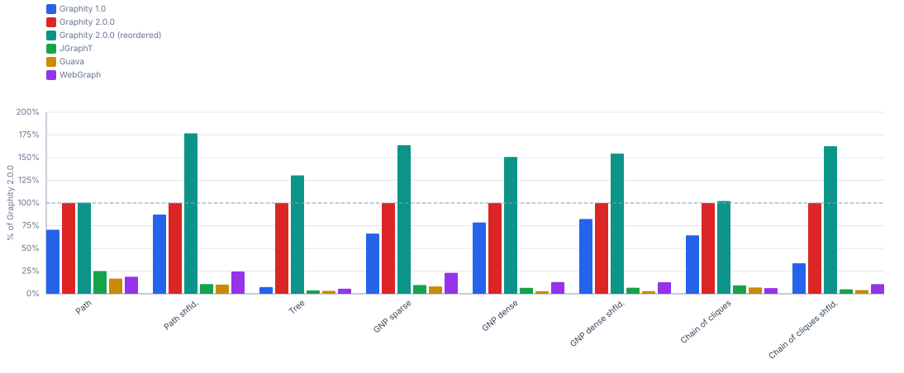

#### Times @ 1M nodes (ms/op, lower is better)

| Shape | Graphity 2.0.0 | Graphity 2.0.0<br>(reordered) |
|---|---:|---:|
| GNP sparse<br><sub>1M nodes, 3M edges</sub> | 57.48 ms | 21.84 ms (0.4×) |
| GNP dense<br><sub>1M nodes, 30M edges</sub> | 201.6 ms | — |
| GNP dense shfld.<br><sub>1M nodes, 30M edges</sub> | 203.4 ms | 53.54 ms (0.3×) |
| Chain of cliques<br><sub>1M nodes, 31.1M edges</sub> | 32.57 ms | — |

#### Throughput @ 1M nodes (op/s, higher is better)

| Shape | Graphity 2.0.0 | Graphity 2.0.0<br>(reordered) |
|---|---:|---:|
| GNP sparse<br><sub>1M nodes, 3M edges</sub> | 17.40 op/s | 45.79 op/s (263%) |
| GNP dense<br><sub>1M nodes, 30M edges</sub> | 4.960 op/s | — |
| GNP dense shfld.<br><sub>1M nodes, 30M edges</sub> | 4.916 op/s | 18.68 op/s (380%) |
| Chain of cliques<br><sub>1M nodes, 31.1M edges</sub> | 30.70 op/s | — |

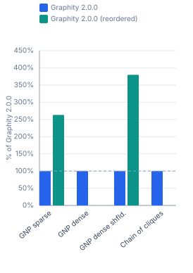

#### Times @ 10M nodes (ms/op, lower is better)

| Shape | Graphity 2.0.0 | Graphity 2.0.0<br>(reordered) |
|---|---:|---:|
| GNP sparse<br><sub>10M nodes, 30M edges</sub> | 2028.3 ms | 295.0 ms (0.1×) |
| GNP dense<br><sub>10M nodes, 299.6M edges</sub> | 3201.4 ms | — |
| GNP dense shfld.<br><sub>10M nodes, 299.6M edges</sub> | 3211.9 ms | 918.3 ms (0.3×) |
| Chain of cliques<br><sub>10M nodes, 310.8M edges</sub> | 339.5 ms | — |

#### Throughput @ 10M nodes (op/s, higher is better)

| Shape | Graphity 2.0.0 | Graphity 2.0.0<br>(reordered) |
|---|---:|---:|
| GNP sparse<br><sub>10M nodes, 30M edges</sub> | 0.493 op/s | 3.390 op/s (688%) |
| GNP dense<br><sub>10M nodes, 299.6M edges</sub> | 0.312 op/s | — |
| GNP dense shfld.<br><sub>10M nodes, 299.6M edges</sub> | 0.311 op/s | 1.089 op/s (350%) |
| Chain of cliques<br><sub>10M nodes, 310.8M edges</sub> | 2.946 op/s | — |

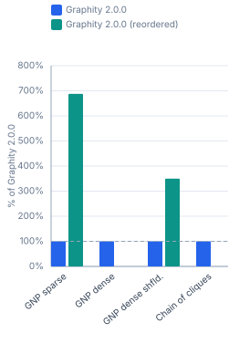

#### Times @ 100M nodes (ms/op, lower is better)

| Shape | Graphity 2.0.0 | Graphity 2.0.0<br>(reordered) |
|---|---:|---:|
| GNP sparse<br><sub>100M nodes, 300M edges</sub> | 25582 ms | 4194.8 ms (0.2×) |

#### Throughput @ 100M nodes (op/s, higher is better)

| Shape | Graphity 2.0.0 | Graphity 2.0.0<br>(reordered) |
|---|---:|---:|
| GNP sparse<br><sub>100M nodes, 300M edges</sub> | 0.039 op/s | 0.238 op/s (610%) |

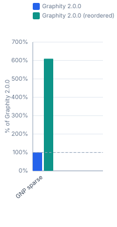

### 1.9 Reorder (DFS-preorder) cost

#### Times @ 10k nodes (ms/op, lower is better)

| Shape | Graphity 2.0.0 |
|---|---:|
| Path<br><sub>10k nodes, 10k edges</sub> | 0.122 ms |
| Path shfld.<br><sub>10k nodes, 10k edges</sub> | 0.121 ms |
| Tree<br><sub>10k nodes, 10k edges</sub> | 0.163 ms |
| GNP sparse<br><sub>10k nodes, 30k edges</sub> | 0.212 ms |
| GNP dense<br><sub>10k nodes, 299.6k edges</sub> | 2.236 ms |
| GNP dense shfld.<br><sub>10k nodes, 299.6k edges</sub> | 2.233 ms |
| Chain of cliques<br><sub>10k nodes, 310.8k edges</sub> | 0.535 ms |
| Chain of cliques shfld.<br><sub>10k nodes, 310.8k edges</sub> | 0.780 ms |

#### Throughput @ 10k nodes (op/s, higher is better)

| Shape | Graphity 2.0.0 |
|---|---:|
| Path<br><sub>10k nodes, 10k edges</sub> | 8 197 op/s |
| Path shfld.<br><sub>10k nodes, 10k edges</sub> | 8 264 op/s |
| Tree<br><sub>10k nodes, 10k edges</sub> | 6 135 op/s |
| GNP sparse<br><sub>10k nodes, 30k edges</sub> | 4 717 op/s |
| GNP dense<br><sub>10k nodes, 299.6k edges</sub> | 447.2 op/s |
| GNP dense shfld.<br><sub>10k nodes, 299.6k edges</sub> | 447.8 op/s |
| Chain of cliques<br><sub>10k nodes, 310.8k edges</sub> | 1 869 op/s |
| Chain of cliques shfld.<br><sub>10k nodes, 310.8k edges</sub> | 1 282 op/s |


#### Times @ 100k nodes (ms/op, lower is better)

| Shape | Graphity 2.0.0 |
|---|---:|
| Path<br><sub>100k nodes, 100k edges</sub> | 1.166 ms |
| Path shfld.<br><sub>100k nodes, 100k edges</sub> | 1.876 ms |
| Tree<br><sub>100k nodes, 100k edges</sub> | 2.738 ms |
| GNP sparse<br><sub>100k nodes, 300k edges</sub> | 5.973 ms |
| GNP dense<br><sub>100k nodes, 3M edges</sub> | 26.98 ms |
| GNP dense shfld.<br><sub>100k nodes, 3M edges</sub> | 26.99 ms |
| Chain of cliques<br><sub>100k nodes, 3.1M edges</sub> | 5.373 ms |
| Chain of cliques shfld.<br><sub>100k nodes, 3.1M edges</sub> | 10.36 ms |

#### Throughput @ 100k nodes (op/s, higher is better)

| Shape | Graphity 2.0.0 |
|---|---:|
| Path<br><sub>100k nodes, 100k edges</sub> | 857.6 op/s |
| Path shfld.<br><sub>100k nodes, 100k edges</sub> | 533.0 op/s |
| Tree<br><sub>100k nodes, 100k edges</sub> | 365.2 op/s |
| GNP sparse<br><sub>100k nodes, 300k edges</sub> | 167.4 op/s |
| GNP dense<br><sub>100k nodes, 3M edges</sub> | 37.06 op/s |
| GNP dense shfld.<br><sub>100k nodes, 3M edges</sub> | 37.05 op/s |
| Chain of cliques<br><sub>100k nodes, 3.1M edges</sub> | 186.1 op/s |
| Chain of cliques shfld.<br><sub>100k nodes, 3.1M edges</sub> | 96.55 op/s |


#### Times @ 1M nodes (ms/op, lower is better)

| Shape | Graphity 2.0.0 |
|---|---:|
| GNP sparse<br><sub>1M nodes, 3M edges</sub> | 88.21 ms |
| GNP dense shfld.<br><sub>1M nodes, 30M edges</sub> | 521.0 ms |

#### Throughput @ 1M nodes (op/s, higher is better)

| Shape | Graphity 2.0.0 |
|---|---:|
| GNP sparse<br><sub>1M nodes, 3M edges</sub> | 11.34 op/s |
| GNP dense shfld.<br><sub>1M nodes, 30M edges</sub> | 1.919 op/s |


#### Times @ 10M nodes (ms/op, lower is better)

| Shape | Graphity 2.0.0 |
|---|---:|
| GNP sparse<br><sub>10M nodes, 30M edges</sub> | 2890.6 ms |
| GNP dense shfld.<br><sub>10M nodes, 299.6M edges</sub> | 9384.8 ms |

#### Throughput @ 10M nodes (op/s, higher is better)

| Shape | Graphity 2.0.0 |
|---|---:|
| GNP sparse<br><sub>10M nodes, 30M edges</sub> | 0.346 op/s |
| GNP dense shfld.<br><sub>10M nodes, 299.6M edges</sub> | 0.107 op/s |


#### Times @ 100M nodes (ms/op, lower is better)

| Shape | Graphity 2.0.0 |
|---|---:|
| GNP sparse<br><sub>100M nodes, 300M edges</sub> | 34486 ms |

#### Throughput @ 100M nodes (op/s, higher is better)

| Shape | Graphity 2.0.0 |
|---|---:|
| GNP sparse<br><sub>100M nodes, 300M edges</sub> | 0.029 op/s |

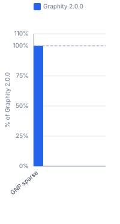

## 2 Memory Footprint

Retained heap in bytes for a fully built graph. Lower is better. Baseline: **Graphity 2.0.0** = 100%. Two charts per section: *Graphity & WebGraph* (same league) and *All libraries*.

### 2.1 Total Graph Size

**Memory footprint in bytes (lower is better)**

| Shape | Graphity 1.0 | Graphity 2.0.0 | JGraphT | Guava | WebGraph |
|---|---:|---:|---:|---:|---:|
| Path<br><sub>10k nodes, 10k edges</sub> | 80.1 kB (100%) | 80.1 kB | 4.0 MB (5037%) | 2.7 MB (3375%) | 18.9 kB (23.6%) |
| Path shfld.<br><sub>10k nodes, 10k edges</sub> | 80.1 kB (100%) | 80.1 kB | 4.0 MB (5037%) | 2.7 MB (3375%) | 37.9 kB (47.4%) |
| Tree<br><sub>10k nodes, 10k edges</sub> | 80.1 kB (100%) | 80.1 kB | 4.0 MB (5043%) | 2.7 MB (3378%) | 32.0 kB (40.0%) |
| GNP sparse<br><sub>10k nodes, 30k edges</sub> | 160 kB (100%) | 160 kB | 8.6 MB (5343%) | 4.8 MB (2984%) | 78.9 kB (49.3%) |
| GNP dense<br><sub>10k nodes, 299.6k edges</sub> | 1.2 MB (100%) | 1.2 MB | 68.6 MB (5544%) | 33.4 MB (2700%) | 475 kB (38.4%) |
| GNP dense shfld.<br><sub>10k nodes, 299.6k edges</sub> | 1.2 MB (100%) | 1.2 MB | 68.6 MB (5543%) | 33.4 MB (2700%) | 475 kB (38.4%) |
| Chain of cliques<br><sub>10k nodes, 310.8k edges</sub> | 1.3 MB (100%) | 1.3 MB | 71.3 MB (5558%) | 22.7 MB (1769%) | 50.7 kB (4.0%) |
| Chain of cliques shfld.<br><sub>10k nodes, 310.8k edges</sub> | 1.3 MB (100%) | 1.3 MB | 71.3 MB (5559%) | 22.7 MB (1769%) | 482 kB (37.6%) |
| Path<br><sub>100k nodes, 100k edges</sub> | 800 kB (100%) | 800 kB | 41.5 MB (5192%) | 27.4 MB (3430%) | 181 kB (22.6%) |
| Path shfld.<br><sub>100k nodes, 100k edges</sub> | 800 kB (100%) | 800 kB | 41.5 MB (5192%) | 27.4 MB (3430%) | 430 kB (53.7%) |
| Tree<br><sub>100k nodes, 100k edges</sub> | 800 kB (100%) | 800 kB | 41.7 MB (5208%) | 27.5 MB (3443%) | 372 kB (46.5%) |
| GNP sparse<br><sub>100k nodes, 300k edges</sub> | 1.6 MB (100%) | 1.6 MB | 85.0 MB (5310%) | 48.3 MB (3016%) | 952 kB (59.5%) |
| GNP dense<br><sub>100k nodes, 3M edges</sub> | 12.4 MB (100%) | 12.4 MB | 680 MB (5488%) | 337 MB (2716%) | 6.4 MB (51.7%) |
| GNP dense shfld.<br><sub>100k nodes, 3M edges</sub> | 12.4 MB (100%) | 12.4 MB | 680 MB (5488%) | 337 MB (2716%) | 6.4 MB (51.7%) |
| Chain of cliques<br><sub>100k nodes, 3.1M edges</sub> | 12.8 MB (100%) | 12.8 MB | 706 MB (5506%) | 228 MB (1777%) | 500 kB (3.9%) |
| Chain of cliques shfld.<br><sub>100k nodes, 3.1M edges</sub> | 12.8 MB (100%) | 12.8 MB | 706 MB (5506%) | 228 MB (1777%) | 6.6 MB (51.6%) |
| GNP sparse<br><sub>1M nodes, 3M edges</sub> | — | 16.0 MB | — | — | — |
| GNP sparse<br><sub>10M nodes, 30M edges</sub> | — | 160 MB | — | — | — |
| GNP sparse<br><sub>100M nodes, 300M edges</sub> | — | 1600 MB | — | — | — |

**Graphity & WebGraph**

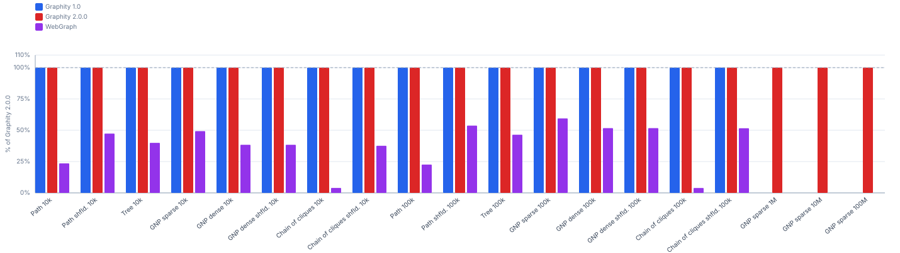

**All libraries**

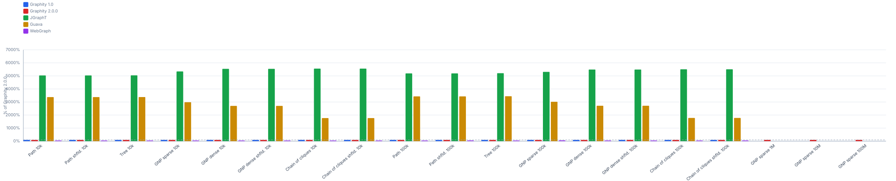

### 2.2 Bytes per Element  `totalBytes / (Nodes + Edges)`

**Memory footprint in bytes (lower is better)**

| Shape | Graphity 1.0 | Graphity 2.0.0 | JGraphT | Guava | WebGraph |
|---|---:|---:|---:|---:|---:|
| Path<br><sub>10k nodes, 10k edges</sub> | 4 B (100%) | 4 B | 201.65 B (5041%) | 135.10 B (3378%) | 0.94 B (23.5%) |
| Path shfld.<br><sub>10k nodes, 10k edges</sub> | 4 B (100%) | 4 B | 201.65 B (5041%) | 135.10 B (3378%) | 1.90 B (47.5%) |
| Tree<br><sub>10k nodes, 10k edges</sub> | 4 B (100%) | 4 B | 201.90 B (5048%) | 135.24 B (3381%) | 1.60 B (40.0%) |
| GNP sparse<br><sub>10k nodes, 30k edges</sub> | 4 B (100%) | 4 B | 213.79 B (5345%) | 119.42 B (2986%) | 1.97 B (49.2%) |
| GNP dense<br><sub>10k nodes, 299.6k edges</sub> | 4 B (100%) | 4 B | 221.75 B (5544%) | 108.02 B (2700%) | 1.54 B (38.5%) |
| GNP dense shfld.<br><sub>10k nodes, 299.6k edges</sub> | 4 B (100%) | 4 B | 221.75 B (5544%) | 108.01 B (2700%) | 1.54 B (38.5%) |
| Chain of cliques<br><sub>10k nodes, 310.8k edges</sub> | 4 B (100%) | 4 B | 222.34 B (5558%) | 70.78 B (1770%) | 0.16 B (4.0%) |
| Chain of cliques shfld.<br><sub>10k nodes, 310.8k edges</sub> | 4 B (100%) | 4 B | 222.36 B (5559%) | 70.78 B (1770%) | 1.50 B (37.5%) |
| Path<br><sub>100k nodes, 100k edges</sub> | 4 B (100%) | 4 B | 207.71 B (5193%) | 137.23 B (3431%) | 0.90 B (22.5%) |
| Path shfld.<br><sub>100k nodes, 100k edges</sub> | 4 B (100%) | 4 B | 207.71 B (5193%) | 137.22 B (3430%) | 2.15 B (53.8%) |
| Tree<br><sub>100k nodes, 100k edges</sub> | 4 B (100%) | 4 B | 208.34 B (5208%) | 137.73 B (3443%) | 1.86 B (46.5%) |
| GNP sparse<br><sub>100k nodes, 300k edges</sub> | 4 B (100%) | 4 B | 212.40 B (5310%) | 120.65 B (3016%) | 2.38 B (59.5%) |
| GNP dense<br><sub>100k nodes, 3M edges</sub> | 4 B (100%) | 4 B | 219.51 B (5488%) | 108.63 B (2716%) | 2.07 B (51.7%) |
| GNP dense shfld.<br><sub>100k nodes, 3M edges</sub> | 4 B (100%) | 4 B | 219.52 B (5488%) | 108.63 B (2716%) | 2.07 B (51.7%) |
| Chain of cliques<br><sub>100k nodes, 3.1M edges</sub> | 4 B (100%) | 4 B | 220.25 B (5506%) | 71.08 B (1777%) | 0.16 B (4.0%) |
| Chain of cliques shfld.<br><sub>100k nodes, 3.1M edges</sub> | 4 B (100%) | 4 B | 220.25 B (5506%) | 71.08 B (1777%) | 2.06 B (51.5%) |
| GNP sparse<br><sub>1M nodes, 3M edges</sub> | — | 4 B | — | — | — |
| GNP sparse<br><sub>10M nodes, 30M edges</sub> | — | 4 B | — | — | — |
| GNP sparse<br><sub>100M nodes, 300M edges</sub> | — | 4 B | — | — | — |

**Graphity & WebGraph**


**All libraries**


## 3 Allocations

Bytes allocated per algorithm invocation (JMH `-prof gc`). Lower is better. Baseline: **Graphity 2.0.0** = 100%.

### 3.1 Build

**Allocations @ 10k nodes in bytes (lower is better)**

| Shape | Graphity 1.0 | Graphity 2.0.0 | JGraphT | Guava | WebGraph |
|---|---:|---:|---:|---:|---:|
| Path<br><sub>10k nodes, 10k edges</sub> | 458 kB (100%) | 458 kB | 4.6 MB (1006%) | 2.8 MB (604%) | 4.3 MB (949%) |
| Path shfld.<br><sub>10k nodes, 10k edges</sub> | 458 kB (100%) | 458 kB | 4.5 MB (975%) | 2.8 MB (604%) | 4.4 MB (955%) |
| Tree<br><sub>10k nodes, 10k edges</sub> | 458 kB (100%) | 458 kB | 4.6 MB (1004%) | 2.8 MB (609%) | 4.1 MB (887%) |
| GNP sparse<br><sub>10k nodes, 30k edges</sub> | 960 kB (100%) | 960 kB | 10.9 MB (1135%) | 5.1 MB (536%) | 4.4 MB (463%) |
| GNP dense<br><sub>10k nodes, 299.6k edges</sub> | 9.9 MB (100%) | 9.9 MB | 89.1 MB (898%) | 37.3 MB (376%) | 9.7 MB (98.1%) |
| GNP dense shfld.<br><sub>10k nodes, 299.6k edges</sub> | 9.9 MB (100.0%) | 9.9 MB | 89.1 MB (898%) | 37.3 MB (376%) | 9.7 MB (98.1%) |
| Chain of cliques<br><sub>10k nodes, 310.8k edges</sub> | 10.0 MB (100%) | 10.0 MB | 93.1 MB (934%) | 29.3 MB (294%) | 8.9 MB (89.7%) |
| Chain of cliques shfld.<br><sub>10k nodes, 310.8k edges</sub> | 10.0 MB (100%) | 10.0 MB | 93.1 MB (934%) | 29.3 MB (294%) | 9.4 MB (94.1%) |

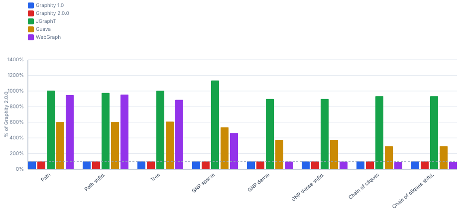

**Allocations @ 100k nodes in bytes (lower is better)**

| Shape | Graphity 1.0 | Graphity 2.0.0 | JGraphT | Guava | WebGraph |
|---|---:|---:|---:|---:|---:|
| Path<br><sub>100k nodes, 100k edges</sub> | 3.8 MB (100%) | 3.8 MB | 47.2 MB (1255%) | 28.5 MB (757%) | 14.2 MB (378%) |
| Path shfld.<br><sub>100k nodes, 100k edges</sub> | 3.8 MB (100%) | 3.8 MB | 47.1 MB (1252%) | 28.5 MB (757%) | 14.5 MB (385%) |
| Tree<br><sub>100k nodes, 100k edges</sub> | 3.8 MB (100%) | 3.8 MB | 48.4 MB (1288%) | 28.8 MB (766%) | 11.4 MB (302%) |
| GNP sparse<br><sub>100k nodes, 300k edges</sub> | 10.6 MB (100%) | 10.6 MB | 108 MB (1012%) | 52.3 MB (492%) | 15.3 MB (144%) |
| GNP dense<br><sub>100k nodes, 3M edges</sub> | 111 MB (100%) | 111 MB | 878 MB (789%) | 376 MB (338%) | 69.8 MB (62.7%) |
| GNP dense shfld.<br><sub>100k nodes, 3M edges</sub> | 111 MB (100%) | 111 MB | 945 MB (849%) | 376 MB (338%) | 69.8 MB (62.7%) |
| Chain of cliques<br><sub>100k nodes, 3.1M edges</sub> | 112 MB (100%) | 112 MB | 915 MB (820%) | 294 MB (264%) | 60.2 MB (53.9%) |
| Chain of cliques shfld.<br><sub>100k nodes, 3.1M edges</sub> | 112 MB (100%) | 112 MB | 1080 MB (967%) | 294 MB (264%) | 66.3 MB (59.4%) |

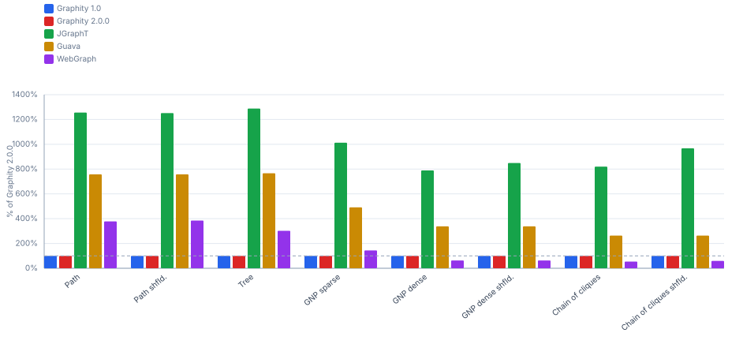

### 3.2 SCC

**Allocations @ 10k nodes in bytes (lower is better)**

| Shape | Graphity 1.0 | Graphity 2.0.0 | JGraphT | Guava | WebGraph |
|---|---:|---:|---:|---:|---:|
| Path<br><sub>10k nodes, 10k edges</sub> | 283 kB (52.0%) | 544 kB | 5.2 MB (957%) | 4.0 MB (744%) | 1.4 MB (264%) |
| Path shfld.<br><sub>10k nodes, 10k edges</sub> | 283 kB (52.0%) | 544 kB | 5.2 MB (949%) | 4.0 MB (734%) | 1.3 MB (243%) |
| Tree<br><sub>10k nodes, 10k edges</sub> | 283 kB (98.1%) | 288 kB | 5.0 MB (1746%) | 3.7 MB (1299%) | 908 kB (315%) |
| GNP sparse<br><sub>10k nodes, 30k edges</sub> | 248 kB (70.1%) | 353 kB | 3.4 MB (964%) | 4.0 MB (1146%) | 1.3 MB (363%) |
| GNP dense<br><sub>10k nodes, 299.6k edges</sub> | 243 kB (48.2%) | 504 kB | 6.3 MB (1260%) | 4.6 MB (904%) | 1.5 MB (291%) |
| GNP dense shfld.<br><sub>10k nodes, 299.6k edges</sub> | 243 kB (48.2%) | 504 kB | 6.3 MB (1260%) | 5.2 MB (1031%) | 1.5 MB (290%) |
| Chain of cliques<br><sub>10k nodes, 310.8k edges</sub> | 244 kB (48.3%) | 505 kB | 4.8 MB (945%) | 8.5 MB (1687%) | 6.1 MB (1213%) |
| Chain of cliques shfld.<br><sub>10k nodes, 310.8k edges</sub> | 244 kB (69.8%) | 350 kB | 6.0 MB (1703%) | 8.7 MB (2478%) | 1.3 MB (362%) |

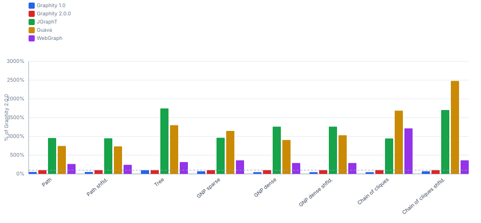

**Allocations @ 100k nodes in bytes (lower is better)**

| Shape | Graphity 1.0 | Graphity 2.0.0 | JGraphT | Guava | WebGraph |
|---|---:|---:|---:|---:|---:|
| Path<br><sub>100k nodes, 100k edges</sub> | 2.8 MB (47.3%) | 6.0 MB | 51.6 MB (865%) | 32.1 MB (537%) | 13.3 MB (223%) |
| Path shfld.<br><sub>100k nodes, 100k edges</sub> | 2.8 MB (57.5%) | 4.9 MB | 51.7 MB (1053%) | 35.4 MB (721%) | 13.5 MB (274%) |
| Tree<br><sub>100k nodes, 100k edges</sub> | 2.8 MB (101%) | 2.8 MB | 50.3 MB (1792%) | 33.5 MB (1192%) | 8.8 MB (314%) |
| GNP sparse<br><sub>100k nodes, 300k edges</sub> | 2.5 MB (64.2%) | 3.8 MB | 34.5 MB (898%) | 42.9 MB (1115%) | 12.3 MB (320%) |
| GNP dense<br><sub>100k nodes, 3M edges</sub> | 2.4 MB (43.5%) | 5.6 MB | 70.7 MB (1269%) | 45.2 MB (812%) | 13.5 MB (242%) |
| GNP dense shfld.<br><sub>100k nodes, 3M edges</sub> | 2.4 MB (43.5%) | 5.6 MB | 70.7 MB (1269%) | 53.3 MB (957%) | 13.5 MB (242%) |
| Chain of cliques<br><sub>100k nodes, 3.1M edges</sub> | 2.4 MB (43.6%) | 5.6 MB | 48.5 MB (869%) | 76.8 MB (1375%) | 60.3 MB (1079%) |
| Chain of cliques shfld.<br><sub>100k nodes, 3.1M edges</sub> | 2.4 MB (73.0%) | 3.3 MB | 61.7 MB (1846%) | 89.7 MB (2685%) | 12.3 MB (368%) |

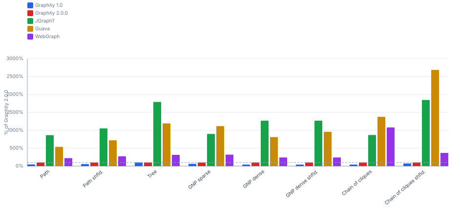

### 3.3 WCC

**Allocations @ 10k nodes in bytes (lower is better)**

| Shape | Graphity 1.0 | Graphity 2.0.0 |
|---|---:|---:|
| Path<br><sub>10k nodes, 10k edges</sub> | 200 kB (100%) | 200 kB |
| Path shfld.<br><sub>10k nodes, 10k edges</sub> | 200 kB (100%) | 200 kB |
| Tree<br><sub>10k nodes, 10k edges</sub> | 200 kB (100%) | 200 kB |
| GNP sparse<br><sub>10k nodes, 30k edges</sub> | 200 kB (100%) | 200 kB |
| GNP dense<br><sub>10k nodes, 299.6k edges</sub> | 200 kB (100%) | 200 kB |
| GNP dense shfld.<br><sub>10k nodes, 299.6k edges</sub> | 200 kB (100%) | 200 kB |
| Chain of cliques<br><sub>10k nodes, 310.8k edges</sub> | 200 kB (100%) | 200 kB |
| Chain of cliques shfld.<br><sub>10k nodes, 310.8k edges</sub> | 200 kB (100%) | 200 kB |


**Allocations @ 100k nodes in bytes (lower is better)**

| Shape | Graphity 1.0 | Graphity 2.0.0 |
|---|---:|---:|
| Path<br><sub>100k nodes, 100k edges</sub> | 2.0 MB (100%) | 2.0 MB |
| Path shfld.<br><sub>100k nodes, 100k edges</sub> | 2.0 MB (100.0%) | 2.0 MB |
| Tree<br><sub>100k nodes, 100k edges</sub> | 2.0 MB (100%) | 2.0 MB |
| GNP sparse<br><sub>100k nodes, 300k edges</sub> | 2.0 MB (100%) | 2.0 MB |
| GNP dense<br><sub>100k nodes, 3M edges</sub> | 2.0 MB (100%) | 2.0 MB |
| GNP dense shfld.<br><sub>100k nodes, 3M edges</sub> | 2.0 MB (100%) | 2.0 MB |
| Chain of cliques<br><sub>100k nodes, 3.1M edges</sub> | 2.0 MB (100.0%) | 2.0 MB |
| Chain of cliques shfld.<br><sub>100k nodes, 3.1M edges</sub> | 2.0 MB (100.0%) | 2.0 MB |


### 3.4 CCs

**Allocations @ 10k nodes in bytes (lower is better)**

| Shape | Graphity 1.0 | Graphity 2.0.0 |
|---|---:|---:|
| Path<br><sub>10k nodes, 10k edges</sub> | 200 kB (100%) | 200 kB |
| Path shfld.<br><sub>10k nodes, 10k edges</sub> | 200 kB (100%) | 200 kB |
| Tree<br><sub>10k nodes, 10k edges</sub> | 200 kB (100%) | 200 kB |
| GNP sparse<br><sub>10k nodes, 30k edges</sub> | 200 kB (100%) | 200 kB |
| GNP dense<br><sub>10k nodes, 299.6k edges</sub> | 200 kB (100%) | 200 kB |
| GNP dense shfld.<br><sub>10k nodes, 299.6k edges</sub> | 200 kB (100%) | 200 kB |
| Chain of cliques<br><sub>10k nodes, 310.8k edges</sub> | 200 kB (100%) | 200 kB |
| Chain of cliques shfld.<br><sub>10k nodes, 310.8k edges</sub> | 200 kB (100%) | 200 kB |


**Allocations @ 100k nodes in bytes (lower is better)**

| Shape | Graphity 1.0 | Graphity 2.0.0 |
|---|---:|---:|
| Path<br><sub>100k nodes, 100k edges</sub> | 2.0 MB (100%) | 2.0 MB |
| Path shfld.<br><sub>100k nodes, 100k edges</sub> | 2.0 MB (100.0%) | 2.0 MB |
| Tree<br><sub>100k nodes, 100k edges</sub> | 2.0 MB (100%) | 2.0 MB |
| GNP sparse<br><sub>100k nodes, 300k edges</sub> | 2.0 MB (100%) | 2.0 MB |
| GNP dense<br><sub>100k nodes, 3M edges</sub> | 2.0 MB (100%) | 2.0 MB |
| GNP dense shfld.<br><sub>100k nodes, 3M edges</sub> | 2.0 MB (100%) | 2.0 MB |
| Chain of cliques<br><sub>100k nodes, 3.1M edges</sub> | 2.0 MB (100%) | 2.0 MB |
| Chain of cliques shfld.<br><sub>100k nodes, 3.1M edges</sub> | 2.0 MB (100%) | 2.0 MB |


### 3.5 TopOrder

**Allocations @ 10k nodes in bytes (lower is better)**

| Shape | Graphity 1.0 | Graphity 2.0.0 | JGraphT | Guava | WebGraph |
|---|---:|---:|---:|---:|---:|
| Path<br><sub>10k nodes, 10k edges</sub> | 42.7 kB (13.9%) | 306 kB | 1.3 MB (409%) | 1.7 MB (569%) | 1.5 MB (479%) |
| Path shfld.<br><sub>10k nodes, 10k edges</sub> | 42.7 kB (13.9%) | 306 kB | 1.3 MB (409%) | 2.4 MB (778%) | 1.0 MB (335%) |
| Tree<br><sub>10k nodes, 10k edges</sub> | 42.7 kB (84.0%) | 50.8 kB | 1.3 MB (2507%) | 2.3 MB (4430%) | 885 kB (1742%) |
| Tree shfld.<br><sub>10k nodes</sub> | 42.7 kB (84.0%) | 50.8 kB | 1.3 MB (2507%) | 2.3 MB (4430%) | 845 kB (1663%) |
| DAG GNP sparse<br><sub>10k nodes</sub> | 42.7 kB (84.0%) | 50.8 kB | 1.3 MB (2507%) | 1.6 MB (3171%) | 984 kB (1936%) |
| DAG GNP dense<br><sub>10k nodes</sub> | 42.7 kB (84.0%) | 50.8 kB | 1.3 MB (2468%) | 1.6 MB (3171%) | 1.1 MB (2162%) |
| DAG GNP dense shfld.<br><sub>10k nodes</sub> | 42.7 kB (84.0%) | 50.8 kB | 1.3 MB (2468%) | 1.6 MB (3171%) | 1.1 MB (2119%) |

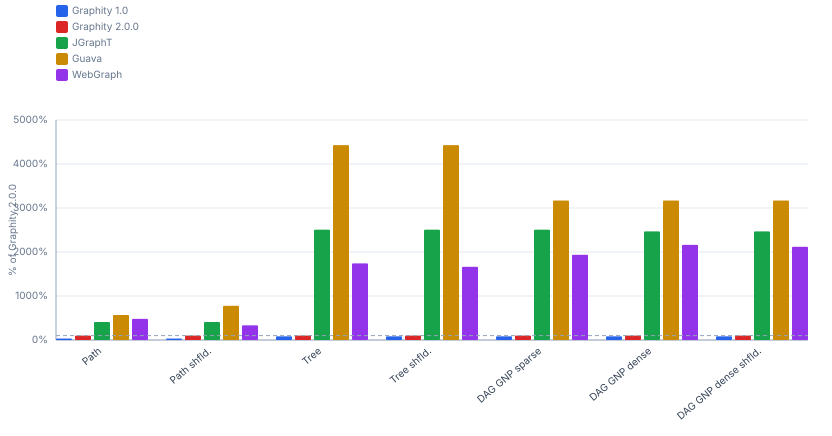

**Allocations @ 100k nodes in bytes (lower is better)**

| Shape | Graphity 1.0 | Graphity 2.0.0 | JGraphT | Guava | WebGraph |
|---|---:|---:|---:|---:|---:|
| Path<br><sub>100k nodes, 100k edges</sub> | 425 kB (11.8%) | 3.6 MB | 13.3 MB (370%) | 17.9 MB (499%) | 10.5 MB (292%) |
| Path shfld.<br><sub>100k nodes, 100k edges</sub> | 425 kB (16.8%) | 2.5 MB | 13.3 MB (525%) | 16.9 MB (667%) | 10.0 MB (396%) |
| Tree<br><sub>100k nodes, 100k edges</sub> | 425 kB (98.1%) | 433 kB | 13.5 MB (3108%) | 15.8 MB (3658%) | 8.5 MB (1953%) |
| Tree shfld.<br><sub>100k nodes</sub> | 425 kB (98.1%) | 433 kB | 13.5 MB (3108%) | 15.8 MB (3658%) | 8.4 MB (1945%) |
| DAG GNP sparse<br><sub>100k nodes</sub> | 425 kB (98.1%) | 433 kB | 13.6 MB (3128%) | 15.8 MB (3657%) | 9.5 MB (2203%) |
| DAG GNP dense<br><sub>100k nodes</sub> | 425 kB (98.1%) | 433 kB | 13.3 MB (3074%) | 15.9 MB (3658%) | 10.3 MB (2375%) |
| DAG GNP dense shfld.<br><sub>100k nodes</sub> | 425 kB (98.1%) | 433 kB | 13.3 MB (3074%) | 15.9 MB (3658%) | 10.2 MB (2362%) |

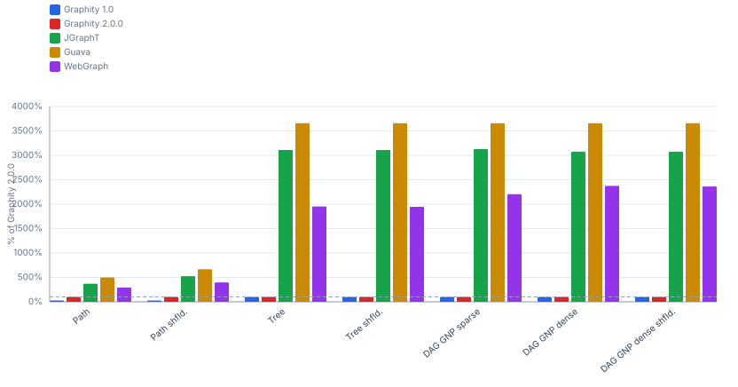

### 3.6 TopOrderAndLevels

**Allocations @ 10k nodes in bytes (lower is better)**

| Shape | Graphity 1.0 | Graphity 2.0.0 |
|---|---:|---:|
| Path<br><sub>10k nodes, 10k edges</sub> | 160 kB (100%) | 160 kB |
| Path shfld.<br><sub>10k nodes, 10k edges</sub> | 160 kB (100%) | 160 kB |
| Tree<br><sub>10k nodes, 10k edges</sub> | 160 kB (100%) | 160 kB |
| Tree shfld.<br><sub>10k nodes</sub> | 160 kB (100%) | 160 kB |
| DAG GNP sparse<br><sub>10k nodes</sub> | 160 kB (100%) | 160 kB |
| DAG GNP dense<br><sub>10k nodes</sub> | 160 kB (100%) | 160 kB |
| DAG GNP dense shfld.<br><sub>10k nodes</sub> | 160 kB (100%) | 160 kB |


**Allocations @ 100k nodes in bytes (lower is better)**

| Shape | Graphity 1.0 | Graphity 2.0.0 |
|---|---:|---:|
| Path<br><sub>100k nodes, 100k edges</sub> | 1.6 MB (100%) | 1.6 MB |
| Path shfld.<br><sub>100k nodes, 100k edges</sub> | 1.6 MB (100%) | 1.6 MB |
| Tree<br><sub>100k nodes, 100k edges</sub> | 1.6 MB (100%) | 1.6 MB |
| Tree shfld.<br><sub>100k nodes</sub> | 1.6 MB (100%) | 1.6 MB |
| DAG GNP sparse<br><sub>100k nodes</sub> | 1.6 MB (100%) | 1.6 MB |
| DAG GNP dense<br><sub>100k nodes</sub> | 1.6 MB (100%) | 1.6 MB |
| DAG GNP dense shfld.<br><sub>100k nodes</sub> | 1.6 MB (100%) | 1.6 MB |


### 3.7 BackEdges

**Allocations @ 10k nodes in bytes (lower is better)**

| Shape | Graphity 1.0 | Graphity 2.0.0 | JGraphT | Guava | WebGraph |
|---|---:|---:|---:|---:|---:|
| Path<br><sub>10k nodes, 10k edges</sub> | 2.7 kB (1.0%) | 266 kB | 161 kB (60.3%) | 961 kB (361%) | 1.4 MB (535%) |
| Path shfld.<br><sub>10k nodes, 10k edges</sub> | 2.7 kB (1.0%) | 266 kB | 161 kB (60.4%) | 1.6 MB (601%) | 985 kB (370%) |
| Tree<br><sub>10k nodes, 10k edges</sub> | 2.7 kB (25.2%) | 10.9 kB | 161 kB (1476%) | 1.6 MB (14712%) | 845 kB (7768%) |
| GNP sparse<br><sub>10k nodes, 30k edges</sub> | 228 kB (67.9%) | 336 kB | 386 kB (115%) | 1.2 MB (353%) | 1.2 MB (351%) |
| GNP dense<br><sub>10k nodes, 299.6k edges</sub> | 3.8 MB (93.6%) | 4.1 MB | 4.0 MB (97.4%) | 4.8 MB (117%) | 4.9 MB (120%) |
| GNP dense shfld.<br><sub>10k nodes, 299.6k edges</sub> | 3.8 MB (93.6%) | 4.1 MB | 4.0 MB (97.4%) | 4.8 MB (117%) | 4.8 MB (118%) |
| Chain of cliques<br><sub>10k nodes, 310.8k edges</sub> | 3.8 MB (93.6%) | 4.1 MB | 4.0 MB (97.4%) | 5.4 MB (132%) | 9.7 MB (235%) |
| Chain of cliques shfld.<br><sub>10k nodes, 310.8k edges</sub> | 3.8 MB (97.3%) | 4.0 MB | 4.0 MB (101%) | 4.8 MB (121%) | 4.9 MB (124%) |

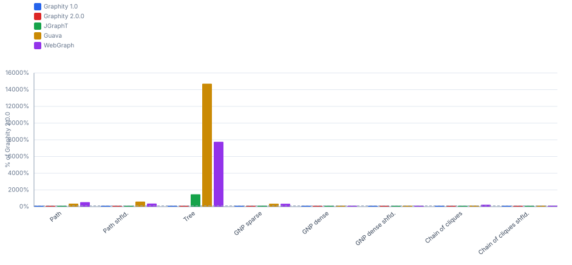

**Allocations @ 100k nodes in bytes (lower is better)**

| Shape | Graphity 1.0 | Graphity 2.0.0 | JGraphT | Guava | WebGraph |
|---|---:|---:|---:|---:|---:|
| Path<br><sub>100k nodes, 100k edges</sub> | 25.2 kB (0.8%) | 3.2 MB | 1.6 MB (50.8%) | 9.6 MB (301%) | 10.1 MB (315%) |
| Path shfld.<br><sub>100k nodes, 100k edges</sub> | 25.3 kB (1.2%) | 2.1 MB | 3.2 MB (151%) | 9.6 MB (451%) | 9.6 MB (452%) |
| Tree<br><sub>100k nodes, 100k edges</sub> | 25.3 kB (75.9%) | 33.4 kB | 1.6 MB (4862%) | 9.6 MB (28821%) | 8.1 MB (24143%) |
| GNP sparse<br><sub>100k nodes, 300k edges</sub> | 2.6 MB (64.9%) | 4.0 MB | 4.2 MB (105%) | 12.2 MB (306%) | 12.1 MB (302%) |
| GNP dense<br><sub>100k nodes, 3M edges</sub> | 43.8 MB (93.2%) | 47.0 MB | 47.0 MB (100%) | 53.4 MB (114%) | 53.6 MB (114%) |
| GNP dense shfld.<br><sub>100k nodes, 3M edges</sub> | 43.8 MB (93.2%) | 47.0 MB | 45.4 MB (96.6%) | 53.4 MB (114%) | 53.6 MB (114%) |
| Chain of cliques<br><sub>100k nodes, 3.1M edges</sub> | 43.8 MB (93.2%) | 47.0 MB | 45.4 MB (96.6%) | 53.4 MB (114%) | 101 MB (214%) |
| Chain of cliques shfld.<br><sub>100k nodes, 3.1M edges</sub> | 43.8 MB (97.9%) | 44.7 MB | 45.4 MB (101%) | 53.4 MB (119%) | 53.5 MB (120%) |

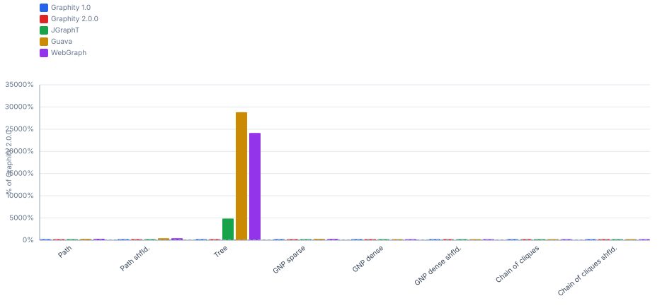

### 3.8 EdgeTypes

**Allocations @ 10k nodes in bytes (lower is better)**

| Shape | Graphity 1.0 | Graphity 2.0.0 | JGraphT | Guava | WebGraph |
|---|---:|---:|---:|---:|---:|
| Path<br><sub>10k nodes, 10k edges</sub> | 52.7 kB (16.7%) | 316 kB | 581 kB (184%) | 1.4 MB (437%) | 1.8 MB (584%) |
| Path shfld.<br><sub>10k nodes, 10k edges</sub> | 52.7 kB (16.7%) | 316 kB | 581 kB (184%) | 2.0 MB (639%) | 1.4 MB (444%) |
| Tree<br><sub>10k nodes, 10k edges</sub> | 52.7 kB (86.6%) | 60.8 kB | 581 kB (956%) | 2.0 MB (3323%) | 1.3 MB (2081%) |
| GNP sparse<br><sub>10k nodes, 30k edges</sub> | 72.7 kB (40.2%) | 181 kB | 1.1 MB (584%) | 1.9 MB (1027%) | 1.8 MB (1023%) |
| GNP dense<br><sub>10k nodes, 299.6k edges</sub> | 342 kB (56.5%) | 606 kB | 9.9 MB (1638%) | 10.7 MB (1770%) | 10.8 MB (1789%) |
| GNP dense shfld.<br><sub>10k nodes, 299.6k edges</sub> | 342 kB (56.5%) | 606 kB | 9.9 MB (1638%) | 11.4 MB (1876%) | 10.8 MB (1777%) |
| Chain of cliques<br><sub>10k nodes, 310.8k edges</sub> | 354 kB (57.3%) | 617 kB | 9.9 MB (1608%) | 11.4 MB (1842%) | 15.6 MB (2525%) |
| Chain of cliques shfld.<br><sub>10k nodes, 310.8k edges</sub> | 354 kB (76.6%) | 462 kB | 9.9 MB (2151%) | 11.4 MB (2463%) | 10.8 MB (2348%) |

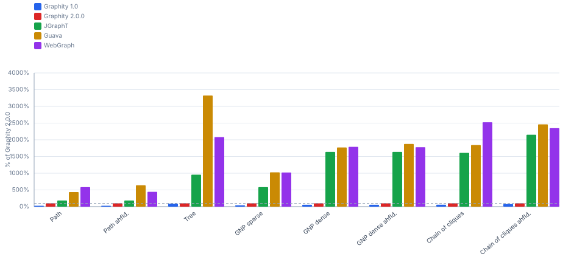

**Allocations @ 100k nodes in bytes (lower is better)**

| Shape | Graphity 1.0 | Graphity 2.0.0 | JGraphT | Guava | WebGraph |
|---|---:|---:|---:|---:|---:|
| Path<br><sub>100k nodes, 100k edges</sub> | 525 kB (14.2%) | 3.7 MB | 4.9 MB (133%) | 12.9 MB (349%) | 13.4 MB (362%) |
| Path shfld.<br><sub>100k nodes, 100k edges</sub> | 525 kB (19.9%) | 2.6 MB | 4.9 MB (186%) | 12.9 MB (490%) | 12.9 MB (491%) |
| Tree<br><sub>100k nodes, 100k edges</sub> | 525 kB (98.5%) | 533 kB | 4.9 MB (920%) | 12.9 MB (2420%) | 11.3 MB (2127%) |
| GNP sparse<br><sub>100k nodes, 300k edges</sub> | 725 kB (34.1%) | 2.1 MB | 11.7 MB (553%) | 19.7 MB (929%) | 19.6 MB (923%) |
| GNP dense<br><sub>100k nodes, 3M edges</sub> | 3.4 MB (51.9%) | 6.6 MB | 113 MB (1710%) | 121 MB (1831%) | 121 MB (1834%) |
| GNP dense shfld.<br><sub>100k nodes, 3M edges</sub> | 3.4 MB (51.9%) | 6.6 MB | 113 MB (1710%) | 121 MB (1831%) | 121 MB (1834%) |
| Chain of cliques<br><sub>100k nodes, 3.1M edges</sub> | 3.5 MB (52.7%) | 6.7 MB | 113 MB (1683%) | 121 MB (1803%) | 168 MB (2506%) |
| Chain of cliques shfld.<br><sub>100k nodes, 3.1M edges</sub> | 3.5 MB (79.2%) | 4.5 MB | 113 MB (2531%) | 121 MB (2710%) | 121 MB (2712%) |


