# Graphity vs. JGraphT, Guava and WebGraph — synthetic / ubuntu-ryzen-9950x

Graphity `2.2.0` against the peer libraries. Peer numbers come from the newest run that measured them, which need not be the run of the newest Graphity version; every column states the version it belongs to. Blocks without a peer column are Graphity-only benchmarks or graph sizes beyond the peers' reach — for the comparison across Graphity versions see [`synthetic-ubuntu-ryzen-9950x-history.md`](synthetic-ubuntu-ryzen-9950x-history.md).

```
Profile:      synthetic
Timestamp:    2026-07-30 09:16:36
JDK:          OpenJDK 64-Bit Server VM 25.0.2 (Amazon.com Inc.)
OS:           Ubuntu 25.10, kernel 6.17.0-41-generic (amd64)
CPU:          AMD Ryzen 9 9950X 16-Core Processor (32 logical cores)
RAM:          89.7 GiB
```

## Contents

- [1 Performance](#1-performance)
  - [1.1 Build](#11-build)
  - [1.2 SCC](#12-scc)
  - [1.3 WCC](#13-wcc)
  - [1.4 CCs](#14-ccs)
  - [1.5 Condense](#15-condense)
  - [1.6 TopOrder](#16-toporder)
  - [1.7 TopOrderAndLevels](#17-toporderandlevels)
  - [1.8 BackEdges](#18-backedges)
  - [1.9 EdgeTypes](#19-edgetypes)
  - [1.10 Reorder (DFS-preorder) cost](#110-reorder-dfs-preorder-cost)
- [2 Memory Footprint](#2-memory-footprint)
  - [2.1 Total Graph Size](#21-total-graph-size)
  - [2.2 Bytes per Element  `totalBytes / (Nodes + Edges)`](#22-bytes-per-element-totalbytes-nodes-edges)
- [3 Allocations](#3-allocations)
  - [3.1 Build](#31-build)
  - [3.2 SCC](#32-scc)
  - [3.3 WCC](#33-wcc)
  - [3.4 CCs](#34-ccs)
  - [3.5 Condense](#35-condense)
  - [3.6 TopOrder](#36-toporder)
  - [3.7 TopOrderAndLevels](#37-toporderandlevels)
  - [3.8 BackEdges](#38-backedges)
  - [3.9 EdgeTypes](#39-edgetypes)

## 1 Performance

Times (ms/op, lower is better) and throughput (op/s, higher is better) for each algorithm and graph size. Non-baseline cells show the factor relative to **Graphity 2.2.0**, or the newest version present in a table it is missing from (= 100% in the throughput table).

### 1.1 Build

#### Times @ 10k nodes (ms/op, lower is better)

| Shape | Graphity 2.2.0 | JGraphT | Guava | WebGraph |
|---|---:|---:|---:|---:|
| Path<br><sub>10k nodes, 10k edges</sub> | 0.082 ms | 1.058 ms (13×) | 0.361 ms (4.4×) | 2.147 ms (26×) |
| Path shfld.<br><sub>10k nodes, 10k edges</sub> | 0.082 ms | 1.140 ms (14×) | 0.550 ms (6.7×) | 2.797 ms (34×) |
| Tree<br><sub>10k nodes, 10k edges</sub> | 0.092 ms | 1.156 ms (13×) | 0.529 ms (5.8×) | 2.595 ms (28×) |
| GNP sparse<br><sub>10k nodes, 30k edges</sub> | 0.162 ms | 3.895 ms (24×) | 2.112 ms (13×) | 8.047 ms (50×) |
| GNP dense<br><sub>10k nodes, 299.6k edges</sub> | 1.556 ms | 53.35 ms (34×) | 31.91 ms (21×) | 45.45 ms (29×) |
| GNP dense shfld.<br><sub>10k nodes, 299.6k edges</sub> | 1.584 ms | 56.13 ms (35×) | 32.17 ms (20×) | 43.46 ms (27×) |
| Chain of cliques<br><sub>10k nodes, 310.8k edges</sub> | 1.572 ms | 42.74 ms (27×) | 8.213 ms (5.2×) | 6.435 ms (4.1×) |
| Chain of cliques shfld.<br><sub>10k nodes, 310.8k edges</sub> | 1.562 ms | 57.00 ms (36×) | 18.55 ms (12×) | 45.35 ms (29×) |

#### Throughput @ 10k nodes (op/s, higher is better)

| Shape | Graphity 2.2.0 | JGraphT | Guava | WebGraph |
|---|---:|---:|---:|---:|
| Path<br><sub>10k nodes, 10k edges</sub> | 12 195 op/s | 945.2 op/s (7.8%) | 2 770 op/s (22.7%) | 465.8 op/s (3.8%) |
| Path shfld.<br><sub>10k nodes, 10k edges</sub> | 12 195 op/s | 877.2 op/s (7.2%) | 1 818 op/s (14.9%) | 357.5 op/s (2.9%) |
| Tree<br><sub>10k nodes, 10k edges</sub> | 10 870 op/s | 865.1 op/s (8.0%) | 1 890 op/s (17.4%) | 385.4 op/s (3.5%) |
| GNP sparse<br><sub>10k nodes, 30k edges</sub> | 6 173 op/s | 256.7 op/s (4.2%) | 473.5 op/s (7.7%) | 124.3 op/s (2.0%) |
| GNP dense<br><sub>10k nodes, 299.6k edges</sub> | 642.7 op/s | 18.74 op/s (2.9%) | 31.34 op/s (4.9%) | 22.00 op/s (3.4%) |
| GNP dense shfld.<br><sub>10k nodes, 299.6k edges</sub> | 631.3 op/s | 17.82 op/s (2.8%) | 31.08 op/s (4.9%) | 23.01 op/s (3.6%) |
| Chain of cliques<br><sub>10k nodes, 310.8k edges</sub> | 636.1 op/s | 23.39 op/s (3.7%) | 121.8 op/s (19.1%) | 155.4 op/s (24.4%) |
| Chain of cliques shfld.<br><sub>10k nodes, 310.8k edges</sub> | 640.2 op/s | 17.54 op/s (2.7%) | 53.92 op/s (8.4%) | 22.05 op/s (3.4%) |

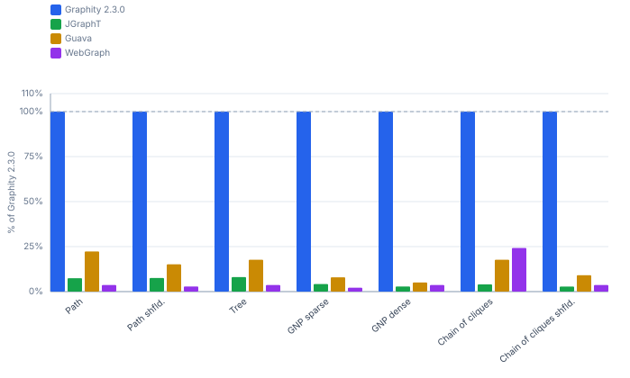

#### Times @ 100k nodes (ms/op, lower is better)

| Shape | Graphity 2.2.0 | JGraphT | Guava | WebGraph |
|---|---:|---:|---:|---:|
| Path<br><sub>100k nodes, 100k edges</sub> | 0.678 ms | 14.18 ms (21×) | 5.549 ms (8.2×) | 19.96 ms (29×) |
| Path shfld.<br><sub>100k nodes, 100k edges</sub> | 0.678 ms | 23.69 ms (35×) | 8.730 ms (13×) | 27.61 ms (41×) |
| Tree<br><sub>100k nodes, 100k edges</sub> | 1.085 ms | 24.17 ms (22×) | 9.976 ms (9.2×) | 28.85 ms (27×) |
| GNP sparse<br><sub>100k nodes, 300k edges</sub> | 2.610 ms | 93.52 ms (36×) | 47.52 ms (18×) | 86.79 ms (33×) |
| GNP dense<br><sub>100k nodes, 3M edges</sub> | 15.91 ms | 1522.2 ms (96×) | 1014.4 ms (64×) | 559.4 ms (35×) |
| GNP dense shfld.<br><sub>100k nodes, 3M edges</sub> | 16.66 ms | 1566.9 ms (94×) | 1011.9 ms (61×) | 518.7 ms (31×) |
| Chain of cliques<br><sub>100k nodes, 3.1M edges</sub> | 16.84 ms | 851.4 ms (51×) | 110.1 ms (6.5×) | 61.99 ms (3.7×) |
| Chain of cliques shfld.<br><sub>100k nodes, 3.1M edges</sub> | 15.92 ms | 1527.8 ms (96×) | 707.3 ms (44×) | 540.5 ms (34×) |

#### Throughput @ 100k nodes (op/s, higher is better)

| Shape | Graphity 2.2.0 | JGraphT | Guava | WebGraph |
|---|---:|---:|---:|---:|
| Path<br><sub>100k nodes, 100k edges</sub> | 1 475 op/s | 70.54 op/s (4.8%) | 180.2 op/s (12.2%) | 50.11 op/s (3.4%) |
| Path shfld.<br><sub>100k nodes, 100k edges</sub> | 1 475 op/s | 42.21 op/s (2.9%) | 114.5 op/s (7.8%) | 36.22 op/s (2.5%) |
| Tree<br><sub>100k nodes, 100k edges</sub> | 921.7 op/s | 41.38 op/s (4.5%) | 100.2 op/s (10.9%) | 34.66 op/s (3.8%) |
| GNP sparse<br><sub>100k nodes, 300k edges</sub> | 383.1 op/s | 10.69 op/s (2.8%) | 21.04 op/s (5.5%) | 11.52 op/s (3.0%) |
| GNP dense<br><sub>100k nodes, 3M edges</sub> | 62.85 op/s | 0.657 op/s (1.0%) | 0.986 op/s (1.6%) | 1.788 op/s (2.8%) |
| GNP dense shfld.<br><sub>100k nodes, 3M edges</sub> | 60.03 op/s | 0.638 op/s (1.1%) | 0.988 op/s (1.6%) | 1.928 op/s (3.2%) |
| Chain of cliques<br><sub>100k nodes, 3.1M edges</sub> | 59.39 op/s | 1.175 op/s (2.0%) | 9.083 op/s (15.3%) | 16.13 op/s (27.2%) |
| Chain of cliques shfld.<br><sub>100k nodes, 3.1M edges</sub> | 62.81 op/s | 0.655 op/s (1.0%) | 1.414 op/s (2.3%) | 1.850 op/s (2.9%) |

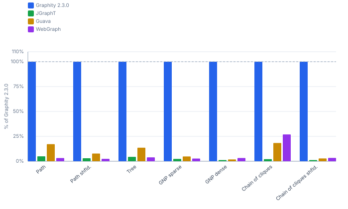

#### Times @ 1M nodes (ms/op, lower is better)

| Shape | Graphity 2.2.0 |
|---|---:|
| GNP sparse<br><sub>1M nodes, 3M edges</sub> | 22.76 ms |
| GNP dense<br><sub>1M nodes, 30M edges</sub> | 181.6 ms |
| GNP dense shfld.<br><sub>1M nodes, 30M edges</sub> | 176.7 ms |
| Chain of cliques<br><sub>1M nodes, 31.1M edges</sub> | 163.2 ms |

#### Throughput @ 1M nodes (op/s, higher is better)

| Shape | Graphity 2.2.0 |
|---|---:|
| GNP sparse<br><sub>1M nodes, 3M edges</sub> | 43.94 op/s |
| GNP dense<br><sub>1M nodes, 30M edges</sub> | 5.507 op/s |
| GNP dense shfld.<br><sub>1M nodes, 30M edges</sub> | 5.659 op/s |
| Chain of cliques<br><sub>1M nodes, 31.1M edges</sub> | 6.127 op/s |

#### Times @ 10M nodes (ms/op, lower is better)

| Shape | Graphity 2.2.0 |
|---|---:|
| GNP sparse<br><sub>10M nodes, 30M edges</sub> | 237.7 ms |
| GNP dense<br><sub>10M nodes, 299.6M edges</sub> | 2294.9 ms |
| GNP dense shfld.<br><sub>10M nodes, 299.6M edges</sub> | 1804.1 ms |
| Chain of cliques<br><sub>10M nodes, 310.8M edges</sub> | 1779.7 ms |

#### Throughput @ 10M nodes (op/s, higher is better)

| Shape | Graphity 2.2.0 |
|---|---:|
| GNP sparse<br><sub>10M nodes, 30M edges</sub> | 4.207 op/s |
| GNP dense<br><sub>10M nodes, 299.6M edges</sub> | 0.436 op/s |
| GNP dense shfld.<br><sub>10M nodes, 299.6M edges</sub> | 0.554 op/s |
| Chain of cliques<br><sub>10M nodes, 310.8M edges</sub> | 0.562 op/s |

#### Times @ 100M nodes (ms/op, lower is better)

| Shape | Graphity 2.2.0 |
|---|---:|
| GNP sparse<br><sub>100M nodes, 300M edges</sub> | 2518.5 ms |

#### Throughput @ 100M nodes (op/s, higher is better)

| Shape | Graphity 2.2.0 |
|---|---:|
| GNP sparse<br><sub>100M nodes, 300M edges</sub> | 0.397 op/s |

### 1.2 SCC

#### Times @ 10k nodes (ms/op, lower is better)

| Shape | Graphity 2.2.0 | Graphity 2.2.0<br>(reordered) | JGraphT | Guava | WebGraph |
|---|---:|---:|---:|---:|---:|
| Path<br><sub>10k nodes, 10k edges</sub> | 0.113 ms | 0.113 ms (1.0×) | 0.738 ms (6.5×) | 0.799 ms (7.1×) | 0.342 ms (3.0×) |
| Path shfld.<br><sub>10k nodes, 10k edges</sub> | 0.130 ms | 0.113 ms (0.9×) | 1.230 ms (9.5×) | 1.339 ms (10×) | 0.493 ms (3.8×) |
| Tree<br><sub>10k nodes, 10k edges</sub> | 0.079 ms | 0.074 ms (0.9×) | 1.133 ms (14×) | 1.237 ms (16×) | 0.468 ms (5.9×) |
| GNP sparse<br><sub>10k nodes, 30k edges</sub> | 0.248 ms | 0.109 ms (0.4×) | 2.116 ms (8.5×) | 2.499 ms (10×) | 0.840 ms (3.4×) |
| GNP dense<br><sub>10k nodes, 299.6k edges</sub> | 0.541 ms | 0.382 ms (0.7×) | 19.69 ms (36×) | 19.29 ms (36×) | 2.319 ms (4.3×) |
| GNP dense shfld.<br><sub>10k nodes, 299.6k edges</sub> | 0.572 ms | 0.372 ms (0.7×) | 24.65 ms (43×) | 22.41 ms (39×) | 2.355 ms (4.1×) |
| Chain of cliques<br><sub>10k nodes, 310.8k edges</sub> | 0.267 ms | 0.264 ms (1.0×) | 16.45 ms (62×) | 4.769 ms (18×) | 3.285 ms (12×) |
| Chain of cliques shfld.<br><sub>10k nodes, 310.8k edges</sub> | 0.353 ms | 0.274 ms (0.8×) | 18.89 ms (54×) | 7.950 ms (23×) | 2.048 ms (5.8×) |

#### Throughput @ 10k nodes (op/s, higher is better)

| Shape | Graphity 2.2.0 | Graphity 2.2.0<br>(reordered) | JGraphT | Guava | WebGraph |
|---|---:|---:|---:|---:|---:|
| Path<br><sub>10k nodes, 10k edges</sub> | 8 850 op/s | 8 850 op/s (100%) | 1 355 op/s (15.3%) | 1 252 op/s (14.1%) | 2 924 op/s (33.0%) |
| Path shfld.<br><sub>10k nodes, 10k edges</sub> | 7 692 op/s | 8 850 op/s (115%) | 813.0 op/s (10.6%) | 746.8 op/s (9.7%) | 2 028 op/s (26.4%) |
| Tree<br><sub>10k nodes, 10k edges</sub> | 12 658 op/s | 13 514 op/s (107%) | 882.6 op/s (7.0%) | 808.4 op/s (6.4%) | 2 137 op/s (16.9%) |
| GNP sparse<br><sub>10k nodes, 30k edges</sub> | 4 032 op/s | 9 174 op/s (228%) | 472.6 op/s (11.7%) | 400.2 op/s (9.9%) | 1 190 op/s (29.5%) |
| GNP dense<br><sub>10k nodes, 299.6k edges</sub> | 1 848 op/s | 2 618 op/s (142%) | 50.78 op/s (2.7%) | 51.85 op/s (2.8%) | 431.2 op/s (23.3%) |
| GNP dense shfld.<br><sub>10k nodes, 299.6k edges</sub> | 1 748 op/s | 2 688 op/s (154%) | 40.56 op/s (2.3%) | 44.62 op/s (2.6%) | 424.6 op/s (24.3%) |
| Chain of cliques<br><sub>10k nodes, 310.8k edges</sub> | 3 745 op/s | 3 788 op/s (101%) | 60.78 op/s (1.6%) | 209.7 op/s (5.6%) | 304.4 op/s (8.1%) |
| Chain of cliques shfld.<br><sub>10k nodes, 310.8k edges</sub> | 2 833 op/s | 3 650 op/s (129%) | 52.92 op/s (1.9%) | 125.8 op/s (4.4%) | 488.3 op/s (17.2%) |

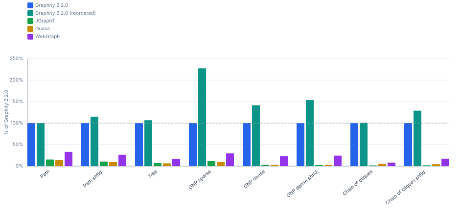

#### Times @ 100k nodes (ms/op, lower is better)

| Shape | Graphity 2.2.0 | Graphity 2.2.0<br>(reordered) | JGraphT | Guava | WebGraph |
|---|---:|---:|---:|---:|---:|
| Path<br><sub>100k nodes, 100k edges</sub> | 1.098 ms | 1.119 ms (1.0×) | 13.15 ms (12×) | 23.58 ms (21×) | 3.321 ms (3.0×) |
| Path shfld.<br><sub>100k nodes, 100k edges</sub> | 2.158 ms | 1.092 ms (0.5×) | 45.23 ms (21×) | 50.38 ms (23×) | 5.393 ms (2.5×) |
| Tree<br><sub>100k nodes, 100k edges</sub> | 1.807 ms | 1.111 ms (0.6×) | 40.83 ms (23×) | 37.29 ms (21×) | 5.616 ms (3.1×) |
| GNP sparse<br><sub>100k nodes, 300k edges</sub> | 4.322 ms | 2.240 ms (0.5×) | 104.6 ms (24×) | 105.6 ms (24×) | 10.34 ms (2.4×) |
| GNP dense<br><sub>100k nodes, 3M edges</sub> | 7.241 ms | 4.356 ms (0.6×) | 486.4 ms (67×) | 424.2 ms (59×) | 33.90 ms (4.7×) |
| GNP dense shfld.<br><sub>100k nodes, 3M edges</sub> | 7.346 ms | 4.502 ms (0.6×) | 461.0 ms (63×) | 361.8 ms (49×) | 35.41 ms (4.8×) |
| Chain of cliques<br><sub>100k nodes, 3.1M edges</sub> | 2.920 ms | 2.648 ms (0.9×) | 179.6 ms (62×) | 115.4 ms (40×) | 36.96 ms (13×) |
| Chain of cliques shfld.<br><sub>100k nodes, 3.1M edges</sub> | 4.717 ms | 2.733 ms (0.6×) | 380.1 ms (81×) | 161.4 ms (34×) | 29.75 ms (6.3×) |

#### Throughput @ 100k nodes (op/s, higher is better)

| Shape | Graphity 2.2.0 | Graphity 2.2.0<br>(reordered) | JGraphT | Guava | WebGraph |
|---|---:|---:|---:|---:|---:|
| Path<br><sub>100k nodes, 100k edges</sub> | 910.7 op/s | 893.7 op/s (98.1%) | 76.05 op/s (8.4%) | 42.41 op/s (4.7%) | 301.1 op/s (33.1%) |
| Path shfld.<br><sub>100k nodes, 100k edges</sub> | 463.4 op/s | 915.8 op/s (198%) | 22.11 op/s (4.8%) | 19.85 op/s (4.3%) | 185.4 op/s (40.0%) |
| Tree<br><sub>100k nodes, 100k edges</sub> | 553.4 op/s | 900.1 op/s (163%) | 24.49 op/s (4.4%) | 26.82 op/s (4.8%) | 178.1 op/s (32.2%) |
| GNP sparse<br><sub>100k nodes, 300k edges</sub> | 231.4 op/s | 446.4 op/s (193%) | 9.560 op/s (4.1%) | 9.470 op/s (4.1%) | 96.76 op/s (41.8%) |
| GNP dense<br><sub>100k nodes, 3M edges</sub> | 138.1 op/s | 229.6 op/s (166%) | 2.056 op/s (1.5%) | 2.357 op/s (1.7%) | 29.50 op/s (21.4%) |
| GNP dense shfld.<br><sub>100k nodes, 3M edges</sub> | 136.1 op/s | 222.1 op/s (163%) | 2.169 op/s (1.6%) | 2.764 op/s (2.0%) | 28.24 op/s (20.7%) |
| Chain of cliques<br><sub>100k nodes, 3.1M edges</sub> | 342.5 op/s | 377.6 op/s (110%) | 5.568 op/s (1.6%) | 8.666 op/s (2.5%) | 27.05 op/s (7.9%) |
| Chain of cliques shfld.<br><sub>100k nodes, 3.1M edges</sub> | 212.0 op/s | 365.9 op/s (173%) | 2.631 op/s (1.2%) | 6.196 op/s (2.9%) | 33.62 op/s (15.9%) |


#### Times @ 1M nodes (ms/op, lower is better)

| Shape | Graphity 2.2.0 | Graphity 2.2.0<br>(reordered) |
|---|---:|---:|
| GNP sparse<br><sub>1M nodes, 3M edges</sub> | 74.83 ms | 25.24 ms (0.3×) |
| GNP dense<br><sub>1M nodes, 30M edges</sub> | 234.8 ms | — |
| GNP dense shfld.<br><sub>1M nodes, 30M edges</sub> | 232.3 ms | 65.01 ms (0.3×) |
| Chain of cliques<br><sub>1M nodes, 31.1M edges</sub> | 26.13 ms | — |

#### Throughput @ 1M nodes (op/s, higher is better)

| Shape | Graphity 2.2.0 | Graphity 2.2.0<br>(reordered) |
|---|---:|---:|
| GNP sparse<br><sub>1M nodes, 3M edges</sub> | 13.36 op/s | 39.62 op/s (296%) |
| GNP dense<br><sub>1M nodes, 30M edges</sub> | 4.259 op/s | — |
| GNP dense shfld.<br><sub>1M nodes, 30M edges</sub> | 4.305 op/s | 15.38 op/s (357%) |
| Chain of cliques<br><sub>1M nodes, 31.1M edges</sub> | 38.27 op/s | — |

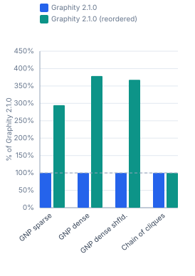

#### Times @ 10M nodes (ms/op, lower is better)

| Shape | Graphity 2.2.0 | Graphity 2.2.0<br>(reordered) |
|---|---:|---:|
| GNP sparse<br><sub>10M nodes, 30M edges</sub> | 3038.1 ms | 718.3 ms (0.2×) |
| GNP dense<br><sub>10M nodes, 299.6M edges</sub> | 6535.4 ms | — |
| GNP dense shfld.<br><sub>10M nodes, 299.6M edges</sub> | 6472.2 ms | 2718.8 ms (0.4×) |
| Chain of cliques<br><sub>10M nodes, 310.8M edges</sub> | 260.5 ms | — |

#### Throughput @ 10M nodes (op/s, higher is better)

| Shape | Graphity 2.2.0 | Graphity 2.2.0<br>(reordered) |
|---|---:|---:|
| GNP sparse<br><sub>10M nodes, 30M edges</sub> | 0.329 op/s | 1.392 op/s (423%) |
| GNP dense<br><sub>10M nodes, 299.6M edges</sub> | 0.153 op/s | — |
| GNP dense shfld.<br><sub>10M nodes, 299.6M edges</sub> | 0.155 op/s | 0.368 op/s (238%) |
| Chain of cliques<br><sub>10M nodes, 310.8M edges</sub> | 3.839 op/s | — |

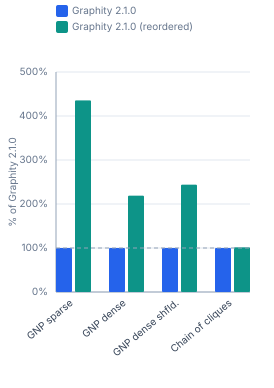

#### Times @ 100M nodes (ms/op, lower is better)

| Shape | Graphity 2.2.0 | Graphity 2.2.0<br>(reordered) |
|---|---:|---:|
| GNP sparse<br><sub>100M nodes, 300M edges</sub> | 36204 ms | 9976.7 ms (0.3×) |

#### Throughput @ 100M nodes (op/s, higher is better)

| Shape | Graphity 2.2.0 | Graphity 2.2.0<br>(reordered) |
|---|---:|---:|
| GNP sparse<br><sub>100M nodes, 300M edges</sub> | 0.028 op/s | 0.100 op/s (363%) |

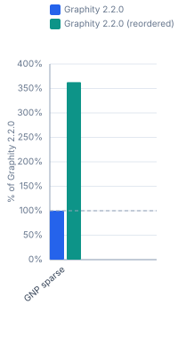

### 1.3 WCC

#### Times @ 10k nodes (ms/op, lower is better)

| Shape | Graphity 2.2.0 | Graphity 2.2.0<br>(reordered) |
|---|---:|---:|
| Path<br><sub>10k nodes, 10k edges</sub> | 0.043 ms | 0.036 ms (0.8×) |
| Path shfld.<br><sub>10k nodes, 10k edges</sub> | 0.045 ms | 0.036 ms (0.8×) |
| Tree<br><sub>10k nodes, 10k edges</sub> | 0.046 ms | 0.038 ms (0.8×) |
| GNP sparse<br><sub>10k nodes, 30k edges</sub> | 0.096 ms | 0.082 ms (0.9×) |
| GNP dense<br><sub>10k nodes, 299.6k edges</sub> | 0.522 ms | 0.522 ms (1.0×) |
| GNP dense shfld.<br><sub>10k nodes, 299.6k edges</sub> | 0.524 ms | 0.521 ms (1.0×) |
| Chain of cliques<br><sub>10k nodes, 310.8k edges</sub> | 0.587 ms | 0.585 ms (1.0×) |
| Chain of cliques shfld.<br><sub>10k nodes, 310.8k edges</sub> | 0.635 ms | 0.615 ms (1.0×) |

#### Throughput @ 10k nodes (op/s, higher is better)

| Shape | Graphity 2.2.0 | Graphity 2.2.0<br>(reordered) |
|---|---:|---:|
| Path<br><sub>10k nodes, 10k edges</sub> | 23 256 op/s | 27 778 op/s (119%) |
| Path shfld.<br><sub>10k nodes, 10k edges</sub> | 22 222 op/s | 27 778 op/s (125%) |
| Tree<br><sub>10k nodes, 10k edges</sub> | 21 739 op/s | 26 316 op/s (121%) |
| GNP sparse<br><sub>10k nodes, 30k edges</sub> | 10 417 op/s | 12 195 op/s (117%) |
| GNP dense<br><sub>10k nodes, 299.6k edges</sub> | 1 916 op/s | 1 916 op/s (100%) |
| GNP dense shfld.<br><sub>10k nodes, 299.6k edges</sub> | 1 908 op/s | 1 919 op/s (101%) |
| Chain of cliques<br><sub>10k nodes, 310.8k edges</sub> | 1 704 op/s | 1 709 op/s (100%) |
| Chain of cliques shfld.<br><sub>10k nodes, 310.8k edges</sub> | 1 575 op/s | 1 626 op/s (103%) |

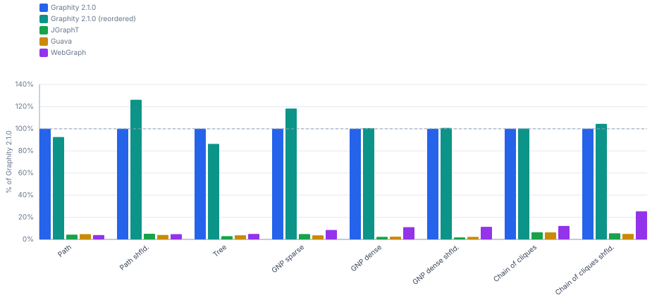

#### Times @ 100k nodes (ms/op, lower is better)

| Shape | Graphity 2.2.0 | Graphity 2.2.0<br>(reordered) |
|---|---:|---:|
| Path<br><sub>100k nodes, 100k edges</sub> | 0.389 ms | 0.392 ms (1.0×) |
| Path shfld.<br><sub>100k nodes, 100k edges</sub> | 1.294 ms | 0.366 ms (0.3×) |
| Tree<br><sub>100k nodes, 100k edges</sub> | 0.642 ms | 0.735 ms (1.1×) |
| GNP sparse<br><sub>100k nodes, 300k edges</sub> | 1.757 ms | 1.552 ms (0.9×) |
| GNP dense<br><sub>100k nodes, 3M edges</sub> | 6.083 ms | 6.037 ms (1.0×) |
| GNP dense shfld.<br><sub>100k nodes, 3M edges</sub> | 6.048 ms | 6.112 ms (1.0×) |
| Chain of cliques<br><sub>100k nodes, 3.1M edges</sub> | 5.756 ms | 6.002 ms (1.0×) |
| Chain of cliques shfld.<br><sub>100k nodes, 3.1M edges</sub> | 5.903 ms | 6.117 ms (1.0×) |

#### Throughput @ 100k nodes (op/s, higher is better)

| Shape | Graphity 2.2.0 | Graphity 2.2.0<br>(reordered) |
|---|---:|---:|
| Path<br><sub>100k nodes, 100k edges</sub> | 2 571 op/s | 2 551 op/s (99.2%) |
| Path shfld.<br><sub>100k nodes, 100k edges</sub> | 772.8 op/s | 2 732 op/s (354%) |
| Tree<br><sub>100k nodes, 100k edges</sub> | 1 558 op/s | 1 361 op/s (87.3%) |
| GNP sparse<br><sub>100k nodes, 300k edges</sub> | 569.2 op/s | 644.3 op/s (113%) |
| GNP dense<br><sub>100k nodes, 3M edges</sub> | 164.4 op/s | 165.6 op/s (101%) |
| GNP dense shfld.<br><sub>100k nodes, 3M edges</sub> | 165.3 op/s | 163.6 op/s (99.0%) |
| Chain of cliques<br><sub>100k nodes, 3.1M edges</sub> | 173.7 op/s | 166.6 op/s (95.9%) |
| Chain of cliques shfld.<br><sub>100k nodes, 3.1M edges</sub> | 169.4 op/s | 163.5 op/s (96.5%) |

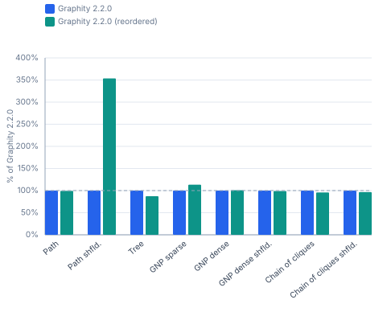

#### Times @ 1M nodes (ms/op, lower is better)

| Shape | Graphity 2.2.0 | Graphity 2.2.0<br>(reordered) |
|---|---:|---:|
| GNP sparse<br><sub>1M nodes, 3M edges</sub> | 19.61 ms | 16.15 ms (0.8×) |
| GNP dense<br><sub>1M nodes, 30M edges</sub> | 66.47 ms | — |
| GNP dense shfld.<br><sub>1M nodes, 30M edges</sub> | 67.62 ms | 66.59 ms (1.0×) |
| Chain of cliques<br><sub>1M nodes, 31.1M edges</sub> | 49.96 ms | — |

#### Throughput @ 1M nodes (op/s, higher is better)

| Shape | Graphity 2.2.0 | Graphity 2.2.0<br>(reordered) |
|---|---:|---:|
| GNP sparse<br><sub>1M nodes, 3M edges</sub> | 51.01 op/s | 61.91 op/s (121%) |
| GNP dense<br><sub>1M nodes, 30M edges</sub> | 15.04 op/s | — |
| GNP dense shfld.<br><sub>1M nodes, 30M edges</sub> | 14.79 op/s | 15.02 op/s (102%) |
| Chain of cliques<br><sub>1M nodes, 31.1M edges</sub> | 20.02 op/s | — |

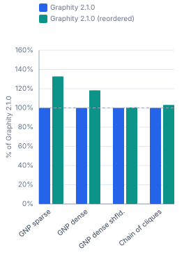

#### Times @ 10M nodes (ms/op, lower is better)

| Shape | Graphity 2.2.0 | Graphity 2.2.0<br>(reordered) |
|---|---:|---:|
| GNP sparse<br><sub>10M nodes, 30M edges</sub> | 539.1 ms | 405.0 ms (0.8×) |
| GNP dense<br><sub>10M nodes, 299.6M edges</sub> | 4129.9 ms | — |
| GNP dense shfld.<br><sub>10M nodes, 299.6M edges</sub> | 3913.6 ms | 3705.6 ms (0.9×) |
| Chain of cliques<br><sub>10M nodes, 310.8M edges</sub> | 589.2 ms | — |

#### Throughput @ 10M nodes (op/s, higher is better)

| Shape | Graphity 2.2.0 | Graphity 2.2.0<br>(reordered) |
|---|---:|---:|
| GNP sparse<br><sub>10M nodes, 30M edges</sub> | 1.855 op/s | 2.469 op/s (133%) |
| GNP dense<br><sub>10M nodes, 299.6M edges</sub> | 0.242 op/s | — |
| GNP dense shfld.<br><sub>10M nodes, 299.6M edges</sub> | 0.256 op/s | 0.270 op/s (106%) |
| Chain of cliques<br><sub>10M nodes, 310.8M edges</sub> | 1.697 op/s | — |

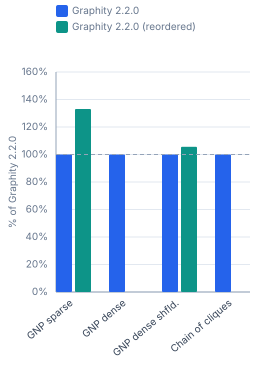

#### Times @ 100M nodes (ms/op, lower is better)

| Shape | Graphity 2.2.0 | Graphity 2.2.0<br>(reordered) |
|---|---:|---:|
| GNP sparse<br><sub>100M nodes, 300M edges</sub> | 8506.2 ms | 6819.8 ms (0.8×) |

#### Throughput @ 100M nodes (op/s, higher is better)

| Shape | Graphity 2.2.0 | Graphity 2.2.0<br>(reordered) |
|---|---:|---:|
| GNP sparse<br><sub>100M nodes, 300M edges</sub> | 0.118 op/s | 0.147 op/s (125%) |

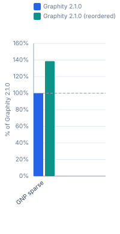

### 1.4 CCs

#### Times @ 10k nodes (ms/op, lower is better)

| Shape | Graphity 2.2.0 | Graphity 2.2.0<br>(reordered) |
|---|---:|---:|
| Path<br><sub>10k nodes, 10k edges</sub> | 0.036 ms | 0.036 ms (1.0×) |
| Path shfld.<br><sub>10k nodes, 10k edges</sub> | 0.057 ms | 0.042 ms (0.7×) |
| Tree<br><sub>10k nodes, 10k edges</sub> | 0.038 ms | 0.043 ms (1.1×) |
| GNP sparse<br><sub>10k nodes, 30k edges</sub> | 0.102 ms | 0.086 ms (0.8×) |
| GNP dense<br><sub>10k nodes, 299.6k edges</sub> | 0.522 ms | 0.519 ms (1.0×) |
| GNP dense shfld.<br><sub>10k nodes, 299.6k edges</sub> | 0.527 ms | 0.521 ms (1.0×) |
| Chain of cliques<br><sub>10k nodes, 310.8k edges</sub> | 0.578 ms | 0.596 ms (1.0×) |
| Chain of cliques shfld.<br><sub>10k nodes, 310.8k edges</sub> | 0.638 ms | 0.609 ms (1.0×) |

#### Throughput @ 10k nodes (op/s, higher is better)

| Shape | Graphity 2.2.0 | Graphity 2.2.0<br>(reordered) |
|---|---:|---:|
| Path<br><sub>10k nodes, 10k edges</sub> | 27 778 op/s | 27 778 op/s (100%) |
| Path shfld.<br><sub>10k nodes, 10k edges</sub> | 17 544 op/s | 23 810 op/s (136%) |
| Tree<br><sub>10k nodes, 10k edges</sub> | 26 316 op/s | 23 256 op/s (88.4%) |
| GNP sparse<br><sub>10k nodes, 30k edges</sub> | 9 804 op/s | 11 628 op/s (119%) |
| GNP dense<br><sub>10k nodes, 299.6k edges</sub> | 1 916 op/s | 1 927 op/s (101%) |
| GNP dense shfld.<br><sub>10k nodes, 299.6k edges</sub> | 1 898 op/s | 1 919 op/s (101%) |
| Chain of cliques<br><sub>10k nodes, 310.8k edges</sub> | 1 730 op/s | 1 678 op/s (97.0%) |
| Chain of cliques shfld.<br><sub>10k nodes, 310.8k edges</sub> | 1 567 op/s | 1 642 op/s (105%) |

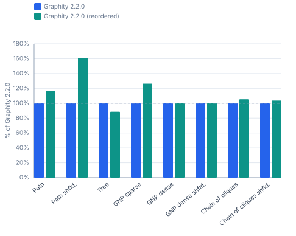

#### Times @ 100k nodes (ms/op, lower is better)

| Shape | Graphity 2.2.0 | Graphity 2.2.0<br>(reordered) |
|---|---:|---:|
| Path<br><sub>100k nodes, 100k edges</sub> | 0.399 ms | 0.356 ms (0.9×) |
| Path shfld.<br><sub>100k nodes, 100k edges</sub> | 1.213 ms | 0.359 ms (0.3×) |
| Tree<br><sub>100k nodes, 100k edges</sub> | 0.630 ms | 0.789 ms (1.3×) |
| GNP sparse<br><sub>100k nodes, 300k edges</sub> | 1.756 ms | 1.677 ms (1.0×) |
| GNP dense<br><sub>100k nodes, 3M edges</sub> | 6.065 ms | 6.053 ms (1.0×) |
| GNP dense shfld.<br><sub>100k nodes, 3M edges</sub> | 6.141 ms | 6.191 ms (1.0×) |
| Chain of cliques<br><sub>100k nodes, 3.1M edges</sub> | 5.839 ms | 5.790 ms (1.0×) |
| Chain of cliques shfld.<br><sub>100k nodes, 3.1M edges</sub> | 5.968 ms | 6.131 ms (1.0×) |

#### Throughput @ 100k nodes (op/s, higher is better)

| Shape | Graphity 2.2.0 | Graphity 2.2.0<br>(reordered) |
|---|---:|---:|
| Path<br><sub>100k nodes, 100k edges</sub> | 2 506 op/s | 2 809 op/s (112%) |
| Path shfld.<br><sub>100k nodes, 100k edges</sub> | 824.4 op/s | 2 786 op/s (338%) |
| Tree<br><sub>100k nodes, 100k edges</sub> | 1 587 op/s | 1 267 op/s (79.8%) |
| GNP sparse<br><sub>100k nodes, 300k edges</sub> | 569.5 op/s | 596.3 op/s (105%) |
| GNP dense<br><sub>100k nodes, 3M edges</sub> | 164.9 op/s | 165.2 op/s (100%) |
| GNP dense shfld.<br><sub>100k nodes, 3M edges</sub> | 162.8 op/s | 161.5 op/s (99.2%) |
| Chain of cliques<br><sub>100k nodes, 3.1M edges</sub> | 171.3 op/s | 172.7 op/s (101%) |
| Chain of cliques shfld.<br><sub>100k nodes, 3.1M edges</sub> | 167.6 op/s | 163.1 op/s (97.3%) |

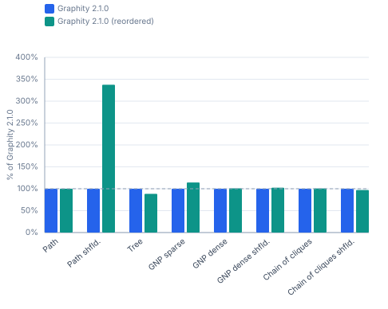

#### Times @ 1M nodes (ms/op, lower is better)

| Shape | Graphity 2.2.0 | Graphity 2.2.0<br>(reordered) |
|---|---:|---:|
| GNP sparse<br><sub>1M nodes, 3M edges</sub> | 19.82 ms | 17.22 ms (0.9×) |
| GNP dense<br><sub>1M nodes, 30M edges</sub> | 65.32 ms | — |
| GNP dense shfld.<br><sub>1M nodes, 30M edges</sub> | 68.51 ms | 66.55 ms (1.0×) |
| Chain of cliques<br><sub>1M nodes, 31.1M edges</sub> | 52.13 ms | — |

#### Throughput @ 1M nodes (op/s, higher is better)

| Shape | Graphity 2.2.0 | Graphity 2.2.0<br>(reordered) |
|---|---:|---:|
| GNP sparse<br><sub>1M nodes, 3M edges</sub> | 50.45 op/s | 58.07 op/s (115%) |
| GNP dense<br><sub>1M nodes, 30M edges</sub> | 15.31 op/s | — |
| GNP dense shfld.<br><sub>1M nodes, 30M edges</sub> | 14.60 op/s | 15.03 op/s (103%) |
| Chain of cliques<br><sub>1M nodes, 31.1M edges</sub> | 19.18 op/s | — |

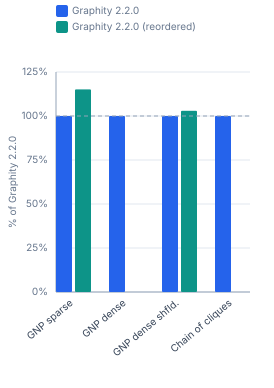

#### Times @ 10M nodes (ms/op, lower is better)

| Shape | Graphity 2.2.0 | Graphity 2.2.0<br>(reordered) |
|---|---:|---:|
| GNP sparse<br><sub>10M nodes, 30M edges</sub> | 600.1 ms | 412.5 ms (0.7×) |
| GNP dense<br><sub>10M nodes, 299.6M edges</sub> | 4066.2 ms | — |
| GNP dense shfld.<br><sub>10M nodes, 299.6M edges</sub> | 3914.0 ms | 3905.4 ms (1.0×) |
| Chain of cliques<br><sub>10M nodes, 310.8M edges</sub> | 594.7 ms | — |

#### Throughput @ 10M nodes (op/s, higher is better)

| Shape | Graphity 2.2.0 | Graphity 2.2.0<br>(reordered) |
|---|---:|---:|
| GNP sparse<br><sub>10M nodes, 30M edges</sub> | 1.666 op/s | 2.424 op/s (145%) |
| GNP dense<br><sub>10M nodes, 299.6M edges</sub> | 0.246 op/s | — |
| GNP dense shfld.<br><sub>10M nodes, 299.6M edges</sub> | 0.255 op/s | 0.256 op/s (100%) |
| Chain of cliques<br><sub>10M nodes, 310.8M edges</sub> | 1.682 op/s | — |

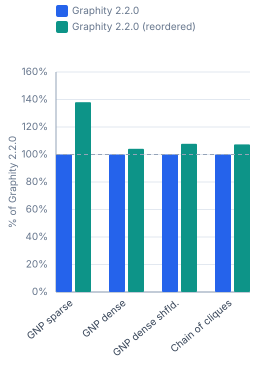

#### Times @ 100M nodes (ms/op, lower is better)

| Shape | Graphity 2.2.0 | Graphity 2.2.0<br>(reordered) |
|---|---:|---:|
| GNP sparse<br><sub>100M nodes, 300M edges</sub> | 8533.7 ms | 5994.7 ms (0.7×) |

#### Throughput @ 100M nodes (op/s, higher is better)

| Shape | Graphity 2.2.0 | Graphity 2.2.0<br>(reordered) |
|---|---:|---:|
| GNP sparse<br><sub>100M nodes, 300M edges</sub> | 0.117 op/s | 0.167 op/s (142%) |

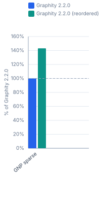

### 1.5 Condense

#### Times @ 1k nodes (ms/op, lower is better)

| Shape | Graphity 2.2.0 |
|---|---:|
| Path<br><sub>1k nodes, 1k edges</sub> | 0.010 ms |
| GNP dense<br><sub>1k nodes, 30k edges</sub> | 0.007 ms |
| Chain of cliques<br><sub>1k nodes, 31.1k edges</sub> | 0.024 ms |
| DAG GNP sparse | 0.017 ms |

#### Throughput @ 1k nodes (op/s, higher is better)

| Shape | Graphity 2.2.0 |
|---|---:|
| Path<br><sub>1k nodes, 1k edges</sub> | 100 000 op/s |
| GNP dense<br><sub>1k nodes, 30k edges</sub> | 142 857 op/s |
| Chain of cliques<br><sub>1k nodes, 31.1k edges</sub> | 41 667 op/s |
| DAG GNP sparse | 58 824 op/s |

#### Times @ 10k nodes (ms/op, lower is better)

| Shape | Graphity 2.2.0 |
|---|---:|
| Path<br><sub>10k nodes, 10k edges</sub> | 0.080 ms |
| GNP dense<br><sub>10k nodes, 299.6k edges</sub> | 0.082 ms |
| Chain of cliques<br><sub>10k nodes, 310.8k edges</sub> | 0.181 ms |
| DAG GNP sparse | 0.257 ms |

#### Throughput @ 10k nodes (op/s, higher is better)

| Shape | Graphity 2.2.0 |
|---|---:|
| Path<br><sub>10k nodes, 10k edges</sub> | 12 500 op/s |
| GNP dense<br><sub>10k nodes, 299.6k edges</sub> | 12 195 op/s |
| Chain of cliques<br><sub>10k nodes, 310.8k edges</sub> | 5 525 op/s |
| DAG GNP sparse | 3 891 op/s |

#### Times @ 100k nodes (ms/op, lower is better)

| Shape | Graphity 2.2.0 |
|---|---:|
| Path<br><sub>100k nodes, 100k edges</sub> | 0.765 ms |
| GNP dense<br><sub>100k nodes, 3M edges</sub> | 1.525 ms |
| Chain of cliques<br><sub>100k nodes, 3.1M edges</sub> | 1.704 ms |
| DAG GNP sparse | 3.535 ms |

#### Throughput @ 100k nodes (op/s, higher is better)

| Shape | Graphity 2.2.0 |
|---|---:|
| Path<br><sub>100k nodes, 100k edges</sub> | 1 307 op/s |
| GNP dense<br><sub>100k nodes, 3M edges</sub> | 655.7 op/s |
| Chain of cliques<br><sub>100k nodes, 3.1M edges</sub> | 586.9 op/s |
| DAG GNP sparse | 282.9 op/s |

### 1.6 TopOrder

#### Times @ 10k nodes (ms/op, lower is better)

| Shape | Graphity 2.2.0 | Graphity 2.2.0<br>(reordered) | JGraphT | Guava | WebGraph |
|---|---:|---:|---:|---:|---:|
| Path<br><sub>10k nodes, 10k edges</sub> | 0.074 ms | 0.074 ms (1.0×) | 0.426 ms (5.8×) | 0.408 ms (5.5×) | 0.552 ms (7.5×) |
| Path shfld.<br><sub>10k nodes, 10k edges</sub> | 0.072 ms | 0.058 ms (0.8×) | 0.682 ms (9.5×) | 0.858 ms (12×) | 0.429 ms (6.0×) |
| Tree<br><sub>10k nodes, 10k edges</sub> | 0.061 ms | 0.057 ms (0.9×) | 0.703 ms (12×) | 0.667 ms (11×) | 0.606 ms (9.9×) |
| Tree shfld. | 0.051 ms | 0.046 ms (0.9×) | 0.715 ms (14×) | 0.683 ms (13×) | 0.526 ms (10×) |
| DAG GNP sparse | 0.086 ms | 0.077 ms (0.9×) | 1.139 ms (13×) | 1.514 ms (18×) | 0.842 ms (9.8×) |
| DAG GNP dense | 0.327 ms | 0.279 ms (0.9×) | 16.57 ms (51×) | 9.378 ms (29×) | 2.095 ms (6.4×) |
| DAG GNP dense shfld. | 0.349 ms | 0.276 ms (0.8×) | 17.83 ms (51×) | 13.03 ms (37×) | 2.319 ms (6.6×) |

#### Throughput @ 10k nodes (op/s, higher is better)

| Shape | Graphity 2.2.0 | Graphity 2.2.0<br>(reordered) | JGraphT | Guava | WebGraph |
|---|---:|---:|---:|---:|---:|
| Path<br><sub>10k nodes, 10k edges</sub> | 13 514 op/s | 13 514 op/s (100%) | 2 347 op/s (17.4%) | 2 451 op/s (18.1%) | 1 812 op/s (13.4%) |
| Path shfld.<br><sub>10k nodes, 10k edges</sub> | 13 889 op/s | 17 241 op/s (124%) | 1 466 op/s (10.6%) | 1 166 op/s (8.4%) | 2 331 op/s (16.8%) |
| Tree<br><sub>10k nodes, 10k edges</sub> | 16 393 op/s | 17 544 op/s (107%) | 1 422 op/s (8.7%) | 1 499 op/s (9.1%) | 1 650 op/s (10.1%) |
| Tree shfld. | 19 608 op/s | 21 739 op/s (111%) | 1 399 op/s (7.1%) | 1 464 op/s (7.5%) | 1 901 op/s (9.7%) |
| DAG GNP sparse | 11 628 op/s | 12 987 op/s (112%) | 878.0 op/s (7.6%) | 660.5 op/s (5.7%) | 1 188 op/s (10.2%) |
| DAG GNP dense | 3 058 op/s | 3 584 op/s (117%) | 60.37 op/s (2.0%) | 106.6 op/s (3.5%) | 477.3 op/s (15.6%) |
| DAG GNP dense shfld. | 2 865 op/s | 3 623 op/s (126%) | 56.08 op/s (2.0%) | 76.72 op/s (2.7%) | 431.2 op/s (15.0%) |

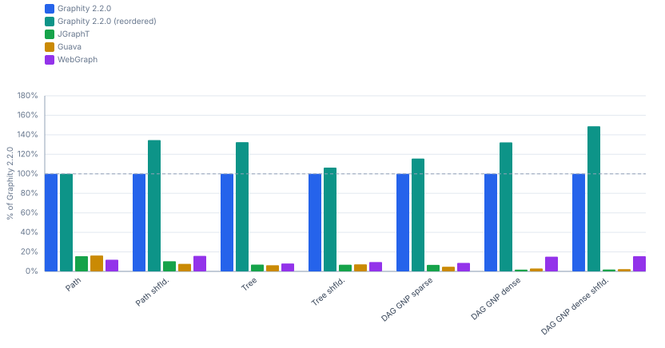

#### Times @ 100k nodes (ms/op, lower is better)

| Shape | Graphity 2.2.0 | Graphity 2.2.0<br>(reordered) | JGraphT | Guava | WebGraph |
|---|---:|---:|---:|---:|---:|
| Path<br><sub>100k nodes, 100k edges</sub> | 0.686 ms | 0.708 ms (1.0×) | 7.508 ms (11×) | 15.22 ms (22×) | 3.401 ms (5.0×) |
| Path shfld.<br><sub>100k nodes, 100k edges</sub> | 1.048 ms | 0.571 ms (0.5×) | 26.54 ms (25×) | 30.64 ms (29×) | 5.050 ms (4.8×) |
| Tree<br><sub>100k nodes, 100k edges</sub> | 1.229 ms | 0.979 ms (0.8×) | 24.20 ms (20×) | 19.23 ms (16×) | 14.89 ms (12×) |
| Tree shfld. | 1.376 ms | 1.146 ms (0.8×) | 25.57 ms (19×) | 20.82 ms (15×) | 10.18 ms (7.4×) |
| DAG GNP sparse | 2.403 ms | 1.605 ms (0.7×) | 64.10 ms (27×) | 53.92 ms (22×) | 17.04 ms (7.1×) |
| DAG GNP dense | 4.220 ms | 2.983 ms (0.7×) | 252.1 ms (60×) | 298.2 ms (71×) | 24.82 ms (5.9×) |
| DAG GNP dense shfld. | 4.895 ms | 3.095 ms (0.6×) | 265.0 ms (54×) | 300.0 ms (61×) | 31.48 ms (6.4×) |

#### Throughput @ 100k nodes (op/s, higher is better)

| Shape | Graphity 2.2.0 | Graphity 2.2.0<br>(reordered) | JGraphT | Guava | WebGraph |
|---|---:|---:|---:|---:|---:|
| Path<br><sub>100k nodes, 100k edges</sub> | 1 458 op/s | 1 412 op/s (96.9%) | 133.2 op/s (9.1%) | 65.71 op/s (4.5%) | 294.0 op/s (20.2%) |
| Path shfld.<br><sub>100k nodes, 100k edges</sub> | 954.2 op/s | 1 751 op/s (184%) | 37.68 op/s (3.9%) | 32.63 op/s (3.4%) | 198.0 op/s (20.8%) |
| Tree<br><sub>100k nodes, 100k edges</sub> | 813.7 op/s | 1 021 op/s (126%) | 41.33 op/s (5.1%) | 52.02 op/s (6.4%) | 67.14 op/s (8.3%) |
| Tree shfld. | 726.7 op/s | 872.6 op/s (120%) | 39.11 op/s (5.4%) | 48.02 op/s (6.6%) | 98.24 op/s (13.5%) |
| DAG GNP sparse | 416.1 op/s | 623.1 op/s (150%) | 15.60 op/s (3.7%) | 18.55 op/s (4.5%) | 58.69 op/s (14.1%) |
| DAG GNP dense | 237.0 op/s | 335.2 op/s (141%) | 3.967 op/s (1.7%) | 3.353 op/s (1.4%) | 40.28 op/s (17.0%) |
| DAG GNP dense shfld. | 204.3 op/s | 323.1 op/s (158%) | 3.774 op/s (1.8%) | 3.333 op/s (1.6%) | 31.76 op/s (15.5%) |

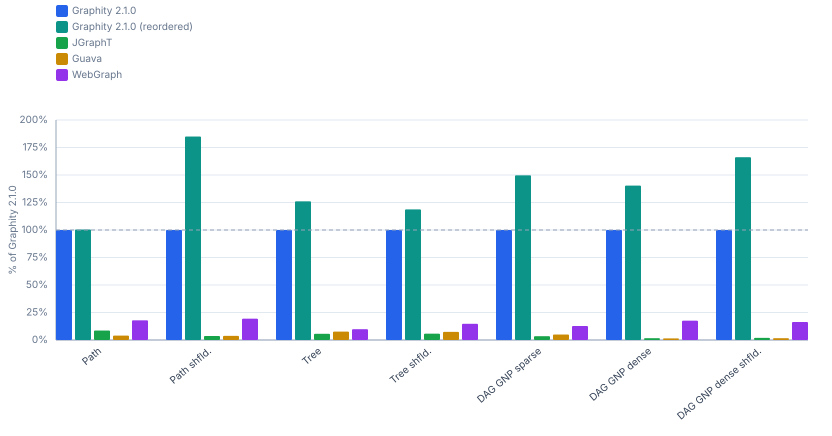

#### Times @ 1M nodes (ms/op, lower is better)

| Shape | Graphity 2.2.0 | Graphity 2.2.0<br>(reordered) |
|---|---:|---:|
| DAG GNP sparse | 28.76 ms | 16.08 ms (0.6×) |
| DAG GNP dense | 94.60 ms | — |
| DAG GNP dense shfld. | 168.2 ms | 35.30 ms (0.2×) |

#### Throughput @ 1M nodes (op/s, higher is better)

| Shape | Graphity 2.2.0 | Graphity 2.2.0<br>(reordered) |
|---|---:|---:|
| DAG GNP sparse | 34.77 op/s | 62.18 op/s (179%) |
| DAG GNP dense | 10.57 op/s | — |
| DAG GNP dense shfld. | 5.945 op/s | 28.33 op/s (476%) |

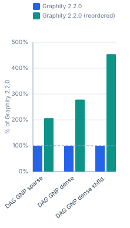

#### Times @ 10M nodes (ms/op, lower is better)

| Shape | Graphity 2.2.0 | Graphity 2.2.0<br>(reordered) |
|---|---:|---:|
| DAG GNP sparse | 1074.8 ms | 155.5 ms (0.1×) |
| DAG GNP dense | 1889.5 ms | — |
| DAG GNP dense shfld. | 2812.4 ms | 421.4 ms (0.1×) |

#### Throughput @ 10M nodes (op/s, higher is better)

| Shape | Graphity 2.2.0 | Graphity 2.2.0<br>(reordered) |
|---|---:|---:|
| DAG GNP sparse | 0.930 op/s | 6.431 op/s (691%) |
| DAG GNP dense | 0.529 op/s | — |
| DAG GNP dense shfld. | 0.356 op/s | 2.373 op/s (667%) |

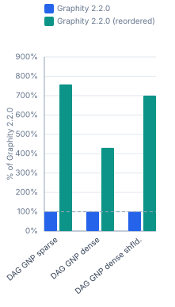

#### Times @ 100M nodes (ms/op, lower is better)

| Shape | Graphity 2.2.0 | Graphity 2.2.0<br>(reordered) |
|---|---:|---:|
| DAG GNP sparse | 15339 ms | 1682.4 ms (0.1×) |

#### Throughput @ 100M nodes (op/s, higher is better)

| Shape | Graphity 2.2.0 | Graphity 2.2.0<br>(reordered) |
|---|---:|---:|
| DAG GNP sparse | 0.065 op/s | 0.594 op/s (912%) |

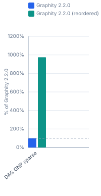

### 1.7 TopOrderAndLevels

#### Times @ 10k nodes (ms/op, lower is better)

| Shape | Graphity 2.2.0 | Graphity 2.2.0<br>(reordered) |
|---|---:|---:|
| Path<br><sub>10k nodes, 10k edges</sub> | 0.039 ms | 0.040 ms (1.0×) |
| Path shfld.<br><sub>10k nodes, 10k edges</sub> | 0.055 ms | 0.039 ms (0.7×) |
| Tree<br><sub>10k nodes, 10k edges</sub> | 0.034 ms | 0.031 ms (0.9×) |
| Tree shfld. | 0.034 ms | 0.028 ms (0.8×) |
| DAG GNP sparse | 0.055 ms | 0.053 ms (1.0×) |
| DAG GNP dense | 0.363 ms | 0.324 ms (0.9×) |
| DAG GNP dense shfld. | 0.395 ms | 0.318 ms (0.8×) |

#### Throughput @ 10k nodes (op/s, higher is better)

| Shape | Graphity 2.2.0 | Graphity 2.2.0<br>(reordered) |
|---|---:|---:|
| Path<br><sub>10k nodes, 10k edges</sub> | 25 641 op/s | 25 000 op/s (97.5%) |
| Path shfld.<br><sub>10k nodes, 10k edges</sub> | 18 182 op/s | 25 641 op/s (141%) |
| Tree<br><sub>10k nodes, 10k edges</sub> | 29 412 op/s | 32 258 op/s (110%) |
| Tree shfld. | 29 412 op/s | 35 714 op/s (121%) |
| DAG GNP sparse | 18 182 op/s | 18 868 op/s (104%) |
| DAG GNP dense | 2 755 op/s | 3 086 op/s (112%) |
| DAG GNP dense shfld. | 2 532 op/s | 3 145 op/s (124%) |

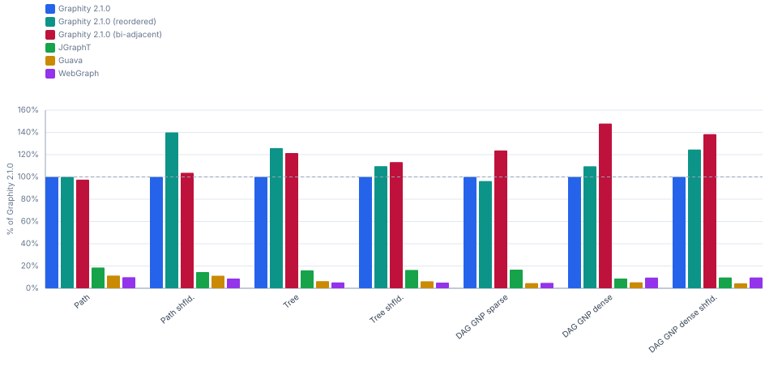

#### Times @ 100k nodes (ms/op, lower is better)

| Shape | Graphity 2.2.0 | Graphity 2.2.0<br>(reordered) |
|---|---:|---:|
| Path<br><sub>100k nodes, 100k edges</sub> | 0.558 ms | 0.453 ms (0.8×) |
| Path shfld.<br><sub>100k nodes, 100k edges</sub> | 1.445 ms | 0.452 ms (0.3×) |
| Tree<br><sub>100k nodes, 100k edges</sub> | 0.874 ms | 0.828 ms (0.9×) |
| Tree shfld. | 1.048 ms | 0.882 ms (0.8×) |
| DAG GNP sparse | 2.150 ms | 1.937 ms (0.9×) |
| DAG GNP dense | 5.021 ms | 4.623 ms (0.9×) |
| DAG GNP dense shfld. | 5.760 ms | 4.521 ms (0.8×) |

#### Throughput @ 100k nodes (op/s, higher is better)

| Shape | Graphity 2.2.0 | Graphity 2.2.0<br>(reordered) |
|---|---:|---:|
| Path<br><sub>100k nodes, 100k edges</sub> | 1 792 op/s | 2 208 op/s (123%) |
| Path shfld.<br><sub>100k nodes, 100k edges</sub> | 692.0 op/s | 2 212 op/s (320%) |
| Tree<br><sub>100k nodes, 100k edges</sub> | 1 144 op/s | 1 208 op/s (106%) |
| Tree shfld. | 954.2 op/s | 1 134 op/s (119%) |
| DAG GNP sparse | 465.1 op/s | 516.3 op/s (111%) |
| DAG GNP dense | 199.2 op/s | 216.3 op/s (109%) |
| DAG GNP dense shfld. | 173.6 op/s | 221.2 op/s (127%) |

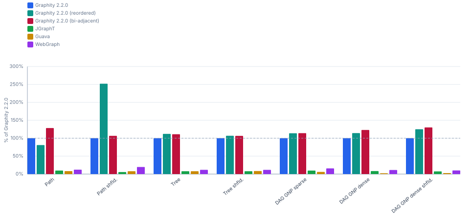

#### Times @ 1M nodes (ms/op, lower is better)

| Shape | Graphity 2.2.0 | Graphity 2.2.0<br>(reordered) |
|---|---:|---:|
| DAG GNP sparse | 28.71 ms | 26.10 ms (0.9×) |
| DAG GNP dense | 109.2 ms | — |
| DAG GNP dense shfld. | 189.9 ms | 92.85 ms (0.5×) |

#### Throughput @ 1M nodes (op/s, higher is better)

| Shape | Graphity 2.2.0 | Graphity 2.2.0<br>(reordered) |
|---|---:|---:|
| DAG GNP sparse | 34.83 op/s | 38.31 op/s (110%) |
| DAG GNP dense | 9.158 op/s | — |
| DAG GNP dense shfld. | 5.266 op/s | 10.77 op/s (205%) |

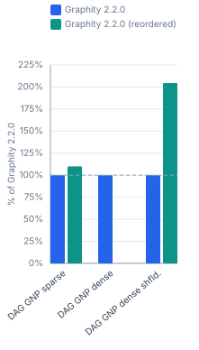

#### Times @ 10M nodes (ms/op, lower is better)

| Shape | Graphity 2.2.0 | Graphity 2.2.0<br>(reordered) |
|---|---:|---:|
| DAG GNP sparse | 844.5 ms | 754.1 ms (0.9×) |
| DAG GNP dense | 2926.5 ms | — |
| DAG GNP dense shfld. | 4397.5 ms | 2573.2 ms (0.6×) |

#### Throughput @ 10M nodes (op/s, higher is better)

| Shape | Graphity 2.2.0 | Graphity 2.2.0<br>(reordered) |
|---|---:|---:|
| DAG GNP sparse | 1.184 op/s | 1.326 op/s (112%) |
| DAG GNP dense | 0.342 op/s | — |
| DAG GNP dense shfld. | 0.227 op/s | 0.389 op/s (171%) |

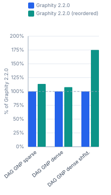

#### Times @ 100M nodes (ms/op, lower is better)

| Shape | Graphity 2.2.0 | Graphity 2.2.0<br>(reordered) |
|---|---:|---:|
| DAG GNP sparse | 11441 ms | 9427.8 ms (0.8×) |

#### Throughput @ 100M nodes (op/s, higher is better)

| Shape | Graphity 2.2.0 | Graphity 2.2.0<br>(reordered) |
|---|---:|---:|
| DAG GNP sparse | 0.087 op/s | 0.106 op/s (121%) |

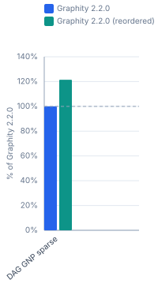

### 1.8 BackEdges

#### Times @ 10k nodes (ms/op, lower is better)

| Shape | Graphity 2.2.0 | Graphity 2.2.0<br>(reordered) | JGraphT | Guava | WebGraph |
|---|---:|---:|---:|---:|---:|
| Path<br><sub>10k nodes, 10k edges</sub> | 0.062 ms | 0.060 ms (1.0×) | 0.172 ms (2.8×) | 0.212 ms (3.4×) | 0.556 ms (9.0×) |
| Path shfld.<br><sub>10k nodes, 10k edges</sub> | 0.066 ms | 0.055 ms (0.8×) | 0.365 ms (5.5×) | 0.498 ms (7.5×) | 0.421 ms (6.4×) |
| Tree<br><sub>10k nodes, 10k edges</sub> | 0.040 ms | 0.046 ms (1.1×) | 0.450 ms (11×) | 0.638 ms (16×) | 0.590 ms (15×) |
| GNP sparse<br><sub>10k nodes, 30k edges</sub> | 0.176 ms | 0.098 ms (0.6×) | 0.613 ms (3.5×) | 1.351 ms (7.7×) | 0.780 ms (4.4×) |
| GNP dense<br><sub>10k nodes, 299.6k edges</sub> | 0.783 ms | 0.663 ms (0.8×) | 4.548 ms (5.8×) | 11.65 ms (15×) | 2.581 ms (3.3×) |
| GNP dense shfld.<br><sub>10k nodes, 299.6k edges</sub> | 0.790 ms | 0.660 ms (0.8×) | 4.835 ms (6.1×) | 13.02 ms (16×) | 2.632 ms (3.3×) |
| Chain of cliques<br><sub>10k nodes, 310.8k edges</sub> | 0.592 ms | 0.591 ms (1.0×) | 3.341 ms (5.6×) | 3.175 ms (5.4×) | 3.890 ms (6.6×) |
| Chain of cliques shfld.<br><sub>10k nodes, 310.8k edges</sub> | 0.646 ms | 0.591 ms (0.9×) | 3.583 ms (5.5×) | 4.898 ms (7.6×) | 2.400 ms (3.7×) |

#### Throughput @ 10k nodes (op/s, higher is better)

| Shape | Graphity 2.2.0 | Graphity 2.2.0<br>(reordered) | JGraphT | Guava | WebGraph |
|---|---:|---:|---:|---:|---:|
| Path<br><sub>10k nodes, 10k edges</sub> | 16 129 op/s | 16 667 op/s (103%) | 5 814 op/s (36.0%) | 4 717 op/s (29.2%) | 1 799 op/s (11.2%) |
| Path shfld.<br><sub>10k nodes, 10k edges</sub> | 15 152 op/s | 18 182 op/s (120%) | 2 740 op/s (18.1%) | 2 008 op/s (13.3%) | 2 375 op/s (15.7%) |
| Tree<br><sub>10k nodes, 10k edges</sub> | 25 000 op/s | 21 739 op/s (87.0%) | 2 222 op/s (8.9%) | 1 567 op/s (6.3%) | 1 695 op/s (6.8%) |
| GNP sparse<br><sub>10k nodes, 30k edges</sub> | 5 682 op/s | 10 204 op/s (180%) | 1 631 op/s (28.7%) | 740.2 op/s (13.0%) | 1 282 op/s (22.6%) |
| GNP dense<br><sub>10k nodes, 299.6k edges</sub> | 1 277 op/s | 1 508 op/s (118%) | 219.9 op/s (17.2%) | 85.87 op/s (6.7%) | 387.4 op/s (30.3%) |
| GNP dense shfld.<br><sub>10k nodes, 299.6k edges</sub> | 1 266 op/s | 1 515 op/s (120%) | 206.8 op/s (16.3%) | 76.82 op/s (6.1%) | 379.9 op/s (30.0%) |
| Chain of cliques<br><sub>10k nodes, 310.8k edges</sub> | 1 689 op/s | 1 692 op/s (100%) | 299.3 op/s (17.7%) | 315.0 op/s (18.6%) | 257.1 op/s (15.2%) |
| Chain of cliques shfld.<br><sub>10k nodes, 310.8k edges</sub> | 1 548 op/s | 1 692 op/s (109%) | 279.1 op/s (18.0%) | 204.2 op/s (13.2%) | 416.7 op/s (26.9%) |

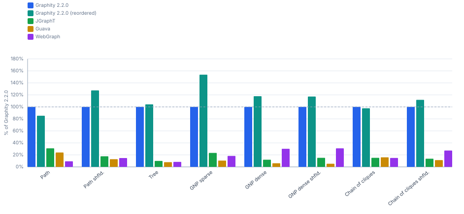

#### Times @ 100k nodes (ms/op, lower is better)

| Shape | Graphity 2.2.0 | Graphity 2.2.0<br>(reordered) | JGraphT | Guava | WebGraph |
|---|---:|---:|---:|---:|---:|
| Path<br><sub>100k nodes, 100k edges</sub> | 0.561 ms | 0.561 ms (1.0×) | 6.599 ms (12×) | 8.197 ms (15×) | 3.701 ms (6.6×) |
| Path shfld.<br><sub>100k nodes, 100k edges</sub> | 1.014 ms | 0.547 ms (0.5×) | 20.27 ms (20×) | 16.91 ms (17×) | 5.145 ms (5.1×) |
| Tree<br><sub>100k nodes, 100k edges</sub> | 1.023 ms | 0.931 ms (0.9×) | 30.35 ms (30×) | 19.30 ms (19×) | 15.16 ms (15×) |
| GNP sparse<br><sub>100k nodes, 300k edges</sub> | 3.025 ms | 1.909 ms (0.6×) | 43.79 ms (14×) | 46.81 ms (15×) | 11.30 ms (3.7×) |
| GNP dense<br><sub>100k nodes, 3M edges</sub> | 12.89 ms | 7.152 ms (0.6×) | 128.5 ms (10.0×) | 259.0 ms (20×) | 44.18 ms (3.4×) |
| GNP dense shfld.<br><sub>100k nodes, 3M edges</sub> | 12.79 ms | 7.276 ms (0.6×) | 131.1 ms (10×) | 221.9 ms (17×) | 46.40 ms (3.6×) |
| Chain of cliques<br><sub>100k nodes, 3.1M edges</sub> | 6.201 ms | 6.199 ms (1.0×) | 79.94 ms (13×) | 78.25 ms (13×) | 49.50 ms (8.0×) |
| Chain of cliques shfld.<br><sub>100k nodes, 3.1M edges</sub> | 10.96 ms | 6.456 ms (0.6×) | 130.0 ms (12×) | 89.17 ms (8.1×) | 39.78 ms (3.6×) |

#### Throughput @ 100k nodes (op/s, higher is better)

| Shape | Graphity 2.2.0 | Graphity 2.2.0<br>(reordered) | JGraphT | Guava | WebGraph |
|---|---:|---:|---:|---:|---:|
| Path<br><sub>100k nodes, 100k edges</sub> | 1 783 op/s | 1 783 op/s (100%) | 151.5 op/s (8.5%) | 122.0 op/s (6.8%) | 270.2 op/s (15.2%) |
| Path shfld.<br><sub>100k nodes, 100k edges</sub> | 986.2 op/s | 1 828 op/s (185%) | 49.33 op/s (5.0%) | 59.12 op/s (6.0%) | 194.4 op/s (19.7%) |
| Tree<br><sub>100k nodes, 100k edges</sub> | 977.5 op/s | 1 074 op/s (110%) | 32.95 op/s (3.4%) | 51.82 op/s (5.3%) | 65.98 op/s (6.7%) |
| GNP sparse<br><sub>100k nodes, 300k edges</sub> | 330.6 op/s | 523.8 op/s (158%) | 22.84 op/s (6.9%) | 21.36 op/s (6.5%) | 88.47 op/s (26.8%) |
| GNP dense<br><sub>100k nodes, 3M edges</sub> | 77.55 op/s | 139.8 op/s (180%) | 7.782 op/s (10.0%) | 3.861 op/s (5.0%) | 22.63 op/s (29.2%) |
| GNP dense shfld.<br><sub>100k nodes, 3M edges</sub> | 78.17 op/s | 137.4 op/s (176%) | 7.628 op/s (9.8%) | 4.507 op/s (5.8%) | 21.55 op/s (27.6%) |
| Chain of cliques<br><sub>100k nodes, 3.1M edges</sub> | 161.3 op/s | 161.3 op/s (100%) | 12.51 op/s (7.8%) | 12.78 op/s (7.9%) | 20.20 op/s (12.5%) |
| Chain of cliques shfld.<br><sub>100k nodes, 3.1M edges</sub> | 91.25 op/s | 154.9 op/s (170%) | 7.692 op/s (8.4%) | 11.21 op/s (12.3%) | 25.14 op/s (27.5%) |

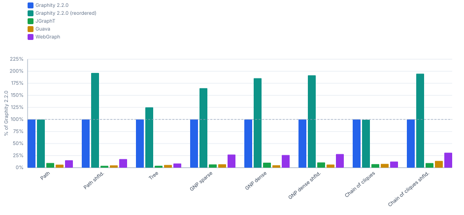

#### Times @ 1M nodes (ms/op, lower is better)

| Shape | Graphity 2.2.0 | Graphity 2.2.0<br>(reordered) |
|---|---:|---:|
| GNP sparse<br><sub>1M nodes, 3M edges</sub> | 46.87 ms | 19.57 ms (0.4×) |
| GNP dense<br><sub>1M nodes, 30M edges</sub> | 242.1 ms | — |
| GNP dense shfld.<br><sub>1M nodes, 30M edges</sub> | 239.5 ms | 91.56 ms (0.4×) |
| Chain of cliques<br><sub>1M nodes, 31.1M edges</sub> | 78.20 ms | — |

#### Throughput @ 1M nodes (op/s, higher is better)

| Shape | Graphity 2.2.0 | Graphity 2.2.0<br>(reordered) |
|---|---:|---:|
| GNP sparse<br><sub>1M nodes, 3M edges</sub> | 21.33 op/s | 51.09 op/s (239%) |
| GNP dense<br><sub>1M nodes, 30M edges</sub> | 4.131 op/s | — |
| GNP dense shfld.<br><sub>1M nodes, 30M edges</sub> | 4.175 op/s | 10.92 op/s (262%) |
| Chain of cliques<br><sub>1M nodes, 31.1M edges</sub> | 12.79 op/s | — |

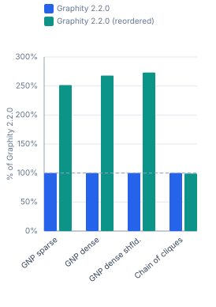

#### Times @ 10M nodes (ms/op, lower is better)

| Shape | Graphity 2.2.0 | Graphity 2.2.0<br>(reordered) |
|---|---:|---:|
| GNP sparse<br><sub>10M nodes, 30M edges</sub> | 1944.9 ms | 250.2 ms (0.1×) |
| GNP dense<br><sub>10M nodes, 299.6M edges</sub> | 3732.9 ms | — |
| GNP dense shfld.<br><sub>10M nodes, 299.6M edges</sub> | 3925.2 ms | 1127.9 ms (0.3×) |
| Chain of cliques<br><sub>10M nodes, 310.8M edges</sub> | 848.5 ms | — |

#### Throughput @ 10M nodes (op/s, higher is better)

| Shape | Graphity 2.2.0 | Graphity 2.2.0<br>(reordered) |
|---|---:|---:|
| GNP sparse<br><sub>10M nodes, 30M edges</sub> | 0.514 op/s | 3.997 op/s (777%) |
| GNP dense<br><sub>10M nodes, 299.6M edges</sub> | 0.268 op/s | — |
| GNP dense shfld.<br><sub>10M nodes, 299.6M edges</sub> | 0.255 op/s | 0.887 op/s (348%) |
| Chain of cliques<br><sub>10M nodes, 310.8M edges</sub> | 1.179 op/s | — |

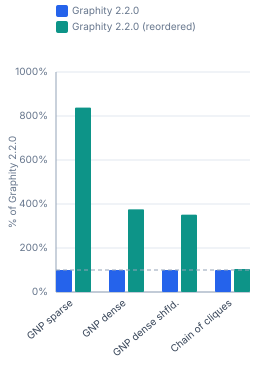

#### Times @ 100M nodes (ms/op, lower is better)

| Shape | Graphity 2.2.0 | Graphity 2.2.0<br>(reordered) |
|---|---:|---:|
| GNP sparse<br><sub>100M nodes, 300M edges</sub> | 26831 ms | 3009.2 ms (0.1×) |

#### Throughput @ 100M nodes (op/s, higher is better)

| Shape | Graphity 2.2.0 | Graphity 2.2.0<br>(reordered) |
|---|---:|---:|
| GNP sparse<br><sub>100M nodes, 300M edges</sub> | 0.037 op/s | 0.332 op/s (892%) |

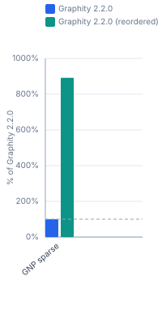

### 1.9 EdgeTypes

#### Times @ 10k nodes (ms/op, lower is better)

| Shape | Graphity 2.2.0 | Graphity 2.2.0<br>(reordered) | JGraphT | Guava | WebGraph |
|---|---:|---:|---:|---:|---:|
| Path<br><sub>10k nodes, 10k edges</sub> | 0.071 ms | 0.072 ms (1.0×) | 0.202 ms (2.8×) | 0.393 ms (5.5×) | 0.613 ms (8.6×) |
| Path shfld.<br><sub>10k nodes, 10k edges</sub> | 0.081 ms | 0.070 ms (0.9×) | 0.385 ms (4.8×) | 0.562 ms (6.9×) | 0.504 ms (6.2×) |
| Tree<br><sub>10k nodes, 10k edges</sub> | 0.046 ms | 0.049 ms (1.1×) | 0.506 ms (11×) | 0.789 ms (17×) | 0.662 ms (14×) |
| GNP sparse<br><sub>10k nodes, 30k edges</sub> | 0.178 ms | 0.084 ms (0.5×) | 0.691 ms (3.9×) | 1.414 ms (7.9×) | 0.887 ms (5.0×) |
| GNP dense<br><sub>10k nodes, 299.6k edges</sub> | 0.526 ms | 0.391 ms (0.7×) | 6.685 ms (13×) | 13.44 ms (26×) | 3.163 ms (6.0×) |
| GNP dense shfld.<br><sub>10k nodes, 299.6k edges</sub> | 0.532 ms | 0.381 ms (0.7×) | 6.451 ms (12×) | 14.66 ms (28×) | 3.149 ms (5.9×) |
| Chain of cliques<br><sub>10k nodes, 310.8k edges</sub> | 0.301 ms | 0.301 ms (1.0×) | 4.566 ms (15×) | 4.285 ms (14×) | 4.598 ms (15×) |
| Chain of cliques shfld.<br><sub>10k nodes, 310.8k edges</sub> | 0.419 ms | 0.350 ms (0.8×) | 5.683 ms (14×) | 6.201 ms (15×) | 3.070 ms (7.3×) |

#### Throughput @ 10k nodes (op/s, higher is better)

| Shape | Graphity 2.2.0 | Graphity 2.2.0<br>(reordered) | JGraphT | Guava | WebGraph |
|---|---:|---:|---:|---:|---:|
| Path<br><sub>10k nodes, 10k edges</sub> | 14 085 op/s | 13 889 op/s (98.6%) | 4 950 op/s (35.1%) | 2 545 op/s (18.1%) | 1 631 op/s (11.6%) |
| Path shfld.<br><sub>10k nodes, 10k edges</sub> | 12 346 op/s | 14 286 op/s (116%) | 2 597 op/s (21.0%) | 1 779 op/s (14.4%) | 1 984 op/s (16.1%) |
| Tree<br><sub>10k nodes, 10k edges</sub> | 21 739 op/s | 20 408 op/s (93.9%) | 1 976 op/s (9.1%) | 1 267 op/s (5.8%) | 1 511 op/s (6.9%) |
| GNP sparse<br><sub>10k nodes, 30k edges</sub> | 5 618 op/s | 11 905 op/s (212%) | 1 447 op/s (25.8%) | 707.2 op/s (12.6%) | 1 127 op/s (20.1%) |
| GNP dense<br><sub>10k nodes, 299.6k edges</sub> | 1 901 op/s | 2 558 op/s (135%) | 149.6 op/s (7.9%) | 74.38 op/s (3.9%) | 316.2 op/s (16.6%) |
| GNP dense shfld.<br><sub>10k nodes, 299.6k edges</sub> | 1 880 op/s | 2 625 op/s (140%) | 155.0 op/s (8.2%) | 68.21 op/s (3.6%) | 317.6 op/s (16.9%) |
| Chain of cliques<br><sub>10k nodes, 310.8k edges</sub> | 3 322 op/s | 3 322 op/s (100%) | 219.0 op/s (6.6%) | 233.4 op/s (7.0%) | 217.5 op/s (6.5%) |
| Chain of cliques shfld.<br><sub>10k nodes, 310.8k edges</sub> | 2 387 op/s | 2 857 op/s (120%) | 176.0 op/s (7.4%) | 161.3 op/s (6.8%) | 325.7 op/s (13.6%) |

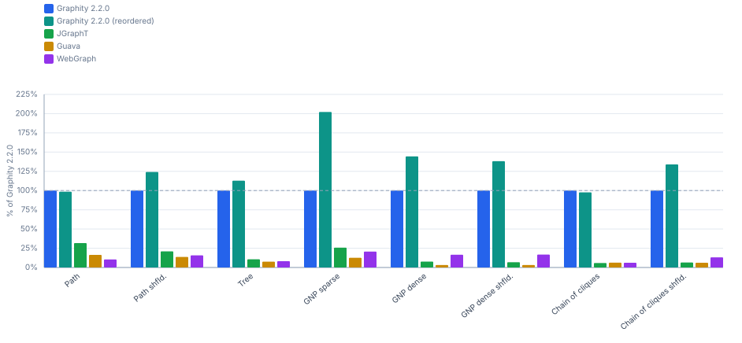

#### Times @ 100k nodes (ms/op, lower is better)

| Shape | Graphity 2.2.0 | Graphity 2.2.0<br>(reordered) | JGraphT | Guava | WebGraph |
|---|---:|---:|---:|---:|---:|
| Path<br><sub>100k nodes, 100k edges</sub> | 0.697 ms | 0.706 ms (1.0×) | 7.889 ms (11×) | 9.987 ms (14×) | 4.823 ms (6.9×) |
| Path shfld.<br><sub>100k nodes, 100k edges</sub> | 1.425 ms | 0.670 ms (0.5×) | 23.16 ms (16×) | 21.14 ms (15×) | 5.985 ms (4.2×) |
| Tree<br><sub>100k nodes, 100k edges</sub> | 1.323 ms | 0.889 ms (0.7×) | 23.66 ms (18×) | 24.32 ms (18×) | 17.74 ms (13×) |
| GNP sparse<br><sub>100k nodes, 300k edges</sub> | 3.494 ms | 1.820 ms (0.5×) | 47.24 ms (14×) | 53.08 ms (15×) | 13.78 ms (3.9×) |
| GNP dense<br><sub>100k nodes, 3M edges</sub> | 7.023 ms | 4.148 ms (0.6×) | 166.1 ms (24×) | 254.7 ms (36×) | 55.65 ms (7.9×) |
| GNP dense shfld.<br><sub>100k nodes, 3M edges</sub> | 6.786 ms | 4.201 ms (0.6×) | 158.4 ms (23×) | 222.6 ms (33×) | 56.85 ms (8.4×) |
| Chain of cliques<br><sub>100k nodes, 3.1M edges</sub> | 3.040 ms | 2.829 ms (0.9×) | 102.5 ms (34×) | 91.82 ms (30×) | 59.11 ms (19×) |
| Chain of cliques shfld.<br><sub>100k nodes, 3.1M edges</sub> | 5.588 ms | 3.067 ms (0.5×) | 167.3 ms (30×) | 116.2 ms (21×) | 52.99 ms (9.5×) |

#### Throughput @ 100k nodes (op/s, higher is better)

| Shape | Graphity 2.2.0 | Graphity 2.2.0<br>(reordered) | JGraphT | Guava | WebGraph |
|---|---:|---:|---:|---:|---:|
| Path<br><sub>100k nodes, 100k edges</sub> | 1 435 op/s | 1 416 op/s (98.7%) | 126.8 op/s (8.8%) | 100.1 op/s (7.0%) | 207.3 op/s (14.5%) |
| Path shfld.<br><sub>100k nodes, 100k edges</sub> | 701.8 op/s | 1 493 op/s (213%) | 43.19 op/s (6.2%) | 47.30 op/s (6.7%) | 167.1 op/s (23.8%) |
| Tree<br><sub>100k nodes, 100k edges</sub> | 755.9 op/s | 1 125 op/s (149%) | 42.27 op/s (5.6%) | 41.12 op/s (5.4%) | 56.37 op/s (7.5%) |
| GNP sparse<br><sub>100k nodes, 300k edges</sub> | 286.2 op/s | 549.5 op/s (192%) | 21.17 op/s (7.4%) | 18.84 op/s (6.6%) | 72.56 op/s (25.4%) |
| GNP dense<br><sub>100k nodes, 3M edges</sub> | 142.4 op/s | 241.1 op/s (169%) | 6.020 op/s (4.2%) | 3.926 op/s (2.8%) | 17.97 op/s (12.6%) |
| GNP dense shfld.<br><sub>100k nodes, 3M edges</sub> | 147.4 op/s | 238.0 op/s (162%) | 6.313 op/s (4.3%) | 4.492 op/s (3.0%) | 17.59 op/s (11.9%) |
| Chain of cliques<br><sub>100k nodes, 3.1M edges</sub> | 328.9 op/s | 353.5 op/s (107%) | 9.756 op/s (3.0%) | 10.89 op/s (3.3%) | 16.92 op/s (5.1%) |
| Chain of cliques shfld.<br><sub>100k nodes, 3.1M edges</sub> | 179.0 op/s | 326.1 op/s (182%) | 5.977 op/s (3.3%) | 8.606 op/s (4.8%) | 18.87 op/s (10.5%) |

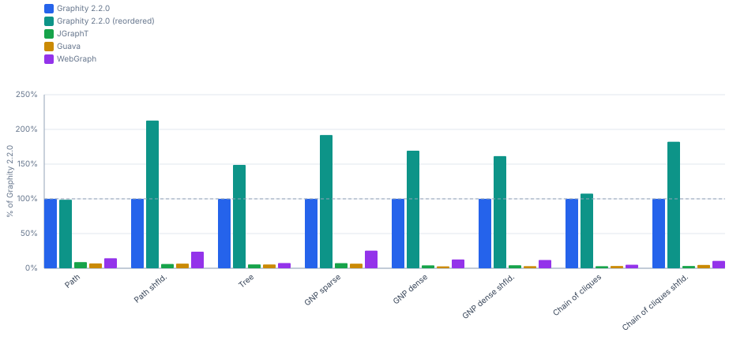

#### Times @ 1M nodes (ms/op, lower is better)

| Shape | Graphity 2.2.0 | Graphity 2.2.0<br>(reordered) |
|---|---:|---:|
| GNP sparse<br><sub>1M nodes, 3M edges</sub> | 57.30 ms | 20.58 ms (0.4×) |
| GNP dense<br><sub>1M nodes, 30M edges</sub> | 236.3 ms | — |
| GNP dense shfld.<br><sub>1M nodes, 30M edges</sub> | 238.3 ms | 59.31 ms (0.2×) |
| Chain of cliques<br><sub>1M nodes, 31.1M edges</sub> | 28.99 ms | — |

#### Throughput @ 1M nodes (op/s, higher is better)

| Shape | Graphity 2.2.0 | Graphity 2.2.0<br>(reordered) |
|---|---:|---:|
| GNP sparse<br><sub>1M nodes, 3M edges</sub> | 17.45 op/s | 48.59 op/s (278%) |
| GNP dense<br><sub>1M nodes, 30M edges</sub> | 4.232 op/s | — |
| GNP dense shfld.<br><sub>1M nodes, 30M edges</sub> | 4.196 op/s | 16.86 op/s (402%) |
| Chain of cliques<br><sub>1M nodes, 31.1M edges</sub> | 34.50 op/s | — |

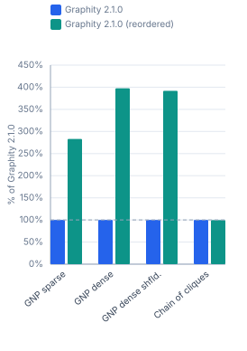

#### Times @ 10M nodes (ms/op, lower is better)

| Shape | Graphity 2.2.0 | Graphity 2.2.0<br>(reordered) |
|---|---:|---:|
| GNP sparse<br><sub>10M nodes, 30M edges</sub> | 2430.7 ms | 414.2 ms (0.2×) |
| GNP dense<br><sub>10M nodes, 299.6M edges</sub> | 4532.5 ms | — |
| GNP dense shfld.<br><sub>10M nodes, 299.6M edges</sub> | 4527.9 ms | 1369.3 ms (0.3×) |
| Chain of cliques<br><sub>10M nodes, 310.8M edges</sub> | 301.6 ms | — |

#### Throughput @ 10M nodes (op/s, higher is better)

| Shape | Graphity 2.2.0 | Graphity 2.2.0<br>(reordered) |
|---|---:|---:|
| GNP sparse<br><sub>10M nodes, 30M edges</sub> | 0.411 op/s | 2.414 op/s (587%) |
| GNP dense<br><sub>10M nodes, 299.6M edges</sub> | 0.221 op/s | — |
| GNP dense shfld.<br><sub>10M nodes, 299.6M edges</sub> | 0.221 op/s | 0.730 op/s (331%) |
| Chain of cliques<br><sub>10M nodes, 310.8M edges</sub> | 3.316 op/s | — |

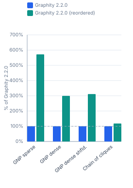

#### Times @ 100M nodes (ms/op, lower is better)

| Shape | Graphity 2.2.0 | Graphity 2.2.0<br>(reordered) |
|---|---:|---:|
| GNP sparse<br><sub>100M nodes, 300M edges</sub> | 31524 ms | 7132.5 ms (0.2×) |

#### Throughput @ 100M nodes (op/s, higher is better)

| Shape | Graphity 2.2.0 | Graphity 2.2.0<br>(reordered) |
|---|---:|---:|
| GNP sparse<br><sub>100M nodes, 300M edges</sub> | 0.032 op/s | 0.140 op/s (442%) |

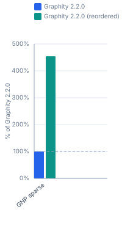

### 1.10 Reorder (DFS-preorder) cost

#### Times @ 10k nodes (ms/op, lower is better)

| Shape | Graphity 2.2.0 |
|---|---:|
| Path<br><sub>10k nodes, 10k edges</sub> | 0.105 ms |
| Path shfld.<br><sub>10k nodes, 10k edges</sub> | 0.125 ms |
| Tree<br><sub>10k nodes, 10k edges</sub> | 0.089 ms |
| GNP sparse<br><sub>10k nodes, 30k edges</sub> | 0.380 ms |
| GNP dense<br><sub>10k nodes, 299.6k edges</sub> | 0.815 ms |
| GNP dense shfld.<br><sub>10k nodes, 299.6k edges</sub> | 0.822 ms |
| Chain of cliques<br><sub>10k nodes, 310.8k edges</sub> | 0.526 ms |
| Chain of cliques shfld.<br><sub>10k nodes, 310.8k edges</sub> | 0.619 ms |

#### Throughput @ 10k nodes (op/s, higher is better)

| Shape | Graphity 2.2.0 |
|---|---:|
| Path<br><sub>10k nodes, 10k edges</sub> | 9 524 op/s |
| Path shfld.<br><sub>10k nodes, 10k edges</sub> | 8 000 op/s |
| Tree<br><sub>10k nodes, 10k edges</sub> | 11 236 op/s |
| GNP sparse<br><sub>10k nodes, 30k edges</sub> | 2 632 op/s |
| GNP dense<br><sub>10k nodes, 299.6k edges</sub> | 1 227 op/s |
| GNP dense shfld.<br><sub>10k nodes, 299.6k edges</sub> | 1 217 op/s |
| Chain of cliques<br><sub>10k nodes, 310.8k edges</sub> | 1 901 op/s |
| Chain of cliques shfld.<br><sub>10k nodes, 310.8k edges</sub> | 1 616 op/s |

#### Times @ 100k nodes (ms/op, lower is better)

| Shape | Graphity 2.2.0 |
|---|---:|
| Path<br><sub>100k nodes, 100k edges</sub> | 0.985 ms |
| Path shfld.<br><sub>100k nodes, 100k edges</sub> | 1.858 ms |
| Tree<br><sub>100k nodes, 100k edges</sub> | 2.216 ms |
| GNP sparse<br><sub>100k nodes, 300k edges</sub> | 5.343 ms |
| GNP dense<br><sub>100k nodes, 3M edges</sub> | 10.73 ms |
| GNP dense shfld.<br><sub>100k nodes, 3M edges</sub> | 10.80 ms |
| Chain of cliques<br><sub>100k nodes, 3.1M edges</sub> | 5.411 ms |
| Chain of cliques shfld.<br><sub>100k nodes, 3.1M edges</sub> | 8.673 ms |

#### Throughput @ 100k nodes (op/s, higher is better)

| Shape | Graphity 2.2.0 |
|---|---:|
| Path<br><sub>100k nodes, 100k edges</sub> | 1 015 op/s |
| Path shfld.<br><sub>100k nodes, 100k edges</sub> | 538.2 op/s |
| Tree<br><sub>100k nodes, 100k edges</sub> | 451.3 op/s |
| GNP sparse<br><sub>100k nodes, 300k edges</sub> | 187.2 op/s |
| GNP dense<br><sub>100k nodes, 3M edges</sub> | 93.18 op/s |
| GNP dense shfld.<br><sub>100k nodes, 3M edges</sub> | 92.55 op/s |
| Chain of cliques<br><sub>100k nodes, 3.1M edges</sub> | 184.8 op/s |
| Chain of cliques shfld.<br><sub>100k nodes, 3.1M edges</sub> | 115.3 op/s |

#### Times @ 1M nodes (ms/op, lower is better)

| Shape | Graphity 2.2.0 |
|---|---:|
| GNP sparse<br><sub>1M nodes, 3M edges</sub> | 75.80 ms |
| GNP dense shfld.<br><sub>1M nodes, 30M edges</sub> | 308.5 ms |

#### Throughput @ 1M nodes (op/s, higher is better)

| Shape | Graphity 2.2.0 |
|---|---:|
| GNP sparse<br><sub>1M nodes, 3M edges</sub> | 13.19 op/s |
| GNP dense shfld.<br><sub>1M nodes, 30M edges</sub> | 3.241 op/s |

#### Times @ 10M nodes (ms/op, lower is better)

| Shape | Graphity 2.2.0 |
|---|---:|
| GNP sparse<br><sub>10M nodes, 30M edges</sub> | 3231.4 ms |
| GNP dense shfld.<br><sub>10M nodes, 299.6M edges</sub> | 7597.1 ms |

#### Throughput @ 10M nodes (op/s, higher is better)

| Shape | Graphity 2.2.0 |
|---|---:|
| GNP sparse<br><sub>10M nodes, 30M edges</sub> | 0.309 op/s |
| GNP dense shfld.<br><sub>10M nodes, 299.6M edges</sub> | 0.132 op/s |

#### Times @ 100M nodes (ms/op, lower is better)

| Shape | Graphity 2.2.0 |
|---|---:|
| GNP sparse<br><sub>100M nodes, 300M edges</sub> | 41169 ms |

#### Throughput @ 100M nodes (op/s, higher is better)

| Shape | Graphity 2.2.0 |
|---|---:|
| GNP sparse<br><sub>100M nodes, 300M edges</sub> | 0.024 op/s |

## 2 Memory Footprint

Retained heap in bytes for a fully built graph. Lower is better. Baseline (= 100%): **Graphity 2.2.0**, or the newest version present in a table it is missing from. Two charts per section: *Graphity & WebGraph* (same league) and *All libraries*.

### 2.1 Total Graph Size

**Memory footprint in bytes (lower is better)**

| Shape | Graphity 2.2.0 | JGraphT | Guava | WebGraph |
|---|---:|---:|---:|---:|
| Path<br><sub>10k nodes, 10k edges</sub> | 80.1 kB | 4.0 MB (5037%) | 2.7 MB (3375%) | 18.8 kB (23.4%) |
| Path shfld.<br><sub>10k nodes, 10k edges</sub> | 80.1 kB | 4.0 MB (5037%) | 2.7 MB (3375%) | 37.8 kB (47.2%) |
| Tree<br><sub>10k nodes, 10k edges</sub> | 80.1 kB | 4.0 MB (5043%) | 2.7 MB (3378%) | 31.9 kB (39.8%) |
| GNP sparse<br><sub>10k nodes, 30k edges</sub> | 160 kB | 8.6 MB (5343%) | 4.8 MB (2984%) | 78.8 kB (49.2%) |
| GNP dense<br><sub>10k nodes, 299.6k edges</sub> | 1.2 MB | 68.6 MB (5544%) | 33.4 MB (2700%) | 475 kB (38.4%) |
| GNP dense shfld.<br><sub>10k nodes, 299.6k edges</sub> | 1.2 MB | 68.6 MB (5543%) | 33.4 MB (2700%) | 475 kB (38.4%) |
| Chain of cliques<br><sub>10k nodes, 310.8k edges</sub> | 1.3 MB | 71.3 MB (5558%) | 22.7 MB (1769%) | 50.6 kB (3.9%) |
| Chain of cliques shfld.<br><sub>10k nodes, 310.8k edges</sub> | 1.3 MB | 71.3 MB (5559%) | 22.7 MB (1769%) | 482 kB (37.6%) |
| Path<br><sub>100k nodes, 100k edges</sub> | 800 kB | 41.5 MB (5192%) | 27.4 MB (3430%) | 181 kB (22.6%) |
| Path shfld.<br><sub>100k nodes, 100k edges</sub> | 800 kB | 41.5 MB (5192%) | 27.4 MB (3430%) | 430 kB (53.7%) |
| Tree<br><sub>100k nodes, 100k edges</sub> | 800 kB | 41.7 MB (5208%) | 27.5 MB (3443%) | 372 kB (46.4%) |
| GNP sparse<br><sub>100k nodes, 300k edges</sub> | 1.6 MB | 85.0 MB (5310%) | 48.3 MB (3016%) | 952 kB (59.5%) |
| GNP dense<br><sub>100k nodes, 3M edges</sub> | 12.4 MB | 680 MB (5488%) | 337 MB (2716%) | 6.4 MB (51.7%) |
| GNP dense shfld.<br><sub>100k nodes, 3M edges</sub> | 12.4 MB | 680 MB (5488%) | 337 MB (2716%) | 6.4 MB (51.7%) |
| Chain of cliques<br><sub>100k nodes, 3.1M edges</sub> | 12.8 MB | 706 MB (5506%) | 228 MB (1777%) | 499 kB (3.9%) |
| Chain of cliques shfld.<br><sub>100k nodes, 3.1M edges</sub> | 12.8 MB | 706 MB (5506%) | 228 MB (1777%) | 6.6 MB (51.6%) |
| GNP sparse<br><sub>1M nodes, 3M edges</sub> | 16.0 MB | — | — | — |
| GNP sparse<br><sub>10M nodes, 30M edges</sub> | 160 MB | — | — | — |
| GNP sparse<br><sub>100M nodes, 300M edges</sub> | 1600 MB | — | — | — |

**Graphity & WebGraph**

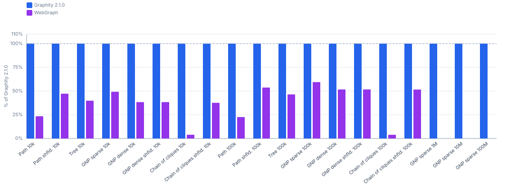

**All libraries**

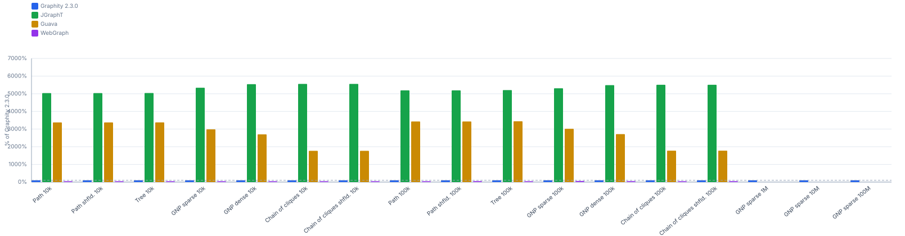

### 2.2 Bytes per Element  `totalBytes / (Nodes + Edges)`

**Memory footprint in bytes (lower is better)**

| Shape | Graphity 2.2.0 | JGraphT | Guava | WebGraph |
|---|---:|---:|---:|---:|
| Path<br><sub>10k nodes, 10k edges</sub> | 4 B | 201.65 B (5041%) | 135.10 B (3378%) | 0.94 B (23.5%) |
| Path shfld.<br><sub>10k nodes, 10k edges</sub> | 4 B | 201.65 B (5041%) | 135.10 B (3378%) | 1.89 B (47.2%) |
| Tree<br><sub>10k nodes, 10k edges</sub> | 4 B | 201.90 B (5048%) | 135.24 B (3381%) | 1.60 B (40.0%) |
| GNP sparse<br><sub>10k nodes, 30k edges</sub> | 4 B | 213.79 B (5345%) | 119.42 B (2986%) | 1.97 B (49.2%) |
| GNP dense<br><sub>10k nodes, 299.6k edges</sub> | 4 B | 221.75 B (5544%) | 108.02 B (2700%) | 1.54 B (38.5%) |
| GNP dense shfld.<br><sub>10k nodes, 299.6k edges</sub> | 4 B | 221.75 B (5544%) | 108.01 B (2700%) | 1.53 B (38.2%) |
| Chain of cliques<br><sub>10k nodes, 310.8k edges</sub> | 4 B | 222.34 B (5558%) | 70.78 B (1770%) | 0.16 B (4.0%) |
| Chain of cliques shfld.<br><sub>10k nodes, 310.8k edges</sub> | 4 B | 222.36 B (5559%) | 70.78 B (1770%) | 1.50 B (37.5%) |
| Path<br><sub>100k nodes, 100k edges</sub> | 4 B | 207.71 B (5193%) | 137.23 B (3431%) | 0.90 B (22.5%) |
| Path shfld.<br><sub>100k nodes, 100k edges</sub> | 4 B | 207.71 B (5193%) | 137.22 B (3430%) | 2.15 B (53.8%) |
| Tree<br><sub>100k nodes, 100k edges</sub> | 4 B | 208.34 B (5208%) | 137.73 B (3443%) | 1.86 B (46.5%) |
| GNP sparse<br><sub>100k nodes, 300k edges</sub> | 4 B | 212.40 B (5310%) | 120.65 B (3016%) | 2.38 B (59.5%) |
| GNP dense<br><sub>100k nodes, 3M edges</sub> | 4 B | 219.51 B (5488%) | 108.63 B (2716%) | 2.07 B (51.7%) |
| GNP dense shfld.<br><sub>100k nodes, 3M edges</sub> | 4 B | 219.52 B (5488%) | 108.63 B (2716%) | 2.07 B (51.7%) |
| Chain of cliques<br><sub>100k nodes, 3.1M edges</sub> | 4 B | 220.25 B (5506%) | 71.08 B (1777%) | 0.16 B (4.0%) |
| Chain of cliques shfld.<br><sub>100k nodes, 3.1M edges</sub> | 4 B | 220.25 B (5506%) | 71.08 B (1777%) | 2.06 B (51.5%) |
| GNP sparse<br><sub>1M nodes, 3M edges</sub> | 4 B | — | — | — |
| GNP sparse<br><sub>10M nodes, 30M edges</sub> | 4 B | — | — | — |
| GNP sparse<br><sub>100M nodes, 300M edges</sub> | 4 B | — | — | — |

**Graphity & WebGraph**


**All libraries**


## 3 Allocations

Bytes allocated per algorithm invocation (JMH `-prof gc`). Lower is better. Baseline (= 100%): **Graphity 2.2.0**, or the newest version present in a table it is missing from.

### 3.1 Build

**Allocations @ 10k nodes in bytes (lower is better)**

| Shape | Graphity 2.2.0 | JGraphT | Guava | WebGraph |
|---|---:|---:|---:|---:|
| Path<br><sub>10k nodes, 10k edges</sub> | 458 kB | 5.3 MB (1163%) | 2.8 MB (604%) | 4.3 MB (948%) |
| Path shfld.<br><sub>10k nodes, 10k edges</sub> | 458 kB | 5.2 MB (1133%) | 2.8 MB (604%) | 4.4 MB (954%) |
| Tree<br><sub>10k nodes, 10k edges</sub> | 458 kB | 5.3 MB (1161%) | 2.8 MB (609%) | 4.1 MB (887%) |
| GNP sparse<br><sub>10k nodes, 30k edges</sub> | 960 kB | 13.1 MB (1360%) | 5.1 MB (536%) | 4.4 MB (463%) |
| GNP dense<br><sub>10k nodes, 299.6k edges</sub> | 9.9 MB | 111 MB (1116%) | 37.3 MB (376%) | 9.7 MB (98.2%) |
| GNP dense shfld.<br><sub>10k nodes, 299.6k edges</sub> | 9.9 MB | 111 MB (1116%) | 37.3 MB (376%) | 9.7 MB (98.1%) |
| Chain of cliques<br><sub>10k nodes, 310.8k edges</sub> | 10.0 MB | 116 MB (1159%) | 29.3 MB (294%) | 8.9 MB (89.7%) |
| Chain of cliques shfld.<br><sub>10k nodes, 310.8k edges</sub> | 10.0 MB | 116 MB (1159%) | 29.3 MB (294%) | 9.4 MB (94.1%) |

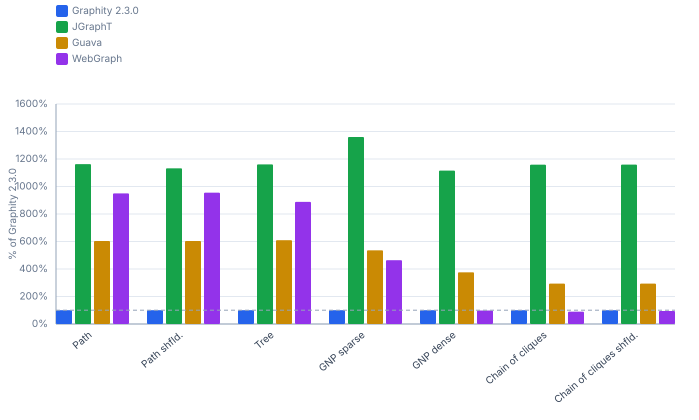

**Allocations @ 100k nodes in bytes (lower is better)**

| Shape | Graphity 2.2.0 | JGraphT | Guava | WebGraph |
|---|---:|---:|---:|---:|
| Path<br><sub>100k nodes, 100k edges</sub> | 3.8 MB | 54.4 MB (1447%) | 28.5 MB (757%) | 14.2 MB (378%) |
| Path shfld.<br><sub>100k nodes, 100k edges</sub> | 3.8 MB | 54.3 MB (1443%) | 28.5 MB (757%) | 14.5 MB (385%) |
| Tree<br><sub>100k nodes, 100k edges</sub> | 3.8 MB | 55.6 MB (1479%) | 28.8 MB (766%) | 11.4 MB (302%) |
| GNP sparse<br><sub>100k nodes, 300k edges</sub> | 10.6 MB | 129 MB (1215%) | 52.3 MB (492%) | 15.3 MB (144%) |
| GNP dense<br><sub>100k nodes, 3M edges</sub> | 111 MB | 1094 MB (983%) | 376 MB (338%) | 69.8 MB (62.7%) |
| GNP dense shfld.<br><sub>100k nodes, 3M edges</sub> | 111 MB | 1094 MB (983%) | 376 MB (338%) | 69.8 MB (62.7%) |
| Chain of cliques<br><sub>100k nodes, 3.1M edges</sub> | 112 MB | 1139 MB (1020%) | 294 MB (264%) | 60.2 MB (53.9%) |
| Chain of cliques shfld.<br><sub>100k nodes, 3.1M edges</sub> | 112 MB | 1139 MB (1020%) | 294 MB (264%) | 66.3 MB (59.4%) |

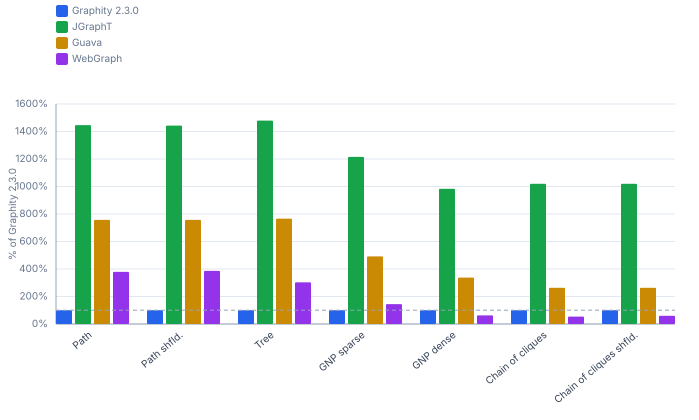

### 3.2 SCC

**Allocations @ 10k nodes in bytes (lower is better)**

| Shape | Graphity 2.2.0 | JGraphT | Guava | WebGraph |
|---|---:|---:|---:|---:|
| Path<br><sub>10k nodes, 10k edges</sub> | 534 kB | 5.2 MB (975%) | 4.0 MB (758%) | 1.4 MB (269%) |
| Path shfld.<br><sub>10k nodes, 10k edges</sub> | 534 kB | 5.2 MB (966%) | 4.0 MB (747%) | 1.3 MB (247%) |
| Tree<br><sub>10k nodes, 10k edges</sub> | 288 kB | 5.0 MB (1746%) | 3.7 MB (1299%) | 908 kB (315%) |
| GNP sparse<br><sub>10k nodes, 30k edges</sub> | 371 kB | 3.2 MB (854%) | 4.0 MB (1091%) | 1.3 MB (346%) |
| GNP dense<br><sub>10k nodes, 299.6k edges</sub> | 498 kB | 6.3 MB (1276%) | 5.2 MB (1044%) | 1.5 MB (295%) |
| GNP dense shfld.<br><sub>10k nodes, 299.6k edges</sub> | 497 kB | 6.3 MB (1277%) | 5.2 MB (1044%) | 1.5 MB (294%) |
| Chain of cliques<br><sub>10k nodes, 310.8k edges</sub> | 495 kB | 4.8 MB (964%) | 8.5 MB (1720%) | 6.1 MB (1237%) |
| Chain of cliques shfld.<br><sub>10k nodes, 310.8k edges</sub> | 364 kB | 6.0 MB (1634%) | 8.7 MB (2378%) | 1.3 MB (348%) |

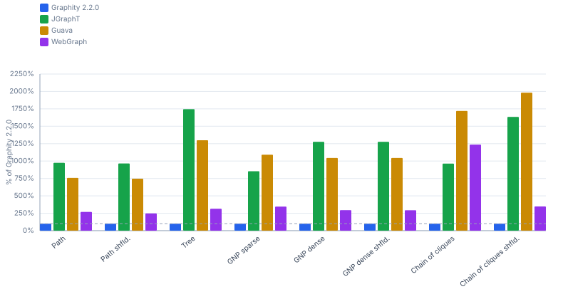

**Allocations @ 100k nodes in bytes (lower is better)**

| Shape | Graphity 2.2.0 | JGraphT | Guava | WebGraph |
|---|---:|---:|---:|---:|
| Path<br><sub>100k nodes, 100k edges</sub> | 4.9 MB | 51.6 MB (1056%) | 28.9 MB (591%) | 13.3 MB (272%) |
| Path shfld.<br><sub>100k nodes, 100k edges</sub> | 4.9 MB | 51.7 MB (1058%) | 41.8 MB (855%) | 13.5 MB (275%) |
| Tree<br><sub>100k nodes, 100k edges</sub> | 2.8 MB | 50.3 MB (1792%) | 25.5 MB (907%) | 8.8 MB (314%) |
| GNP sparse<br><sub>100k nodes, 300k edges</sub> | 3.5 MB | 32.1 MB (916%) | 42.9 MB (1222%) | 12.3 MB (351%) |
| GNP dense<br><sub>100k nodes, 3M edges</sub> | 4.5 MB | 71.2 MB (1576%) | 45.2 MB (1002%) | 13.5 MB (298%) |
| GNP dense shfld.<br><sub>100k nodes, 3M edges</sub> | 4.5 MB | 70.9 MB (1570%) | 53.3 MB (1181%) | 13.5 MB (298%) |
| Chain of cliques<br><sub>100k nodes, 3.1M edges</sub> | 4.5 MB | 48.5 MB (1078%) | 76.8 MB (1706%) | 60.3 MB (1339%) |
| Chain of cliques shfld.<br><sub>100k nodes, 3.1M edges</sub> | 3.5 MB | 61.4 MB (1777%) | 89.7 MB (2598%) | 12.3 MB (356%) |

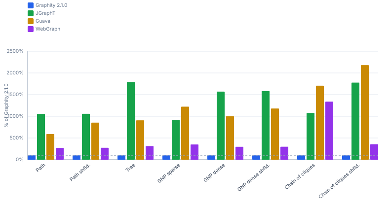

### 3.3 WCC

**Allocations @ 10k nodes in bytes (lower is better)**

| Shape | Graphity 2.2.0 |
|---|---:|
| Path<br><sub>10k nodes, 10k edges</sub> | 200 kB |
| Path shfld.<br><sub>10k nodes, 10k edges</sub> | 200 kB |
| Tree<br><sub>10k nodes, 10k edges</sub> | 200 kB |
| GNP sparse<br><sub>10k nodes, 30k edges</sub> | 200 kB |
| GNP dense<br><sub>10k nodes, 299.6k edges</sub> | 200 kB |
| GNP dense shfld.<br><sub>10k nodes, 299.6k edges</sub> | 200 kB |
| Chain of cliques<br><sub>10k nodes, 310.8k edges</sub> | 200 kB |
| Chain of cliques shfld.<br><sub>10k nodes, 310.8k edges</sub> | 200 kB |

**Allocations @ 100k nodes in bytes (lower is better)**

| Shape | Graphity 2.2.0 |
|---|---:|
| Path<br><sub>100k nodes, 100k edges</sub> | 2.0 MB |
| Path shfld.<br><sub>100k nodes, 100k edges</sub> | 2.0 MB |
| Tree<br><sub>100k nodes, 100k edges</sub> | 2.0 MB |
| GNP sparse<br><sub>100k nodes, 300k edges</sub> | 2.0 MB |
| GNP dense<br><sub>100k nodes, 3M edges</sub> | 2.0 MB |
| GNP dense shfld.<br><sub>100k nodes, 3M edges</sub> | 2.0 MB |
| Chain of cliques<br><sub>100k nodes, 3.1M edges</sub> | 2.0 MB |
| Chain of cliques shfld.<br><sub>100k nodes, 3.1M edges</sub> | 2.0 MB |

### 3.4 CCs

**Allocations @ 10k nodes in bytes (lower is better)**

| Shape | Graphity 2.2.0 |
|---|---:|
| Path<br><sub>10k nodes, 10k edges</sub> | 200 kB |
| Path shfld.<br><sub>10k nodes, 10k edges</sub> | 200 kB |
| Tree<br><sub>10k nodes, 10k edges</sub> | 200 kB |
| GNP sparse<br><sub>10k nodes, 30k edges</sub> | 200 kB |
| GNP dense<br><sub>10k nodes, 299.6k edges</sub> | 200 kB |
| GNP dense shfld.<br><sub>10k nodes, 299.6k edges</sub> | 200 kB |
| Chain of cliques<br><sub>10k nodes, 310.8k edges</sub> | 200 kB |
| Chain of cliques shfld.<br><sub>10k nodes, 310.8k edges</sub> | 200 kB |

**Allocations @ 100k nodes in bytes (lower is better)**

| Shape | Graphity 2.2.0 |
|---|---:|
| Path<br><sub>100k nodes, 100k edges</sub> | 2.0 MB |
| Path shfld.<br><sub>100k nodes, 100k edges</sub> | 2.0 MB |
| Tree<br><sub>100k nodes, 100k edges</sub> | 2.0 MB |
| GNP sparse<br><sub>100k nodes, 300k edges</sub> | 2.0 MB |
| GNP dense<br><sub>100k nodes, 3M edges</sub> | 2.0 MB |
| GNP dense shfld.<br><sub>100k nodes, 3M edges</sub> | 2.0 MB |
| Chain of cliques<br><sub>100k nodes, 3.1M edges</sub> | 2.0 MB |
| Chain of cliques shfld.<br><sub>100k nodes, 3.1M edges</sub> | 2.0 MB |

### 3.5 Condense

**Allocations @ 1k nodes in bytes (lower is better)**

| Shape | Graphity 2.2.0 |
|---|---:|
| Path<br><sub>1k nodes, 1k edges</sub> | 23.2 kB |
| GNP dense<br><sub>1k nodes, 30k edges</sub> | 96 B |
| Chain of cliques<br><sub>1k nodes, 31.1k edges</sub> | 760 B |
| DAG GNP sparse<br><sub>1k nodes</sub> | 66.4 kB |

**Allocations @ 10k nodes in bytes (lower is better)**

| Shape | Graphity 2.2.0 |
|---|---:|
| Path<br><sub>10k nodes, 10k edges</sub> | 250 kB |
| GNP dense<br><sub>10k nodes, 299.6k edges</sub> | 97 B |
| Chain of cliques<br><sub>10k nodes, 310.8k edges</sub> | 7.2 kB |
| DAG GNP sparse<br><sub>10k nodes</sub> | 541 kB |

**Allocations @ 100k nodes in bytes (lower is better)**

| Shape | Graphity 2.2.0 |
|---|---:|
| Path<br><sub>100k nodes, 100k edges</sub> | 2.1 MB |
| GNP dense<br><sub>100k nodes, 3M edges</sub> | 107 B |
| Chain of cliques<br><sub>100k nodes, 3.1M edges</sub> | 75.7 kB |
| DAG GNP sparse<br><sub>100k nodes</sub> | 5.9 MB |

### 3.6 TopOrder

**Allocations @ 10k nodes in bytes (lower is better)**

| Shape | Graphity 2.2.0 | JGraphT | Guava | WebGraph |
|---|---:|---:|---:|---:|
| Path<br><sub>10k nodes, 10k edges</sub> | 297 kB | 1.3 MB (422%) | 943 kB (318%) | 1.5 MB (494%) |
| Path shfld.<br><sub>10k nodes, 10k edges</sub> | 297 kB | 1.3 MB (422%) | 2.4 MB (803%) | 1.0 MB (345%) |
| Tree<br><sub>10k nodes, 10k edges</sub> | 50.8 kB | 1.3 MB (2507%) | 813 kB (1600%) | 885 kB (1742%) |
| Tree shfld.<br><sub>10k nodes</sub> | 50.8 kB | 1.3 MB (2507%) | 2.3 MB (4430%) | 845 kB (1663%) |
| DAG GNP sparse<br><sub>10k nodes</sub> | 50.8 kB | 1.3 MB (2507%) | 2.3 MB (4430%) | 984 kB (1936%) |
| DAG GNP dense<br><sub>10k nodes</sub> | 50.8 kB | 1.3 MB (2468%) | 812 kB (1597%) | 1.1 MB (2162%) |
| DAG GNP dense shfld.<br><sub>10k nodes</sub> | 50.8 kB | 1.3 MB (2468%) | 812 kB (1597%) | 1.1 MB (2119%) |

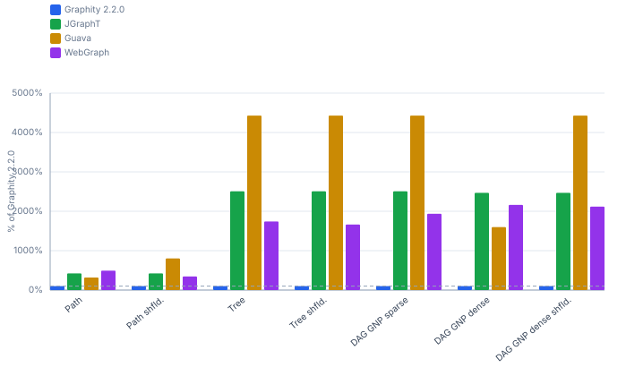

**Allocations @ 100k nodes in bytes (lower is better)**

| Shape | Graphity 2.2.0 | JGraphT | Guava | WebGraph |
|---|---:|---:|---:|---:|
| Path<br><sub>100k nodes, 100k edges</sub> | 2.5 MB | 13.3 MB (529%) | 24.3 MB (968%) | 10.5 MB (417%) |
| Path shfld.<br><sub>100k nodes, 100k edges</sub> | 2.5 MB | 13.3 MB (529%) | 23.3 MB (927%) | 10.0 MB (400%) |
| Tree<br><sub>100k nodes, 100k edges</sub> | 433 kB | 13.5 MB (3108%) | 22.2 MB (5134%) | 8.5 MB (1953%) |
| Tree shfld.<br><sub>100k nodes</sub> | 433 kB | 13.5 MB (3108%) | 22.2 MB (5134%) | 8.4 MB (1945%) |
| DAG GNP sparse<br><sub>100k nodes</sub> | 433 kB | 13.6 MB (3128%) | 22.2 MB (5134%) | 9.5 MB (2203%) |
| DAG GNP dense<br><sub>100k nodes</sub> | 433 kB | 13.9 MB (3212%) | 7.9 MB (1812%) | 10.3 MB (2375%) |
| DAG GNP dense shfld.<br><sub>100k nodes</sub> | 433 kB | 13.3 MB (3074%) | 7.9 MB (1812%) | 10.2 MB (2361%) |

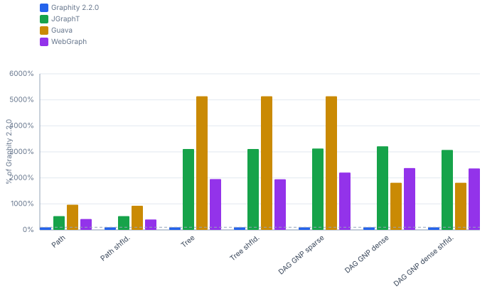

### 3.7 TopOrderAndLevels

**Allocations @ 10k nodes in bytes (lower is better)**

| Shape | Graphity 2.2.0 |
|---|---:|
| Path<br><sub>10k nodes, 10k edges</sub> | 160 kB |
| Path shfld.<br><sub>10k nodes, 10k edges</sub> | 160 kB |
| Tree<br><sub>10k nodes, 10k edges</sub> | 160 kB |
| Tree shfld.<br><sub>10k nodes</sub> | 160 kB |
| DAG GNP sparse<br><sub>10k nodes</sub> | 160 kB |
| DAG GNP dense<br><sub>10k nodes</sub> | 160 kB |
| DAG GNP dense shfld.<br><sub>10k nodes</sub> | 160 kB |

**Allocations @ 100k nodes in bytes (lower is better)**

| Shape | Graphity 2.2.0 |
|---|---:|
| Path<br><sub>100k nodes, 100k edges</sub> | 1.6 MB |
| Path shfld.<br><sub>100k nodes, 100k edges</sub> | 1.6 MB |
| Tree<br><sub>100k nodes, 100k edges</sub> | 1.6 MB |
| Tree shfld.<br><sub>100k nodes</sub> | 1.6 MB |
| DAG GNP sparse<br><sub>100k nodes</sub> | 1.6 MB |
| DAG GNP dense<br><sub>100k nodes</sub> | 1.6 MB |
| DAG GNP dense shfld.<br><sub>100k nodes</sub> | 1.6 MB |

### 3.8 BackEdges

**Allocations @ 10k nodes in bytes (lower is better)**

| Shape | Graphity 2.2.0 | JGraphT | Guava | WebGraph |
|---|---:|---:|---:|---:|
| Path<br><sub>10k nodes, 10k edges</sub> | 257 kB | 161 kB (62.6%) | 1.6 MB (624%) | 1.4 MB (555%) |
| Path shfld.<br><sub>10k nodes, 10k edges</sub> | 257 kB | 161 kB (62.6%) | 1.6 MB (624%) | 985 kB (384%) |
| Tree<br><sub>10k nodes, 10k edges</sub> | 10.9 kB | 161 kB (1476%) | 1.6 MB (14712%) | 845 kB (7768%) |
| GNP sparse<br><sub>10k nodes, 30k edges</sub> | 351 kB | 386 kB (110%) | 1.8 MB (520%) | 1.2 MB (336%) |
| GNP dense<br><sub>10k nodes, 299.6k edges</sub> | 4.1 MB | 4.0 MB (97.7%) | 5.4 MB (133%) | 4.9 MB (120%) |
| GNP dense shfld.<br><sub>10k nodes, 299.6k edges</sub> | 4.1 MB | 4.0 MB (97.7%) | 4.8 MB (117%) | 4.8 MB (118%) |
| Chain of cliques<br><sub>10k nodes, 310.8k edges</sub> | 4.1 MB | 4.0 MB (97.7%) | 5.4 MB (133%) | 9.7 MB (236%) |
| Chain of cliques shfld.<br><sub>10k nodes, 310.8k edges</sub> | 4.0 MB | 4.0 MB (101%) | 5.4 MB (137%) | 4.9 MB (124%) |

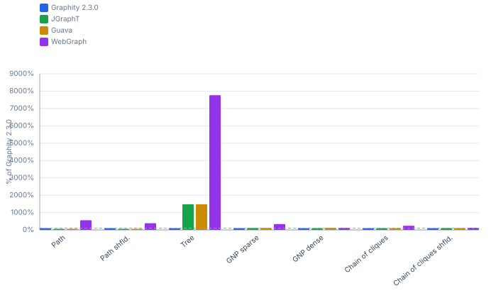

**Allocations @ 100k nodes in bytes (lower is better)**

| Shape | Graphity 2.2.0 | JGraphT | Guava | WebGraph |
|---|---:|---:|---:|---:|
| Path<br><sub>100k nodes, 100k edges</sub> | 2.1 MB | 1.6 MB (76.8%) | 16.0 MB (758%) | 10.1 MB (477%) |
| Path shfld.<br><sub>100k nodes, 100k edges</sub> | 2.1 MB | 1.6 MB (76.8%) | 16.0 MB (758%) | 9.6 MB (456%) |
| Tree<br><sub>100k nodes, 100k edges</sub> | 33.4 kB | 1.6 MB (4861%) | 1.6 MB (4861%) | 8.1 MB (24142%) |
| GNP sparse<br><sub>100k nodes, 300k edges</sub> | 3.6 MB | 4.2 MB (115%) | 18.6 MB (512%) | 12.1 MB (332%) |
| GNP dense<br><sub>100k nodes, 3M edges</sub> | 45.9 MB | 45.4 MB (98.9%) | 53.9 MB (117%) | 53.6 MB (117%) |
| GNP dense shfld.<br><sub>100k nodes, 3M edges</sub> | 45.9 MB | 45.4 MB (98.9%) | 53.7 MB (117%) | 53.6 MB (117%) |
| Chain of cliques<br><sub>100k nodes, 3.1M edges</sub> | 45.9 MB | 45.4 MB (98.9%) | 59.8 MB (130%) | 101 MB (219%) |
| Chain of cliques shfld.<br><sub>100k nodes, 3.1M edges</sub> | 44.8 MB | 45.4 MB (101%) | 45.4 MB (101%) | 53.5 MB (119%) |

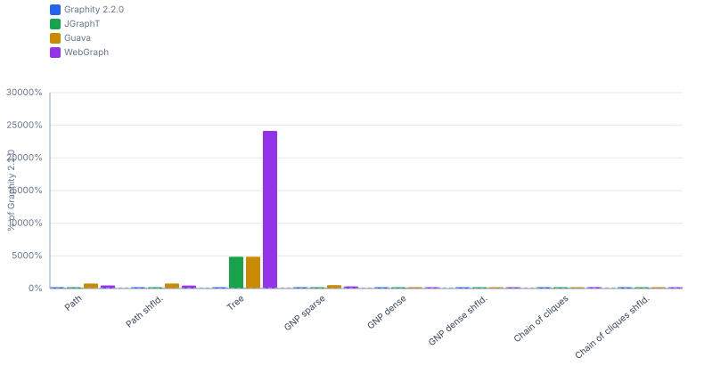

### 3.9 EdgeTypes

**Allocations @ 10k nodes in bytes (lower is better)**

| Shape | Graphity 2.2.0 | JGraphT | Guava | WebGraph |
|---|---:|---:|---:|---:|
| Path<br><sub>10k nodes, 10k edges</sub> | 307 kB | 581 kB (190%) | 581 kB (190%) | 1.8 MB (602%) |
| Path shfld.<br><sub>10k nodes, 10k edges</sub> | 307 kB | 581 kB (190%) | 2.0 MB (659%) | 1.4 MB (458%) |
| Tree<br><sub>10k nodes, 10k edges</sub> | 60.8 kB | 581 kB (956%) | 2.0 MB (3323%) | 1.3 MB (2081%) |
| GNP sparse<br><sub>10k nodes, 30k edges</sub> | 196 kB | 1.1 MB (540%) | 2.5 MB (1276%) | 1.8 MB (945%) |
| GNP dense<br><sub>10k nodes, 299.6k edges</sub> | 596 kB | 9.9 MB (1665%) | 11.4 MB (1906%) | 10.8 MB (1818%) |
| GNP dense shfld.<br><sub>10k nodes, 299.6k edges</sub> | 596 kB | 9.9 MB (1665%) | 11.4 MB (1906%) | 10.8 MB (1806%) |
| Chain of cliques<br><sub>10k nodes, 310.8k edges</sub> | 607 kB | 9.9 MB (1634%) | 11.4 MB (1871%) | 15.6 MB (2565%) |
| Chain of cliques shfld.<br><sub>10k nodes, 310.8k edges</sub> | 476 kB | 9.9 MB (2084%) | 11.4 MB (2386%) | 10.8 MB (2275%) |

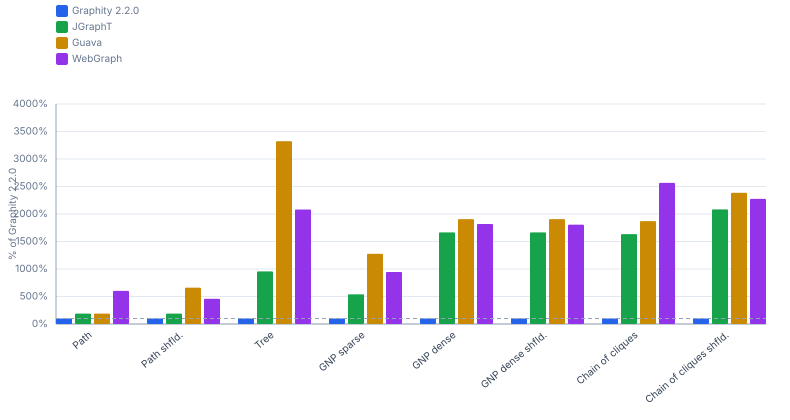

**Allocations @ 100k nodes in bytes (lower is better)**

| Shape | Graphity 2.2.0 | JGraphT | Guava | WebGraph |
|---|---:|---:|---:|---:|
| Path<br><sub>100k nodes, 100k edges</sub> | 2.6 MB | 4.9 MB (188%) | 19.3 MB (738%) | 13.4 MB (511%) |
| Path shfld.<br><sub>100k nodes, 100k edges</sub> | 2.6 MB | 4.9 MB (188%) | 19.3 MB (738%) | 12.9 MB (495%) |
| Tree<br><sub>100k nodes, 100k edges</sub> | 533 kB | 4.9 MB (920%) | 19.3 MB (3620%) | 11.3 MB (2127%) |
| GNP sparse<br><sub>100k nodes, 300k edges</sub> | 1.8 MB | 11.7 MB (665%) | 26.1 MB (1481%) | 19.6 MB (1112%) |
| GNP dense<br><sub>100k nodes, 3M edges</sub> | 5.5 MB | 113 MB (2046%) | 121 MB (2191%) | 121 MB (2194%) |
| GNP dense shfld.<br><sub>100k nodes, 3M edges</sub> | 5.5 MB | 113 MB (2046%) | 121 MB (2191%) | 121 MB (2195%) |
| Chain of cliques<br><sub>100k nodes, 3.1M edges</sub> | 5.6 MB | 113 MB (2008%) | 127 MB (2264%) | 168 MB (2990%) |
| Chain of cliques shfld.<br><sub>100k nodes, 3.1M edges</sub> | 4.6 MB | 113 MB (2469%) | 117 MB (2556%) | 121 MB (2646%) |

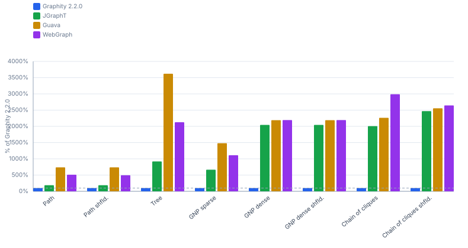
