# Graphity vs. JGraphT, Guava and WebGraph — synthetic / ubuntu-ryzen-9950x

Graphity `2.3.0` against the peer libraries. Peer numbers come from the newest run that measured them, which need not be the run of the newest Graphity version; every column states the version it belongs to. Blocks without a peer column are Graphity-only benchmarks or graph sizes beyond the peers' reach — for the comparison across Graphity versions see [`synthetic-ubuntu-ryzen-9950x-history.md`](synthetic-ubuntu-ryzen-9950x-history.md).

```
Profile:      synthetic
Timestamp:    2026-10-16 04:51:31
JDK:          OpenJDK 64-Bit Server VM 25.0.2 (Amazon.com Inc.)
OS:           Ubuntu 25.10, kernel 6.17.0-41-generic (amd64)
CPU:          AMD Ryzen 9 9950X 16-Core Processor (32 logical cores)
RAM:          89.7 GiB
Estimate:     near-best window - 3rd-fastest of 15 or more, 2nd-fastest of 5 or more
Revision:     303d801d508b + uncommitted changes b4b1cd1fe72e "Prepare 2.3.0 release"
Memory:       revision not recorded per row
```

## Contents

- [1 Performance](#1-performance)
  - [1.1 Build](#11-build)
  - [1.2 Out-adjacency traversal (outNodes, no algorithm)](#12-out-adjacency-traversal-outnodes-no-algorithm)
  - [1.3 In-adjacency traversal (inNodes, no algorithm)](#13-in-adjacency-traversal-innodes-no-algorithm)
  - [1.4 SCC](#14-scc)
  - [1.5 WCC](#15-wcc)
  - [1.6 CCs](#16-ccs)
  - [1.7 Condense](#17-condense)
  - [1.8 TopOrder](#18-toporder)
  - [1.9 TopOrderAndLevels](#19-toporderandlevels)
  - [1.10 BackEdges](#110-backedges)
  - [1.11 EdgeTypes](#111-edgetypes)
  - [1.12 Reorder (DFS-preorder) cost](#112-reorder-dfs-preorder-cost)
  - [1.13 BiAdjacency (in-adjacency) cost](#113-biadjacency-in-adjacency-cost)
  - [1.14 Symmetrize (WebGraph) cost](#114-symmetrize-webgraph-cost)
  - [1.15 Dominators](#115-dominators)
  - [1.16 Dominance frontiers](#116-dominance-frontiers)
  - [1.17 Iterated dominance frontier (build + one query per variable)](#117-iterated-dominance-frontier-build-one-query-per-variable)
  - [1.18 Loops](#118-loops)
  - [1.19 Ancestry of the dominator tree](#119-ancestry-of-the-dominator-tree)
  - [1.20 PreorderAncestry of the dominator tree](#120-preorderancestry-of-the-dominator-tree)
- [2 Memory Footprint](#2-memory-footprint)
  - [2.1 Total Graph Size](#21-total-graph-size)
  - [2.2 Bytes per Element  `totalBytes / (Nodes + Edges)`](#22-bytes-per-element-totalbytes-nodes-edges)
- [3 Allocations](#3-allocations)
  - [3.1 Build](#31-build)
  - [3.2 SCC](#32-scc)
  - [3.3 WCC](#33-wcc)
  - [3.4 CCs](#34-ccs)
  - [3.5 Condense](#35-condense)
  - [3.6 TopOrder](#36-toporder)
  - [3.7 TopOrderAndLevels](#37-toporderandlevels)
  - [3.8 BackEdges](#38-backedges)
  - [3.9 EdgeTypes](#39-edgetypes)
  - [3.10 Dominators](#310-dominators)
  - [3.11 Dominance frontiers](#311-dominance-frontiers)
  - [3.12 Iterated dominance frontier (build + one query per variable)](#312-iterated-dominance-frontier-build-one-query-per-variable)
  - [3.13 Loops](#313-loops)
  - [3.14 Ancestry of the dominator tree](#314-ancestry-of-the-dominator-tree)
  - [3.15 PreorderAncestry of the dominator tree](#315-preorderancestry-of-the-dominator-tree)

## 1 Performance

Times (ms/op, lower is better) and throughput (op/s, higher is better) for each algorithm and graph size. Non-baseline cells show the factor relative to **Graphity 2.3.0**, or the newest version present in a table it is missing from (= 100% in the throughput table).

### 1.1 Build

#### Times @ 10k nodes (ms/op, lower is better)

| Shape | Graphity 2.3.0 | JGraphT | Guava | WebGraph |
|---|---:|---:|---:|---:|
| Path<br><sub>10k nodes, 10k edges</sub> | 0.083 ms | 1.111 ms (13×) | 0.372 ms (4.5×) | 2.260 ms (27×) |
| Path shfld.<br><sub>10k nodes, 10k edges</sub> | 0.084 ms | 1.115 ms (13×) | 0.555 ms (6.6×) | 2.936 ms (35×) |
| Tree<br><sub>10k nodes, 10k edges</sub> | 0.093 ms | 1.153 ms (12×) | 0.526 ms (5.7×) | 2.559 ms (28×) |
| GNP sparse<br><sub>10k nodes, 30k edges</sub> | 0.171 ms | 4.088 ms (24×) | 2.145 ms (13×) | 7.956 ms (47×) |
| GNP dense<br><sub>10k nodes, 299.6k edges</sub> | 1.569 ms | 55.01 ms (35×) | 31.20 ms (20×) | 43.27 ms (28×) |
| Chain of cliques<br><sub>10k nodes, 310.8k edges</sub> | 1.600 ms | 40.13 ms (25×) | 9.044 ms (5.7×) | 6.600 ms (4.1×) |
| Chain of cliques shfld.<br><sub>10k nodes, 310.8k edges</sub> | 1.606 ms | 57.04 ms (36×) | 17.65 ms (11×) | 43.73 ms (27×) |

#### Throughput @ 10k nodes (op/s, higher is better)

| Shape | Graphity 2.3.0 | JGraphT | Guava | WebGraph |
|---|---:|---:|---:|---:|
| Path<br><sub>10k nodes, 10k edges</sub> | 12 048 op/s | 900.1 op/s (7.5%) | 2 688 op/s (22.3%) | 442.5 op/s (3.7%) |
| Path shfld.<br><sub>10k nodes, 10k edges</sub> | 11 905 op/s | 896.9 op/s (7.5%) | 1 802 op/s (15.1%) | 340.6 op/s (2.9%) |
| Tree<br><sub>10k nodes, 10k edges</sub> | 10 753 op/s | 867.3 op/s (8.1%) | 1 901 op/s (17.7%) | 390.8 op/s (3.6%) |
| GNP sparse<br><sub>10k nodes, 30k edges</sub> | 5 848 op/s | 244.6 op/s (4.2%) | 466.2 op/s (8.0%) | 125.7 op/s (2.1%) |
| GNP dense<br><sub>10k nodes, 299.6k edges</sub> | 637.3 op/s | 18.18 op/s (2.9%) | 32.06 op/s (5.0%) | 23.11 op/s (3.6%) |
| Chain of cliques<br><sub>10k nodes, 310.8k edges</sub> | 625.0 op/s | 24.92 op/s (4.0%) | 110.6 op/s (17.7%) | 151.5 op/s (24.2%) |
| Chain of cliques shfld.<br><sub>10k nodes, 310.8k edges</sub> | 622.7 op/s | 17.53 op/s (2.8%) | 56.66 op/s (9.1%) | 22.87 op/s (3.7%) |


#### Times @ 100k nodes (ms/op, lower is better)

| Shape | Graphity 2.3.0 | JGraphT | Guava | WebGraph |
|---|---:|---:|---:|---:|
| Path<br><sub>100k nodes, 100k edges</sub> | 0.693 ms | 14.04 ms (20×) | 4.043 ms (5.8×) | 21.64 ms (31×) |
| Path shfld.<br><sub>100k nodes, 100k edges</sub> | 0.695 ms | 23.03 ms (33×) | 8.956 ms (13×) | 29.21 ms (42×) |
| Tree<br><sub>100k nodes, 100k edges</sub> | 1.101 ms | 25.14 ms (23×) | 8.092 ms (7.3×) | 28.09 ms (26×) |
| GNP sparse<br><sub>100k nodes, 300k edges</sub> | 2.278 ms | 95.96 ms (42×) | 47.37 ms (21×) | 85.02 ms (37×) |
| GNP dense<br><sub>100k nodes, 3M edges</sub> | 17.57 ms | 1498.0 ms (85×) | 965.5 ms (55×) | 542.8 ms (31×) |
| Chain of cliques<br><sub>100k nodes, 3.1M edges</sub> | 17.14 ms | 818.9 ms (48×) | 93.49 ms (5.5×) | 63.61 ms (3.7×) |
| Chain of cliques shfld.<br><sub>100k nodes, 3.1M edges</sub> | 17.10 ms | 1482.1 ms (87×) | 612.9 ms (36×) | 508.0 ms (30×) |

#### Throughput @ 100k nodes (op/s, higher is better)

| Shape | Graphity 2.3.0 | JGraphT | Guava | WebGraph |
|---|---:|---:|---:|---:|
| Path<br><sub>100k nodes, 100k edges</sub> | 1 443 op/s | 71.21 op/s (4.9%) | 247.3 op/s (17.1%) | 46.21 op/s (3.2%) |
| Path shfld.<br><sub>100k nodes, 100k edges</sub> | 1 439 op/s | 43.42 op/s (3.0%) | 111.7 op/s (7.8%) | 34.23 op/s (2.4%) |
| Tree<br><sub>100k nodes, 100k edges</sub> | 908.3 op/s | 39.77 op/s (4.4%) | 123.6 op/s (13.6%) | 35.60 op/s (3.9%) |
| GNP sparse<br><sub>100k nodes, 300k edges</sub> | 439.0 op/s | 10.42 op/s (2.4%) | 21.11 op/s (4.8%) | 11.76 op/s (2.7%) |
| GNP dense<br><sub>100k nodes, 3M edges</sub> | 56.93 op/s | 0.668 op/s (1.2%) | 1.036 op/s (1.8%) | 1.842 op/s (3.2%) |
| Chain of cliques<br><sub>100k nodes, 3.1M edges</sub> | 58.35 op/s | 1.221 op/s (2.1%) | 10.70 op/s (18.3%) | 15.72 op/s (26.9%) |
| Chain of cliques shfld.<br><sub>100k nodes, 3.1M edges</sub> | 58.48 op/s | 0.675 op/s (1.2%) | 1.632 op/s (2.8%) | 1.969 op/s (3.4%) |


#### Times @ 1M nodes (ms/op, lower is better)

| Shape | Graphity 2.3.0 |
|---|---:|
| GNP sparse<br><sub>1M nodes, 3M edges</sub> | 27.59 ms |
| GNP dense<br><sub>1M nodes, 30M edges</sub> | 169.7 ms |
| Chain of cliques<br><sub>1M nodes, 31.1M edges</sub> | 166.0 ms |

#### Throughput @ 1M nodes (op/s, higher is better)

| Shape | Graphity 2.3.0 |
|---|---:|
| GNP sparse<br><sub>1M nodes, 3M edges</sub> | 36.24 op/s |
| GNP dense<br><sub>1M nodes, 30M edges</sub> | 5.893 op/s |
| Chain of cliques<br><sub>1M nodes, 31.1M edges</sub> | 6.024 op/s |

#### Times @ 10M nodes (ms/op, lower is better)

| Shape | Graphity 2.3.0 |
|---|---:|
| GNP sparse<br><sub>10M nodes, 30M edges</sub> | 242.5 ms |
| GNP dense<br><sub>10M nodes, 299.6M edges</sub> | 1739.0 ms |
| Chain of cliques<br><sub>10M nodes, 310.8M edges</sub> | 2061.3 ms |

#### Throughput @ 10M nodes (op/s, higher is better)

| Shape | Graphity 2.3.0 |
|---|---:|
| GNP sparse<br><sub>10M nodes, 30M edges</sub> | 4.124 op/s |
| GNP dense<br><sub>10M nodes, 299.6M edges</sub> | 0.575 op/s |
| Chain of cliques<br><sub>10M nodes, 310.8M edges</sub> | 0.485 op/s |

#### Times @ 100M nodes (ms/op, lower is better)

| Shape | Graphity 2.3.0 |
|---|---:|
| GNP sparse<br><sub>100M nodes, 300M edges</sub> | 2457.0 ms |

#### Throughput @ 100M nodes (op/s, higher is better)

| Shape | Graphity 2.3.0 |
|---|---:|
| GNP sparse<br><sub>100M nodes, 300M edges</sub> | 0.407 op/s |

### 1.2 Out-adjacency traversal (outNodes, no algorithm)

#### Times @ 10k nodes (ms/op, lower is better)

| Shape | Graphity 2.3.0 |
|---|---:|
| Path<br><sub>10k nodes, 10k edges</sub> | 0.014 ms |
| Path shfld.<br><sub>10k nodes, 10k edges</sub> | 0.014 ms |
| Tree<br><sub>10k nodes, 10k edges</sub> | 0.010 ms |
| GNP sparse<br><sub>10k nodes, 30k edges</sub> | 0.017 ms |
| GNP dense<br><sub>10k nodes, 299.6k edges</sub> | 0.048 ms |
| Chain of cliques<br><sub>10k nodes, 310.8k edges</sub> | 0.051 ms |
| Chain of cliques shfld.<br><sub>10k nodes, 310.8k edges</sub> | 0.053 ms |

#### Throughput @ 10k nodes (op/s, higher is better)

| Shape | Graphity 2.3.0 |
|---|---:|
| Path<br><sub>10k nodes, 10k edges</sub> | 71 429 op/s |
| Path shfld.<br><sub>10k nodes, 10k edges</sub> | 71 429 op/s |
| Tree<br><sub>10k nodes, 10k edges</sub> | 100 000 op/s |
| GNP sparse<br><sub>10k nodes, 30k edges</sub> | 58 824 op/s |
| GNP dense<br><sub>10k nodes, 299.6k edges</sub> | 20 833 op/s |
| Chain of cliques<br><sub>10k nodes, 310.8k edges</sub> | 19 608 op/s |
| Chain of cliques shfld.<br><sub>10k nodes, 310.8k edges</sub> | 18 868 op/s |

#### Times @ 100k nodes (ms/op, lower is better)

| Shape | Graphity 2.3.0 |
|---|---:|
| Path<br><sub>100k nodes, 100k edges</sub> | 0.169 ms |
| Path shfld.<br><sub>100k nodes, 100k edges</sub> | 0.170 ms |
| Tree<br><sub>100k nodes, 100k edges</sub> | 0.404 ms |
| GNP sparse<br><sub>100k nodes, 300k edges</sub> | 0.658 ms |
| GNP dense<br><sub>100k nodes, 3M edges</sub> | 1.134 ms |
| Chain of cliques<br><sub>100k nodes, 3.1M edges</sub> | 0.517 ms |
| Chain of cliques shfld.<br><sub>100k nodes, 3.1M edges</sub> | 0.514 ms |

#### Throughput @ 100k nodes (op/s, higher is better)

| Shape | Graphity 2.3.0 |
|---|---:|
| Path<br><sub>100k nodes, 100k edges</sub> | 5 917 op/s |
| Path shfld.<br><sub>100k nodes, 100k edges</sub> | 5 882 op/s |
| Tree<br><sub>100k nodes, 100k edges</sub> | 2 475 op/s |
| GNP sparse<br><sub>100k nodes, 300k edges</sub> | 1 520 op/s |
| GNP dense<br><sub>100k nodes, 3M edges</sub> | 881.8 op/s |
| Chain of cliques<br><sub>100k nodes, 3.1M edges</sub> | 1 934 op/s |
| Chain of cliques shfld.<br><sub>100k nodes, 3.1M edges</sub> | 1 946 op/s |

### 1.3 In-adjacency traversal (inNodes, no algorithm)

#### Times @ 10k nodes (ms/op, lower is better)

| Shape | Graphity 2.3.0 |
|---|---:|
| Path<br><sub>10k nodes, 10k edges</sub> | 0.014 ms |
| Path shfld.<br><sub>10k nodes, 10k edges</sub> | 0.014 ms |
| Tree<br><sub>10k nodes, 10k edges</sub> | 0.014 ms |
| GNP sparse<br><sub>10k nodes, 30k edges</sub> | 0.017 ms |
| GNP dense<br><sub>10k nodes, 299.6k edges</sub> | 0.050 ms |
| Chain of cliques<br><sub>10k nodes, 310.8k edges</sub> | 0.054 ms |
| Chain of cliques shfld.<br><sub>10k nodes, 310.8k edges</sub> | 0.056 ms |

#### Throughput @ 10k nodes (op/s, higher is better)

| Shape | Graphity 2.3.0 |
|---|---:|
| Path<br><sub>10k nodes, 10k edges</sub> | 71 429 op/s |
| Path shfld.<br><sub>10k nodes, 10k edges</sub> | 71 429 op/s |
| Tree<br><sub>10k nodes, 10k edges</sub> | 71 429 op/s |
| GNP sparse<br><sub>10k nodes, 30k edges</sub> | 58 824 op/s |
| GNP dense<br><sub>10k nodes, 299.6k edges</sub> | 20 000 op/s |
| Chain of cliques<br><sub>10k nodes, 310.8k edges</sub> | 18 519 op/s |
| Chain of cliques shfld.<br><sub>10k nodes, 310.8k edges</sub> | 17 857 op/s |

#### Times @ 100k nodes (ms/op, lower is better)

| Shape | Graphity 2.3.0 |
|---|---:|
| Path<br><sub>100k nodes, 100k edges</sub> | 0.170 ms |
| Path shfld.<br><sub>100k nodes, 100k edges</sub> | 0.171 ms |
| Tree<br><sub>100k nodes, 100k edges</sub> | 0.170 ms |
| GNP sparse<br><sub>100k nodes, 300k edges</sub> | 0.669 ms |
| GNP dense<br><sub>100k nodes, 3M edges</sub> | 1.238 ms |
| Chain of cliques<br><sub>100k nodes, 3.1M edges</sub> | 0.538 ms |
| Chain of cliques shfld.<br><sub>100k nodes, 3.1M edges</sub> | 0.540 ms |

#### Throughput @ 100k nodes (op/s, higher is better)

| Shape | Graphity 2.3.0 |
|---|---:|
| Path<br><sub>100k nodes, 100k edges</sub> | 5 882 op/s |
| Path shfld.<br><sub>100k nodes, 100k edges</sub> | 5 848 op/s |
| Tree<br><sub>100k nodes, 100k edges</sub> | 5 882 op/s |
| GNP sparse<br><sub>100k nodes, 300k edges</sub> | 1 495 op/s |
| GNP dense<br><sub>100k nodes, 3M edges</sub> | 807.8 op/s |
| Chain of cliques<br><sub>100k nodes, 3.1M edges</sub> | 1 859 op/s |
| Chain of cliques shfld.<br><sub>100k nodes, 3.1M edges</sub> | 1 852 op/s |

### 1.4 SCC

#### Times @ 10k nodes (ms/op, lower is better)

| Shape | Graphity 2.3.0 | Graphity 2.3.0<br>(reordered) | JGraphT | Guava | WebGraph |
|---|---:|---:|---:|---:|---:|
| Path<br><sub>10k nodes, 10k edges</sub> | 0.106 ms | 0.106 ms (1.0×) | 0.763 ms (7.2×) | 0.674 ms (6.4×) | 0.347 ms (3.3×) |
| Path shfld.<br><sub>10k nodes, 10k edges</sub> | 0.134 ms | 0.104 ms (0.8×) | 1.263 ms (9.4×) | 1.194 ms (8.9×) | 0.492 ms (3.7×) |
| Tree<br><sub>10k nodes, 10k edges</sub> | 0.103 ms | 0.084 ms (0.8×) | 1.136 ms (11×) | 1.085 ms (11×) | 0.481 ms (4.7×) |
| GNP sparse<br><sub>10k nodes, 30k edges</sub> | 0.232 ms | 0.110 ms (0.5×) | 2.189 ms (9.4×) | 2.241 ms (9.7×) | 0.840 ms (3.6×) |
| GNP dense<br><sub>10k nodes, 299.6k edges</sub> | 0.533 ms | 0.400 ms (0.8×) | 20.54 ms (39×) | 19.72 ms (37×) | 2.357 ms (4.4×) |
| Chain of cliques<br><sub>10k nodes, 310.8k edges</sub> | 0.260 ms | 0.260 ms (1.0×) | 8.923 ms (34×) | 4.842 ms (19×) | 3.357 ms (13×) |
| Chain of cliques shfld.<br><sub>10k nodes, 310.8k edges</sub> | 0.342 ms | 0.255 ms (0.7×) | 13.57 ms (40×) | 7.107 ms (21×) | 2.084 ms (6.1×) |

#### Throughput @ 10k nodes (op/s, higher is better)

| Shape | Graphity 2.3.0 | Graphity 2.3.0<br>(reordered) | JGraphT | Guava | WebGraph |
|---|---:|---:|---:|---:|---:|
| Path<br><sub>10k nodes, 10k edges</sub> | 9 434 op/s | 9 434 op/s (100%) | 1 311 op/s (13.9%) | 1 484 op/s (15.7%) | 2 882 op/s (30.5%) |
| Path shfld.<br><sub>10k nodes, 10k edges</sub> | 7 463 op/s | 9 615 op/s (129%) | 791.8 op/s (10.6%) | 837.5 op/s (11.2%) | 2 033 op/s (27.2%) |
| Tree<br><sub>10k nodes, 10k edges</sub> | 9 709 op/s | 11 905 op/s (123%) | 880.3 op/s (9.1%) | 921.7 op/s (9.5%) | 2 079 op/s (21.4%) |
| GNP sparse<br><sub>10k nodes, 30k edges</sub> | 4 310 op/s | 9 091 op/s (211%) | 456.8 op/s (10.6%) | 446.2 op/s (10.4%) | 1 190 op/s (27.6%) |
| GNP dense<br><sub>10k nodes, 299.6k edges</sub> | 1 876 op/s | 2 500 op/s (133%) | 48.69 op/s (2.6%) | 50.71 op/s (2.7%) | 424.3 op/s (22.6%) |
| Chain of cliques<br><sub>10k nodes, 310.8k edges</sub> | 3 846 op/s | 3 846 op/s (100%) | 112.1 op/s (2.9%) | 206.5 op/s (5.4%) | 297.9 op/s (7.7%) |
| Chain of cliques shfld.<br><sub>10k nodes, 310.8k edges</sub> | 2 924 op/s | 3 922 op/s (134%) | 73.66 op/s (2.5%) | 140.7 op/s (4.8%) | 479.8 op/s (16.4%) |

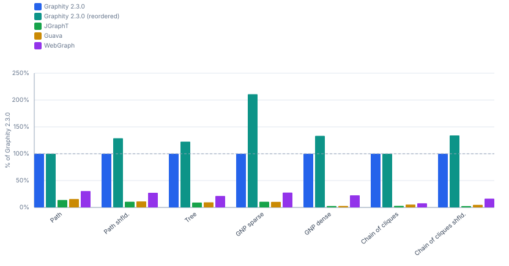

#### Times @ 100k nodes (ms/op, lower is better)

| Shape | Graphity 2.3.0 | Graphity 2.3.0<br>(reordered) | JGraphT | Guava | WebGraph |
|---|---:|---:|---:|---:|---:|
| Path<br><sub>100k nodes, 100k edges</sub> | 1.118 ms | 1.027 ms (0.9×) | 15.26 ms (14×) | 21.46 ms (19×) | 3.401 ms (3.0×) |
| Path shfld.<br><sub>100k nodes, 100k edges</sub> | 2.279 ms | 1.040 ms (0.5×) | 46.48 ms (20×) | 45.40 ms (20×) | 5.508 ms (2.4×) |
| Tree<br><sub>100k nodes, 100k edges</sub> | 2.159 ms | 1.285 ms (0.6×) | 41.51 ms (19×) | 38.09 ms (18×) | 5.712 ms (2.6×) |
| GNP sparse<br><sub>100k nodes, 300k edges</sub> | 4.400 ms | 2.152 ms (0.5×) | 109.6 ms (25×) | 87.01 ms (20×) | 10.30 ms (2.3×) |
| GNP dense<br><sub>100k nodes, 3M edges</sub> | 7.751 ms | 4.474 ms (0.6×) | 446.5 ms (58×) | 333.1 ms (43×) | 36.12 ms (4.7×) |
| Chain of cliques<br><sub>100k nodes, 3.1M edges</sub> | 2.614 ms | 2.616 ms (1.0×) | 166.0 ms (64×) | 108.0 ms (41×) | 37.02 ms (14×) |
| Chain of cliques shfld.<br><sub>100k nodes, 3.1M edges</sub> | 5.033 ms | 2.732 ms (0.5×) | 379.0 ms (75×) | 175.2 ms (35×) | 31.00 ms (6.2×) |

#### Throughput @ 100k nodes (op/s, higher is better)

| Shape | Graphity 2.3.0 | Graphity 2.3.0<br>(reordered) | JGraphT | Guava | WebGraph |
|---|---:|---:|---:|---:|---:|
| Path<br><sub>100k nodes, 100k edges</sub> | 894.5 op/s | 973.7 op/s (109%) | 65.51 op/s (7.3%) | 46.60 op/s (5.2%) | 294.0 op/s (32.9%) |
| Path shfld.<br><sub>100k nodes, 100k edges</sub> | 438.8 op/s | 961.5 op/s (219%) | 21.51 op/s (4.9%) | 22.03 op/s (5.0%) | 181.6 op/s (41.4%) |
| Tree<br><sub>100k nodes, 100k edges</sub> | 463.2 op/s | 778.2 op/s (168%) | 24.09 op/s (5.2%) | 26.26 op/s (5.7%) | 175.1 op/s (37.8%) |
| GNP sparse<br><sub>100k nodes, 300k edges</sub> | 227.3 op/s | 464.7 op/s (204%) | 9.124 op/s (4.0%) | 11.49 op/s (5.1%) | 97.10 op/s (42.7%) |
| GNP dense<br><sub>100k nodes, 3M edges</sub> | 129.0 op/s | 223.5 op/s (173%) | 2.240 op/s (1.7%) | 3.002 op/s (2.3%) | 27.69 op/s (21.5%) |
| Chain of cliques<br><sub>100k nodes, 3.1M edges</sub> | 382.6 op/s | 382.3 op/s (99.9%) | 6.024 op/s (1.6%) | 9.259 op/s (2.4%) | 27.01 op/s (7.1%) |
| Chain of cliques shfld.<br><sub>100k nodes, 3.1M edges</sub> | 198.7 op/s | 366.0 op/s (184%) | 2.639 op/s (1.3%) | 5.708 op/s (2.9%) | 32.25 op/s (16.2%) |

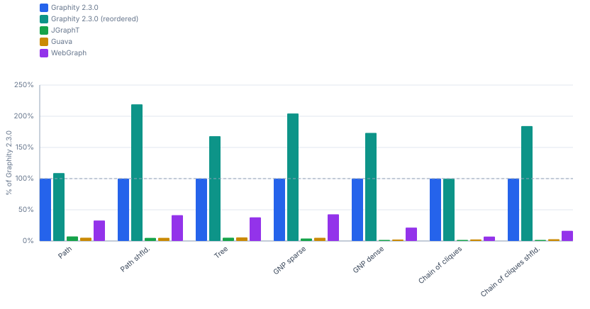

#### Times @ 1M nodes (ms/op, lower is better)

| Shape | Graphity 2.3.0 | Graphity 2.3.0<br>(reordered) |
|---|---:|---:|
| GNP sparse<br><sub>1M nodes, 3M edges</sub> | 83.52 ms | 26.19 ms (0.3×) |
| GNP dense<br><sub>1M nodes, 30M edges</sub> | 239.7 ms | 61.88 ms (0.3×) |
| Chain of cliques<br><sub>1M nodes, 31.1M edges</sub> | 26.41 ms | 26.47 ms (1.0×) |

#### Throughput @ 1M nodes (op/s, higher is better)

| Shape | Graphity 2.3.0 | Graphity 2.3.0<br>(reordered) |
|---|---:|---:|
| GNP sparse<br><sub>1M nodes, 3M edges</sub> | 11.97 op/s | 38.19 op/s (319%) |
| GNP dense<br><sub>1M nodes, 30M edges</sub> | 4.172 op/s | 16.16 op/s (387%) |
| Chain of cliques<br><sub>1M nodes, 31.1M edges</sub> | 37.87 op/s | 37.78 op/s (99.8%) |

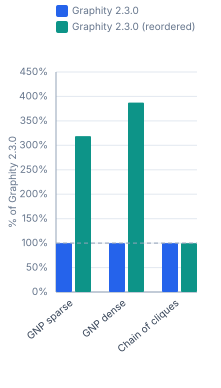

#### Times @ 10M nodes (ms/op, lower is better)

| Shape | Graphity 2.3.0 | Graphity 2.3.0<br>(reordered) |
|---|---:|---:|
| GNP sparse<br><sub>10M nodes, 30M edges</sub> | 3055.4 ms | 716.1 ms (0.2×) |
| GNP dense<br><sub>10M nodes, 299.6M edges</sub> | 6885.2 ms | 2873.4 ms (0.4×) |
| Chain of cliques<br><sub>10M nodes, 310.8M edges</sub> | 283.3 ms | 281.5 ms (1.0×) |

#### Throughput @ 10M nodes (op/s, higher is better)

| Shape | Graphity 2.3.0 | Graphity 2.3.0<br>(reordered) |
|---|---:|---:|
| GNP sparse<br><sub>10M nodes, 30M edges</sub> | 0.327 op/s | 1.396 op/s (427%) |
| GNP dense<br><sub>10M nodes, 299.6M edges</sub> | 0.145 op/s | 0.348 op/s (240%) |
| Chain of cliques<br><sub>10M nodes, 310.8M edges</sub> | 3.530 op/s | 3.552 op/s (101%) |

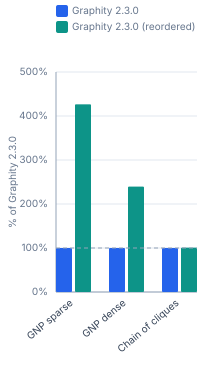

#### Times @ 100M nodes (ms/op, lower is better)

| Shape | Graphity 2.3.0 | Graphity 2.3.0<br>(reordered) |
|---|---:|---:|
| GNP sparse<br><sub>100M nodes, 300M edges</sub> | 36155 ms | 9842.1 ms (0.3×) |

#### Throughput @ 100M nodes (op/s, higher is better)

| Shape | Graphity 2.3.0 | Graphity 2.3.0<br>(reordered) |
|---|---:|---:|
| GNP sparse<br><sub>100M nodes, 300M edges</sub> | 0.028 op/s | 0.102 op/s (367%) |

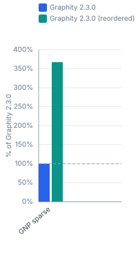

### 1.5 WCC

#### Times @ 10k nodes (ms/op, lower is better)

| Shape | Graphity 2.3.0 | Graphity 2.3.0<br>(reordered) | JGraphT | Guava | WebGraph |
|---|---:|---:|---:|---:|---:|
| Path<br><sub>10k nodes, 10k edges</sub> | 0.040 ms | 0.036 ms (0.9×) | 0.839 ms (21×) | 0.720 ms (18×) | 0.864 ms (22×) |
| Path shfld.<br><sub>10k nodes, 10k edges</sub> | 0.056 ms | 0.042 ms (0.8×) | 1.062 ms (19×) | 1.235 ms (22×) | 1.017 ms (18×) |
| Tree<br><sub>10k nodes, 10k edges</sub> | 0.038 ms | 0.039 ms (1.0×) | 1.246 ms (33×) | 0.941 ms (25×) | 0.687 ms (18×) |
| GNP sparse<br><sub>10k nodes, 30k edges</sub> | 0.095 ms | 0.089 ms (0.9×) | 2.088 ms (22×) | 2.473 ms (26×) | 1.066 ms (11×) |
| GNP dense<br><sub>10k nodes, 299.6k edges</sub> | 0.513 ms | 0.512 ms (1.0×) | 14.50 ms (28×) | 22.65 ms (44×) | 4.431 ms (8.6×) |
| Chain of cliques<br><sub>10k nodes, 310.8k edges</sub> | 0.572 ms | 0.571 ms (1.0×) | 8.927 ms (16×) | 9.144 ms (16×) | 4.730 ms (8.3×) |
| Chain of cliques shfld.<br><sub>10k nodes, 310.8k edges</sub> | 0.633 ms | 0.572 ms (0.9×) | 9.382 ms (15×) | 13.34 ms (21×) | 2.438 ms (3.9×) |

#### Throughput @ 10k nodes (op/s, higher is better)

| Shape | Graphity 2.3.0 | Graphity 2.3.0<br>(reordered) | JGraphT | Guava | WebGraph |
|---|---:|---:|---:|---:|---:|
| Path<br><sub>10k nodes, 10k edges</sub> | 25 000 op/s | 27 778 op/s (111%) | 1 192 op/s (4.8%) | 1 389 op/s (5.6%) | 1 157 op/s (4.6%) |
| Path shfld.<br><sub>10k nodes, 10k edges</sub> | 17 857 op/s | 23 810 op/s (133%) | 941.6 op/s (5.3%) | 809.7 op/s (4.5%) | 983.3 op/s (5.5%) |
| Tree<br><sub>10k nodes, 10k edges</sub> | 26 316 op/s | 25 641 op/s (97.4%) | 802.6 op/s (3.0%) | 1 063 op/s (4.0%) | 1 456 op/s (5.5%) |
| GNP sparse<br><sub>10k nodes, 30k edges</sub> | 10 526 op/s | 11 236 op/s (107%) | 478.9 op/s (4.5%) | 404.4 op/s (3.8%) | 938.1 op/s (8.9%) |
| GNP dense<br><sub>10k nodes, 299.6k edges</sub> | 1 949 op/s | 1 953 op/s (100%) | 68.96 op/s (3.5%) | 44.15 op/s (2.3%) | 225.7 op/s (11.6%) |
| Chain of cliques<br><sub>10k nodes, 310.8k edges</sub> | 1 748 op/s | 1 751 op/s (100%) | 112.0 op/s (6.4%) | 109.4 op/s (6.3%) | 211.4 op/s (12.1%) |
| Chain of cliques shfld.<br><sub>10k nodes, 310.8k edges</sub> | 1 580 op/s | 1 748 op/s (111%) | 106.6 op/s (6.7%) | 74.94 op/s (4.7%) | 410.2 op/s (26.0%) |

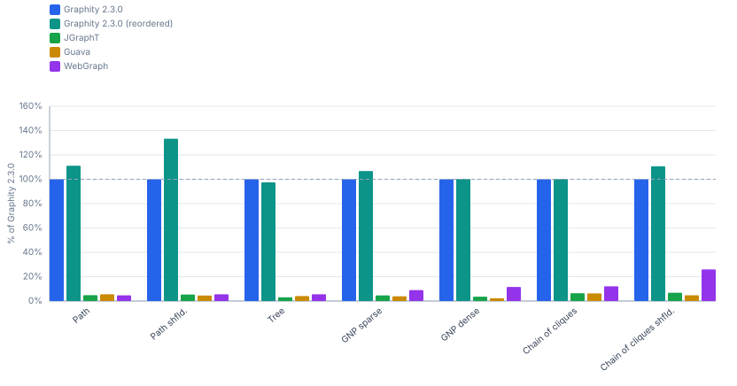

#### Times @ 100k nodes (ms/op, lower is better)

| Shape | Graphity 2.3.0 | Graphity 2.3.0<br>(reordered) | JGraphT | Guava | WebGraph |
|---|---:|---:|---:|---:|---:|
| Path<br><sub>100k nodes, 100k edges</sub> | 0.395 ms | 0.400 ms (1.0×) | 14.51 ms (37×) | 11.36 ms (29×) | 8.595 ms (22×) |
| Path shfld.<br><sub>100k nodes, 100k edges</sub> | 1.228 ms | 0.392 ms (0.3×) | 41.33 ms (34×) | 26.05 ms (21×) | 10.75 ms (8.8×) |
| Tree<br><sub>100k nodes, 100k edges</sub> | 0.632 ms | 0.713 ms (1.1×) | 44.03 ms (70×) | 20.77 ms (33×) | 8.299 ms (13×) |
| GNP sparse<br><sub>100k nodes, 300k edges</sub> | 1.772 ms | 1.525 ms (0.9×) | 84.45 ms (48×) | 54.94 ms (31×) | 14.68 ms (8.3×) |
| GNP dense<br><sub>100k nodes, 3M edges</sub> | 6.078 ms | 6.004 ms (1.0×) | 515.0 ms (85×) | 338.6 ms (56×) | 48.08 ms (7.9×) |
| Chain of cliques<br><sub>100k nodes, 3.1M edges</sub> | 5.791 ms | 5.672 ms (1.0×) | 121.2 ms (21×) | 110.0 ms (19×) | 49.67 ms (8.6×) |
| Chain of cliques shfld.<br><sub>100k nodes, 3.1M edges</sub> | 5.883 ms | 5.888 ms (1.0×) | 220.5 ms (37×) | 298.2 ms (51×) | 31.10 ms (5.3×) |

#### Throughput @ 100k nodes (op/s, higher is better)

| Shape | Graphity 2.3.0 | Graphity 2.3.0<br>(reordered) | JGraphT | Guava | WebGraph |
|---|---:|---:|---:|---:|---:|
| Path<br><sub>100k nodes, 100k edges</sub> | 2 532 op/s | 2 500 op/s (98.8%) | 68.94 op/s (2.7%) | 88.04 op/s (3.5%) | 116.3 op/s (4.6%) |
| Path shfld.<br><sub>100k nodes, 100k edges</sub> | 814.3 op/s | 2 551 op/s (313%) | 24.19 op/s (3.0%) | 38.39 op/s (4.7%) | 93.02 op/s (11.4%) |
| Tree<br><sub>100k nodes, 100k edges</sub> | 1 582 op/s | 1 403 op/s (88.6%) | 22.71 op/s (1.4%) | 48.15 op/s (3.0%) | 120.5 op/s (7.6%) |
| GNP sparse<br><sub>100k nodes, 300k edges</sub> | 564.3 op/s | 655.7 op/s (116%) | 11.84 op/s (2.1%) | 18.20 op/s (3.2%) | 68.13 op/s (12.1%) |
| GNP dense<br><sub>100k nodes, 3M edges</sub> | 164.5 op/s | 166.6 op/s (101%) | 1.942 op/s (1.2%) | 2.953 op/s (1.8%) | 20.80 op/s (12.6%) |
| Chain of cliques<br><sub>100k nodes, 3.1M edges</sub> | 172.7 op/s | 176.3 op/s (102%) | 8.251 op/s (4.8%) | 9.091 op/s (5.3%) | 20.13 op/s (11.7%) |
| Chain of cliques shfld.<br><sub>100k nodes, 3.1M edges</sub> | 170.0 op/s | 169.8 op/s (99.9%) | 4.535 op/s (2.7%) | 3.353 op/s (2.0%) | 32.15 op/s (18.9%) |

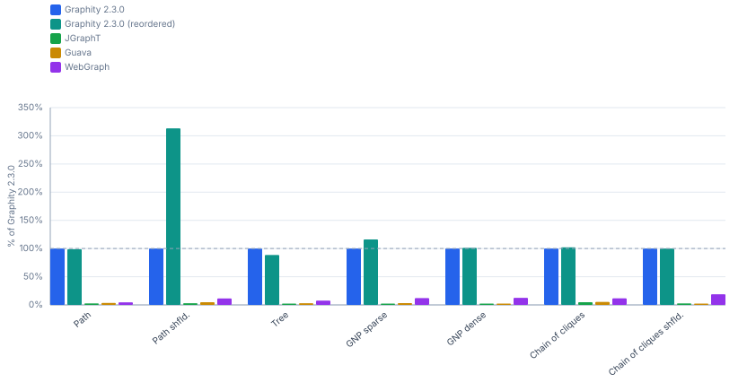

#### Times @ 1M nodes (ms/op, lower is better)

| Shape | Graphity 2.3.0 | Graphity 2.3.0<br>(reordered) |
|---|---:|---:|
| GNP sparse<br><sub>1M nodes, 3M edges</sub> | 21.40 ms | 17.45 ms (0.8×) |
| GNP dense<br><sub>1M nodes, 30M edges</sub> | 67.67 ms | 66.93 ms (1.0×) |
| Chain of cliques<br><sub>1M nodes, 31.1M edges</sub> | 50.41 ms | 50.15 ms (1.0×) |

#### Throughput @ 1M nodes (op/s, higher is better)

| Shape | Graphity 2.3.0 | Graphity 2.3.0<br>(reordered) |
|---|---:|---:|
| GNP sparse<br><sub>1M nodes, 3M edges</sub> | 46.73 op/s | 57.29 op/s (123%) |
| GNP dense<br><sub>1M nodes, 30M edges</sub> | 14.78 op/s | 14.94 op/s (101%) |
| Chain of cliques<br><sub>1M nodes, 31.1M edges</sub> | 19.84 op/s | 19.94 op/s (101%) |

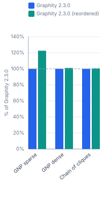

#### Times @ 10M nodes (ms/op, lower is better)

| Shape | Graphity 2.3.0 | Graphity 2.3.0<br>(reordered) |
|---|---:|---:|
| GNP sparse<br><sub>10M nodes, 30M edges</sub> | 590.8 ms | 406.0 ms (0.7×) |
| GNP dense<br><sub>10M nodes, 299.6M edges</sub> | 3441.2 ms | 3251.8 ms (0.9×) |
| Chain of cliques<br><sub>10M nodes, 310.8M edges</sub> | 518.9 ms | 521.1 ms (1.0×) |

#### Throughput @ 10M nodes (op/s, higher is better)

| Shape | Graphity 2.3.0 | Graphity 2.3.0<br>(reordered) |
|---|---:|---:|
| GNP sparse<br><sub>10M nodes, 30M edges</sub> | 1.693 op/s | 2.463 op/s (146%) |
| GNP dense<br><sub>10M nodes, 299.6M edges</sub> | 0.291 op/s | 0.308 op/s (106%) |
| Chain of cliques<br><sub>10M nodes, 310.8M edges</sub> | 1.927 op/s | 1.919 op/s (99.6%) |


#### Times @ 100M nodes (ms/op, lower is better)

| Shape | Graphity 2.3.0 | Graphity 2.3.0<br>(reordered) |
|---|---:|---:|
| GNP sparse<br><sub>100M nodes, 300M edges</sub> | 8807.1 ms | 7245.4 ms (0.8×) |

#### Throughput @ 100M nodes (op/s, higher is better)

| Shape | Graphity 2.3.0 | Graphity 2.3.0<br>(reordered) |
|---|---:|---:|
| GNP sparse<br><sub>100M nodes, 300M edges</sub> | 0.114 op/s | 0.138 op/s (122%) |


### 1.6 CCs

#### Times @ 10k nodes (ms/op, lower is better)

| Shape | Graphity 2.3.0 | Graphity 2.3.0<br>(reordered) |
|---|---:|---:|
| Path<br><sub>10k nodes, 10k edges</sub> | 0.042 ms | 0.036 ms (0.9×) |
| Path shfld.<br><sub>10k nodes, 10k edges</sub> | 0.045 ms | 0.041 ms (0.9×) |
| Tree<br><sub>10k nodes, 10k edges</sub> | 0.044 ms | 0.038 ms (0.9×) |
| GNP sparse<br><sub>10k nodes, 30k edges</sub> | 0.082 ms | 0.089 ms (1.1×) |
| GNP dense<br><sub>10k nodes, 299.6k edges</sub> | 0.516 ms | 0.512 ms (1.0×) |
| Chain of cliques<br><sub>10k nodes, 310.8k edges</sub> | 0.582 ms | 0.569 ms (1.0×) |
| Chain of cliques shfld.<br><sub>10k nodes, 310.8k edges</sub> | 0.632 ms | 0.607 ms (1.0×) |

#### Throughput @ 10k nodes (op/s, higher is better)

| Shape | Graphity 2.3.0 | Graphity 2.3.0<br>(reordered) |
|---|---:|---:|
| Path<br><sub>10k nodes, 10k edges</sub> | 23 810 op/s | 27 778 op/s (117%) |
| Path shfld.<br><sub>10k nodes, 10k edges</sub> | 22 222 op/s | 24 390 op/s (110%) |
| Tree<br><sub>10k nodes, 10k edges</sub> | 22 727 op/s | 26 316 op/s (116%) |
| GNP sparse<br><sub>10k nodes, 30k edges</sub> | 12 195 op/s | 11 236 op/s (92.1%) |
| GNP dense<br><sub>10k nodes, 299.6k edges</sub> | 1 938 op/s | 1 953 op/s (101%) |
| Chain of cliques<br><sub>10k nodes, 310.8k edges</sub> | 1 718 op/s | 1 757 op/s (102%) |
| Chain of cliques shfld.<br><sub>10k nodes, 310.8k edges</sub> | 1 582 op/s | 1 647 op/s (104%) |

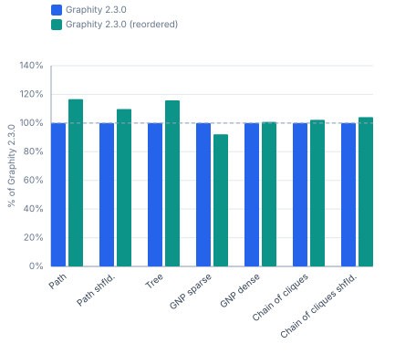

#### Times @ 100k nodes (ms/op, lower is better)

| Shape | Graphity 2.3.0 | Graphity 2.3.0<br>(reordered) |
|---|---:|---:|
| Path<br><sub>100k nodes, 100k edges</sub> | 0.359 ms | 0.359 ms (1.0×) |
| Path shfld.<br><sub>100k nodes, 100k edges</sub> | 1.314 ms | 0.362 ms (0.3×) |
| Tree<br><sub>100k nodes, 100k edges</sub> | 0.664 ms | 0.747 ms (1.1×) |
| GNP sparse<br><sub>100k nodes, 300k edges</sub> | 1.756 ms | 1.559 ms (0.9×) |
| GNP dense<br><sub>100k nodes, 3M edges</sub> | 6.012 ms | 5.998 ms (1.0×) |
| Chain of cliques<br><sub>100k nodes, 3.1M edges</sub> | 5.678 ms | 5.683 ms (1.0×) |
| Chain of cliques shfld.<br><sub>100k nodes, 3.1M edges</sub> | 5.926 ms | 6.068 ms (1.0×) |

#### Throughput @ 100k nodes (op/s, higher is better)

| Shape | Graphity 2.3.0 | Graphity 2.3.0<br>(reordered) |
|---|---:|---:|
| Path<br><sub>100k nodes, 100k edges</sub> | 2 786 op/s | 2 786 op/s (100%) |
| Path shfld.<br><sub>100k nodes, 100k edges</sub> | 761.0 op/s | 2 762 op/s (363%) |
| Tree<br><sub>100k nodes, 100k edges</sub> | 1 506 op/s | 1 339 op/s (88.9%) |
| GNP sparse<br><sub>100k nodes, 300k edges</sub> | 569.5 op/s | 641.4 op/s (113%) |
| GNP dense<br><sub>100k nodes, 3M edges</sub> | 166.3 op/s | 166.7 op/s (100%) |
| Chain of cliques<br><sub>100k nodes, 3.1M edges</sub> | 176.1 op/s | 176.0 op/s (99.9%) |
| Chain of cliques shfld.<br><sub>100k nodes, 3.1M edges</sub> | 168.7 op/s | 164.8 op/s (97.7%) |

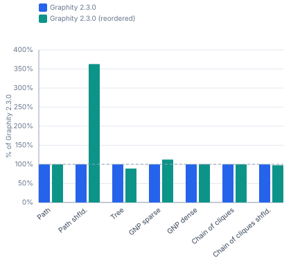

#### Times @ 1M nodes (ms/op, lower is better)

| Shape | Graphity 2.3.0 | Graphity 2.3.0<br>(reordered) |
|---|---:|---:|
| GNP sparse<br><sub>1M nodes, 3M edges</sub> | 22.02 ms | 16.34 ms (0.7×) |
| GNP dense<br><sub>1M nodes, 30M edges</sub> | 68.75 ms | 64.90 ms (0.9×) |
| Chain of cliques<br><sub>1M nodes, 31.1M edges</sub> | 49.23 ms | 50.53 ms (1.0×) |

#### Throughput @ 1M nodes (op/s, higher is better)

| Shape | Graphity 2.3.0 | Graphity 2.3.0<br>(reordered) |
|---|---:|---:|
| GNP sparse<br><sub>1M nodes, 3M edges</sub> | 45.41 op/s | 61.19 op/s (135%) |
| GNP dense<br><sub>1M nodes, 30M edges</sub> | 14.55 op/s | 15.41 op/s (106%) |
| Chain of cliques<br><sub>1M nodes, 31.1M edges</sub> | 20.31 op/s | 19.79 op/s (97.4%) |

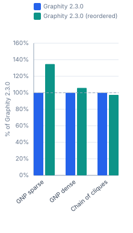

#### Times @ 10M nodes (ms/op, lower is better)

| Shape | Graphity 2.3.0 | Graphity 2.3.0<br>(reordered) |
|---|---:|---:|
| GNP sparse<br><sub>10M nodes, 30M edges</sub> | 589.4 ms | 405.6 ms (0.7×) |
| GNP dense<br><sub>10M nodes, 299.6M edges</sub> | 3362.6 ms | 3218.0 ms (1.0×) |
| Chain of cliques<br><sub>10M nodes, 310.8M edges</sub> | 518.4 ms | 517.2 ms (1.0×) |

#### Throughput @ 10M nodes (op/s, higher is better)

| Shape | Graphity 2.3.0 | Graphity 2.3.0<br>(reordered) |
|---|---:|---:|
| GNP sparse<br><sub>10M nodes, 30M edges</sub> | 1.697 op/s | 2.465 op/s (145%) |
| GNP dense<br><sub>10M nodes, 299.6M edges</sub> | 0.297 op/s | 0.311 op/s (104%) |
| Chain of cliques<br><sub>10M nodes, 310.8M edges</sub> | 1.929 op/s | 1.933 op/s (100%) |

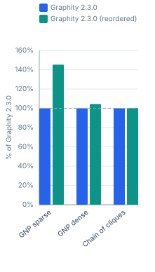

#### Times @ 100M nodes (ms/op, lower is better)

| Shape | Graphity 2.3.0 | Graphity 2.3.0<br>(reordered) |
|---|---:|---:|
| GNP sparse<br><sub>100M nodes, 300M edges</sub> | 8738.0 ms | 7211.5 ms (0.8×) |

#### Throughput @ 100M nodes (op/s, higher is better)

| Shape | Graphity 2.3.0 | Graphity 2.3.0<br>(reordered) |
|---|---:|---:|
| GNP sparse<br><sub>100M nodes, 300M edges</sub> | 0.114 op/s | 0.139 op/s (121%) |


### 1.7 Condense

#### Times @ 1k nodes (ms/op, lower is better)

| Shape | Graphity 2.3.0 |
|---|---:|
| Path<br><sub>1k nodes, 1k edges</sub> | 0.010 ms |
| GNP dense<br><sub>1k nodes, 30k edges</sub> | 0.007 ms |
| Chain of cliques<br><sub>1k nodes, 31.1k edges</sub> | 0.021 ms |
| DAG GNP sparse | 0.016 ms |

#### Throughput @ 1k nodes (op/s, higher is better)

| Shape | Graphity 2.3.0 |
|---|---:|
| Path<br><sub>1k nodes, 1k edges</sub> | 100 000 op/s |
| GNP dense<br><sub>1k nodes, 30k edges</sub> | 142 857 op/s |
| Chain of cliques<br><sub>1k nodes, 31.1k edges</sub> | 47 619 op/s |
| DAG GNP sparse | 62 500 op/s |

#### Times @ 10k nodes (ms/op, lower is better)

| Shape | Graphity 2.3.0 |
|---|---:|
| Path<br><sub>10k nodes, 10k edges</sub> | 0.080 ms |
| GNP dense<br><sub>10k nodes, 299.6k edges</sub> | 0.098 ms |
| Chain of cliques<br><sub>10k nodes, 310.8k edges</sub> | 0.200 ms |
| DAG GNP sparse | 0.261 ms |

#### Throughput @ 10k nodes (op/s, higher is better)

| Shape | Graphity 2.3.0 |
|---|---:|
| Path<br><sub>10k nodes, 10k edges</sub> | 12 500 op/s |
| GNP dense<br><sub>10k nodes, 299.6k edges</sub> | 10 204 op/s |
| Chain of cliques<br><sub>10k nodes, 310.8k edges</sub> | 5 000 op/s |
| DAG GNP sparse | 3 831 op/s |

#### Times @ 100k nodes (ms/op, lower is better)

| Shape | Graphity 2.3.0 |
|---|---:|
| Path<br><sub>100k nodes, 100k edges</sub> | 0.764 ms |
| GNP dense<br><sub>100k nodes, 3M edges</sub> | 1.572 ms |
| Chain of cliques<br><sub>100k nodes, 3.1M edges</sub> | 1.908 ms |
| DAG GNP sparse | 3.590 ms |

#### Throughput @ 100k nodes (op/s, higher is better)

| Shape | Graphity 2.3.0 |
|---|---:|
| Path<br><sub>100k nodes, 100k edges</sub> | 1 309 op/s |
| GNP dense<br><sub>100k nodes, 3M edges</sub> | 636.1 op/s |
| Chain of cliques<br><sub>100k nodes, 3.1M edges</sub> | 524.1 op/s |
| DAG GNP sparse | 278.6 op/s |

### 1.8 TopOrder

#### Times @ 10k nodes (ms/op, lower is better)

| Shape | Graphity 2.3.0 | Graphity 2.3.0<br>(reordered) | JGraphT | Guava | WebGraph |
|---|---:|---:|---:|---:|---:|
| Path<br><sub>10k nodes, 10k edges</sub> | 0.063 ms | 0.066 ms (1.0×) | 0.436 ms (6.9×) | 0.406 ms (6.4×) | 0.536 ms (8.5×) |
| Path shfld.<br><sub>10k nodes, 10k edges</sub> | 0.070 ms | 0.052 ms (0.7×) | 0.679 ms (9.7×) | 0.729 ms (10×) | 0.420 ms (6.0×) |
| Tree<br><sub>10k nodes, 10k edges</sub> | 0.055 ms | 0.044 ms (0.8×) | 0.698 ms (13×) | 0.669 ms (12×) | 0.600 ms (11×) |
| Tree shfld. | 0.050 ms | 0.046 ms (0.9×) | 0.714 ms (14×) | 0.674 ms (13×) | 0.504 ms (10×) |
| DAG GNP sparse | 0.078 ms | 0.064 ms (0.8×) | 1.152 ms (15×) | 1.316 ms (17×) | 0.829 ms (11×) |
| DAG GNP dense | 0.326 ms | 0.239 ms (0.7×) | 16.46 ms (51×) | 9.801 ms (30×) | 1.985 ms (6.1×) |
| DAG GNP dense shfld. | 0.382 ms | 0.243 ms (0.6×) | 17.71 ms (46×) | 10.05 ms (26×) | 2.258 ms (5.9×) |

#### Throughput @ 10k nodes (op/s, higher is better)

| Shape | Graphity 2.3.0 | Graphity 2.3.0<br>(reordered) | JGraphT | Guava | WebGraph |
|---|---:|---:|---:|---:|---:|
| Path<br><sub>10k nodes, 10k edges</sub> | 15 873 op/s | 15 152 op/s (95.5%) | 2 294 op/s (14.4%) | 2 463 op/s (15.5%) | 1 866 op/s (11.8%) |
| Path shfld.<br><sub>10k nodes, 10k edges</sub> | 14 286 op/s | 19 231 op/s (135%) | 1 473 op/s (10.3%) | 1 372 op/s (9.6%) | 2 381 op/s (16.7%) |
| Tree<br><sub>10k nodes, 10k edges</sub> | 18 182 op/s | 22 727 op/s (125%) | 1 433 op/s (7.9%) | 1 495 op/s (8.2%) | 1 667 op/s (9.2%) |
| Tree shfld. | 20 000 op/s | 21 739 op/s (109%) | 1 401 op/s (7.0%) | 1 484 op/s (7.4%) | 1 984 op/s (9.9%) |
| DAG GNP sparse | 12 821 op/s | 15 625 op/s (122%) | 868.1 op/s (6.8%) | 759.9 op/s (5.9%) | 1 206 op/s (9.4%) |
| DAG GNP dense | 3 067 op/s | 4 184 op/s (136%) | 60.74 op/s (2.0%) | 102.0 op/s (3.3%) | 503.8 op/s (16.4%) |
| DAG GNP dense shfld. | 2 618 op/s | 4 115 op/s (157%) | 56.48 op/s (2.2%) | 99.45 op/s (3.8%) | 442.9 op/s (16.9%) |

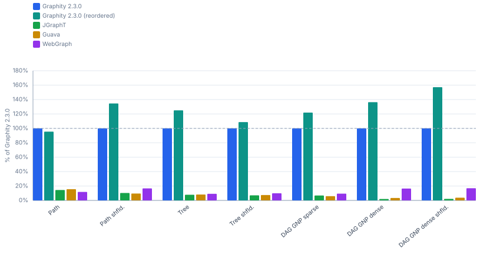

#### Times @ 100k nodes (ms/op, lower is better)

| Shape | Graphity 2.3.0 | Graphity 2.3.0<br>(reordered) | JGraphT | Guava | WebGraph |
|---|---:|---:|---:|---:|---:|
| Path<br><sub>100k nodes, 100k edges</sub> | 0.631 ms | 0.631 ms (1.0×) | 7.961 ms (13×) | 11.70 ms (19×) | 3.041 ms (4.8×) |
| Path shfld.<br><sub>100k nodes, 100k edges</sub> | 1.080 ms | 0.520 ms (0.5×) | 25.93 ms (24×) | 25.97 ms (24×) | 4.956 ms (4.6×) |
| Tree<br><sub>100k nodes, 100k edges</sub> | 1.175 ms | 1.128 ms (1.0×) | 26.52 ms (23×) | 19.22 ms (16×) | 14.43 ms (12×) |
| Tree shfld. | 1.473 ms | 1.236 ms (0.8×) | 26.51 ms (18×) | 18.65 ms (13×) | 9.834 ms (6.7×) |
| DAG GNP sparse | 2.269 ms | 1.442 ms (0.6×) | 54.43 ms (24×) | 44.66 ms (20×) | 17.21 ms (7.6×) |
| DAG GNP dense | 4.475 ms | 3.041 ms (0.7×) | 234.8 ms (52×) | 305.7 ms (68×) | 24.48 ms (5.5×) |
| DAG GNP dense shfld. | 5.321 ms | 3.130 ms (0.6×) | 243.6 ms (46×) | 300.5 ms (56×) | 31.28 ms (5.9×) |

#### Throughput @ 100k nodes (op/s, higher is better)

| Shape | Graphity 2.3.0 | Graphity 2.3.0<br>(reordered) | JGraphT | Guava | WebGraph |
|---|---:|---:|---:|---:|---:|
| Path<br><sub>100k nodes, 100k edges</sub> | 1 585 op/s | 1 585 op/s (100%) | 125.6 op/s (7.9%) | 85.51 op/s (5.4%) | 328.8 op/s (20.7%) |
| Path shfld.<br><sub>100k nodes, 100k edges</sub> | 925.9 op/s | 1 923 op/s (208%) | 38.56 op/s (4.2%) | 38.51 op/s (4.2%) | 201.8 op/s (21.8%) |
| Tree<br><sub>100k nodes, 100k edges</sub> | 851.1 op/s | 886.5 op/s (104%) | 37.71 op/s (4.4%) | 52.02 op/s (6.1%) | 69.32 op/s (8.1%) |
| Tree shfld. | 678.9 op/s | 809.1 op/s (119%) | 37.72 op/s (5.6%) | 53.62 op/s (7.9%) | 101.7 op/s (15.0%) |
| DAG GNP sparse | 440.7 op/s | 693.5 op/s (157%) | 18.37 op/s (4.2%) | 22.39 op/s (5.1%) | 58.11 op/s (13.2%) |
| DAG GNP dense | 223.5 op/s | 328.8 op/s (147%) | 4.259 op/s (1.9%) | 3.271 op/s (1.5%) | 40.84 op/s (18.3%) |
| DAG GNP dense shfld. | 187.9 op/s | 319.5 op/s (170%) | 4.105 op/s (2.2%) | 3.328 op/s (1.8%) | 31.97 op/s (17.0%) |

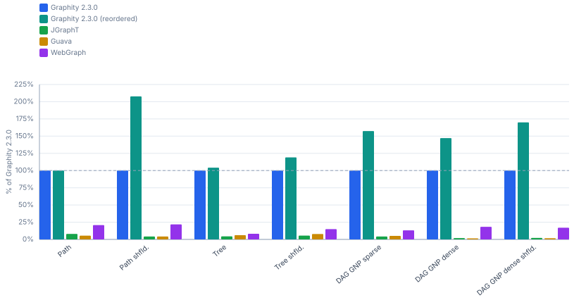

#### Times @ 1M nodes (ms/op, lower is better)

| Shape | Graphity 2.3.0 | Graphity 2.3.0<br>(reordered) |
|---|---:|---:|
| DAG GNP sparse | 33.89 ms | 14.76 ms (0.4×) |
| DAG GNP dense | 104.2 ms | 38.09 ms (0.4×) |
| DAG GNP dense shfld. | 178.7 ms | 38.93 ms (0.2×) |

#### Throughput @ 1M nodes (op/s, higher is better)

| Shape | Graphity 2.3.0 | Graphity 2.3.0<br>(reordered) |
|---|---:|---:|
| DAG GNP sparse | 29.51 op/s | 67.77 op/s (230%) |
| DAG GNP dense | 9.597 op/s | 26.25 op/s (274%) |
| DAG GNP dense shfld. | 5.596 op/s | 25.69 op/s (459%) |

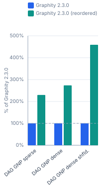

#### Times @ 10M nodes (ms/op, lower is better)

| Shape | Graphity 2.3.0 | Graphity 2.3.0<br>(reordered) |
|---|---:|---:|
| DAG GNP sparse | 1133.7 ms | 154.0 ms (0.1×) |
| DAG GNP dense | 1935.8 ms | 466.2 ms (0.2×) |
| DAG GNP dense shfld. | 2829.4 ms | 429.6 ms (0.2×) |

#### Throughput @ 10M nodes (op/s, higher is better)

| Shape | Graphity 2.3.0 | Graphity 2.3.0<br>(reordered) |
|---|---:|---:|
| DAG GNP sparse | 0.882 op/s | 6.494 op/s (736%) |
| DAG GNP dense | 0.517 op/s | 2.145 op/s (415%) |
| DAG GNP dense shfld. | 0.353 op/s | 2.328 op/s (659%) |

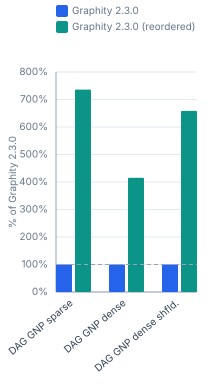

#### Times @ 100M nodes (ms/op, lower is better)

| Shape | Graphity 2.3.0 | Graphity 2.3.0<br>(reordered) |
|---|---:|---:|
| DAG GNP sparse | 16836 ms | 1845.1 ms (0.1×) |

#### Throughput @ 100M nodes (op/s, higher is better)

| Shape | Graphity 2.3.0 | Graphity 2.3.0<br>(reordered) |
|---|---:|---:|
| DAG GNP sparse | 0.059 op/s | 0.542 op/s (912%) |

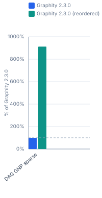

### 1.9 TopOrderAndLevels

#### Times @ 10k nodes (ms/op, lower is better)

| Shape | Graphity 2.3.0 | Graphity 2.3.0<br>(reordered) | Graphity 2.3.0<br>(bi-adjacent) | JGraphT | Guava | WebGraph |
|---|---:|---:|---:|---:|---:|---:|
| Path<br><sub>10k nodes, 10k edges</sub> | 0.040 ms | 0.039 ms (1.0×) | 0.040 ms (1.0×) | 0.262 ms (6.5×) | 0.230 ms (5.8×) | 0.388 ms (9.7×) |
| Path shfld.<br><sub>10k nodes, 10k edges</sub> | 0.056 ms | 0.039 ms (0.7×) | 0.054 ms (1.0×) | 0.374 ms (6.7×) | 0.365 ms (6.5×) | 0.626 ms (11×) |
| Tree<br><sub>10k nodes, 10k edges</sub> | 0.031 ms | 0.031 ms (1.0×) | 0.028 ms (0.9×) | 0.201 ms (6.5×) | 0.347 ms (11×) | 0.639 ms (21×) |
| Tree shfld. | 0.031 ms | 0.031 ms (1.0×) | 0.029 ms (0.9×) | 0.206 ms (6.6×) | 0.343 ms (11×) | 0.671 ms (22×) |
| DAG GNP sparse | 0.052 ms | 0.054 ms (1.0×) | 0.042 ms (0.8×) | 0.288 ms (5.5×) | 1.030 ms (20×) | 1.018 ms (20×) |
| DAG GNP dense | 0.350 ms | 0.320 ms (0.9×) | 0.241 ms (0.7×) | 4.308 ms (12×) | 7.351 ms (21×) | 3.629 ms (10×) |
| DAG GNP dense shfld. | 0.395 ms | 0.312 ms (0.8×) | 0.280 ms (0.7×) | 4.203 ms (11×) | 7.433 ms (19×) | 3.963 ms (10×) |

#### Throughput @ 10k nodes (op/s, higher is better)

| Shape | Graphity 2.3.0 | Graphity 2.3.0<br>(reordered) | Graphity 2.3.0<br>(bi-adjacent) | JGraphT | Guava | WebGraph |
|---|---:|---:|---:|---:|---:|---:|
| Path<br><sub>10k nodes, 10k edges</sub> | 25 000 op/s | 25 641 op/s (103%) | 25 000 op/s (100%) | 3 817 op/s (15.3%) | 4 348 op/s (17.4%) | 2 577 op/s (10.3%) |
| Path shfld.<br><sub>10k nodes, 10k edges</sub> | 17 857 op/s | 25 641 op/s (144%) | 18 519 op/s (104%) | 2 674 op/s (15.0%) | 2 740 op/s (15.3%) | 1 597 op/s (8.9%) |
| Tree<br><sub>10k nodes, 10k edges</sub> | 32 258 op/s | 32 258 op/s (100%) | 35 714 op/s (111%) | 4 975 op/s (15.4%) | 2 882 op/s (8.9%) | 1 565 op/s (4.9%) |
| Tree shfld. | 32 258 op/s | 32 258 op/s (100%) | 34 483 op/s (107%) | 4 854 op/s (15.0%) | 2 915 op/s (9.0%) | 1 490 op/s (4.6%) |
| DAG GNP sparse | 19 231 op/s | 18 519 op/s (96.3%) | 23 810 op/s (124%) | 3 472 op/s (18.1%) | 970.9 op/s (5.0%) | 982.3 op/s (5.1%) |
| DAG GNP dense | 2 857 op/s | 3 125 op/s (109%) | 4 149 op/s (145%) | 232.1 op/s (8.1%) | 136.0 op/s (4.8%) | 275.6 op/s (9.6%) |
| DAG GNP dense shfld. | 2 532 op/s | 3 205 op/s (127%) | 3 571 op/s (141%) | 237.9 op/s (9.4%) | 134.5 op/s (5.3%) | 252.3 op/s (10.0%) |

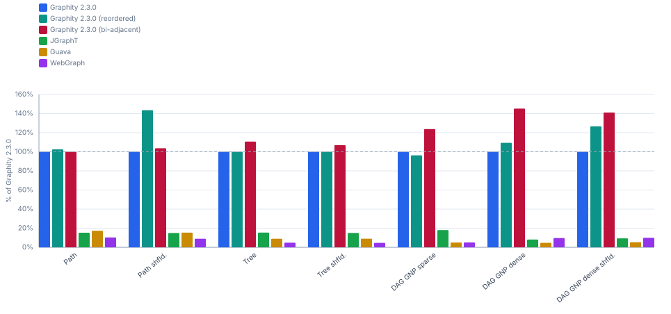

#### Times @ 100k nodes (ms/op, lower is better)

| Shape | Graphity 2.3.0 | Graphity 2.3.0<br>(reordered) | Graphity 2.3.0<br>(bi-adjacent) | JGraphT | Guava | WebGraph |
|---|---:|---:|---:|---:|---:|---:|
| Path<br><sub>100k nodes, 100k edges</sub> | 0.452 ms | 0.547 ms (1.2×) | 0.370 ms (0.8×) | 4.201 ms (9.3×) | 3.671 ms (8.1×) | 3.702 ms (8.2×) |
| Path shfld.<br><sub>100k nodes, 100k edges</sub> | 1.314 ms | 0.450 ms (0.3×) | 1.280 ms (1.0×) | 14.55 ms (11×) | 10.38 ms (7.9×) | 7.255 ms (5.5×) |
| Tree<br><sub>100k nodes, 100k edges</sub> | 0.926 ms | 0.783 ms (0.8×) | 0.849 ms (0.9×) | 7.912 ms (8.5×) | 8.530 ms (9.2×) | 7.634 ms (8.2×) |
| Tree shfld. | 0.951 ms | 0.835 ms (0.9×) | 0.917 ms (1.0×) | 7.294 ms (7.7×) | 8.774 ms (9.2×) | 7.867 ms (8.3×) |
| DAG GNP sparse | 2.153 ms | 1.936 ms (0.9×) | 1.931 ms (0.9×) | 18.56 ms (8.6×) | 29.87 ms (14×) | 13.99 ms (6.5×) |
| DAG GNP dense | 5.212 ms | 4.618 ms (0.9×) | 3.651 ms (0.7×) | 64.01 ms (12×) | 202.5 ms (39×) | 44.30 ms (8.5×) |
| DAG GNP dense shfld. | 6.018 ms | 4.535 ms (0.8×) | 4.514 ms (0.8×) | 72.93 ms (12×) | 213.5 ms (35×) | 56.25 ms (9.3×) |

#### Throughput @ 100k nodes (op/s, higher is better)

| Shape | Graphity 2.3.0 | Graphity 2.3.0<br>(reordered) | Graphity 2.3.0<br>(bi-adjacent) | JGraphT | Guava | WebGraph |
|---|---:|---:|---:|---:|---:|---:|
| Path<br><sub>100k nodes, 100k edges</sub> | 2 212 op/s | 1 828 op/s (82.6%) | 2 703 op/s (122%) | 238.0 op/s (10.8%) | 272.4 op/s (12.3%) | 270.1 op/s (12.2%) |
| Path shfld.<br><sub>100k nodes, 100k edges</sub> | 761.0 op/s | 2 222 op/s (292%) | 781.2 op/s (103%) | 68.72 op/s (9.0%) | 96.32 op/s (12.7%) | 137.8 op/s (18.1%) |
| Tree<br><sub>100k nodes, 100k edges</sub> | 1 080 op/s | 1 277 op/s (118%) | 1 178 op/s (109%) | 126.4 op/s (11.7%) | 117.2 op/s (10.9%) | 131.0 op/s (12.1%) |
| Tree shfld. | 1 052 op/s | 1 198 op/s (114%) | 1 091 op/s (104%) | 137.1 op/s (13.0%) | 114.0 op/s (10.8%) | 127.1 op/s (12.1%) |
| DAG GNP sparse | 464.5 op/s | 516.5 op/s (111%) | 517.9 op/s (111%) | 53.87 op/s (11.6%) | 33.48 op/s (7.2%) | 71.49 op/s (15.4%) |
| DAG GNP dense | 191.9 op/s | 216.5 op/s (113%) | 273.9 op/s (143%) | 15.62 op/s (8.1%) | 4.938 op/s (2.6%) | 22.57 op/s (11.8%) |
| DAG GNP dense shfld. | 166.2 op/s | 220.5 op/s (133%) | 221.5 op/s (133%) | 13.71 op/s (8.3%) | 4.684 op/s (2.8%) | 17.78 op/s (10.7%) |

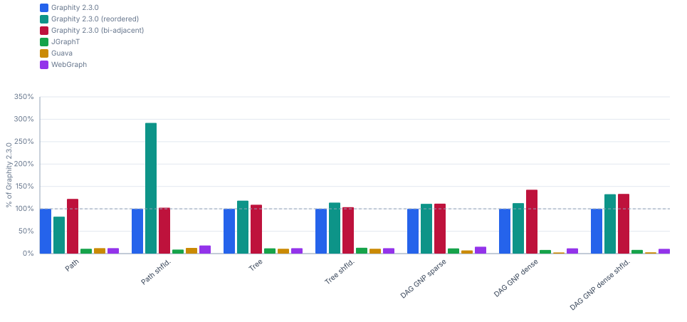

#### Times @ 1M nodes (ms/op, lower is better)

| Shape | Graphity 2.3.0 | Graphity 2.3.0<br>(reordered) |
|---|---:|---:|
| DAG GNP sparse | 31.72 ms | 28.43 ms (0.9×) |
| DAG GNP dense | 112.5 ms | 93.99 ms (0.8×) |
| DAG GNP dense shfld. | 199.4 ms | 92.20 ms (0.5×) |

#### Throughput @ 1M nodes (op/s, higher is better)

| Shape | Graphity 2.3.0 | Graphity 2.3.0<br>(reordered) |
|---|---:|---:|
| DAG GNP sparse | 31.53 op/s | 35.18 op/s (112%) |
| DAG GNP dense | 8.889 op/s | 10.64 op/s (120%) |
| DAG GNP dense shfld. | 5.015 op/s | 10.85 op/s (216%) |

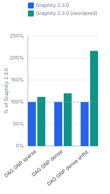

#### Times @ 10M nodes (ms/op, lower is better)

| Shape | Graphity 2.3.0 | Graphity 2.3.0<br>(reordered) |
|---|---:|---:|
| DAG GNP sparse | 847.7 ms | 752.4 ms (0.9×) |
| DAG GNP dense | 3082.4 ms | 2699.6 ms (0.9×) |
| DAG GNP dense shfld. | 4329.4 ms | 2707.5 ms (0.6×) |

#### Throughput @ 10M nodes (op/s, higher is better)

| Shape | Graphity 2.3.0 | Graphity 2.3.0<br>(reordered) |
|---|---:|---:|
| DAG GNP sparse | 1.180 op/s | 1.329 op/s (113%) |
| DAG GNP dense | 0.324 op/s | 0.370 op/s (114%) |
| DAG GNP dense shfld. | 0.231 op/s | 0.369 op/s (160%) |

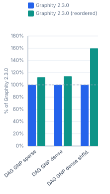

#### Times @ 100M nodes (ms/op, lower is better)

| Shape | Graphity 2.3.0 | Graphity 2.3.0<br>(reordered) |
|---|---:|---:|
| DAG GNP sparse | 11214 ms | 9499.8 ms (0.8×) |

#### Throughput @ 100M nodes (op/s, higher is better)

| Shape | Graphity 2.3.0 | Graphity 2.3.0<br>(reordered) |
|---|---:|---:|
| DAG GNP sparse | 0.089 op/s | 0.105 op/s (118%) |

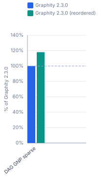

### 1.10 BackEdges

#### Times @ 10k nodes (ms/op, lower is better)

| Shape | Graphity 2.3.0 | Graphity 2.3.0<br>(reordered) | JGraphT | Guava | WebGraph |
|---|---:|---:|---:|---:|---:|
| Path<br><sub>10k nodes, 10k edges</sub> | 0.059 ms | 0.059 ms (1.0×) | 0.157 ms (2.7×) | 0.212 ms (3.6×) | 0.538 ms (9.1×) |
| Path shfld.<br><sub>10k nodes, 10k edges</sub> | 0.065 ms | 0.051 ms (0.8×) | 0.357 ms (5.5×) | 0.368 ms (5.7×) | 0.423 ms (6.5×) |
| Tree<br><sub>10k nodes, 10k edges</sub> | 0.048 ms | 0.041 ms (0.9×) | 0.439 ms (9.1×) | 0.669 ms (14×) | 0.585 ms (12×) |
| GNP sparse<br><sub>10k nodes, 30k edges</sub> | 0.165 ms | 0.085 ms (0.5×) | 0.641 ms (3.9×) | 1.139 ms (6.9×) | 0.775 ms (4.7×) |
| GNP dense<br><sub>10k nodes, 299.6k edges</sub> | 0.781 ms | 0.656 ms (0.8×) | 4.477 ms (5.7×) | 12.04 ms (15×) | 2.629 ms (3.4×) |
| Chain of cliques<br><sub>10k nodes, 310.8k edges</sub> | 0.583 ms | 0.589 ms (1.0×) | 3.378 ms (5.8×) | 2.229 ms (3.8×) | 3.964 ms (6.8×) |
| Chain of cliques shfld.<br><sub>10k nodes, 310.8k edges</sub> | 0.642 ms | 0.582 ms (0.9×) | 4.182 ms (6.5×) | 3.747 ms (5.8×) | 2.436 ms (3.8×) |

#### Throughput @ 10k nodes (op/s, higher is better)

| Shape | Graphity 2.3.0 | Graphity 2.3.0<br>(reordered) | JGraphT | Guava | WebGraph |
|---|---:|---:|---:|---:|---:|
| Path<br><sub>10k nodes, 10k edges</sub> | 16 949 op/s | 16 949 op/s (100%) | 6 369 op/s (37.6%) | 4 717 op/s (27.8%) | 1 859 op/s (11.0%) |
| Path shfld.<br><sub>10k nodes, 10k edges</sub> | 15 385 op/s | 19 608 op/s (127%) | 2 801 op/s (18.2%) | 2 717 op/s (17.7%) | 2 364 op/s (15.4%) |
| Tree<br><sub>10k nodes, 10k edges</sub> | 20 833 op/s | 24 390 op/s (117%) | 2 278 op/s (10.9%) | 1 495 op/s (7.2%) | 1 709 op/s (8.2%) |
| GNP sparse<br><sub>10k nodes, 30k edges</sub> | 6 061 op/s | 11 765 op/s (194%) | 1 560 op/s (25.7%) | 878.0 op/s (14.5%) | 1 290 op/s (21.3%) |
| GNP dense<br><sub>10k nodes, 299.6k edges</sub> | 1 280 op/s | 1 524 op/s (119%) | 223.4 op/s (17.4%) | 83.09 op/s (6.5%) | 380.4 op/s (29.7%) |
| Chain of cliques<br><sub>10k nodes, 310.8k edges</sub> | 1 715 op/s | 1 698 op/s (99.0%) | 296.0 op/s (17.3%) | 448.6 op/s (26.2%) | 252.3 op/s (14.7%) |
| Chain of cliques shfld.<br><sub>10k nodes, 310.8k edges</sub> | 1 558 op/s | 1 718 op/s (110%) | 239.1 op/s (15.4%) | 266.9 op/s (17.1%) | 410.5 op/s (26.4%) |

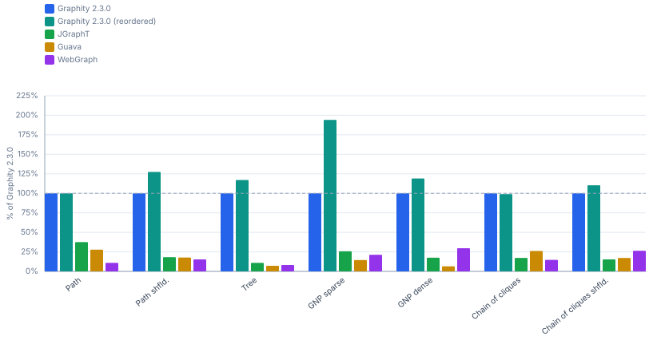

#### Times @ 100k nodes (ms/op, lower is better)

| Shape | Graphity 2.3.0 | Graphity 2.3.0<br>(reordered) | JGraphT | Guava | WebGraph |
|---|---:|---:|---:|---:|---:|
| Path<br><sub>100k nodes, 100k edges</sub> | 0.557 ms | 0.558 ms (1.0×) | 6.257 ms (11×) | 5.693 ms (10×) | 3.301 ms (5.9×) |
| Path shfld.<br><sub>100k nodes, 100k edges</sub> | 1.042 ms | 0.503 ms (0.5×) | 23.32 ms (22×) | 15.49 ms (15×) | 5.017 ms (4.8×) |
| Tree<br><sub>100k nodes, 100k edges</sub> | 1.315 ms | 1.038 ms (0.8×) | 26.66 ms (20×) | 20.59 ms (16×) | 14.48 ms (11×) |
| GNP sparse<br><sub>100k nodes, 300k edges</sub> | 3.047 ms | 1.962 ms (0.6×) | 44.84 ms (15×) | 43.34 ms (14×) | 10.88 ms (3.6×) |
| GNP dense<br><sub>100k nodes, 3M edges</sub> | 13.08 ms | 7.220 ms (0.6×) | 135.9 ms (10×) | 204.1 ms (16×) | 43.18 ms (3.3×) |
| Chain of cliques<br><sub>100k nodes, 3.1M edges</sub> | 6.134 ms | 6.154 ms (1.0×) | 77.86 ms (13×) | 62.76 ms (10×) | 46.98 ms (7.7×) |
| Chain of cliques shfld.<br><sub>100k nodes, 3.1M edges</sub> | 11.61 ms | 6.395 ms (0.6×) | 138.9 ms (12×) | 110.1 ms (9.5×) | 42.60 ms (3.7×) |

#### Throughput @ 100k nodes (op/s, higher is better)

| Shape | Graphity 2.3.0 | Graphity 2.3.0<br>(reordered) | JGraphT | Guava | WebGraph |
|---|---:|---:|---:|---:|---:|
| Path<br><sub>100k nodes, 100k edges</sub> | 1 795 op/s | 1 792 op/s (99.8%) | 159.8 op/s (8.9%) | 175.7 op/s (9.8%) | 302.9 op/s (16.9%) |
| Path shfld.<br><sub>100k nodes, 100k edges</sub> | 959.7 op/s | 1 988 op/s (207%) | 42.88 op/s (4.5%) | 64.57 op/s (6.7%) | 199.3 op/s (20.8%) |
| Tree<br><sub>100k nodes, 100k edges</sub> | 760.5 op/s | 963.4 op/s (127%) | 37.51 op/s (4.9%) | 48.57 op/s (6.4%) | 69.05 op/s (9.1%) |
| GNP sparse<br><sub>100k nodes, 300k edges</sub> | 328.2 op/s | 509.7 op/s (155%) | 22.30 op/s (6.8%) | 23.07 op/s (7.0%) | 91.88 op/s (28.0%) |
| GNP dense<br><sub>100k nodes, 3M edges</sub> | 76.43 op/s | 138.5 op/s (181%) | 7.358 op/s (9.6%) | 4.900 op/s (6.4%) | 23.16 op/s (30.3%) |
| Chain of cliques<br><sub>100k nodes, 3.1M edges</sub> | 163.0 op/s | 162.5 op/s (99.7%) | 12.84 op/s (7.9%) | 15.93 op/s (9.8%) | 21.29 op/s (13.1%) |
| Chain of cliques shfld.<br><sub>100k nodes, 3.1M edges</sub> | 86.14 op/s | 156.4 op/s (182%) | 7.199 op/s (8.4%) | 9.083 op/s (10.5%) | 23.47 op/s (27.3%) |

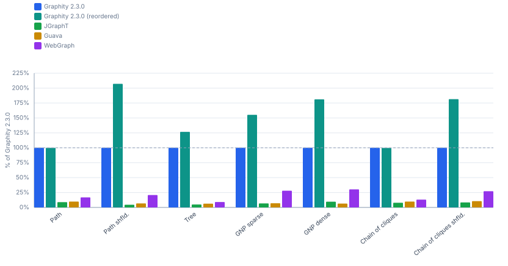

#### Times @ 1M nodes (ms/op, lower is better)

| Shape | Graphity 2.3.0 | Graphity 2.3.0<br>(reordered) |
|---|---:|---:|
| GNP sparse<br><sub>1M nodes, 3M edges</sub> | 53.11 ms | 21.00 ms (0.4×) |
| GNP dense<br><sub>1M nodes, 30M edges</sub> | 247.6 ms | 89.72 ms (0.4×) |
| Chain of cliques<br><sub>1M nodes, 31.1M edges</sub> | 74.96 ms | 76.19 ms (1.0×) |

#### Throughput @ 1M nodes (op/s, higher is better)

| Shape | Graphity 2.3.0 | Graphity 2.3.0<br>(reordered) |
|---|---:|---:|
| GNP sparse<br><sub>1M nodes, 3M edges</sub> | 18.83 op/s | 47.63 op/s (253%) |
| GNP dense<br><sub>1M nodes, 30M edges</sub> | 4.039 op/s | 11.15 op/s (276%) |
| Chain of cliques<br><sub>1M nodes, 31.1M edges</sub> | 13.34 op/s | 13.12 op/s (98.4%) |

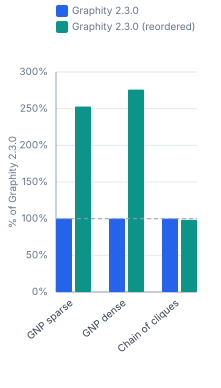

#### Times @ 10M nodes (ms/op, lower is better)

| Shape | Graphity 2.3.0 | Graphity 2.3.0<br>(reordered) |
|---|---:|---:|
| GNP sparse<br><sub>10M nodes, 30M edges</sub> | 2025.5 ms | 246.6 ms (0.1×) |
| GNP dense<br><sub>10M nodes, 299.6M edges</sub> | 3661.0 ms | 927.2 ms (0.3×) |
| Chain of cliques<br><sub>10M nodes, 310.8M edges</sub> | 692.1 ms | 689.2 ms (1.0×) |

#### Throughput @ 10M nodes (op/s, higher is better)

| Shape | Graphity 2.3.0 | Graphity 2.3.0<br>(reordered) |
|---|---:|---:|
| GNP sparse<br><sub>10M nodes, 30M edges</sub> | 0.494 op/s | 4.055 op/s (821%) |
| GNP dense<br><sub>10M nodes, 299.6M edges</sub> | 0.273 op/s | 1.079 op/s (395%) |
| Chain of cliques<br><sub>10M nodes, 310.8M edges</sub> | 1.445 op/s | 1.451 op/s (100%) |

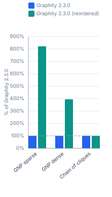

#### Times @ 100M nodes (ms/op, lower is better)

| Shape | Graphity 2.3.0 | Graphity 2.3.0<br>(reordered) |
|---|---:|---:|
| GNP sparse<br><sub>100M nodes, 300M edges</sub> | 27738 ms | 3076.0 ms (0.1×) |

#### Throughput @ 100M nodes (op/s, higher is better)

| Shape | Graphity 2.3.0 | Graphity 2.3.0<br>(reordered) |
|---|---:|---:|
| GNP sparse<br><sub>100M nodes, 300M edges</sub> | 0.036 op/s | 0.325 op/s (902%) |

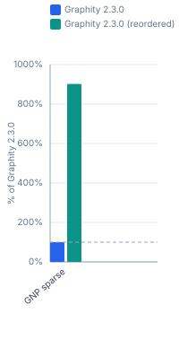

### 1.11 EdgeTypes

#### Times @ 10k nodes (ms/op, lower is better)

| Shape | Graphity 2.3.0 | Graphity 2.3.0<br>(reordered) | JGraphT | Guava | WebGraph |
|---|---:|---:|---:|---:|---:|
| Path<br><sub>10k nodes, 10k edges</sub> | 0.064 ms | 0.064 ms (1.0×) | 0.187 ms (2.9×) | 0.243 ms (3.8×) | 0.610 ms (9.5×) |
| Path shfld.<br><sub>10k nodes, 10k edges</sub> | 0.078 ms | 0.060 ms (0.8×) | 0.382 ms (4.9×) | 0.410 ms (5.3×) | 0.505 ms (6.5×) |
| Tree<br><sub>10k nodes, 10k edges</sub> | 0.052 ms | 0.046 ms (0.9×) | 0.501 ms (9.6×) | 0.681 ms (13×) | 0.653 ms (13×) |
| GNP sparse<br><sub>10k nodes, 30k edges</sub> | 0.166 ms | 0.078 ms (0.5×) | 0.656 ms (4.0×) | 1.388 ms (8.4×) | 0.917 ms (5.5×) |
| GNP dense<br><sub>10k nodes, 299.6k edges</sub> | 0.531 ms | 0.384 ms (0.7×) | 8.162 ms (15×) | 13.61 ms (26×) | 3.287 ms (6.2×) |
| Chain of cliques<br><sub>10k nodes, 310.8k edges</sub> | 0.293 ms | 0.293 ms (1.0×) | 5.143 ms (18×) | 3.720 ms (13×) | 4.633 ms (16×) |
| Chain of cliques shfld.<br><sub>10k nodes, 310.8k edges</sub> | 0.394 ms | 0.295 ms (0.7×) | 6.289 ms (16×) | 5.361 ms (14×) | 3.152 ms (8.0×) |

#### Throughput @ 10k nodes (op/s, higher is better)

| Shape | Graphity 2.3.0 | Graphity 2.3.0<br>(reordered) | JGraphT | Guava | WebGraph |
|---|---:|---:|---:|---:|---:|
| Path<br><sub>10k nodes, 10k edges</sub> | 15 625 op/s | 15 625 op/s (100%) | 5 348 op/s (34.2%) | 4 115 op/s (26.3%) | 1 639 op/s (10.5%) |
| Path shfld.<br><sub>10k nodes, 10k edges</sub> | 12 821 op/s | 16 667 op/s (130%) | 2 618 op/s (20.4%) | 2 439 op/s (19.0%) | 1 980 op/s (15.4%) |
| Tree<br><sub>10k nodes, 10k edges</sub> | 19 231 op/s | 21 739 op/s (113%) | 1 996 op/s (10.4%) | 1 468 op/s (7.6%) | 1 531 op/s (8.0%) |
| GNP sparse<br><sub>10k nodes, 30k edges</sub> | 6 024 op/s | 12 821 op/s (213%) | 1 524 op/s (25.3%) | 720.5 op/s (12.0%) | 1 091 op/s (18.1%) |
| GNP dense<br><sub>10k nodes, 299.6k edges</sub> | 1 883 op/s | 2 604 op/s (138%) | 122.5 op/s (6.5%) | 73.50 op/s (3.9%) | 304.2 op/s (16.2%) |
| Chain of cliques<br><sub>10k nodes, 310.8k edges</sub> | 3 413 op/s | 3 413 op/s (100%) | 194.4 op/s (5.7%) | 268.8 op/s (7.9%) | 215.8 op/s (6.3%) |
| Chain of cliques shfld.<br><sub>10k nodes, 310.8k edges</sub> | 2 538 op/s | 3 390 op/s (134%) | 159.0 op/s (6.3%) | 186.5 op/s (7.3%) | 317.3 op/s (12.5%) |

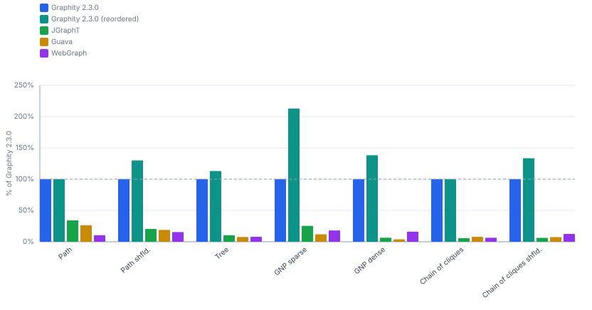

#### Times @ 100k nodes (ms/op, lower is better)

| Shape | Graphity 2.3.0 | Graphity 2.3.0<br>(reordered) | JGraphT | Guava | WebGraph |
|---|---:|---:|---:|---:|---:|
| Path<br><sub>100k nodes, 100k edges</sub> | 0.595 ms | 0.604 ms (1.0×) | 9.131 ms (15×) | 8.504 ms (14×) | 4.627 ms (7.8×) |
| Path shfld.<br><sub>100k nodes, 100k edges</sub> | 1.386 ms | 0.623 ms (0.4×) | 20.39 ms (15×) | 17.50 ms (13×) | 6.072 ms (4.4×) |
| Tree<br><sub>100k nodes, 100k edges</sub> | 1.439 ms | 1.044 ms (0.7×) | 32.24 ms (22×) | 21.79 ms (15×) | 17.55 ms (12×) |
| GNP sparse<br><sub>100k nodes, 300k edges</sub> | 3.580 ms | 1.830 ms (0.5×) | 46.91 ms (13×) | 48.17 ms (13×) | 13.27 ms (3.7×) |
| GNP dense<br><sub>100k nodes, 3M edges</sub> | 7.214 ms | 4.159 ms (0.6×) | 158.3 ms (22×) | 218.7 ms (30×) | 54.56 ms (7.6×) |
| Chain of cliques<br><sub>100k nodes, 3.1M edges</sub> | 2.701 ms | 2.642 ms (1.0×) | 88.85 ms (33×) | 74.75 ms (28×) | 58.03 ms (21×) |
| Chain of cliques shfld.<br><sub>100k nodes, 3.1M edges</sub> | 5.809 ms | 2.965 ms (0.5×) | 164.0 ms (28×) | 127.1 ms (22×) | 54.12 ms (9.3×) |

#### Throughput @ 100k nodes (op/s, higher is better)

| Shape | Graphity 2.3.0 | Graphity 2.3.0<br>(reordered) | JGraphT | Guava | WebGraph |
|---|---:|---:|---:|---:|---:|
| Path<br><sub>100k nodes, 100k edges</sub> | 1 681 op/s | 1 656 op/s (98.5%) | 109.5 op/s (6.5%) | 117.6 op/s (7.0%) | 216.1 op/s (12.9%) |
| Path shfld.<br><sub>100k nodes, 100k edges</sub> | 721.5 op/s | 1 605 op/s (222%) | 49.04 op/s (6.8%) | 57.15 op/s (7.9%) | 164.7 op/s (22.8%) |
| Tree<br><sub>100k nodes, 100k edges</sub> | 694.9 op/s | 957.9 op/s (138%) | 31.01 op/s (4.5%) | 45.89 op/s (6.6%) | 56.97 op/s (8.2%) |
| GNP sparse<br><sub>100k nodes, 300k edges</sub> | 279.3 op/s | 546.4 op/s (196%) | 21.32 op/s (7.6%) | 20.76 op/s (7.4%) | 75.35 op/s (27.0%) |
| GNP dense<br><sub>100k nodes, 3M edges</sub> | 138.6 op/s | 240.4 op/s (173%) | 6.317 op/s (4.6%) | 4.572 op/s (3.3%) | 18.33 op/s (13.2%) |
| Chain of cliques<br><sub>100k nodes, 3.1M edges</sub> | 370.2 op/s | 378.5 op/s (102%) | 11.26 op/s (3.0%) | 13.38 op/s (3.6%) | 17.23 op/s (4.7%) |
| Chain of cliques shfld.<br><sub>100k nodes, 3.1M edges</sub> | 172.1 op/s | 337.3 op/s (196%) | 6.098 op/s (3.5%) | 7.868 op/s (4.6%) | 18.48 op/s (10.7%) |

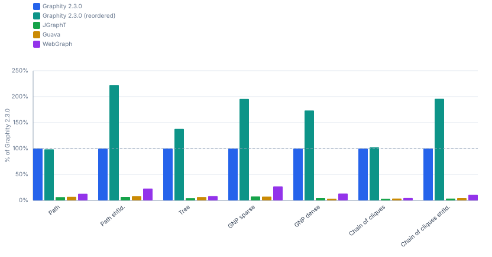

#### Times @ 1M nodes (ms/op, lower is better)

| Shape | Graphity 2.3.0 | Graphity 2.3.0<br>(reordered) |
|---|---:|---:|
| GNP sparse<br><sub>1M nodes, 3M edges</sub> | 67.35 ms | 21.38 ms (0.3×) |
| GNP dense<br><sub>1M nodes, 30M edges</sub> | 241.3 ms | 61.23 ms (0.3×) |
| Chain of cliques<br><sub>1M nodes, 31.1M edges</sub> | 26.94 ms | 26.71 ms (1.0×) |

#### Throughput @ 1M nodes (op/s, higher is better)

| Shape | Graphity 2.3.0 | Graphity 2.3.0<br>(reordered) |
|---|---:|---:|
| GNP sparse<br><sub>1M nodes, 3M edges</sub> | 14.85 op/s | 46.77 op/s (315%) |
| GNP dense<br><sub>1M nodes, 30M edges</sub> | 4.144 op/s | 16.33 op/s (394%) |
| Chain of cliques<br><sub>1M nodes, 31.1M edges</sub> | 37.12 op/s | 37.44 op/s (101%) |

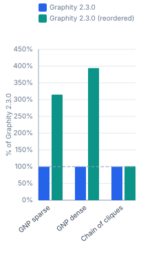

#### Times @ 10M nodes (ms/op, lower is better)

| Shape | Graphity 2.3.0 | Graphity 2.3.0<br>(reordered) |
|---|---:|---:|
| GNP sparse<br><sub>10M nodes, 30M edges</sub> | 2500.9 ms | 411.7 ms (0.2×) |
| GNP dense<br><sub>10M nodes, 299.6M edges</sub> | 4606.3 ms | 1435.0 ms (0.3×) |
| Chain of cliques<br><sub>10M nodes, 310.8M edges</sub> | 278.7 ms | 279.7 ms (1.0×) |

#### Throughput @ 10M nodes (op/s, higher is better)

| Shape | Graphity 2.3.0 | Graphity 2.3.0<br>(reordered) |
|---|---:|---:|
| GNP sparse<br><sub>10M nodes, 30M edges</sub> | 0.400 op/s | 2.429 op/s (607%) |
| GNP dense<br><sub>10M nodes, 299.6M edges</sub> | 0.217 op/s | 0.697 op/s (321%) |
| Chain of cliques<br><sub>10M nodes, 310.8M edges</sub> | 3.588 op/s | 3.575 op/s (99.6%) |

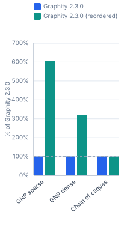

#### Times @ 100M nodes (ms/op, lower is better)

| Shape | Graphity 2.3.0 | Graphity 2.3.0<br>(reordered) |
|---|---:|---:|
| GNP sparse<br><sub>100M nodes, 300M edges</sub> | 31640 ms | 6770.4 ms (0.2×) |

#### Throughput @ 100M nodes (op/s, higher is better)

| Shape | Graphity 2.3.0 | Graphity 2.3.0<br>(reordered) |
|---|---:|---:|
| GNP sparse<br><sub>100M nodes, 300M edges</sub> | 0.032 op/s | 0.148 op/s (467%) |

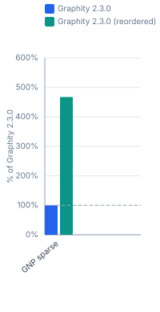

### 1.12 Reorder (DFS-preorder) cost

#### Times @ 10k nodes (ms/op, lower is better)

| Shape | Graphity 2.3.0 |
|---|---:|
| Path<br><sub>10k nodes, 10k edges</sub> | 0.112 ms |
| Path shfld.<br><sub>10k nodes, 10k edges</sub> | 0.124 ms |
| Tree<br><sub>10k nodes, 10k edges</sub> | 0.084 ms |
| GNP sparse<br><sub>10k nodes, 30k edges</sub> | 0.380 ms |
| GNP dense<br><sub>10k nodes, 299.6k edges</sub> | 0.811 ms |
| Chain of cliques<br><sub>10k nodes, 310.8k edges</sub> | 0.519 ms |
| Chain of cliques shfld.<br><sub>10k nodes, 310.8k edges</sub> | 0.614 ms |

#### Throughput @ 10k nodes (op/s, higher is better)

| Shape | Graphity 2.3.0 |
|---|---:|
| Path<br><sub>10k nodes, 10k edges</sub> | 8 929 op/s |
| Path shfld.<br><sub>10k nodes, 10k edges</sub> | 8 065 op/s |
| Tree<br><sub>10k nodes, 10k edges</sub> | 11 905 op/s |
| GNP sparse<br><sub>10k nodes, 30k edges</sub> | 2 632 op/s |
| GNP dense<br><sub>10k nodes, 299.6k edges</sub> | 1 233 op/s |
| Chain of cliques<br><sub>10k nodes, 310.8k edges</sub> | 1 927 op/s |
| Chain of cliques shfld.<br><sub>10k nodes, 310.8k edges</sub> | 1 629 op/s |

#### Times @ 100k nodes (ms/op, lower is better)

| Shape | Graphity 2.3.0 |
|---|---:|
| Path<br><sub>100k nodes, 100k edges</sub> | 1.099 ms |
| Path shfld.<br><sub>100k nodes, 100k edges</sub> | 2.113 ms |
| Tree<br><sub>100k nodes, 100k edges</sub> | 2.463 ms |
| GNP sparse<br><sub>100k nodes, 300k edges</sub> | 5.407 ms |
| GNP dense<br><sub>100k nodes, 3M edges</sub> | 11.16 ms |
| Chain of cliques<br><sub>100k nodes, 3.1M edges</sub> | 5.367 ms |
| Chain of cliques shfld.<br><sub>100k nodes, 3.1M edges</sub> | 9.224 ms |

#### Throughput @ 100k nodes (op/s, higher is better)

| Shape | Graphity 2.3.0 |
|---|---:|
| Path<br><sub>100k nodes, 100k edges</sub> | 909.9 op/s |
| Path shfld.<br><sub>100k nodes, 100k edges</sub> | 473.3 op/s |
| Tree<br><sub>100k nodes, 100k edges</sub> | 406.0 op/s |
| GNP sparse<br><sub>100k nodes, 300k edges</sub> | 184.9 op/s |
| GNP dense<br><sub>100k nodes, 3M edges</sub> | 89.61 op/s |
| Chain of cliques<br><sub>100k nodes, 3.1M edges</sub> | 186.3 op/s |
| Chain of cliques shfld.<br><sub>100k nodes, 3.1M edges</sub> | 108.4 op/s |

#### Times @ 1M nodes (ms/op, lower is better)

| Shape | Graphity 2.3.0 |
|---|---:|
| GNP sparse<br><sub>1M nodes, 3M edges</sub> | 87.61 ms |
| GNP dense<br><sub>1M nodes, 30M edges</sub> | 318.2 ms |
| Chain of cliques<br><sub>1M nodes, 31.1M edges</sub> | 52.32 ms |

#### Throughput @ 1M nodes (op/s, higher is better)

| Shape | Graphity 2.3.0 |
|---|---:|
| GNP sparse<br><sub>1M nodes, 3M edges</sub> | 11.41 op/s |
| GNP dense<br><sub>1M nodes, 30M edges</sub> | 3.143 op/s |
| Chain of cliques<br><sub>1M nodes, 31.1M edges</sub> | 19.11 op/s |

#### Times @ 10M nodes (ms/op, lower is better)

| Shape | Graphity 2.3.0 |
|---|---:|
| GNP sparse<br><sub>10M nodes, 30M edges</sub> | 3194.6 ms |
| GNP dense<br><sub>10M nodes, 299.6M edges</sub> | 7202.3 ms |
| Chain of cliques<br><sub>10M nodes, 310.8M edges</sub> | 543.0 ms |

#### Throughput @ 10M nodes (op/s, higher is better)

| Shape | Graphity 2.3.0 |
|---|---:|
| GNP sparse<br><sub>10M nodes, 30M edges</sub> | 0.313 op/s |
| GNP dense<br><sub>10M nodes, 299.6M edges</sub> | 0.139 op/s |
| Chain of cliques<br><sub>10M nodes, 310.8M edges</sub> | 1.842 op/s |

#### Times @ 100M nodes (ms/op, lower is better)

| Shape | Graphity 2.3.0 |
|---|---:|
| GNP sparse<br><sub>100M nodes, 300M edges</sub> | 40225 ms |

#### Throughput @ 100M nodes (op/s, higher is better)

| Shape | Graphity 2.3.0 |
|---|---:|
| GNP sparse<br><sub>100M nodes, 300M edges</sub> | 0.025 op/s |

### 1.13 BiAdjacency (in-adjacency) cost

#### Times @ 10k nodes (ms/op, lower is better)

| Shape | Graphity 2.3.0 |
|---|---:|
| Path<br><sub>10k nodes, 10k edges</sub> | 0.015 ms |
| Path shfld.<br><sub>10k nodes, 10k edges</sub> | 0.023 ms |
| Tree<br><sub>10k nodes, 10k edges</sub> | 0.023 ms |
| GNP sparse<br><sub>10k nodes, 30k edges</sub> | 0.057 ms |
| GNP dense<br><sub>10k nodes, 299.6k edges</sub> | 0.544 ms |
| Chain of cliques<br><sub>10k nodes, 310.8k edges</sub> | 0.542 ms |
| Chain of cliques shfld.<br><sub>10k nodes, 310.8k edges</sub> | 0.544 ms |

#### Throughput @ 10k nodes (op/s, higher is better)

| Shape | Graphity 2.3.0 |
|---|---:|
| Path<br><sub>10k nodes, 10k edges</sub> | 66 667 op/s |
| Path shfld.<br><sub>10k nodes, 10k edges</sub> | 43 478 op/s |
| Tree<br><sub>10k nodes, 10k edges</sub> | 43 478 op/s |
| GNP sparse<br><sub>10k nodes, 30k edges</sub> | 17 544 op/s |
| GNP dense<br><sub>10k nodes, 299.6k edges</sub> | 1 838 op/s |
| Chain of cliques<br><sub>10k nodes, 310.8k edges</sub> | 1 845 op/s |
| Chain of cliques shfld.<br><sub>10k nodes, 310.8k edges</sub> | 1 838 op/s |

#### Times @ 100k nodes (ms/op, lower is better)

| Shape | Graphity 2.3.0 |
|---|---:|
| Path<br><sub>100k nodes, 100k edges</sub> | 0.203 ms |
| Path shfld.<br><sub>100k nodes, 100k edges</sub> | 0.236 ms |
| Tree<br><sub>100k nodes, 100k edges</sub> | 0.606 ms |
| GNP sparse<br><sub>100k nodes, 300k edges</sub> | 1.408 ms |
| GNP dense<br><sub>100k nodes, 3M edges</sub> | 7.385 ms |
| Chain of cliques<br><sub>100k nodes, 3.1M edges</sub> | 5.548 ms |
| Chain of cliques shfld.<br><sub>100k nodes, 3.1M edges</sub> | 7.574 ms |

#### Throughput @ 100k nodes (op/s, higher is better)

| Shape | Graphity 2.3.0 |
|---|---:|
| Path<br><sub>100k nodes, 100k edges</sub> | 4 926 op/s |
| Path shfld.<br><sub>100k nodes, 100k edges</sub> | 4 237 op/s |
| Tree<br><sub>100k nodes, 100k edges</sub> | 1 650 op/s |
| GNP sparse<br><sub>100k nodes, 300k edges</sub> | 710.2 op/s |
| GNP dense<br><sub>100k nodes, 3M edges</sub> | 135.4 op/s |
| Chain of cliques<br><sub>100k nodes, 3.1M edges</sub> | 180.2 op/s |
| Chain of cliques shfld.<br><sub>100k nodes, 3.1M edges</sub> | 132.0 op/s |

### 1.14 Symmetrize (WebGraph) cost

#### Times @ 10k nodes (ms/op, lower is better)

| Shape | WebGraph |
|---|---:|
| Path<br><sub>10k nodes, 10k edges</sub> | 5.437 ms |
| Path shfld.<br><sub>10k nodes, 10k edges</sub> | 8.017 ms |
| Tree<br><sub>10k nodes, 10k edges</sub> | 8.057 ms |
| GNP sparse<br><sub>10k nodes, 30k edges</sub> | 18.51 ms |
| GNP dense<br><sub>10k nodes, 299.6k edges</sub> | 111.5 ms |
| Chain of cliques<br><sub>10k nodes, 310.8k edges</sub> | 14.95 ms |
| Chain of cliques shfld.<br><sub>10k nodes, 310.8k edges</sub> | 58.27 ms |

#### Throughput @ 10k nodes (op/s, higher is better)

| Shape | WebGraph |
|---|---:|
| Path<br><sub>10k nodes, 10k edges</sub> | 183.9 op/s |
| Path shfld.<br><sub>10k nodes, 10k edges</sub> | 124.7 op/s |
| Tree<br><sub>10k nodes, 10k edges</sub> | 124.1 op/s |
| GNP sparse<br><sub>10k nodes, 30k edges</sub> | 54.04 op/s |
| GNP dense<br><sub>10k nodes, 299.6k edges</sub> | 8.969 op/s |
| Chain of cliques<br><sub>10k nodes, 310.8k edges</sub> | 66.88 op/s |
| Chain of cliques shfld.<br><sub>10k nodes, 310.8k edges</sub> | 17.16 op/s |

#### Times @ 100k nodes (ms/op, lower is better)

| Shape | WebGraph |
|---|---:|
| Path<br><sub>100k nodes, 100k edges</sub> | 38.47 ms |
| Path shfld.<br><sub>100k nodes, 100k edges</sub> | 62.81 ms |
| Tree<br><sub>100k nodes, 100k edges</sub> | 69.78 ms |
| GNP sparse<br><sub>100k nodes, 300k edges</sub> | 183.9 ms |
| GNP dense<br><sub>100k nodes, 3M edges</sub> | 1111.0 ms |
| Chain of cliques<br><sub>100k nodes, 3.1M edges</sub> | 122.3 ms |
| Chain of cliques shfld.<br><sub>100k nodes, 3.1M edges</sub> | 667.5 ms |

#### Throughput @ 100k nodes (op/s, higher is better)

| Shape | WebGraph |
|---|---:|
| Path<br><sub>100k nodes, 100k edges</sub> | 26.00 op/s |
| Path shfld.<br><sub>100k nodes, 100k edges</sub> | 15.92 op/s |
| Tree<br><sub>100k nodes, 100k edges</sub> | 14.33 op/s |
| GNP sparse<br><sub>100k nodes, 300k edges</sub> | 5.438 op/s |
| GNP dense<br><sub>100k nodes, 3M edges</sub> | 0.900 op/s |
| Chain of cliques<br><sub>100k nodes, 3.1M edges</sub> | 8.177 op/s |
| Chain of cliques shfld.<br><sub>100k nodes, 3.1M edges</sub> | 1.498 op/s |

### 1.15 Dominators

#### Times @ 10k nodes (ms/op, lower is better)

| Shape | Graphity 2.3.0 |
|---|---:|
| Structured | 0.165 ms |
| Irreducible | 0.164 ms |
| Ladder | 0.159 ms |
| Chain | 0.113 ms |
| Fan behind chain | 0.143 ms |
| Small methods | 0.184 ms |

#### Throughput @ 10k nodes (op/s, higher is better)

| Shape | Graphity 2.3.0 |
|---|---:|
| Structured | 6 061 op/s |
| Irreducible | 6 098 op/s |
| Ladder | 6 289 op/s |
| Chain | 8 850 op/s |
| Fan behind chain | 6 993 op/s |
| Small methods | 5 435 op/s |

#### Times @ 100k nodes (ms/op, lower is better)

| Shape | Graphity 2.3.0 |
|---|---:|
| Structured | 3.546 ms |
| Irreducible | 3.771 ms |
| Ladder | 1.465 ms |
| Chain | 1.096 ms |
| Fan behind chain | 1.459 ms |
| Small methods | 2.900 ms |

#### Throughput @ 100k nodes (op/s, higher is better)

| Shape | Graphity 2.3.0 |
|---|---:|
| Structured | 282.0 op/s |
| Irreducible | 265.2 op/s |
| Ladder | 682.6 op/s |
| Chain | 912.4 op/s |
| Fan behind chain | 685.4 op/s |
| Small methods | 344.8 op/s |

### 1.16 Dominance frontiers

#### Times @ 10k nodes (ms/op, lower is better)

| Shape | Graphity 2.3.0 |
|---|---:|
| Structured | 0.069 ms |
| Irreducible | 0.080 ms |
| Ladder | 45.03 ms |
| Chain | 0.036 ms |
| Fan behind chain | 103.3 ms |
| Small methods | 0.055 ms |

#### Throughput @ 10k nodes (op/s, higher is better)

| Shape | Graphity 2.3.0 |
|---|---:|
| Structured | 14 493 op/s |
| Irreducible | 12 500 op/s |
| Ladder | 22.21 op/s |
| Chain | 27 778 op/s |
| Fan behind chain | 9.681 op/s |
| Small methods | 18 182 op/s |

#### Times @ 100k nodes (ms/op, lower is better)

| Shape | Graphity 2.3.0 |
|---|---:|
| Structured | 1.957 ms |
| Irreducible | 2.310 ms |
| Chain | 0.358 ms |
| Small methods | 1.425 ms |

#### Throughput @ 100k nodes (op/s, higher is better)

| Shape | Graphity 2.3.0 |
|---|---:|
| Structured | 511.0 op/s |
| Irreducible | 432.9 op/s |
| Chain | 2 793 op/s |
| Small methods | 701.8 op/s |

### 1.17 Iterated dominance frontier (build + one query per variable)

#### Times @ 10k nodes (ms/op, lower is better)

| Shape | Graphity 2.3.0 |
|---|---:|
| Structured | 30.80 ms |
| Irreducible | 41.67 ms |
| Ladder | 35.74 ms |
| Chain | 20.90 ms |
| Fan behind chain | 33.78 ms |
| Small methods | 0.435 ms |

#### Throughput @ 10k nodes (op/s, higher is better)

| Shape | Graphity 2.3.0 |
|---|---:|
| Structured | 32.47 op/s |
| Irreducible | 24.00 op/s |
| Ladder | 27.98 op/s |
| Chain | 47.85 op/s |
| Fan behind chain | 29.61 op/s |
| Small methods | 2 299 op/s |

#### Times @ 100k nodes (ms/op, lower is better)

| Shape | Graphity 2.3.0 |
|---|---:|
| Structured | 433.1 ms |
| Irreducible | 557.4 ms |
| Ladder | 364.3 ms |
| Chain | 228.3 ms |
| Fan behind chain | 404.0 ms |
| Small methods | 4.420 ms |

#### Throughput @ 100k nodes (op/s, higher is better)

| Shape | Graphity 2.3.0 |
|---|---:|
| Structured | 2.309 op/s |
| Irreducible | 1.794 op/s |
| Ladder | 2.745 op/s |
| Chain | 4.380 op/s |
| Fan behind chain | 2.475 op/s |
| Small methods | 226.2 op/s |

### 1.18 Loops

#### Times @ 10k nodes (ms/op, lower is better)

| Shape | Graphity 2.3.0 |
|---|---:|
| Structured | 0.395 ms |
| Irreducible | 0.422 ms |
| Ladder | 0.101 ms |
| Chain | 0.102 ms |
| Fan behind chain | 0.102 ms |
| Small methods | 0.464 ms |

#### Throughput @ 10k nodes (op/s, higher is better)

| Shape | Graphity 2.3.0 |
|---|---:|
| Structured | 2 532 op/s |
| Irreducible | 2 370 op/s |
| Ladder | 9 901 op/s |
| Chain | 9 804 op/s |
| Fan behind chain | 9 804 op/s |
| Small methods | 2 155 op/s |

#### Times @ 100k nodes (ms/op, lower is better)

| Shape | Graphity 2.3.0 |
|---|---:|
| Structured | 5.751 ms |
| Irreducible | 7.272 ms |
| Ladder | 1.020 ms |
| Chain | 0.994 ms |
| Fan behind chain | 0.997 ms |
| Small methods | 4.844 ms |

#### Throughput @ 100k nodes (op/s, higher is better)

| Shape | Graphity 2.3.0 |
|---|---:|
| Structured | 173.9 op/s |
| Irreducible | 137.5 op/s |
| Ladder | 980.4 op/s |
| Chain | 1 006 op/s |
| Fan behind chain | 1 003 op/s |
| Small methods | 206.4 op/s |

### 1.19 Ancestry of the dominator tree

#### Times @ 10k nodes (ms/op, lower is better)

| Shape | Graphity 2.3.0 |
|---|---:|
| Structured | 0.065 ms |
| Irreducible | 0.066 ms |
| Ladder | 0.045 ms |
| Chain | 0.056 ms |
| Fan behind chain | 0.051 ms |
| Small methods | 0.057 ms |

#### Throughput @ 10k nodes (op/s, higher is better)

| Shape | Graphity 2.3.0 |
|---|---:|
| Structured | 15 385 op/s |
| Irreducible | 15 152 op/s |
| Ladder | 22 222 op/s |
| Chain | 17 857 op/s |
| Fan behind chain | 19 608 op/s |
| Small methods | 17 544 op/s |

#### Times @ 100k nodes (ms/op, lower is better)

| Shape | Graphity 2.3.0 |
|---|---:|
| Structured | 1.792 ms |
| Irreducible | 1.718 ms |
| Ladder | 0.488 ms |
| Chain | 0.553 ms |
| Fan behind chain | 0.490 ms |
| Small methods | 1.564 ms |

#### Throughput @ 100k nodes (op/s, higher is better)

| Shape | Graphity 2.3.0 |
|---|---:|
| Structured | 558.0 op/s |
| Irreducible | 582.1 op/s |
| Ladder | 2 049 op/s |
| Chain | 1 808 op/s |
| Fan behind chain | 2 041 op/s |
| Small methods | 639.4 op/s |

### 1.20 PreorderAncestry of the dominator tree

#### Times @ 10k nodes (ms/op, lower is better)

| Shape | Graphity 2.3.0 |
|---|---:|
| Structured | 0.051 ms |
| Irreducible | 0.051 ms |
| Ladder | 0.044 ms |
| Chain | 0.046 ms |
| Fan behind chain | 0.045 ms |
| Small methods | 0.048 ms |

#### Throughput @ 10k nodes (op/s, higher is better)

| Shape | Graphity 2.3.0 |
|---|---:|
| Structured | 19 608 op/s |
| Irreducible | 19 608 op/s |
| Ladder | 22 727 op/s |
| Chain | 21 739 op/s |
| Fan behind chain | 22 222 op/s |
| Small methods | 20 833 op/s |

#### Times @ 100k nodes (ms/op, lower is better)

| Shape | Graphity 2.3.0 |
|---|---:|
| Structured | 1.094 ms |
| Irreducible | 1.055 ms |
| Ladder | 0.346 ms |
| Chain | 0.411 ms |
| Fan behind chain | 0.401 ms |
| Small methods | 0.846 ms |

#### Throughput @ 100k nodes (op/s, higher is better)

| Shape | Graphity 2.3.0 |
|---|---:|
| Structured | 914.1 op/s |
| Irreducible | 947.9 op/s |
| Ladder | 2 890 op/s |
| Chain | 2 433 op/s |
| Fan behind chain | 2 494 op/s |
| Small methods | 1 182 op/s |

## 2 Memory Footprint

Retained heap in bytes for a fully built graph. Lower is better. Baseline (= 100%): **Graphity 2.3.0**, or the newest version present in a table it is missing from. Two charts per section: *Graphity & WebGraph* (same league) and *All libraries*.

### 2.1 Total Graph Size

**Memory footprint in bytes (lower is better)**

| Shape | Graphity 2.3.0 | JGraphT | Guava | WebGraph |
|---|---:|---:|---:|---:|
| Path<br><sub>10k nodes, 10k edges</sub> | 80.1 kB | 4.0 MB (5037%) | 2.7 MB (3375%) | 18.8 kB (23.4%) |
| Path shfld.<br><sub>10k nodes, 10k edges</sub> | 80.1 kB | 4.0 MB (5037%) | 2.7 MB (3375%) | 37.8 kB (47.2%) |
| Tree<br><sub>10k nodes, 10k edges</sub> | 80.1 kB | 4.0 MB (5043%) | 2.7 MB (3378%) | 31.9 kB (39.8%) |
| GNP sparse<br><sub>10k nodes, 30k edges</sub> | 160 kB | 8.6 MB (5343%) | 4.8 MB (2984%) | 78.8 kB (49.2%) |
| GNP dense<br><sub>10k nodes, 299.6k edges</sub> | 1.2 MB | 68.6 MB (5544%) | 33.4 MB (2700%) | 475 kB (38.4%) |
| Chain of cliques<br><sub>10k nodes, 310.8k edges</sub> | 1.3 MB | 71.3 MB (5558%) | 22.7 MB (1769%) | 50.6 kB (3.9%) |
| Chain of cliques shfld.<br><sub>10k nodes, 310.8k edges</sub> | 1.3 MB | 71.3 MB (5559%) | 22.7 MB (1769%) | 482 kB (37.6%) |
| Path<br><sub>100k nodes, 100k edges</sub> | 800 kB | 41.5 MB (5192%) | 27.4 MB (3430%) | 181 kB (22.6%) |
| Path shfld.<br><sub>100k nodes, 100k edges</sub> | 800 kB | 41.5 MB (5192%) | 27.4 MB (3430%) | 430 kB (53.7%) |
| Tree<br><sub>100k nodes, 100k edges</sub> | 800 kB | 41.7 MB (5208%) | 27.5 MB (3443%) | 372 kB (46.4%) |
| GNP sparse<br><sub>100k nodes, 300k edges</sub> | 1.6 MB | 85.0 MB (5310%) | 48.3 MB (3016%) | 952 kB (59.5%) |
| GNP dense<br><sub>100k nodes, 3M edges</sub> | 12.4 MB | 680 MB (5488%) | 337 MB (2716%) | 6.4 MB (51.7%) |
| Chain of cliques<br><sub>100k nodes, 3.1M edges</sub> | 12.8 MB | 706 MB (5506%) | 228 MB (1777%) | 499 kB (3.9%) |
| Chain of cliques shfld.<br><sub>100k nodes, 3.1M edges</sub> | 12.8 MB | 706 MB (5506%) | 228 MB (1777%) | 6.6 MB (51.6%) |
| GNP sparse<br><sub>1M nodes, 3M edges</sub> | 16.0 MB | — | — | — |
| GNP sparse<br><sub>10M nodes, 30M edges</sub> | 160 MB | — | — | — |
| GNP sparse<br><sub>100M nodes, 300M edges</sub> | 1600 MB | — | — | — |

**Graphity & WebGraph**


**All libraries**


### 2.2 Bytes per Element  `totalBytes / (Nodes + Edges)`

**Memory footprint in bytes (lower is better)**

| Shape | Graphity 2.3.0 | JGraphT | Guava | WebGraph |
|---|---:|---:|---:|---:|
| Path<br><sub>10k nodes, 10k edges</sub> | 4 B | 201.65 B (5041%) | 135.10 B (3378%) | 0.94 B (23.5%) |
| Path shfld.<br><sub>10k nodes, 10k edges</sub> | 4 B | 201.65 B (5041%) | 135.10 B (3378%) | 1.89 B (47.2%) |
| Tree<br><sub>10k nodes, 10k edges</sub> | 4 B | 201.90 B (5048%) | 135.24 B (3381%) | 1.60 B (40.0%) |
| GNP sparse<br><sub>10k nodes, 30k edges</sub> | 4 B | 213.79 B (5345%) | 119.42 B (2986%) | 1.97 B (49.2%) |
| GNP dense<br><sub>10k nodes, 299.6k edges</sub> | 4 B | 221.75 B (5544%) | 108.02 B (2700%) | 1.54 B (38.5%) |
| Chain of cliques<br><sub>10k nodes, 310.8k edges</sub> | 4 B | 222.34 B (5558%) | 70.78 B (1770%) | 0.16 B (4.0%) |
| Chain of cliques shfld.<br><sub>10k nodes, 310.8k edges</sub> | 4 B | 222.36 B (5559%) | 70.78 B (1770%) | 1.50 B (37.5%) |
| Path<br><sub>100k nodes, 100k edges</sub> | 4 B | 207.71 B (5193%) | 137.23 B (3431%) | 0.90 B (22.5%) |
| Path shfld.<br><sub>100k nodes, 100k edges</sub> | 4 B | 207.71 B (5193%) | 137.22 B (3430%) | 2.15 B (53.8%) |
| Tree<br><sub>100k nodes, 100k edges</sub> | 4 B | 208.34 B (5208%) | 137.73 B (3443%) | 1.86 B (46.5%) |
| GNP sparse<br><sub>100k nodes, 300k edges</sub> | 4 B | 212.40 B (5310%) | 120.65 B (3016%) | 2.38 B (59.5%) |
| GNP dense<br><sub>100k nodes, 3M edges</sub> | 4 B | 219.51 B (5488%) | 108.63 B (2716%) | 2.07 B (51.7%) |
| Chain of cliques<br><sub>100k nodes, 3.1M edges</sub> | 4 B | 220.25 B (5506%) | 71.08 B (1777%) | 0.16 B (4.0%) |
| Chain of cliques shfld.<br><sub>100k nodes, 3.1M edges</sub> | 4 B | 220.25 B (5506%) | 71.08 B (1777%) | 2.06 B (51.5%) |
| GNP sparse<br><sub>1M nodes, 3M edges</sub> | 4 B | — | — | — |
| GNP sparse<br><sub>10M nodes, 30M edges</sub> | 4 B | — | — | — |
| GNP sparse<br><sub>100M nodes, 300M edges</sub> | 4 B | — | — | — |

**Graphity & WebGraph**


**All libraries**


## 3 Allocations

Bytes allocated per algorithm invocation (JMH `-prof gc`). Lower is better. Baseline (= 100%): **Graphity 2.3.0**, or the newest version present in a table it is missing from.

### 3.1 Build

**Allocations @ 10k nodes in bytes (lower is better)**

| Shape | Graphity 2.3.0 | JGraphT | Guava | WebGraph |
|---|---:|---:|---:|---:|
| Path<br><sub>10k nodes, 10k edges</sub> | 458 kB | 5.3 MB (1163%) | 2.8 MB (604%) | 4.3 MB (949%) |
| Path shfld.<br><sub>10k nodes, 10k edges</sub> | 458 kB | 5.2 MB (1133%) | 2.8 MB (604%) | 4.4 MB (955%) |
| Tree<br><sub>10k nodes, 10k edges</sub> | 458 kB | 5.3 MB (1161%) | 2.8 MB (609%) | 4.1 MB (888%) |
| GNP sparse<br><sub>10k nodes, 30k edges</sub> | 960 kB | 13.1 MB (1360%) | 5.1 MB (536%) | 4.5 MB (464%) |
| GNP dense<br><sub>10k nodes, 299.6k edges</sub> | 9.9 MB | 111 MB (1116%) | 37.3 MB (376%) | 9.8 MB (98.5%) |
| Chain of cliques<br><sub>10k nodes, 310.8k edges</sub> | 10.0 MB | 116 MB (1159%) | 29.3 MB (294%) | 8.9 MB (89.7%) |
| Chain of cliques shfld.<br><sub>10k nodes, 310.8k edges</sub> | 10.0 MB | 116 MB (1159%) | 29.3 MB (294%) | 9.4 MB (94.5%) |


**Allocations @ 100k nodes in bytes (lower is better)**

| Shape | Graphity 2.3.0 | JGraphT | Guava | WebGraph |
|---|---:|---:|---:|---:|
| Path<br><sub>100k nodes, 100k edges</sub> | 3.8 MB | 54.4 MB (1447%) | 28.5 MB (757%) | 14.3 MB (379%) |
| Path shfld.<br><sub>100k nodes, 100k edges</sub> | 3.8 MB | 54.3 MB (1443%) | 28.5 MB (757%) | 14.5 MB (386%) |
| Tree<br><sub>100k nodes, 100k edges</sub> | 3.8 MB | 55.7 MB (1479%) | 28.8 MB (766%) | 11.4 MB (303%) |
| GNP sparse<br><sub>100k nodes, 300k edges</sub> | 10.6 MB | 129 MB (1215%) | 52.3 MB (492%) | 15.4 MB (145%) |
| GNP dense<br><sub>100k nodes, 3M edges</sub> | 111 MB | 1094 MB (983%) | 376 MB (338%) | 69.9 MB (62.8%) |
| Chain of cliques<br><sub>100k nodes, 3.1M edges</sub> | 112 MB | 1139 MB (1020%) | 294 MB (264%) | 60.2 MB (53.9%) |
| Chain of cliques shfld.<br><sub>100k nodes, 3.1M edges</sub> | 112 MB | 1139 MB (1020%) | 294 MB (264%) | 66.4 MB (59.5%) |


### 3.2 SCC

**Allocations @ 10k nodes in bytes (lower is better)**

| Shape | Graphity 2.3.0 | JGraphT | Guava | WebGraph |
|---|---:|---:|---:|---:|
| Path<br><sub>10k nodes, 10k edges</sub> | 534 kB | 5.2 MB (975%) | 2.6 MB (488%) | 1.4 MB (269%) |
| Path shfld.<br><sub>10k nodes, 10k edges</sub> | 534 kB | 5.2 MB (966%) | 2.6 MB (478%) | 1.3 MB (247%) |
| Tree<br><sub>10k nodes, 10k edges</sub> | 288 kB | 5.0 MB (1746%) | 2.3 MB (799%) | 908 kB (315%) |
| GNP sparse<br><sub>10k nodes, 30k edges</sub> | 371 kB | 3.2 MB (854%) | 2.6 MB (703%) | 1.3 MB (346%) |
| GNP dense<br><sub>10k nodes, 299.6k edges</sub> | 498 kB | 6.4 MB (1276%) | 4.6 MB (916%) | 1.5 MB (295%) |
| Chain of cliques<br><sub>10k nodes, 310.8k edges</sub> | 496 kB | 4.8 MB (964%) | 7.1 MB (1429%) | 6.1 MB (1237%) |
| Chain of cliques shfld.<br><sub>10k nodes, 310.8k edges</sub> | 364 kB | 6.0 MB (1634%) | 7.2 MB (1982%) | 1.3 MB (348%) |


**Allocations @ 100k nodes in bytes (lower is better)**

| Shape | Graphity 2.3.0 | JGraphT | Guava | WebGraph |
|---|---:|---:|---:|---:|
| Path<br><sub>100k nodes, 100k edges</sub> | 4.9 MB | 51.6 MB (1056%) | 28.9 MB (591%) | 13.3 MB (272%) |
| Path shfld.<br><sub>100k nodes, 100k edges</sub> | 4.9 MB | 51.7 MB (1058%) | 27.4 MB (561%) | 13.5 MB (275%) |
| Tree<br><sub>100k nodes, 100k edges</sub> | 2.8 MB | 50.3 MB (1792%) | 25.5 MB (907%) | 8.8 MB (314%) |
| GNP sparse<br><sub>100k nodes, 300k edges</sub> | 3.5 MB | 32.2 MB (916%) | 28.5 MB (812%) | 12.3 MB (351%) |
| GNP dense<br><sub>100k nodes, 3M edges</sub> | 4.5 MB | 70.1 MB (1552%) | 45.2 MB (1002%) | 13.5 MB (298%) |
| Chain of cliques<br><sub>100k nodes, 3.1M edges</sub> | 4.5 MB | 48.5 MB (1078%) | 76.8 MB (1706%) | 60.3 MB (1339%) |
| Chain of cliques shfld.<br><sub>100k nodes, 3.1M edges</sub> | 3.5 MB | 61.4 MB (1777%) | 75.3 MB (2181%) | 12.3 MB (356%) |


### 3.3 WCC

**Allocations @ 10k nodes in bytes (lower is better)**

| Shape | Graphity 2.3.0 | JGraphT | Guava | WebGraph |
|---|---:|---:|---:|---:|
| Path<br><sub>10k nodes, 10k edges</sub> | 200 kB | 3.0 MB (1516%) | 2.4 MB (1196%) | 2.0 MB (989%) |
| Path shfld.<br><sub>10k nodes, 10k edges</sub> | 200 kB | 2.3 MB (1156%) | 2.4 MB (1196%) | 1.9 MB (929%) |
| Tree<br><sub>10k nodes, 10k edges</sub> | 200 kB | 3.1 MB (1545%) | 2.4 MB (1196%) | 1.2 MB (611%) |
| GNP sparse<br><sub>10k nodes, 30k edges</sub> | 200 kB | 3.1 MB (1551%) | 2.9 MB (1435%) | 1.2 MB (600%) |
| GNP dense<br><sub>10k nodes, 299.6k edges</sub> | 200 kB | 10.3 MB (5169%) | 9.3 MB (4668%) | 1.3 MB (650%) |
| Chain of cliques<br><sub>10k nodes, 310.8k edges</sub> | 200 kB | 9.4 MB (4720%) | 9.6 MB (4802%) | 6.1 MB (3070%) |
| Chain of cliques shfld.<br><sub>10k nodes, 310.8k edges</sub> | 200 kB | 9.8 MB (4919%) | 9.6 MB (4802%) | 1.3 MB (642%) |

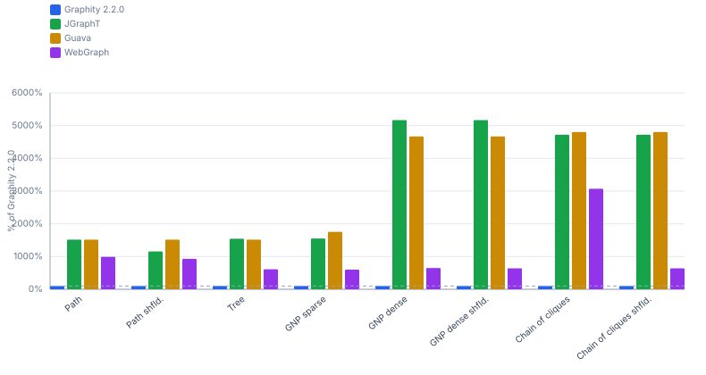

**Allocations @ 100k nodes in bytes (lower is better)**

| Shape | Graphity 2.3.0 | JGraphT | Guava | WebGraph |
|---|---:|---:|---:|---:|
| Path<br><sub>100k nodes, 100k edges</sub> | 2.0 MB | 32.7 MB (1635%) | 26.3 MB (1315%) | 19.3 MB (965%) |
| Path shfld.<br><sub>100k nodes, 100k edges</sub> | 2.0 MB | 32.7 MB (1635%) | 26.3 MB (1315%) | 16.5 MB (824%) |
| Tree<br><sub>100k nodes, 100k edges</sub> | 2.0 MB | 33.2 MB (1661%) | 26.3 MB (1315%) | 11.1 MB (557%) |
| GNP sparse<br><sub>100k nodes, 300k edges</sub> | 2.0 MB | 37.5 MB (1875%) | 31.1 MB (1554%) | 11.0 MB (552%) |
| GNP dense<br><sub>100k nodes, 3M edges</sub> | 2.0 MB | 106 MB (5303%) | 95.9 MB (4793%) | 11.7 MB (587%) |
| Chain of cliques<br><sub>100k nodes, 3.1M edges</sub> | 2.0 MB | 101 MB (5036%) | 98.4 MB (4917%) | 61.4 MB (3070%) |
| Chain of cliques shfld.<br><sub>100k nodes, 3.1M edges</sub> | 2.0 MB | 96.8 MB (4836%) | 98.4 MB (4917%) | 12.5 MB (623%) |

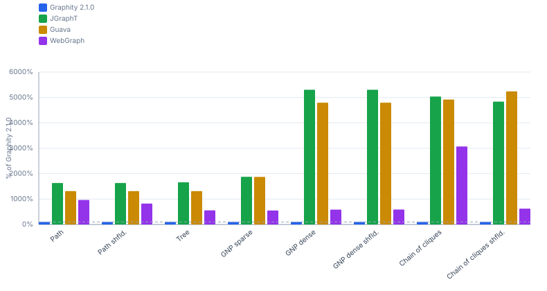

### 3.4 CCs

**Allocations @ 10k nodes in bytes (lower is better)**

| Shape | Graphity 2.3.0 |
|---|---:|
| Path<br><sub>10k nodes, 10k edges</sub> | 200 kB |
| Path shfld.<br><sub>10k nodes, 10k edges</sub> | 200 kB |
| Tree<br><sub>10k nodes, 10k edges</sub> | 200 kB |
| GNP sparse<br><sub>10k nodes, 30k edges</sub> | 200 kB |
| GNP dense<br><sub>10k nodes, 299.6k edges</sub> | 200 kB |
| Chain of cliques<br><sub>10k nodes, 310.8k edges</sub> | 200 kB |
| Chain of cliques shfld.<br><sub>10k nodes, 310.8k edges</sub> | 200 kB |

**Allocations @ 100k nodes in bytes (lower is better)**

| Shape | Graphity 2.3.0 |
|---|---:|
| Path<br><sub>100k nodes, 100k edges</sub> | 2.0 MB |
| Path shfld.<br><sub>100k nodes, 100k edges</sub> | 2.0 MB |
| Tree<br><sub>100k nodes, 100k edges</sub> | 2.0 MB |
| GNP sparse<br><sub>100k nodes, 300k edges</sub> | 2.0 MB |
| GNP dense<br><sub>100k nodes, 3M edges</sub> | 2.0 MB |
| Chain of cliques<br><sub>100k nodes, 3.1M edges</sub> | 2.0 MB |
| Chain of cliques shfld.<br><sub>100k nodes, 3.1M edges</sub> | 2.0 MB |

### 3.5 Condense

**Allocations @ 1k nodes in bytes (lower is better)**

| Shape | Graphity 2.3.0 |
|---|---:|
| Path<br><sub>1k nodes, 1k edges</sub> | 23.2 kB |
| GNP dense<br><sub>1k nodes, 30k edges</sub> | 97 B |
| Chain of cliques<br><sub>1k nodes, 31.1k edges</sub> | 761 B |
| DAG GNP sparse<br><sub>1k nodes</sub> | 66.4 kB |

**Allocations @ 10k nodes in bytes (lower is better)**

| Shape | Graphity 2.3.0 |
|---|---:|
| Path<br><sub>10k nodes, 10k edges</sub> | 250 kB |
| GNP dense<br><sub>10k nodes, 299.6k edges</sub> | 103 B |
| Chain of cliques<br><sub>10k nodes, 310.8k edges</sub> | 7.2 kB |
| DAG GNP sparse<br><sub>10k nodes</sub> | 541 kB |

**Allocations @ 100k nodes in bytes (lower is better)**

| Shape | Graphity 2.3.0 |
|---|---:|
| Path<br><sub>100k nodes, 100k edges</sub> | 2.1 MB |
| GNP dense<br><sub>100k nodes, 3M edges</sub> | 205 B |
| Chain of cliques<br><sub>100k nodes, 3.1M edges</sub> | 75.8 kB |
| DAG GNP sparse<br><sub>100k nodes</sub> | 5.9 MB |

### 3.6 TopOrder

**Allocations @ 10k nodes in bytes (lower is better)**

| Shape | Graphity 2.3.0 | JGraphT | Guava | WebGraph |
|---|---:|---:|---:|---:|
| Path<br><sub>10k nodes, 10k edges</sub> | 297 kB | 1.3 MB (422%) | 943 kB (318%) | 1.5 MB (494%) |
| Path shfld.<br><sub>10k nodes, 10k edges</sub> | 297 kB | 1.3 MB (422%) | 1.1 MB (372%) | 1.0 MB (345%) |
| Tree<br><sub>10k nodes, 10k edges</sub> | 50.8 kB | 1.3 MB (2507%) | 812 kB (1597%) | 885 kB (1742%) |
| Tree shfld.<br><sub>10k nodes</sub> | 50.8 kB | 1.3 MB (2507%) | 812 kB (1597%) | 845 kB (1663%) |
| DAG GNP sparse<br><sub>10k nodes</sub> | 50.8 kB | 1.3 MB (2506%) | 930 kB (1830%) | 984 kB (1936%) |
| DAG GNP dense<br><sub>10k nodes</sub> | 50.8 kB | 1.3 MB (2469%) | 812 kB (1597%) | 1.1 MB (2161%) |
| DAG GNP dense shfld.<br><sub>10k nodes</sub> | 50.9 kB | 1.3 MB (2469%) | 812 kB (1597%) | 1.1 MB (2118%) |


**Allocations @ 100k nodes in bytes (lower is better)**

| Shape | Graphity 2.3.0 | JGraphT | Guava | WebGraph |
|---|---:|---:|---:|---:|
| Path<br><sub>100k nodes, 100k edges</sub> | 2.5 MB | 13.3 MB (529%) | 9.9 MB (396%) | 10.5 MB (417%) |
| Path shfld.<br><sub>100k nodes, 100k edges</sub> | 2.5 MB | 13.3 MB (529%) | 8.9 MB (354%) | 10.0 MB (400%) |
| Tree<br><sub>100k nodes, 100k edges</sub> | 433 kB | 13.5 MB (3108%) | 7.9 MB (1811%) | 8.5 MB (1953%) |
| Tree shfld.<br><sub>100k nodes</sub> | 433 kB | 13.5 MB (3108%) | 7.9 MB (1811%) | 8.4 MB (1944%) |
| DAG GNP sparse<br><sub>100k nodes</sub> | 433 kB | 13.6 MB (3128%) | 9.6 MB (2210%) | 9.5 MB (2203%) |
| DAG GNP dense<br><sub>100k nodes</sub> | 434 kB | 13.3 MB (3073%) | 7.9 MB (1812%) | 10.3 MB (2374%) |
| DAG GNP dense shfld.<br><sub>100k nodes</sub> | 434 kB | 13.3 MB (3073%) | 7.9 MB (1811%) | 10.2 MB (2360%) |


### 3.7 TopOrderAndLevels

**Allocations @ 10k nodes in bytes (lower is better)**

| Shape | Graphity 2.3.0 | Graphity 2.3.0<br>(bi-adjacent) | JGraphT | Guava | WebGraph |
|---|---:|---:|---:|---:|---:|
| Path<br><sub>10k nodes, 10k edges</sub> | 160 kB | 160 kB (100%) | 476 kB (297%) | 476 kB (297%) | 1.7 MB (1088%) |
| Path shfld.<br><sub>10k nodes, 10k edges</sub> | 160 kB | 160 kB (100%) | 476 kB (297%) | 476 kB (297%) | 1.7 MB (1070%) |
| Tree<br><sub>10k nodes, 10k edges</sub> | 160 kB | 160 kB (100%) | 476 kB (297%) | 476 kB (297%) | 1.3 MB (829%) |
| Tree shfld.<br><sub>10k nodes</sub> | 160 kB | 160 kB (100%) | 476 kB (297%) | 476 kB (297%) | 1.3 MB (796%) |
| DAG GNP sparse<br><sub>10k nodes</sub> | 160 kB | 160 kB (100.0%) | 476 kB (297%) | 476 kB (297%) | 1.6 MB (1016%) |
| DAG GNP dense<br><sub>10k nodes</sub> | 160 kB | 160 kB (100.0%) | 476 kB (297%) | 477 kB (297%) | 1.8 MB (1126%) |
| DAG GNP dense shfld.<br><sub>10k nodes</sub> | 160 kB | 160 kB (100.0%) | 476 kB (297%) | 477 kB (297%) | 1.8 MB (1140%) |

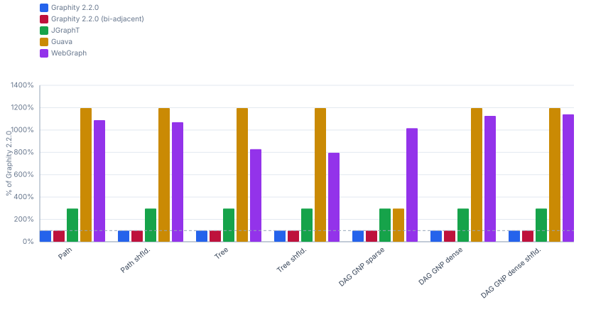

**Allocations @ 100k nodes in bytes (lower is better)**

| Shape | Graphity 2.3.0 | Graphity 2.3.0<br>(bi-adjacent) | JGraphT | Guava | WebGraph |
|---|---:|---:|---:|---:|---:|
| Path<br><sub>100k nodes, 100k edges</sub> | 1.6 MB | 1.6 MB (100.0%) | 4.8 MB (300%) | 4.8 MB (300%) | 16.9 MB (1054%) |
| Path shfld.<br><sub>100k nodes, 100k edges</sub> | 1.6 MB | 1.6 MB (100.0%) | 4.8 MB (300%) | 4.8 MB (300%) | 16.8 MB (1052%) |
| Tree<br><sub>100k nodes, 100k edges</sub> | 1.6 MB | 1.6 MB (100.0%) | 4.8 MB (300%) | 4.8 MB (300%) | 12.5 MB (780%) |
| Tree shfld.<br><sub>100k nodes</sub> | 1.6 MB | 1.6 MB (100.0%) | 4.8 MB (300%) | 4.8 MB (300%) | 12.4 MB (777%) |
| DAG GNP sparse<br><sub>100k nodes</sub> | 1.6 MB | 1.6 MB (100.0%) | 4.8 MB (300%) | 4.8 MB (300%) | 15.5 MB (967%) |
| DAG GNP dense<br><sub>100k nodes</sub> | 1.6 MB | 1.6 MB (100.0%) | 4.8 MB (300%) | 4.8 MB (300%) | 17.1 MB (1070%) |
| DAG GNP dense shfld.<br><sub>100k nodes</sub> | 1.6 MB | 1.6 MB (100.0%) | 4.8 MB (300%) | 4.8 MB (300%) | 17.1 MB (1069%) |

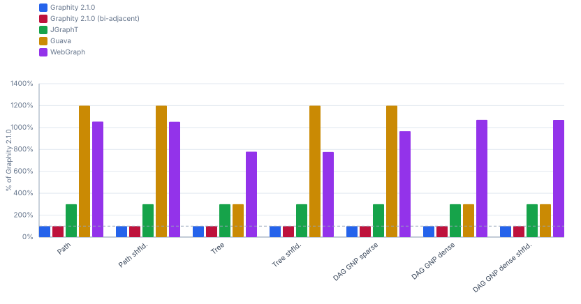

### 3.8 BackEdges

**Allocations @ 10k nodes in bytes (lower is better)**

| Shape | Graphity 2.3.0 | JGraphT | Guava | WebGraph |
|---|---:|---:|---:|---:|
| Path<br><sub>10k nodes, 10k edges</sub> | 257 kB | 161 kB (62.6%) | 161 kB (62.6%) | 1.4 MB (555%) |
| Path shfld.<br><sub>10k nodes, 10k edges</sub> | 257 kB | 161 kB (62.6%) | 161 kB (62.6%) | 985 kB (384%) |
| Tree<br><sub>10k nodes, 10k edges</sub> | 10.9 kB | 161 kB (1476%) | 161 kB (1476%) | 845 kB (7766%) |
| GNP sparse<br><sub>10k nodes, 30k edges</sub> | 351 kB | 386 kB (110%) | 386 kB (110%) | 1.2 MB (336%) |
| GNP dense<br><sub>10k nodes, 299.6k edges</sub> | 4.1 MB | 4.0 MB (97.7%) | 4.8 MB (117%) | 4.9 MB (120%) |
| Chain of cliques<br><sub>10k nodes, 310.8k edges</sub> | 4.1 MB | 4.0 MB (97.7%) | 4.0 MB (97.7%) | 9.7 MB (236%) |
| Chain of cliques shfld.<br><sub>10k nodes, 310.8k edges</sub> | 4.0 MB | 4.0 MB (101%) | 4.0 MB (101%) | 4.9 MB (124%) |


**Allocations @ 100k nodes in bytes (lower is better)**

| Shape | Graphity 2.3.0 | JGraphT | Guava | WebGraph |
|---|---:|---:|---:|---:|
| Path<br><sub>100k nodes, 100k edges</sub> | 2.1 MB | 1.6 MB (76.8%) | 1.6 MB (76.8%) | 10.1 MB (477%) |
| Path shfld.<br><sub>100k nodes, 100k edges</sub> | 2.1 MB | 1.6 MB (76.8%) | 3.2 MB (152%) | 9.6 MB (456%) |
| Tree<br><sub>100k nodes, 100k edges</sub> | 33.5 kB | 1.6 MB (4854%) | 1.6 MB (4853%) | 8.1 MB (24086%) |
| GNP sparse<br><sub>100k nodes, 300k edges</sub> | 3.6 MB | 4.2 MB (115%) | 4.2 MB (115%) | 12.1 MB (332%) |
| GNP dense<br><sub>100k nodes, 3M edges</sub> | 45.9 MB | 45.4 MB (98.9%) | 53.4 MB (116%) | 53.6 MB (117%) |
| Chain of cliques<br><sub>100k nodes, 3.1M edges</sub> | 45.9 MB | 45.4 MB (98.9%) | 45.4 MB (98.9%) | 101 MB (219%) |
| Chain of cliques shfld.<br><sub>100k nodes, 3.1M edges</sub> | 44.8 MB | 45.4 MB (101%) | 45.4 MB (101%) | 53.5 MB (119%) |


### 3.9 EdgeTypes

**Allocations @ 10k nodes in bytes (lower is better)**

| Shape | Graphity 2.3.0 | JGraphT | Guava | WebGraph |
|---|---:|---:|---:|---:|
| Path<br><sub>10k nodes, 10k edges</sub> | 307 kB | 581 kB (190%) | 581 kB (190%) | 1.8 MB (602%) |
| Path shfld.<br><sub>10k nodes, 10k edges</sub> | 307 kB | 581 kB (190%) | 581 kB (190%) | 1.4 MB (458%) |
| Tree<br><sub>10k nodes, 10k edges</sub> | 60.8 kB | 581 kB (955%) | 581 kB (956%) | 1.3 MB (2081%) |
| GNP sparse<br><sub>10k nodes, 30k edges</sub> | 196 kB | 1.1 MB (540%) | 1.5 MB (756%) | 1.8 MB (945%) |
| GNP dense<br><sub>10k nodes, 299.6k edges</sub> | 596 kB | 9.9 MB (1665%) | 10.7 MB (1799%) | 10.8 MB (1818%) |
| Chain of cliques<br><sub>10k nodes, 310.8k edges</sub> | 608 kB | 9.9 MB (1634%) | 9.9 MB (1634%) | 15.6 MB (2565%) |
| Chain of cliques shfld.<br><sub>10k nodes, 310.8k edges</sub> | 476 kB | 9.9 MB (2084%) | 9.9 MB (2084%) | 10.8 MB (2275%) |


**Allocations @ 100k nodes in bytes (lower is better)**

| Shape | Graphity 2.3.0 | JGraphT | Guava | WebGraph |
|---|---:|---:|---:|---:|
| Path<br><sub>100k nodes, 100k edges</sub> | 2.6 MB | 4.9 MB (188%) | 4.9 MB (188%) | 13.4 MB (511%) |
| Path shfld.<br><sub>100k nodes, 100k edges</sub> | 2.6 MB | 4.9 MB (188%) | 4.9 MB (188%) | 12.9 MB (495%) |
| Tree<br><sub>100k nodes, 100k edges</sub> | 533 kB | 4.9 MB (920%) | 4.9 MB (920%) | 11.3 MB (2127%) |
| GNP sparse<br><sub>100k nodes, 300k edges</sub> | 1.8 MB | 11.8 MB (666%) | 16.0 MB (903%) | 19.6 MB (1111%) |
| GNP dense<br><sub>100k nodes, 3M edges</sub> | 5.5 MB | 113 MB (2045%) | 121 MB (2191%) | 121 MB (2194%) |
| Chain of cliques<br><sub>100k nodes, 3.1M edges</sub> | 5.6 MB | 113 MB (2008%) | 113 MB (2008%) | 168 MB (2990%) |
| Chain of cliques shfld.<br><sub>100k nodes, 3.1M edges</sub> | 4.6 MB | 113 MB (2469%) | 113 MB (2469%) | 121 MB (2645%) |


### 3.10 Dominators

**Allocations @ 10k nodes in bytes (lower is better)**

| Shape | Graphity 2.3.0 |
|---|---:|
| Structured<br><sub>10k nodes</sub> | 371 kB |
| Irreducible<br><sub>10k nodes</sub> | 371 kB |
| Ladder<br><sub>10k nodes</sub> | 486 kB |
| Chain<br><sub>10k nodes</sub> | 566 kB |
| Fan behind chain<br><sub>10k nodes</sub> | 486 kB |
| Small methods<br><sub>10k nodes</sub> | 475 kB |

**Allocations @ 100k nodes in bytes (lower is better)**

| Shape | Graphity 2.3.0 |
|---|---:|
| Structured<br><sub>100k nodes</sub> | 3.7 MB |
| Irreducible<br><sub>100k nodes</sub> | 3.7 MB |
| Ladder<br><sub>100k nodes</sub> | 4.7 MB |
| Chain<br><sub>100k nodes</sub> | 5.5 MB |
| Fan behind chain<br><sub>100k nodes</sub> | 4.7 MB |
| Small methods<br><sub>100k nodes</sub> | 4.7 MB |

### 3.11 Dominance frontiers

**Allocations @ 10k nodes in bytes (lower is better)**

| Shape | Graphity 2.3.0 |
|---|---:|
| Structured<br><sub>10k nodes</sub> | 134 kB |
| Irreducible<br><sub>10k nodes</sub> | 144 kB |
| Ladder<br><sub>10k nodes</sub> | 50.1 MB |
| Chain<br><sub>10k nodes</sub> | 80.1 kB |
| Fan behind chain<br><sub>10k nodes</sub> | 100 MB |
| Small methods<br><sub>10k nodes</sub> | 140 kB |

**Allocations @ 100k nodes in bytes (lower is better)**

| Shape | Graphity 2.3.0 |
|---|---:|
| Structured<br><sub>100k nodes</sub> | 1.3 MB |
| Irreducible<br><sub>100k nodes</sub> | 1.4 MB |
| Chain<br><sub>100k nodes</sub> | 800 kB |
| Small methods<br><sub>100k nodes</sub> | 1.4 MB |

### 3.12 Iterated dominance frontier (build + one query per variable)

**Allocations @ 10k nodes in bytes (lower is better)**

| Shape | Graphity 2.3.0 |
|---|---:|
| Structured<br><sub>10k nodes</sub> | 25.4 MB |
| Irreducible<br><sub>10k nodes</sub> | 28.9 MB |
| Ladder<br><sub>10k nodes</sub> | 53.8 MB |
| Chain<br><sub>10k nodes</sub> | 21.4 MB |
| Fan behind chain<br><sub>10k nodes</sub> | 65.4 MB |
| Small methods<br><sub>10k nodes</sub> | 604 kB |

**Allocations @ 100k nodes in bytes (lower is better)**

| Shape | Graphity 2.3.0 |
|---|---:|
| Structured<br><sub>100k nodes</sub> | 370 MB |
| Irreducible<br><sub>100k nodes</sub> | 451 MB |
| Ladder<br><sub>100k nodes</sub> | 504 MB |
| Chain<br><sub>100k nodes</sub> | 198 MB |
| Fan behind chain<br><sub>100k nodes</sub> | 662 MB |
| Small methods<br><sub>100k nodes</sub> | 5.8 MB |

### 3.13 Loops

**Allocations @ 10k nodes in bytes (lower is better)**

| Shape | Graphity 2.3.0 |
|---|---:|
| Structured<br><sub>10k nodes</sub> | 772 kB |
| Irreducible<br><sub>10k nodes</sub> | 812 kB |
| Ladder<br><sub>10k nodes</sub> | 675 kB |
| Chain<br><sub>10k nodes</sub> | 735 kB |
| Fan behind chain<br><sub>10k nodes</sub> | 675 kB |
| Small methods<br><sub>10k nodes</sub> | 897 kB |

**Allocations @ 100k nodes in bytes (lower is better)**

| Shape | Graphity 2.3.0 |
|---|---:|
| Structured<br><sub>100k nodes</sub> | 7.5 MB |
| Irreducible<br><sub>100k nodes</sub> | 13.5 MB |
| Ladder<br><sub>100k nodes</sub> | 6.6 MB |
| Chain<br><sub>100k nodes</sub> | 7.2 MB |
| Fan behind chain<br><sub>100k nodes</sub> | 6.6 MB |
| Small methods<br><sub>100k nodes</sub> | 8.9 MB |

### 3.14 Ancestry of the dominator tree

**Allocations @ 10k nodes in bytes (lower is better)**

| Shape | Graphity 2.3.0 |
|---|---:|
| Structured<br><sub>10k nodes</sub> | 280 kB |
| Irreducible<br><sub>10k nodes</sub> | 280 kB |
| Ladder<br><sub>10k nodes</sub> | 280 kB |
| Chain<br><sub>10k nodes</sub> | 280 kB |
| Fan behind chain<br><sub>10k nodes</sub> | 280 kB |
| Small methods<br><sub>10k nodes</sub> | 297 kB |

**Allocations @ 100k nodes in bytes (lower is better)**

| Shape | Graphity 2.3.0 |
|---|---:|
| Structured<br><sub>100k nodes</sub> | 2.8 MB |
| Irreducible<br><sub>100k nodes</sub> | 2.8 MB |
| Ladder<br><sub>100k nodes</sub> | 2.8 MB |
| Chain<br><sub>100k nodes</sub> | 2.8 MB |
| Fan behind chain<br><sub>100k nodes</sub> | 2.8 MB |
| Small methods<br><sub>100k nodes</sub> | 2.9 MB |

### 3.15 PreorderAncestry of the dominator tree

**Allocations @ 10k nodes in bytes (lower is better)**

| Shape | Graphity 2.3.0 |
|---|---:|
| Structured<br><sub>10k nodes</sub> | 200 kB |
| Irreducible<br><sub>10k nodes</sub> | 200 kB |
| Ladder<br><sub>10k nodes</sub> | 200 kB |
| Chain<br><sub>10k nodes</sub> | 200 kB |
| Fan behind chain<br><sub>10k nodes</sub> | 200 kB |
| Small methods<br><sub>10k nodes</sub> | 216 kB |

**Allocations @ 100k nodes in bytes (lower is better)**

| Shape | Graphity 2.3.0 |
|---|---:|
| Structured<br><sub>100k nodes</sub> | 2.0 MB |
| Irreducible<br><sub>100k nodes</sub> | 2.0 MB |
| Ladder<br><sub>100k nodes</sub> | 2.0 MB |
| Chain<br><sub>100k nodes</sub> | 2.0 MB |
| Fan behind chain<br><sub>100k nodes</sub> | 2.0 MB |
| Small methods<br><sub>100k nodes</sub> | 2.1 MB |
