# Graphity vs. JGraphT, Guava and WebGraph — synthetic / ubuntu-ryzen-9950x

Graphity `3.0.0` against the peer libraries. Peer numbers come from the newest run that measured them, which need not be the run of the newest Graphity version; every column states the version it belongs to. Blocks without a peer column are Graphity-only benchmarks or graph sizes beyond the peers' reach — for the comparison across Graphity versions see [`synthetic-ubuntu-ryzen-9950x-history.md`](synthetic-ubuntu-ryzen-9950x-history.md).

```
Profile:      synthetic
Timestamp:    2026-10-31 05:43:55
JDK:          OpenJDK 64-Bit Server VM 25.0.2 (Amazon.com Inc.)
OS:           Ubuntu 25.10, kernel 6.17.0-41-generic (amd64)
CPU:          AMD Ryzen 9 9950X 16-Core Processor (32 logical cores)
RAM:          89.7 GiB
Estimate:     near-best window - 3rd-fastest of 15 or more, 2nd-fastest of 5 or more
Revisions:    2, the report combines runs of different states
              3.0.0 (682 cases)
              2.3.0 (602 cases)
Memory:       revision not recorded per row
```

## Contents

- [1 Performance](#1-performance)
  - [1.1 Build](#11-build)
  - [1.2 Out-adjacency traversal (outNodes, no algorithm)](#12-out-adjacency-traversal-outnodes-no-algorithm)
  - [1.3 In-adjacency traversal (inNodes, no algorithm)](#13-in-adjacency-traversal-innodes-no-algorithm)
  - [1.4 SCC](#14-scc)
  - [1.5 WCC](#15-wcc)
  - [1.6 CCs](#16-ccs)
  - [1.7 Condense](#17-condense)
  - [1.8 TopOrder](#18-toporder)
  - [1.9 TopOrderAndLevels](#19-toporderandlevels)
  - [1.10 BackEdges](#110-backedges)
  - [1.11 EdgeTypes](#111-edgetypes)
  - [1.12 Reorder (DFS-preorder) cost](#112-reorder-dfs-preorder-cost)
  - [1.13 BiAdjacency (in-adjacency) cost](#113-biadjacency-in-adjacency-cost)
  - [1.14 Symmetrize (WebGraph) cost](#114-symmetrize-webgraph-cost)
  - [1.15 Dominators](#115-dominators)
  - [1.16 Dominance frontiers](#116-dominance-frontiers)
  - [1.17 Iterated dominance frontier (build + one query per variable)](#117-iterated-dominance-frontier-build--one-query-per-variable)
  - [1.18 Loops](#118-loops)
  - [1.19 Ancestry of the dominator tree](#119-ancestry-of-the-dominator-tree)
  - [1.20 PreorderAncestry of the dominator tree](#120-preorderancestry-of-the-dominator-tree)
- [2 Memory Footprint](#2-memory-footprint)
  - [2.1 Total Graph Size](#21-total-graph-size)
  - [2.2 Bytes per Element  `totalBytes / (Nodes + Edges)`](#22-bytes-per-element--totalbytes--nodes--edges)
- [3 Allocations](#3-allocations)
  - [3.1 Build](#31-build)
  - [3.2 SCC](#32-scc)
  - [3.3 WCC](#33-wcc)
  - [3.4 CCs](#34-ccs)
  - [3.5 Condense](#35-condense)
  - [3.6 TopOrder](#36-toporder)
  - [3.7 TopOrderAndLevels](#37-toporderandlevels)
  - [3.8 BackEdges](#38-backedges)
  - [3.9 EdgeTypes](#39-edgetypes)
  - [3.10 Dominators](#310-dominators)
  - [3.11 Dominance frontiers](#311-dominance-frontiers)
  - [3.12 Iterated dominance frontier (build + one query per variable)](#312-iterated-dominance-frontier-build--one-query-per-variable)
  - [3.13 Loops](#313-loops)
  - [3.14 Ancestry of the dominator tree](#314-ancestry-of-the-dominator-tree)
  - [3.15 PreorderAncestry of the dominator tree](#315-preorderancestry-of-the-dominator-tree)

## 1 Performance

Times (ms/op, lower is better) and throughput (op/s, higher is better) for each algorithm and graph size. Non-baseline cells show the factor relative to **Graphity 3.0.0**, or the newest version present in a table it is missing from (= 100% in the throughput table).

### 1.1 Build

#### Times @ 10k nodes (ms/op, lower is better)

| Shape | Graphity 3.0.0 | JGraphT | Guava | WebGraph |
|---|---:|---:|---:|---:|
| Path<br><sub>10k nodes, 10k edges</sub> | 0.086 ms | 1.111 ms (13×) | 0.372 ms (4.3×) | 2.260 ms (26×) |
| Path shfld.<br><sub>10k nodes, 10k edges</sub> | 0.087 ms | 1.115 ms (13×) | 0.555 ms (6.4×) | 2.936 ms (34×) |
| Tree<br><sub>10k nodes, 10k edges</sub> | 0.095 ms | 1.153 ms (12×) | 0.526 ms (5.5×) | 2.559 ms (27×) |
| GNP sparse<br><sub>10k nodes, 30k edges</sub> | 0.209 ms | 4.088 ms (20×) | 2.145 ms (10×) | 7.956 ms (38×) |
| GNP dense<br><sub>10k nodes, 299.6k edges</sub> | 1.673 ms | 55.01 ms (33×) | 31.20 ms (19×) | 43.27 ms (26×) |
| Chain of cliques<br><sub>10k nodes, 310.8k edges</sub> | 1.667 ms | 40.13 ms (24×) | 9.044 ms (5.4×) | 6.600 ms (4.0×) |
| Chain of cliques shfld.<br><sub>10k nodes, 310.8k edges</sub> | 1.638 ms | 57.04 ms (35×) | 17.65 ms (11×) | 43.73 ms (27×) |

#### Throughput @ 10k nodes (op/s, higher is better)

| Shape | Graphity 3.0.0 | JGraphT | Guava | WebGraph |
|---|---:|---:|---:|---:|
| Path<br><sub>10k nodes, 10k edges</sub> | 11 628 op/s | 900.1 op/s (7.7%) | 2 688 op/s (23.1%) | 442.5 op/s (3.8%) |
| Path shfld.<br><sub>10k nodes, 10k edges</sub> | 11 494 op/s | 896.9 op/s (7.8%) | 1 802 op/s (15.7%) | 340.6 op/s (3.0%) |
| Tree<br><sub>10k nodes, 10k edges</sub> | 10 526 op/s | 867.3 op/s (8.2%) | 1 901 op/s (18.1%) | 390.8 op/s (3.7%) |
| GNP sparse<br><sub>10k nodes, 30k edges</sub> | 4 785 op/s | 244.6 op/s (5.1%) | 466.2 op/s (9.7%) | 125.7 op/s (2.6%) |
| GNP dense<br><sub>10k nodes, 299.6k edges</sub> | 597.7 op/s | 18.18 op/s (3.0%) | 32.06 op/s (5.4%) | 23.11 op/s (3.9%) |
| Chain of cliques<br><sub>10k nodes, 310.8k edges</sub> | 599.9 op/s | 24.92 op/s (4.2%) | 110.6 op/s (18.4%) | 151.5 op/s (25.3%) |
| Chain of cliques shfld.<br><sub>10k nodes, 310.8k edges</sub> | 610.5 op/s | 17.53 op/s (2.9%) | 56.66 op/s (9.3%) | 22.87 op/s (3.7%) |

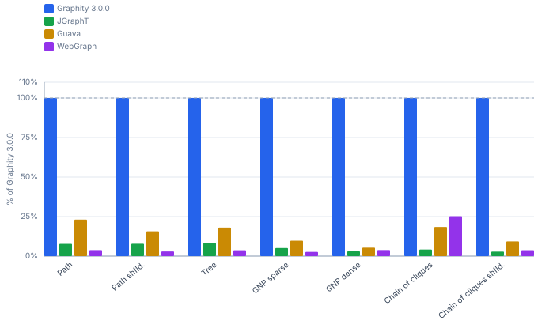

#### Times @ 100k nodes (ms/op, lower is better)

| Shape | Graphity 3.0.0 | JGraphT | Guava | WebGraph |
|---|---:|---:|---:|---:|
| Path<br><sub>100k nodes, 100k edges</sub> | 0.677 ms | 14.04 ms (21×) | 4.043 ms (6.0×) | 21.64 ms (32×) |
| Path shfld.<br><sub>100k nodes, 100k edges</sub> | 0.781 ms | 23.03 ms (29×) | 8.956 ms (11×) | 29.21 ms (37×) |
| Tree<br><sub>100k nodes, 100k edges</sub> | 1.099 ms | 25.14 ms (23×) | 8.092 ms (7.4×) | 28.09 ms (26×) |
| GNP sparse<br><sub>100k nodes, 300k edges</sub> | 2.687 ms | 95.96 ms (36×) | 47.37 ms (18×) | 85.02 ms (32×) |
| GNP dense<br><sub>100k nodes, 3M edges</sub> | 17.75 ms | 1498.0 ms (84×) | 965.5 ms (54×) | 542.8 ms (31×) |
| Chain of cliques<br><sub>100k nodes, 3.1M edges</sub> | 17.30 ms | 818.9 ms (47×) | 93.49 ms (5.4×) | 63.61 ms (3.7×) |
| Chain of cliques shfld.<br><sub>100k nodes, 3.1M edges</sub> | 17.26 ms | 1482.1 ms (86×) | 612.9 ms (36×) | 508.0 ms (29×) |

#### Throughput @ 100k nodes (op/s, higher is better)

| Shape | Graphity 3.0.0 | JGraphT | Guava | WebGraph |
|---|---:|---:|---:|---:|
| Path<br><sub>100k nodes, 100k edges</sub> | 1 477 op/s | 71.21 op/s (4.8%) | 247.3 op/s (16.7%) | 46.21 op/s (3.1%) |
| Path shfld.<br><sub>100k nodes, 100k edges</sub> | 1 280 op/s | 43.42 op/s (3.4%) | 111.7 op/s (8.7%) | 34.23 op/s (2.7%) |
| Tree<br><sub>100k nodes, 100k edges</sub> | 909.9 op/s | 39.77 op/s (4.4%) | 123.6 op/s (13.6%) | 35.60 op/s (3.9%) |
| GNP sparse<br><sub>100k nodes, 300k edges</sub> | 372.2 op/s | 10.42 op/s (2.8%) | 21.11 op/s (5.7%) | 11.76 op/s (3.2%) |
| GNP dense<br><sub>100k nodes, 3M edges</sub> | 56.33 op/s | 0.668 op/s (1.2%) | 1.036 op/s (1.8%) | 1.842 op/s (3.3%) |
| Chain of cliques<br><sub>100k nodes, 3.1M edges</sub> | 57.79 op/s | 1.221 op/s (2.1%) | 10.70 op/s (18.5%) | 15.72 op/s (27.2%) |
| Chain of cliques shfld.<br><sub>100k nodes, 3.1M edges</sub> | 57.94 op/s | 0.675 op/s (1.2%) | 1.632 op/s (2.8%) | 1.969 op/s (3.4%) |

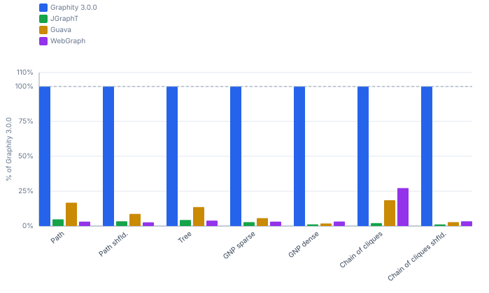

#### Times @ 1M nodes (ms/op, lower is better)

| Shape | Graphity 3.0.0 |
|---|---:|
| GNP sparse<br><sub>1M nodes, 3M edges</sub> | 25.90 ms |
| GNP dense<br><sub>1M nodes, 30M edges</sub> | 182.4 ms |
| Chain of cliques<br><sub>1M nodes, 31.1M edges</sub> | 179.7 ms |

#### Throughput @ 1M nodes (op/s, higher is better)

| Shape | Graphity 3.0.0 |
|---|---:|
| GNP sparse<br><sub>1M nodes, 3M edges</sub> | 38.60 op/s |
| GNP dense<br><sub>1M nodes, 30M edges</sub> | 5.482 op/s |
| Chain of cliques<br><sub>1M nodes, 31.1M edges</sub> | 5.565 op/s |

#### Times @ 10M nodes (ms/op, lower is better)

| Shape | Graphity 3.0.0 |
|---|---:|
| GNP sparse<br><sub>10M nodes, 30M edges</sub> | 284.2 ms |
| GNP dense<br><sub>10M nodes, 299.6M edges</sub> | 2052.3 ms |
| Chain of cliques<br><sub>10M nodes, 310.8M edges</sub> | 2052.5 ms |

#### Throughput @ 10M nodes (op/s, higher is better)

| Shape | Graphity 3.0.0 |
|---|---:|
| GNP sparse<br><sub>10M nodes, 30M edges</sub> | 3.519 op/s |
| GNP dense<br><sub>10M nodes, 299.6M edges</sub> | 0.487 op/s |
| Chain of cliques<br><sub>10M nodes, 310.8M edges</sub> | 0.487 op/s |

#### Times @ 100M nodes (ms/op, lower is better)

| Shape | Graphity 3.0.0 |
|---|---:|
| GNP sparse<br><sub>100M nodes, 300M edges</sub> | 2733.8 ms |

#### Throughput @ 100M nodes (op/s, higher is better)

| Shape | Graphity 3.0.0 |
|---|---:|
| GNP sparse<br><sub>100M nodes, 300M edges</sub> | 0.366 op/s |

### 1.2 Out-adjacency traversal (outNodes, no algorithm)

#### Times @ 10k nodes (ms/op, lower is better)

| Shape | Graphity 3.0.0 |
|---|---:|
| Path<br><sub>10k nodes, 10k edges</sub> | 0.014 ms |
| Path shfld.<br><sub>10k nodes, 10k edges</sub> | 0.014 ms |
| Tree<br><sub>10k nodes, 10k edges</sub> | 0.010 ms |
| GNP sparse<br><sub>10k nodes, 30k edges</sub> | 0.017 ms |
| GNP dense<br><sub>10k nodes, 299.6k edges</sub> | 0.048 ms |
| Chain of cliques<br><sub>10k nodes, 310.8k edges</sub> | 0.051 ms |
| Chain of cliques shfld.<br><sub>10k nodes, 310.8k edges</sub> | 0.053 ms |

#### Throughput @ 10k nodes (op/s, higher is better)

| Shape | Graphity 3.0.0 |
|---|---:|
| Path<br><sub>10k nodes, 10k edges</sub> | 71 429 op/s |
| Path shfld.<br><sub>10k nodes, 10k edges</sub> | 71 429 op/s |
| Tree<br><sub>10k nodes, 10k edges</sub> | 100 000 op/s |
| GNP sparse<br><sub>10k nodes, 30k edges</sub> | 58 824 op/s |
| GNP dense<br><sub>10k nodes, 299.6k edges</sub> | 20 833 op/s |
| Chain of cliques<br><sub>10k nodes, 310.8k edges</sub> | 19 608 op/s |
| Chain of cliques shfld.<br><sub>10k nodes, 310.8k edges</sub> | 18 868 op/s |

#### Times @ 100k nodes (ms/op, lower is better)

| Shape | Graphity 3.0.0 |
|---|---:|
| Path<br><sub>100k nodes, 100k edges</sub> | 0.169 ms |
| Path shfld.<br><sub>100k nodes, 100k edges</sub> | 0.169 ms |
| Tree<br><sub>100k nodes, 100k edges</sub> | 0.400 ms |
| GNP sparse<br><sub>100k nodes, 300k edges</sub> | 0.652 ms |
| GNP dense<br><sub>100k nodes, 3M edges</sub> | 1.132 ms |
| Chain of cliques<br><sub>100k nodes, 3.1M edges</sub> | 0.514 ms |
| Chain of cliques shfld.<br><sub>100k nodes, 3.1M edges</sub> | 0.512 ms |

#### Throughput @ 100k nodes (op/s, higher is better)

| Shape | Graphity 3.0.0 |
|---|---:|
| Path<br><sub>100k nodes, 100k edges</sub> | 5 917 op/s |
| Path shfld.<br><sub>100k nodes, 100k edges</sub> | 5 917 op/s |
| Tree<br><sub>100k nodes, 100k edges</sub> | 2 500 op/s |
| GNP sparse<br><sub>100k nodes, 300k edges</sub> | 1 534 op/s |
| GNP dense<br><sub>100k nodes, 3M edges</sub> | 883.4 op/s |
| Chain of cliques<br><sub>100k nodes, 3.1M edges</sub> | 1 946 op/s |
| Chain of cliques shfld.<br><sub>100k nodes, 3.1M edges</sub> | 1 953 op/s |

### 1.3 In-adjacency traversal (inNodes, no algorithm)

#### Times @ 10k nodes (ms/op, lower is better)

| Shape | Graphity 3.0.0 |
|---|---:|
| Path<br><sub>10k nodes, 10k edges</sub> | 0.014 ms |
| Path shfld.<br><sub>10k nodes, 10k edges</sub> | 0.014 ms |
| Tree<br><sub>10k nodes, 10k edges</sub> | 0.014 ms |
| GNP sparse<br><sub>10k nodes, 30k edges</sub> | 0.017 ms |
| GNP dense<br><sub>10k nodes, 299.6k edges</sub> | 0.050 ms |
| Chain of cliques<br><sub>10k nodes, 310.8k edges</sub> | 0.054 ms |
| Chain of cliques shfld.<br><sub>10k nodes, 310.8k edges</sub> | 0.056 ms |

#### Throughput @ 10k nodes (op/s, higher is better)

| Shape | Graphity 3.0.0 |
|---|---:|
| Path<br><sub>10k nodes, 10k edges</sub> | 71 429 op/s |
| Path shfld.<br><sub>10k nodes, 10k edges</sub> | 71 429 op/s |
| Tree<br><sub>10k nodes, 10k edges</sub> | 71 429 op/s |
| GNP sparse<br><sub>10k nodes, 30k edges</sub> | 58 824 op/s |
| GNP dense<br><sub>10k nodes, 299.6k edges</sub> | 20 000 op/s |
| Chain of cliques<br><sub>10k nodes, 310.8k edges</sub> | 18 519 op/s |
| Chain of cliques shfld.<br><sub>10k nodes, 310.8k edges</sub> | 17 857 op/s |

#### Times @ 100k nodes (ms/op, lower is better)

| Shape | Graphity 3.0.0 |
|---|---:|
| Path<br><sub>100k nodes, 100k edges</sub> | 0.170 ms |
| Path shfld.<br><sub>100k nodes, 100k edges</sub> | 0.170 ms |
| Tree<br><sub>100k nodes, 100k edges</sub> | 0.170 ms |
| GNP sparse<br><sub>100k nodes, 300k edges</sub> | 0.658 ms |
| GNP dense<br><sub>100k nodes, 3M edges</sub> | 1.179 ms |
| Chain of cliques<br><sub>100k nodes, 3.1M edges</sub> | 0.534 ms |
| Chain of cliques shfld.<br><sub>100k nodes, 3.1M edges</sub> | 0.534 ms |

#### Throughput @ 100k nodes (op/s, higher is better)

| Shape | Graphity 3.0.0 |
|---|---:|
| Path<br><sub>100k nodes, 100k edges</sub> | 5 882 op/s |
| Path shfld.<br><sub>100k nodes, 100k edges</sub> | 5 882 op/s |
| Tree<br><sub>100k nodes, 100k edges</sub> | 5 882 op/s |
| GNP sparse<br><sub>100k nodes, 300k edges</sub> | 1 520 op/s |
| GNP dense<br><sub>100k nodes, 3M edges</sub> | 848.2 op/s |
| Chain of cliques<br><sub>100k nodes, 3.1M edges</sub> | 1 873 op/s |
| Chain of cliques shfld.<br><sub>100k nodes, 3.1M edges</sub> | 1 873 op/s |

### 1.4 SCC

#### Times @ 10k nodes (ms/op, lower is better)

| Shape | Graphity 3.0.0 | Graphity 3.0.0<br>(reordered) | JGraphT | Guava | WebGraph |
|---|---:|---:|---:|---:|---:|
| Path<br><sub>10k nodes, 10k edges</sub> | 0.108 ms | 0.106 ms (1.0×) | 0.763 ms (7.1×) | 0.674 ms (6.2×) | 0.347 ms (3.2×) |
| Path shfld.<br><sub>10k nodes, 10k edges</sub> | 0.135 ms | 0.110 ms (0.8×) | 1.263 ms (9.4×) | 1.194 ms (8.8×) | 0.492 ms (3.6×) |
| Tree<br><sub>10k nodes, 10k edges</sub> | 0.107 ms | 0.093 ms (0.9×) | 1.136 ms (11×) | 1.085 ms (10×) | 0.481 ms (4.5×) |
| GNP sparse<br><sub>10k nodes, 30k edges</sub> | 0.246 ms | 0.115 ms (0.5×) | 2.189 ms (8.9×) | 2.241 ms (9.1×) | 0.840 ms (3.4×) |
| GNP dense<br><sub>10k nodes, 299.6k edges</sub> | 0.556 ms | 0.411 ms (0.7×) | 20.54 ms (37×) | 19.72 ms (35×) | 2.357 ms (4.2×) |
| Chain of cliques<br><sub>10k nodes, 310.8k edges</sub> | 0.281 ms | 0.295 ms (1.0×) | 8.923 ms (32×) | 4.842 ms (17×) | 3.357 ms (12×) |
| Chain of cliques shfld.<br><sub>10k nodes, 310.8k edges</sub> | 0.388 ms | 0.288 ms (0.7×) | 13.57 ms (35×) | 7.107 ms (18×) | 2.084 ms (5.4×) |

#### Throughput @ 10k nodes (op/s, higher is better)

| Shape | Graphity 3.0.0 | Graphity 3.0.0<br>(reordered) | JGraphT | Guava | WebGraph |
|---|---:|---:|---:|---:|---:|
| Path<br><sub>10k nodes, 10k edges</sub> | 9 259 op/s | 9 434 op/s (102%) | 1 311 op/s (14.2%) | 1 484 op/s (16.0%) | 2 882 op/s (31.1%) |
| Path shfld.<br><sub>10k nodes, 10k edges</sub> | 7 407 op/s | 9 091 op/s (123%) | 791.8 op/s (10.7%) | 837.5 op/s (11.3%) | 2 033 op/s (27.4%) |
| Tree<br><sub>10k nodes, 10k edges</sub> | 9 346 op/s | 10 753 op/s (115%) | 880.3 op/s (9.4%) | 921.7 op/s (9.9%) | 2 079 op/s (22.2%) |
| GNP sparse<br><sub>10k nodes, 30k edges</sub> | 4 065 op/s | 8 696 op/s (214%) | 456.8 op/s (11.2%) | 446.2 op/s (11.0%) | 1 190 op/s (29.3%) |
| GNP dense<br><sub>10k nodes, 299.6k edges</sub> | 1 799 op/s | 2 433 op/s (135%) | 48.69 op/s (2.7%) | 50.71 op/s (2.8%) | 424.3 op/s (23.6%) |
| Chain of cliques<br><sub>10k nodes, 310.8k edges</sub> | 3 559 op/s | 3 390 op/s (95.3%) | 112.1 op/s (3.1%) | 206.5 op/s (5.8%) | 297.9 op/s (8.4%) |
| Chain of cliques shfld.<br><sub>10k nodes, 310.8k edges</sub> | 2 577 op/s | 3 472 op/s (135%) | 73.66 op/s (2.9%) | 140.7 op/s (5.5%) | 479.8 op/s (18.6%) |

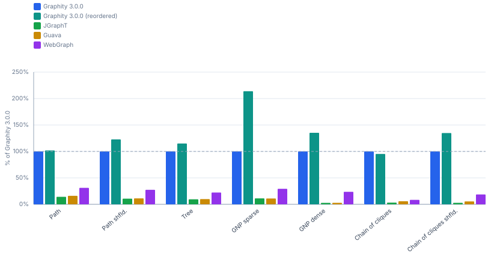

#### Times @ 100k nodes (ms/op, lower is better)

| Shape | Graphity 3.0.0 | Graphity 3.0.0<br>(reordered) | JGraphT | Guava | WebGraph |
|---|---:|---:|---:|---:|---:|
| Path<br><sub>100k nodes, 100k edges</sub> | 1.129 ms | 1.029 ms (0.9×) | 15.26 ms (14×) | 21.46 ms (19×) | 3.401 ms (3.0×) |
| Path shfld.<br><sub>100k nodes, 100k edges</sub> | 2.347 ms | 1.052 ms (0.4×) | 46.48 ms (20×) | 45.40 ms (19×) | 5.508 ms (2.3×) |
| Tree<br><sub>100k nodes, 100k edges</sub> | 2.074 ms | 1.290 ms (0.6×) | 41.51 ms (20×) | 38.09 ms (18×) | 5.712 ms (2.8×) |
| GNP sparse<br><sub>100k nodes, 300k edges</sub> | 4.378 ms | 2.200 ms (0.5×) | 109.6 ms (25×) | 87.01 ms (20×) | 10.30 ms (2.4×) |
| GNP dense<br><sub>100k nodes, 3M edges</sub> | 7.713 ms | 4.534 ms (0.6×) | 446.5 ms (58×) | 333.1 ms (43×) | 36.12 ms (4.7×) |
| Chain of cliques<br><sub>100k nodes, 3.1M edges</sub> | 3.001 ms | 2.834 ms (0.9×) | 166.0 ms (55×) | 108.0 ms (36×) | 37.02 ms (12×) |
| Chain of cliques shfld.<br><sub>100k nodes, 3.1M edges</sub> | 4.929 ms | 2.902 ms (0.6×) | 379.0 ms (77×) | 175.2 ms (36×) | 31.00 ms (6.3×) |

#### Throughput @ 100k nodes (op/s, higher is better)

| Shape | Graphity 3.0.0 | Graphity 3.0.0<br>(reordered) | JGraphT | Guava | WebGraph |
|---|---:|---:|---:|---:|---:|
| Path<br><sub>100k nodes, 100k edges</sub> | 885.7 op/s | 971.8 op/s (110%) | 65.51 op/s (7.4%) | 46.60 op/s (5.3%) | 294.0 op/s (33.2%) |
| Path shfld.<br><sub>100k nodes, 100k edges</sub> | 426.1 op/s | 950.6 op/s (223%) | 21.51 op/s (5.0%) | 22.03 op/s (5.2%) | 181.6 op/s (42.6%) |
| Tree<br><sub>100k nodes, 100k edges</sub> | 482.2 op/s | 775.2 op/s (161%) | 24.09 op/s (5.0%) | 26.26 op/s (5.4%) | 175.1 op/s (36.3%) |
| GNP sparse<br><sub>100k nodes, 300k edges</sub> | 228.4 op/s | 454.5 op/s (199%) | 9.124 op/s (4.0%) | 11.49 op/s (5.0%) | 97.10 op/s (42.5%) |
| GNP dense<br><sub>100k nodes, 3M edges</sub> | 129.7 op/s | 220.6 op/s (170%) | 2.240 op/s (1.7%) | 3.002 op/s (2.3%) | 27.69 op/s (21.4%) |
| Chain of cliques<br><sub>100k nodes, 3.1M edges</sub> | 333.2 op/s | 352.9 op/s (106%) | 6.024 op/s (1.8%) | 9.259 op/s (2.8%) | 27.01 op/s (8.1%) |
| Chain of cliques shfld.<br><sub>100k nodes, 3.1M edges</sub> | 202.9 op/s | 344.6 op/s (170%) | 2.639 op/s (1.3%) | 5.708 op/s (2.8%) | 32.25 op/s (15.9%) |

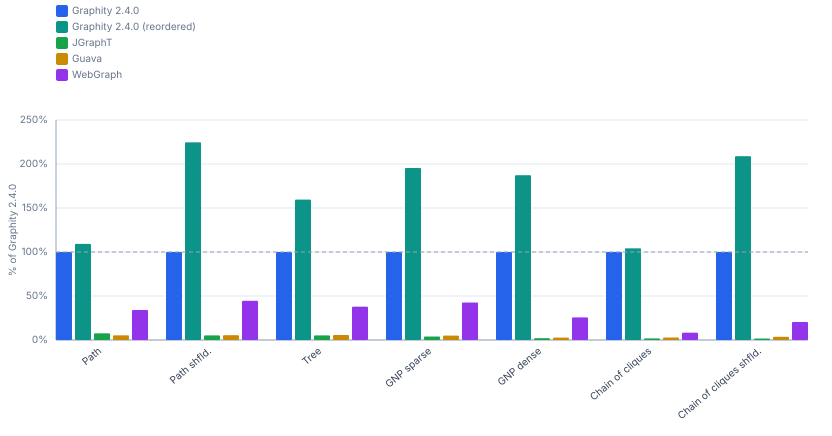

#### Times @ 1M nodes (ms/op, lower is better)

| Shape | Graphity 3.0.0 | Graphity 3.0.0<br>(reordered) |
|---|---:|---:|
| GNP sparse<br><sub>1M nodes, 3M edges</sub> | 75.93 ms | 25.82 ms (0.3×) |
| GNP dense<br><sub>1M nodes, 30M edges</sub> | 250.1 ms | 65.54 ms (0.3×) |
| Chain of cliques<br><sub>1M nodes, 31.1M edges</sub> | 29.42 ms | 29.40 ms (1.0×) |

#### Throughput @ 1M nodes (op/s, higher is better)

| Shape | Graphity 3.0.0 | Graphity 3.0.0<br>(reordered) |
|---|---:|---:|
| GNP sparse<br><sub>1M nodes, 3M edges</sub> | 13.17 op/s | 38.73 op/s (294%) |
| GNP dense<br><sub>1M nodes, 30M edges</sub> | 3.998 op/s | 15.26 op/s (382%) |
| Chain of cliques<br><sub>1M nodes, 31.1M edges</sub> | 33.99 op/s | 34.01 op/s (100%) |

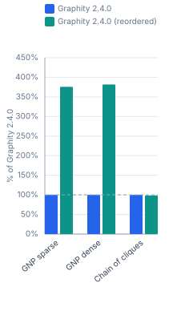

#### Times @ 10M nodes (ms/op, lower is better)

| Shape | Graphity 3.0.0 | Graphity 3.0.0<br>(reordered) |
|---|---:|---:|
| GNP sparse<br><sub>10M nodes, 30M edges</sub> | 3118.7 ms | 741.3 ms (0.2×) |
| GNP dense<br><sub>10M nodes, 299.6M edges</sub> | 6700.8 ms | 3089.4 ms (0.5×) |
| Chain of cliques<br><sub>10M nodes, 310.8M edges</sub> | 346.1 ms | 307.9 ms (0.9×) |

#### Throughput @ 10M nodes (op/s, higher is better)

| Shape | Graphity 3.0.0 | Graphity 3.0.0<br>(reordered) |
|---|---:|---:|
| GNP sparse<br><sub>10M nodes, 30M edges</sub> | 0.321 op/s | 1.349 op/s (421%) |
| GNP dense<br><sub>10M nodes, 299.6M edges</sub> | 0.149 op/s | 0.324 op/s (217%) |
| Chain of cliques<br><sub>10M nodes, 310.8M edges</sub> | 2.889 op/s | 3.248 op/s (112%) |

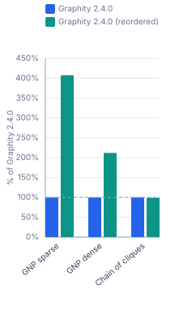

#### Times @ 100M nodes (ms/op, lower is better)

| Shape | Graphity 3.0.0 | Graphity 3.0.0<br>(reordered) |
|---|---:|---:|
| GNP sparse<br><sub>100M nodes, 300M edges</sub> | 37185 ms | 10067 ms (0.3×) |

#### Throughput @ 100M nodes (op/s, higher is better)

| Shape | Graphity 3.0.0 | Graphity 3.0.0<br>(reordered) |
|---|---:|---:|
| GNP sparse<br><sub>100M nodes, 300M edges</sub> | 0.027 op/s | 0.099 op/s (369%) |

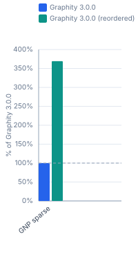

### 1.5 WCC

#### Times @ 10k nodes (ms/op, lower is better)

| Shape | Graphity 3.0.0 | Graphity 3.0.0<br>(reordered) | JGraphT | Guava | WebGraph |
|---|---:|---:|---:|---:|---:|
| Path<br><sub>10k nodes, 10k edges</sub> | 0.037 ms | 0.037 ms (1.0×) | 0.839 ms (23×) | 0.720 ms (19×) | 0.864 ms (23×) |
| Path shfld.<br><sub>10k nodes, 10k edges</sub> | 0.039 ms | 0.036 ms (0.9×) | 1.062 ms (27×) | 1.235 ms (32×) | 1.017 ms (26×) |
| Tree<br><sub>10k nodes, 10k edges</sub> | 0.039 ms | 0.039 ms (1.0×) | 1.246 ms (32×) | 0.941 ms (24×) | 0.687 ms (18×) |
| GNP sparse<br><sub>10k nodes, 30k edges</sub> | 0.084 ms | 0.077 ms (0.9×) | 2.088 ms (25×) | 2.473 ms (29×) | 1.066 ms (13×) |
| GNP dense<br><sub>10k nodes, 299.6k edges</sub> | 0.474 ms | 0.472 ms (1.0×) | 14.50 ms (31×) | 22.65 ms (48×) | 4.431 ms (9.3×) |
| Chain of cliques<br><sub>10k nodes, 310.8k edges</sub> | 0.552 ms | 0.558 ms (1.0×) | 8.927 ms (16×) | 9.144 ms (17×) | 4.730 ms (8.6×) |
| Chain of cliques shfld.<br><sub>10k nodes, 310.8k edges</sub> | 0.678 ms | 0.483 ms (0.7×) | 9.382 ms (14×) | 13.34 ms (20×) | 2.438 ms (3.6×) |

#### Throughput @ 10k nodes (op/s, higher is better)

| Shape | Graphity 3.0.0 | Graphity 3.0.0<br>(reordered) | JGraphT | Guava | WebGraph |
|---|---:|---:|---:|---:|---:|
| Path<br><sub>10k nodes, 10k edges</sub> | 27 027 op/s | 27 027 op/s (100%) | 1 192 op/s (4.4%) | 1 389 op/s (5.1%) | 1 157 op/s (4.3%) |
| Path shfld.<br><sub>10k nodes, 10k edges</sub> | 25 641 op/s | 27 778 op/s (108%) | 941.6 op/s (3.7%) | 809.7 op/s (3.2%) | 983.3 op/s (3.8%) |
| Tree<br><sub>10k nodes, 10k edges</sub> | 25 641 op/s | 25 641 op/s (100%) | 802.6 op/s (3.1%) | 1 063 op/s (4.1%) | 1 456 op/s (5.7%) |
| GNP sparse<br><sub>10k nodes, 30k edges</sub> | 11 905 op/s | 12 987 op/s (109%) | 478.9 op/s (4.0%) | 404.4 op/s (3.4%) | 938.1 op/s (7.9%) |
| GNP dense<br><sub>10k nodes, 299.6k edges</sub> | 2 110 op/s | 2 119 op/s (100%) | 68.96 op/s (3.3%) | 44.15 op/s (2.1%) | 225.7 op/s (10.7%) |
| Chain of cliques<br><sub>10k nodes, 310.8k edges</sub> | 1 812 op/s | 1 792 op/s (98.9%) | 112.0 op/s (6.2%) | 109.4 op/s (6.0%) | 211.4 op/s (11.7%) |
| Chain of cliques shfld.<br><sub>10k nodes, 310.8k edges</sub> | 1 475 op/s | 2 070 op/s (140%) | 106.6 op/s (7.2%) | 74.94 op/s (5.1%) | 410.2 op/s (27.8%) |

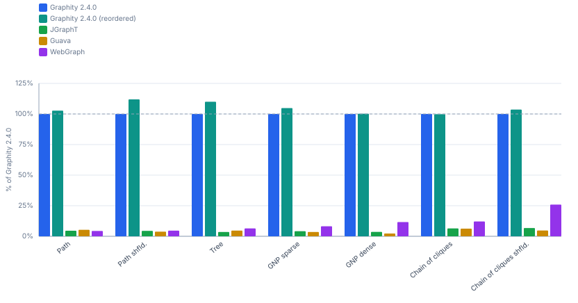

#### Times @ 100k nodes (ms/op, lower is better)

| Shape | Graphity 3.0.0 | Graphity 3.0.0<br>(reordered) | JGraphT | Guava | WebGraph |
|---|---:|---:|---:|---:|---:|
| Path<br><sub>100k nodes, 100k edges</sub> | 0.362 ms | 0.359 ms (1.0×) | 14.51 ms (40×) | 11.36 ms (31×) | 8.595 ms (24×) |
| Path shfld.<br><sub>100k nodes, 100k edges</sub> | 1.164 ms | 0.360 ms (0.3×) | 41.33 ms (36×) | 26.05 ms (22×) | 10.75 ms (9.2×) |
| Tree<br><sub>100k nodes, 100k edges</sub> | 0.619 ms | 0.700 ms (1.1×) | 44.03 ms (71×) | 20.77 ms (34×) | 8.299 ms (13×) |
| GNP sparse<br><sub>100k nodes, 300k edges</sub> | 1.746 ms | 1.405 ms (0.8×) | 84.45 ms (48×) | 54.94 ms (31×) | 14.68 ms (8.4×) |
| GNP dense<br><sub>100k nodes, 3M edges</sub> | 5.967 ms | 5.323 ms (0.9×) | 515.0 ms (86×) | 338.6 ms (57×) | 48.08 ms (8.1×) |
| Chain of cliques<br><sub>100k nodes, 3.1M edges</sub> | 5.211 ms | 5.223 ms (1.0×) | 121.2 ms (23×) | 110.0 ms (21×) | 49.67 ms (9.5×) |
| Chain of cliques shfld.<br><sub>100k nodes, 3.1M edges</sub> | 5.374 ms | 5.221 ms (1.0×) | 220.5 ms (41×) | 298.2 ms (55×) | 31.10 ms (5.8×) |

#### Throughput @ 100k nodes (op/s, higher is better)

| Shape | Graphity 3.0.0 | Graphity 3.0.0<br>(reordered) | JGraphT | Guava | WebGraph |
|---|---:|---:|---:|---:|---:|
| Path<br><sub>100k nodes, 100k edges</sub> | 2 762 op/s | 2 786 op/s (101%) | 68.94 op/s (2.5%) | 88.04 op/s (3.2%) | 116.3 op/s (4.2%) |
| Path shfld.<br><sub>100k nodes, 100k edges</sub> | 859.1 op/s | 2 778 op/s (323%) | 24.19 op/s (2.8%) | 38.39 op/s (4.5%) | 93.02 op/s (10.8%) |
| Tree<br><sub>100k nodes, 100k edges</sub> | 1 616 op/s | 1 429 op/s (88.4%) | 22.71 op/s (1.4%) | 48.15 op/s (3.0%) | 120.5 op/s (7.5%) |
| GNP sparse<br><sub>100k nodes, 300k edges</sub> | 572.7 op/s | 711.7 op/s (124%) | 11.84 op/s (2.1%) | 18.20 op/s (3.2%) | 68.13 op/s (11.9%) |
| GNP dense<br><sub>100k nodes, 3M edges</sub> | 167.6 op/s | 187.9 op/s (112%) | 1.942 op/s (1.2%) | 2.953 op/s (1.8%) | 20.80 op/s (12.4%) |
| Chain of cliques<br><sub>100k nodes, 3.1M edges</sub> | 191.9 op/s | 191.5 op/s (99.8%) | 8.251 op/s (4.3%) | 9.091 op/s (4.7%) | 20.13 op/s (10.5%) |
| Chain of cliques shfld.<br><sub>100k nodes, 3.1M edges</sub> | 186.1 op/s | 191.5 op/s (103%) | 4.535 op/s (2.4%) | 3.353 op/s (1.8%) | 32.15 op/s (17.3%) |

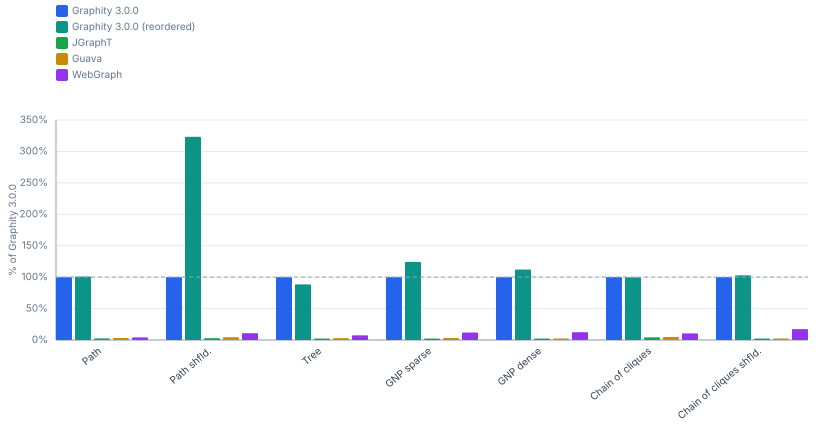

#### Times @ 1M nodes (ms/op, lower is better)

| Shape | Graphity 3.0.0 | Graphity 3.0.0<br>(reordered) |
|---|---:|---:|
| GNP sparse<br><sub>1M nodes, 3M edges</sub> | 18.98 ms | 15.20 ms (0.8×) |
| GNP dense<br><sub>1M nodes, 30M edges</sub> | 69.50 ms | 68.66 ms (1.0×) |
| Chain of cliques<br><sub>1M nodes, 31.1M edges</sub> | 57.66 ms | 60.40 ms (1.0×) |

#### Throughput @ 1M nodes (op/s, higher is better)

| Shape | Graphity 3.0.0 | Graphity 3.0.0<br>(reordered) |
|---|---:|---:|
| GNP sparse<br><sub>1M nodes, 3M edges</sub> | 52.68 op/s | 65.77 op/s (125%) |
| GNP dense<br><sub>1M nodes, 30M edges</sub> | 14.39 op/s | 14.57 op/s (101%) |
| Chain of cliques<br><sub>1M nodes, 31.1M edges</sub> | 17.34 op/s | 16.56 op/s (95.5%) |

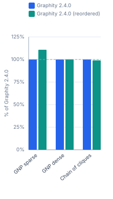

#### Times @ 10M nodes (ms/op, lower is better)

| Shape | Graphity 3.0.0 | Graphity 3.0.0<br>(reordered) |
|---|---:|---:|
| GNP sparse<br><sub>10M nodes, 30M edges</sub> | 597.3 ms | 373.0 ms (0.6×) |
| GNP dense<br><sub>10M nodes, 299.6M edges</sub> | 3772.8 ms | 3556.2 ms (0.9×) |
| Chain of cliques<br><sub>10M nodes, 310.8M edges</sub> | 608.6 ms | 537.1 ms (0.9×) |

#### Throughput @ 10M nodes (op/s, higher is better)

| Shape | Graphity 3.0.0 | Graphity 3.0.0<br>(reordered) |
|---|---:|---:|
| GNP sparse<br><sub>10M nodes, 30M edges</sub> | 1.674 op/s | 2.681 op/s (160%) |
| GNP dense<br><sub>10M nodes, 299.6M edges</sub> | 0.265 op/s | 0.281 op/s (106%) |
| Chain of cliques<br><sub>10M nodes, 310.8M edges</sub> | 1.643 op/s | 1.862 op/s (113%) |

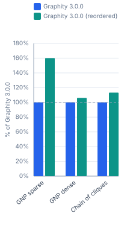

#### Times @ 100M nodes (ms/op, lower is better)

| Shape | Graphity 3.0.0 | Graphity 3.0.0<br>(reordered) |
|---|---:|---:|
| GNP sparse<br><sub>100M nodes, 300M edges</sub> | 8971.8 ms | 6199.9 ms (0.7×) |

#### Throughput @ 100M nodes (op/s, higher is better)

| Shape | Graphity 3.0.0 | Graphity 3.0.0<br>(reordered) |
|---|---:|---:|
| GNP sparse<br><sub>100M nodes, 300M edges</sub> | 0.111 op/s | 0.161 op/s (145%) |

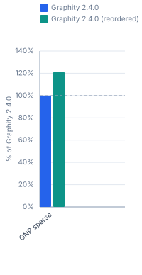

### 1.6 CCs

#### Times @ 10k nodes (ms/op, lower is better)

| Shape | Graphity 3.0.0 | Graphity 3.0.0<br>(reordered) |
|---|---:|---:|
| Path<br><sub>10k nodes, 10k edges</sub> | 0.037 ms | 0.037 ms (1.0×) |
| Path shfld.<br><sub>10k nodes, 10k edges</sub> | 0.039 ms | 0.037 ms (0.9×) |
| Tree<br><sub>10k nodes, 10k edges</sub> | 0.039 ms | 0.039 ms (1.0×) |
| GNP sparse<br><sub>10k nodes, 30k edges</sub> | 0.085 ms | 0.076 ms (0.9×) |
| GNP dense<br><sub>10k nodes, 299.6k edges</sub> | 0.474 ms | 0.470 ms (1.0×) |
| Chain of cliques<br><sub>10k nodes, 310.8k edges</sub> | 0.552 ms | 0.527 ms (1.0×) |
| Chain of cliques shfld.<br><sub>10k nodes, 310.8k edges</sub> | 0.655 ms | 0.484 ms (0.7×) |

#### Throughput @ 10k nodes (op/s, higher is better)

| Shape | Graphity 3.0.0 | Graphity 3.0.0<br>(reordered) |
|---|---:|---:|
| Path<br><sub>10k nodes, 10k edges</sub> | 27 027 op/s | 27 027 op/s (100%) |
| Path shfld.<br><sub>10k nodes, 10k edges</sub> | 25 641 op/s | 27 027 op/s (105%) |
| Tree<br><sub>10k nodes, 10k edges</sub> | 25 641 op/s | 25 641 op/s (100%) |
| GNP sparse<br><sub>10k nodes, 30k edges</sub> | 11 765 op/s | 13 158 op/s (112%) |
| GNP dense<br><sub>10k nodes, 299.6k edges</sub> | 2 110 op/s | 2 128 op/s (101%) |
| Chain of cliques<br><sub>10k nodes, 310.8k edges</sub> | 1 812 op/s | 1 898 op/s (105%) |
| Chain of cliques shfld.<br><sub>10k nodes, 310.8k edges</sub> | 1 527 op/s | 2 066 op/s (135%) |

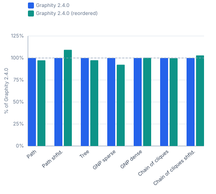

#### Times @ 100k nodes (ms/op, lower is better)

| Shape | Graphity 3.0.0 | Graphity 3.0.0<br>(reordered) |
|---|---:|---:|
| Path<br><sub>100k nodes, 100k edges</sub> | 0.363 ms | 0.358 ms (1.0×) |
| Path shfld.<br><sub>100k nodes, 100k edges</sub> | 1.145 ms | 0.361 ms (0.3×) |
| Tree<br><sub>100k nodes, 100k edges</sub> | 0.618 ms | 0.689 ms (1.1×) |
| GNP sparse<br><sub>100k nodes, 300k edges</sub> | 1.619 ms | 1.394 ms (0.9×) |
| GNP dense<br><sub>100k nodes, 3M edges</sub> | 5.413 ms | 5.329 ms (1.0×) |
| Chain of cliques<br><sub>100k nodes, 3.1M edges</sub> | 5.543 ms | 5.232 ms (0.9×) |
| Chain of cliques shfld.<br><sub>100k nodes, 3.1M edges</sub> | 4.511 ms | 5.639 ms (1.3×) |

#### Throughput @ 100k nodes (op/s, higher is better)

| Shape | Graphity 3.0.0 | Graphity 3.0.0<br>(reordered) |
|---|---:|---:|
| Path<br><sub>100k nodes, 100k edges</sub> | 2 755 op/s | 2 793 op/s (101%) |
| Path shfld.<br><sub>100k nodes, 100k edges</sub> | 873.4 op/s | 2 770 op/s (317%) |
| Tree<br><sub>100k nodes, 100k edges</sub> | 1 618 op/s | 1 451 op/s (89.7%) |
| GNP sparse<br><sub>100k nodes, 300k edges</sub> | 617.7 op/s | 717.4 op/s (116%) |
| GNP dense<br><sub>100k nodes, 3M edges</sub> | 184.7 op/s | 187.7 op/s (102%) |
| Chain of cliques<br><sub>100k nodes, 3.1M edges</sub> | 180.4 op/s | 191.1 op/s (106%) |
| Chain of cliques shfld.<br><sub>100k nodes, 3.1M edges</sub> | 221.7 op/s | 177.3 op/s (80.0%) |

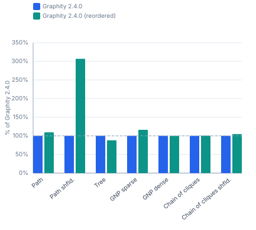

#### Times @ 1M nodes (ms/op, lower is better)

| Shape | Graphity 3.0.0 | Graphity 3.0.0<br>(reordered) |
|---|---:|---:|
| GNP sparse<br><sub>1M nodes, 3M edges</sub> | 19.00 ms | 17.35 ms (0.9×) |
| GNP dense<br><sub>1M nodes, 30M edges</sub> | 70.75 ms | 68.41 ms (1.0×) |
| Chain of cliques<br><sub>1M nodes, 31.1M edges</sub> | 62.93 ms | 58.79 ms (0.9×) |

#### Throughput @ 1M nodes (op/s, higher is better)

| Shape | Graphity 3.0.0 | Graphity 3.0.0<br>(reordered) |
|---|---:|---:|
| GNP sparse<br><sub>1M nodes, 3M edges</sub> | 52.63 op/s | 57.64 op/s (110%) |
| GNP dense<br><sub>1M nodes, 30M edges</sub> | 14.13 op/s | 14.62 op/s (103%) |
| Chain of cliques<br><sub>1M nodes, 31.1M edges</sub> | 15.89 op/s | 17.01 op/s (107%) |

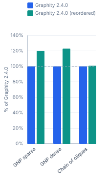

#### Times @ 10M nodes (ms/op, lower is better)

| Shape | Graphity 3.0.0 | Graphity 3.0.0<br>(reordered) |
|---|---:|---:|
| GNP sparse<br><sub>10M nodes, 30M edges</sub> | 589.2 ms | 364.0 ms (0.6×) |
| GNP dense<br><sub>10M nodes, 299.6M edges</sub> | 3750.7 ms | 3694.0 ms (1.0×) |
| Chain of cliques<br><sub>10M nodes, 310.8M edges</sub> | 540.0 ms | 540.6 ms (1.0×) |

#### Throughput @ 10M nodes (op/s, higher is better)

| Shape | Graphity 3.0.0 | Graphity 3.0.0<br>(reordered) |
|---|---:|---:|
| GNP sparse<br><sub>10M nodes, 30M edges</sub> | 1.697 op/s | 2.747 op/s (162%) |
| GNP dense<br><sub>10M nodes, 299.6M edges</sub> | 0.267 op/s | 0.271 op/s (102%) |
| Chain of cliques<br><sub>10M nodes, 310.8M edges</sub> | 1.852 op/s | 1.850 op/s (99.9%) |

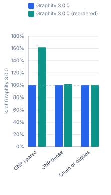

#### Times @ 100M nodes (ms/op, lower is better)

| Shape | Graphity 3.0.0 | Graphity 3.0.0<br>(reordered) |
|---|---:|---:|
| GNP sparse<br><sub>100M nodes, 300M edges</sub> | 10160 ms | 6277.9 ms (0.6×) |

#### Throughput @ 100M nodes (op/s, higher is better)

| Shape | Graphity 3.0.0 | Graphity 3.0.0<br>(reordered) |
|---|---:|---:|
| GNP sparse<br><sub>100M nodes, 300M edges</sub> | 0.098 op/s | 0.159 op/s (162%) |


### 1.7 Condense

#### Times @ 1k nodes (ms/op, lower is better)

| Shape | Graphity 3.0.0 |
|---|---:|
| Path<br><sub>1k nodes, 1k edges</sub> | 0.010 ms |
| GNP dense<br><sub>1k nodes, 30k edges</sub> | 0.007 ms |
| Chain of cliques<br><sub>1k nodes, 31.1k edges</sub> | 0.021 ms |
| DAG GNP sparse | 0.017 ms |

#### Throughput @ 1k nodes (op/s, higher is better)

| Shape | Graphity 3.0.0 |
|---|---:|
| Path<br><sub>1k nodes, 1k edges</sub> | 100 000 op/s |
| GNP dense<br><sub>1k nodes, 30k edges</sub> | 142 857 op/s |
| Chain of cliques<br><sub>1k nodes, 31.1k edges</sub> | 47 619 op/s |
| DAG GNP sparse | 58 824 op/s |

#### Times @ 10k nodes (ms/op, lower is better)

| Shape | Graphity 3.0.0 |
|---|---:|
| Path<br><sub>10k nodes, 10k edges</sub> | 0.080 ms |
| GNP dense<br><sub>10k nodes, 299.6k edges</sub> | 0.079 ms |
| Chain of cliques<br><sub>10k nodes, 310.8k edges</sub> | 0.199 ms |
| DAG GNP sparse | 0.251 ms |

#### Throughput @ 10k nodes (op/s, higher is better)

| Shape | Graphity 3.0.0 |
|---|---:|
| Path<br><sub>10k nodes, 10k edges</sub> | 12 500 op/s |
| GNP dense<br><sub>10k nodes, 299.6k edges</sub> | 12 658 op/s |
| Chain of cliques<br><sub>10k nodes, 310.8k edges</sub> | 5 025 op/s |
| DAG GNP sparse | 3 984 op/s |

#### Times @ 100k nodes (ms/op, lower is better)

| Shape | Graphity 3.0.0 |
|---|---:|
| Path<br><sub>100k nodes, 100k edges</sub> | 0.761 ms |
| GNP dense<br><sub>100k nodes, 3M edges</sub> | 1.555 ms |
| Chain of cliques<br><sub>100k nodes, 3.1M edges</sub> | 2.290 ms |
| DAG GNP sparse | 3.467 ms |

#### Throughput @ 100k nodes (op/s, higher is better)

| Shape | Graphity 3.0.0 |
|---|---:|
| Path<br><sub>100k nodes, 100k edges</sub> | 1 314 op/s |
| GNP dense<br><sub>100k nodes, 3M edges</sub> | 643.1 op/s |
| Chain of cliques<br><sub>100k nodes, 3.1M edges</sub> | 436.7 op/s |
| DAG GNP sparse | 288.4 op/s |

### 1.8 TopOrder

#### Times @ 10k nodes (ms/op, lower is better)

| Shape | Graphity 3.0.0 | Graphity 3.0.0<br>(reordered) | JGraphT | Guava | WebGraph |
|---|---:|---:|---:|---:|---:|
| Path<br><sub>10k nodes, 10k edges</sub> | 0.064 ms | 0.060 ms (0.9×) | 0.436 ms (6.8×) | 0.406 ms (6.3×) | 0.536 ms (8.4×) |
| Path shfld.<br><sub>10k nodes, 10k edges</sub> | 0.064 ms | 0.054 ms (0.8×) | 0.679 ms (11×) | 0.729 ms (11×) | 0.420 ms (6.6×) |
| Tree<br><sub>10k nodes, 10k edges</sub> | 0.055 ms | 0.050 ms (0.9×) | 0.698 ms (13×) | 0.669 ms (12×) | 0.600 ms (11×) |
| Tree shfld. | 0.053 ms | 0.047 ms (0.9×) | 0.714 ms (13×) | 0.674 ms (13×) | 0.504 ms (9.5×) |
| DAG GNP sparse | 0.075 ms | 0.067 ms (0.9×) | 1.152 ms (15×) | 1.316 ms (18×) | 0.829 ms (11×) |
| DAG GNP dense | 0.333 ms | 0.253 ms (0.8×) | 16.46 ms (49×) | 9.801 ms (29×) | 1.985 ms (6.0×) |
| DAG GNP dense shfld. | 0.377 ms | 0.249 ms (0.7×) | 17.71 ms (47×) | 10.05 ms (27×) | 2.258 ms (6.0×) |

#### Throughput @ 10k nodes (op/s, higher is better)

| Shape | Graphity 3.0.0 | Graphity 3.0.0<br>(reordered) | JGraphT | Guava | WebGraph |
|---|---:|---:|---:|---:|---:|
| Path<br><sub>10k nodes, 10k edges</sub> | 15 625 op/s | 16 667 op/s (107%) | 2 294 op/s (14.7%) | 2 463 op/s (15.8%) | 1 866 op/s (11.9%) |
| Path shfld.<br><sub>10k nodes, 10k edges</sub> | 15 625 op/s | 18 519 op/s (119%) | 1 473 op/s (9.4%) | 1 372 op/s (8.8%) | 2 381 op/s (15.2%) |
| Tree<br><sub>10k nodes, 10k edges</sub> | 18 182 op/s | 20 000 op/s (110%) | 1 433 op/s (7.9%) | 1 495 op/s (8.2%) | 1 667 op/s (9.2%) |
| Tree shfld. | 18 868 op/s | 21 277 op/s (113%) | 1 401 op/s (7.4%) | 1 484 op/s (7.9%) | 1 984 op/s (10.5%) |
| DAG GNP sparse | 13 333 op/s | 14 925 op/s (112%) | 868.1 op/s (6.5%) | 759.9 op/s (5.7%) | 1 206 op/s (9.0%) |
| DAG GNP dense | 3 003 op/s | 3 953 op/s (132%) | 60.74 op/s (2.0%) | 102.0 op/s (3.4%) | 503.8 op/s (16.8%) |
| DAG GNP dense shfld. | 2 653 op/s | 4 016 op/s (151%) | 56.48 op/s (2.1%) | 99.45 op/s (3.7%) | 442.9 op/s (16.7%) |

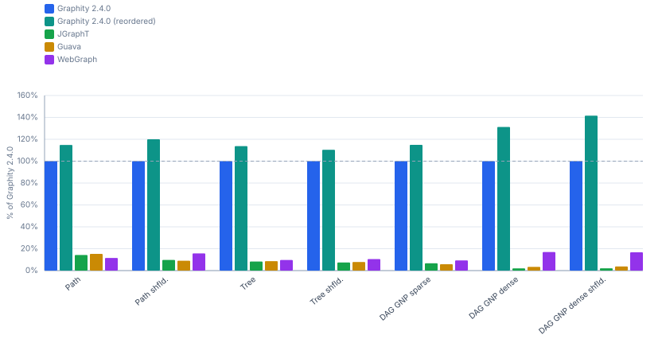

#### Times @ 100k nodes (ms/op, lower is better)

| Shape | Graphity 3.0.0 | Graphity 3.0.0<br>(reordered) | JGraphT | Guava | WebGraph |
|---|---:|---:|---:|---:|---:|
| Path<br><sub>100k nodes, 100k edges</sub> | 0.568 ms | 0.614 ms (1.1×) | 7.961 ms (14×) | 11.70 ms (21×) | 3.041 ms (5.4×) |
| Path shfld.<br><sub>100k nodes, 100k edges</sub> | 1.057 ms | 0.641 ms (0.6×) | 25.93 ms (25×) | 25.97 ms (25×) | 4.956 ms (4.7×) |
| Tree<br><sub>100k nodes, 100k edges</sub> | 1.116 ms | 0.882 ms (0.8×) | 26.52 ms (24×) | 19.22 ms (17×) | 14.43 ms (13×) |
| Tree shfld. | 1.280 ms | 1.097 ms (0.9×) | 26.51 ms (21×) | 18.65 ms (15×) | 9.834 ms (7.7×) |
| DAG GNP sparse | 2.135 ms | 1.384 ms (0.6×) | 54.43 ms (25×) | 44.66 ms (21×) | 17.21 ms (8.1×) |
| DAG GNP dense | 4.424 ms | 3.166 ms (0.7×) | 234.8 ms (53×) | 305.7 ms (69×) | 24.48 ms (5.5×) |
| DAG GNP dense shfld. | 5.096 ms | 3.237 ms (0.6×) | 243.6 ms (48×) | 300.5 ms (59×) | 31.28 ms (6.1×) |

#### Throughput @ 100k nodes (op/s, higher is better)

| Shape | Graphity 3.0.0 | Graphity 3.0.0<br>(reordered) | JGraphT | Guava | WebGraph |
|---|---:|---:|---:|---:|---:|
| Path<br><sub>100k nodes, 100k edges</sub> | 1 761 op/s | 1 629 op/s (92.5%) | 125.6 op/s (7.1%) | 85.51 op/s (4.9%) | 328.8 op/s (18.7%) |
| Path shfld.<br><sub>100k nodes, 100k edges</sub> | 946.1 op/s | 1 560 op/s (165%) | 38.56 op/s (4.1%) | 38.51 op/s (4.1%) | 201.8 op/s (21.3%) |
| Tree<br><sub>100k nodes, 100k edges</sub> | 896.1 op/s | 1 134 op/s (127%) | 37.71 op/s (4.2%) | 52.02 op/s (5.8%) | 69.32 op/s (7.7%) |
| Tree shfld. | 781.2 op/s | 911.6 op/s (117%) | 37.72 op/s (4.8%) | 53.62 op/s (6.9%) | 101.7 op/s (13.0%) |
| DAG GNP sparse | 468.4 op/s | 722.5 op/s (154%) | 18.37 op/s (3.9%) | 22.39 op/s (4.8%) | 58.11 op/s (12.4%) |
| DAG GNP dense | 226.0 op/s | 315.9 op/s (140%) | 4.259 op/s (1.9%) | 3.271 op/s (1.4%) | 40.84 op/s (18.1%) |
| DAG GNP dense shfld. | 196.2 op/s | 308.9 op/s (157%) | 4.105 op/s (2.1%) | 3.328 op/s (1.7%) | 31.97 op/s (16.3%) |

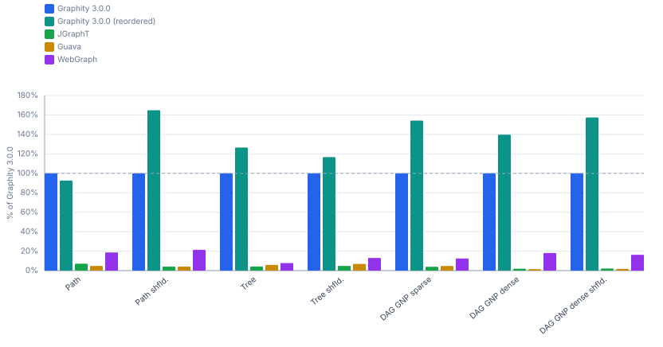

#### Times @ 1M nodes (ms/op, lower is better)

| Shape | Graphity 3.0.0 | Graphity 3.0.0<br>(reordered) |
|---|---:|---:|
| DAG GNP sparse | 29.61 ms | 14.00 ms (0.5×) |
| DAG GNP dense | 103.3 ms | 38.34 ms (0.4×) |
| DAG GNP dense shfld. | 173.6 ms | 38.09 ms (0.2×) |

#### Throughput @ 1M nodes (op/s, higher is better)

| Shape | Graphity 3.0.0 | Graphity 3.0.0<br>(reordered) |
|---|---:|---:|
| DAG GNP sparse | 33.78 op/s | 71.42 op/s (211%) |
| DAG GNP dense | 9.681 op/s | 26.09 op/s (269%) |
| DAG GNP dense shfld. | 5.760 op/s | 26.25 op/s (456%) |

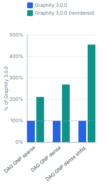

#### Times @ 10M nodes (ms/op, lower is better)

| Shape | Graphity 3.0.0 | Graphity 3.0.0<br>(reordered) |
|---|---:|---:|
| DAG GNP sparse | 1120.6 ms | 159.8 ms (0.1×) |
| DAG GNP dense | 1919.6 ms | 505.2 ms (0.3×) |
| DAG GNP dense shfld. | 2694.5 ms | 414.3 ms (0.2×) |

#### Throughput @ 10M nodes (op/s, higher is better)

| Shape | Graphity 3.0.0 | Graphity 3.0.0<br>(reordered) |
|---|---:|---:|
| DAG GNP sparse | 0.892 op/s | 6.258 op/s (701%) |
| DAG GNP dense | 0.521 op/s | 1.979 op/s (380%) |
| DAG GNP dense shfld. | 0.371 op/s | 2.414 op/s (650%) |

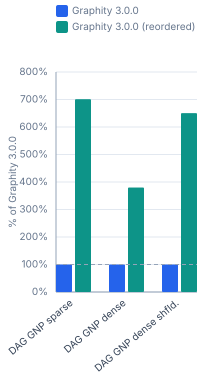

#### Times @ 100M nodes (ms/op, lower is better)

| Shape | Graphity 3.0.0 | Graphity 3.0.0<br>(reordered) |
|---|---:|---:|
| DAG GNP sparse | 16414 ms | 1730.7 ms (0.1×) |

#### Throughput @ 100M nodes (op/s, higher is better)

| Shape | Graphity 3.0.0 | Graphity 3.0.0<br>(reordered) |
|---|---:|---:|
| DAG GNP sparse | 0.061 op/s | 0.578 op/s (948%) |

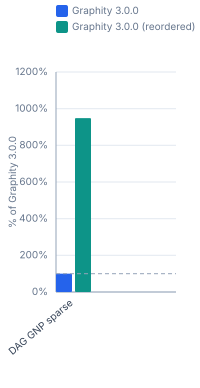

### 1.9 TopOrderAndLevels

#### Times @ 10k nodes (ms/op, lower is better)

| Shape | Graphity 3.0.0 | Graphity 3.0.0<br>(reordered) | Graphity 3.0.0<br>(bi-adjacent) | JGraphT | Guava | WebGraph |
|---|---:|---:|---:|---:|---:|---:|
| Path<br><sub>10k nodes, 10k edges</sub> | 0.039 ms | 0.039 ms (1.0×) | 0.039 ms (1.0×) | 0.262 ms (6.7×) | 0.230 ms (5.9×) | 0.388 ms (9.9×) |
| Path shfld.<br><sub>10k nodes, 10k edges</sub> | 0.056 ms | 0.040 ms (0.7×) | 0.054 ms (1.0×) | 0.374 ms (6.7×) | 0.365 ms (6.5×) | 0.626 ms (11×) |
| Tree<br><sub>10k nodes, 10k edges</sub> | 0.030 ms | 0.030 ms (1.0×) | 0.028 ms (0.9×) | 0.201 ms (6.7×) | 0.347 ms (12×) | 0.639 ms (21×) |
| Tree shfld. | 0.031 ms | 0.027 ms (0.9×) | 0.029 ms (0.9×) | 0.206 ms (6.6×) | 0.343 ms (11×) | 0.671 ms (22×) |
| DAG GNP sparse | 0.056 ms | 0.055 ms (1.0×) | 0.040 ms (0.7×) | 0.288 ms (5.1×) | 1.030 ms (18×) | 1.018 ms (18×) |
| DAG GNP dense | 0.386 ms | 0.340 ms (0.9×) | 0.216 ms (0.6×) | 4.308 ms (11×) | 7.351 ms (19×) | 3.629 ms (9.4×) |
| DAG GNP dense shfld. | 0.415 ms | 0.353 ms (0.9×) | 0.261 ms (0.6×) | 4.203 ms (10×) | 7.433 ms (18×) | 3.963 ms (9.5×) |

#### Throughput @ 10k nodes (op/s, higher is better)

| Shape | Graphity 3.0.0 | Graphity 3.0.0<br>(reordered) | Graphity 3.0.0<br>(bi-adjacent) | JGraphT | Guava | WebGraph |
|---|---:|---:|---:|---:|---:|---:|
| Path<br><sub>10k nodes, 10k edges</sub> | 25 641 op/s | 25 641 op/s (100%) | 25 641 op/s (100%) | 3 817 op/s (14.9%) | 4 348 op/s (17.0%) | 2 577 op/s (10.1%) |
| Path shfld.<br><sub>10k nodes, 10k edges</sub> | 17 857 op/s | 25 000 op/s (140%) | 18 519 op/s (104%) | 2 674 op/s (15.0%) | 2 740 op/s (15.3%) | 1 597 op/s (8.9%) |
| Tree<br><sub>10k nodes, 10k edges</sub> | 33 333 op/s | 33 333 op/s (100%) | 35 714 op/s (107%) | 4 975 op/s (14.9%) | 2 882 op/s (8.6%) | 1 565 op/s (4.7%) |
| Tree shfld. | 32 258 op/s | 37 037 op/s (115%) | 34 483 op/s (107%) | 4 854 op/s (15.0%) | 2 915 op/s (9.0%) | 1 490 op/s (4.6%) |
| DAG GNP sparse | 17 857 op/s | 18 182 op/s (102%) | 25 000 op/s (140%) | 3 472 op/s (19.4%) | 970.9 op/s (5.4%) | 982.3 op/s (5.5%) |
| DAG GNP dense | 2 591 op/s | 2 941 op/s (114%) | 4 630 op/s (179%) | 232.1 op/s (9.0%) | 136.0 op/s (5.3%) | 275.6 op/s (10.6%) |
| DAG GNP dense shfld. | 2 410 op/s | 2 833 op/s (118%) | 3 831 op/s (159%) | 237.9 op/s (9.9%) | 134.5 op/s (5.6%) | 252.3 op/s (10.5%) |

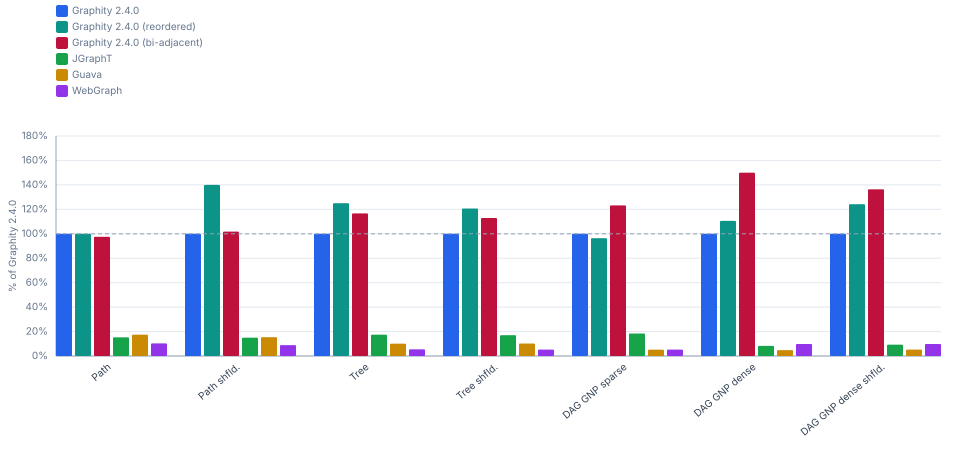

#### Times @ 100k nodes (ms/op, lower is better)

| Shape | Graphity 3.0.0 | Graphity 3.0.0<br>(reordered) | Graphity 3.0.0<br>(bi-adjacent) | JGraphT | Guava | WebGraph |
|---|---:|---:|---:|---:|---:|---:|
| Path<br><sub>100k nodes, 100k edges</sub> | 0.552 ms | 0.377 ms (0.7×) | 0.395 ms (0.7×) | 4.201 ms (7.6×) | 3.671 ms (6.7×) | 3.702 ms (6.7×) |
| Path shfld.<br><sub>100k nodes, 100k edges</sub> | 1.471 ms | 0.572 ms (0.4×) | 1.267 ms (0.9×) | 14.55 ms (9.9×) | 10.38 ms (7.1×) | 7.255 ms (4.9×) |
| Tree<br><sub>100k nodes, 100k edges</sub> | 0.945 ms | 0.839 ms (0.9×) | 0.827 ms (0.9×) | 7.912 ms (8.4×) | 8.530 ms (9.0×) | 7.634 ms (8.1×) |
| Tree shfld. | 0.959 ms | 0.891 ms (0.9×) | 0.873 ms (0.9×) | 7.294 ms (7.6×) | 8.774 ms (9.1×) | 7.867 ms (8.2×) |
| DAG GNP sparse | 2.160 ms | 1.940 ms (0.9×) | 1.880 ms (0.9×) | 18.56 ms (8.6×) | 29.87 ms (14×) | 13.99 ms (6.5×) |
| DAG GNP dense | 5.104 ms | 4.710 ms (0.9×) | 3.631 ms (0.7×) | 64.01 ms (13×) | 202.5 ms (40×) | 44.30 ms (8.7×) |
| DAG GNP dense shfld. | 5.786 ms | 4.550 ms (0.8×) | 4.287 ms (0.7×) | 72.93 ms (13×) | 213.5 ms (37×) | 56.25 ms (9.7×) |

#### Throughput @ 100k nodes (op/s, higher is better)

| Shape | Graphity 3.0.0 | Graphity 3.0.0<br>(reordered) | Graphity 3.0.0<br>(bi-adjacent) | JGraphT | Guava | WebGraph |
|---|---:|---:|---:|---:|---:|---:|
| Path<br><sub>100k nodes, 100k edges</sub> | 1 812 op/s | 2 653 op/s (146%) | 2 532 op/s (140%) | 238.0 op/s (13.1%) | 272.4 op/s (15.0%) | 270.1 op/s (14.9%) |
| Path shfld.<br><sub>100k nodes, 100k edges</sub> | 679.8 op/s | 1 748 op/s (257%) | 789.3 op/s (116%) | 68.72 op/s (10.1%) | 96.32 op/s (14.2%) | 137.8 op/s (20.3%) |
| Tree<br><sub>100k nodes, 100k edges</sub> | 1 058 op/s | 1 192 op/s (113%) | 1 209 op/s (114%) | 126.4 op/s (11.9%) | 117.2 op/s (11.1%) | 131.0 op/s (12.4%) |
| Tree shfld. | 1 043 op/s | 1 122 op/s (108%) | 1 145 op/s (110%) | 137.1 op/s (13.1%) | 114.0 op/s (10.9%) | 127.1 op/s (12.2%) |
| DAG GNP sparse | 463.0 op/s | 515.5 op/s (111%) | 531.9 op/s (115%) | 53.87 op/s (11.6%) | 33.48 op/s (7.2%) | 71.49 op/s (15.4%) |
| DAG GNP dense | 195.9 op/s | 212.3 op/s (108%) | 275.4 op/s (141%) | 15.62 op/s (8.0%) | 4.938 op/s (2.5%) | 22.57 op/s (11.5%) |
| DAG GNP dense shfld. | 172.8 op/s | 219.8 op/s (127%) | 233.3 op/s (135%) | 13.71 op/s (7.9%) | 4.684 op/s (2.7%) | 17.78 op/s (10.3%) |

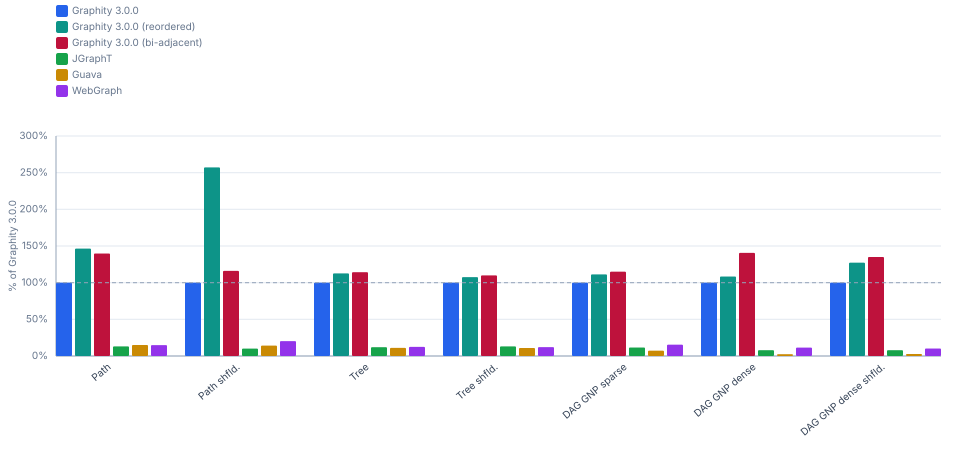

#### Times @ 1M nodes (ms/op, lower is better)

| Shape | Graphity 3.0.0 | Graphity 3.0.0<br>(reordered) |
|---|---:|---:|
| DAG GNP sparse | 29.53 ms | 25.93 ms (0.9×) |
| DAG GNP dense | 111.6 ms | 89.49 ms (0.8×) |
| DAG GNP dense shfld. | 194.0 ms | 91.16 ms (0.5×) |

#### Throughput @ 1M nodes (op/s, higher is better)

| Shape | Graphity 3.0.0 | Graphity 3.0.0<br>(reordered) |
|---|---:|---:|
| DAG GNP sparse | 33.86 op/s | 38.57 op/s (114%) |
| DAG GNP dense | 8.961 op/s | 11.17 op/s (125%) |
| DAG GNP dense shfld. | 5.155 op/s | 10.97 op/s (213%) |

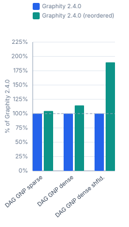

#### Times @ 10M nodes (ms/op, lower is better)

| Shape | Graphity 3.0.0 | Graphity 3.0.0<br>(reordered) |
|---|---:|---:|
| DAG GNP sparse | 895.3 ms | 773.8 ms (0.9×) |
| DAG GNP dense | 2966.2 ms | 2703.4 ms (0.9×) |
| DAG GNP dense shfld. | 4616.3 ms | 2724.6 ms (0.6×) |

#### Throughput @ 10M nodes (op/s, higher is better)

| Shape | Graphity 3.0.0 | Graphity 3.0.0<br>(reordered) |
|---|---:|---:|
| DAG GNP sparse | 1.117 op/s | 1.292 op/s (116%) |
| DAG GNP dense | 0.337 op/s | 0.370 op/s (110%) |
| DAG GNP dense shfld. | 0.217 op/s | 0.367 op/s (169%) |

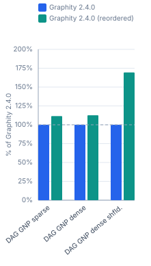

#### Times @ 100M nodes (ms/op, lower is better)

| Shape | Graphity 3.0.0 | Graphity 3.0.0<br>(reordered) |
|---|---:|---:|
| DAG GNP sparse | 12069 ms | 10542 ms (0.9×) |

#### Throughput @ 100M nodes (op/s, higher is better)

| Shape | Graphity 3.0.0 | Graphity 3.0.0<br>(reordered) |
|---|---:|---:|
| DAG GNP sparse | 0.083 op/s | 0.095 op/s (114%) |

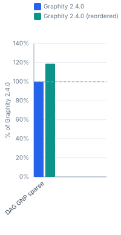

### 1.10 BackEdges

#### Times @ 10k nodes (ms/op, lower is better)

| Shape | Graphity 3.0.0 | Graphity 3.0.0<br>(reordered) | JGraphT | Guava | WebGraph |
|---|---:|---:|---:|---:|---:|
| Path<br><sub>10k nodes, 10k edges</sub> | 0.057 ms | 0.048 ms (0.8×) | 0.157 ms (2.8×) | 0.212 ms (3.7×) | 0.538 ms (9.4×) |
| Path shfld.<br><sub>10k nodes, 10k edges</sub> | 0.067 ms | 0.054 ms (0.8×) | 0.357 ms (5.3×) | 0.368 ms (5.5×) | 0.423 ms (6.3×) |
| Tree<br><sub>10k nodes, 10k edges</sub> | 0.046 ms | 0.042 ms (0.9×) | 0.439 ms (9.5×) | 0.669 ms (15×) | 0.585 ms (13×) |
| GNP sparse<br><sub>10k nodes, 30k edges</sub> | 0.190 ms | 0.103 ms (0.5×) | 0.641 ms (3.4×) | 1.139 ms (6.0×) | 0.775 ms (4.1×) |
| GNP dense<br><sub>10k nodes, 299.6k edges</sub> | 1.008 ms | 0.875 ms (0.9×) | 4.477 ms (4.4×) | 12.04 ms (12×) | 2.629 ms (2.6×) |
| Chain of cliques<br><sub>10k nodes, 310.8k edges</sub> | 0.816 ms | 0.816 ms (1.0×) | 3.378 ms (4.1×) | 2.229 ms (2.7×) | 3.964 ms (4.9×) |
| Chain of cliques shfld.<br><sub>10k nodes, 310.8k edges</sub> | 0.869 ms | 0.801 ms (0.9×) | 4.182 ms (4.8×) | 3.747 ms (4.3×) | 2.436 ms (2.8×) |

#### Throughput @ 10k nodes (op/s, higher is better)

| Shape | Graphity 3.0.0 | Graphity 3.0.0<br>(reordered) | JGraphT | Guava | WebGraph |
|---|---:|---:|---:|---:|---:|
| Path<br><sub>10k nodes, 10k edges</sub> | 17 544 op/s | 20 833 op/s (119%) | 6 369 op/s (36.3%) | 4 717 op/s (26.9%) | 1 859 op/s (10.6%) |
| Path shfld.<br><sub>10k nodes, 10k edges</sub> | 14 925 op/s | 18 519 op/s (124%) | 2 801 op/s (18.8%) | 2 717 op/s (18.2%) | 2 364 op/s (15.8%) |
| Tree<br><sub>10k nodes, 10k edges</sub> | 21 739 op/s | 23 810 op/s (110%) | 2 278 op/s (10.5%) | 1 495 op/s (6.9%) | 1 709 op/s (7.9%) |
| GNP sparse<br><sub>10k nodes, 30k edges</sub> | 5 263 op/s | 9 709 op/s (184%) | 1 560 op/s (29.6%) | 878.0 op/s (16.7%) | 1 290 op/s (24.5%) |
| GNP dense<br><sub>10k nodes, 299.6k edges</sub> | 992.1 op/s | 1 143 op/s (115%) | 223.4 op/s (22.5%) | 83.09 op/s (8.4%) | 380.4 op/s (38.3%) |
| Chain of cliques<br><sub>10k nodes, 310.8k edges</sub> | 1 225 op/s | 1 225 op/s (100%) | 296.0 op/s (24.2%) | 448.6 op/s (36.6%) | 252.3 op/s (20.6%) |
| Chain of cliques shfld.<br><sub>10k nodes, 310.8k edges</sub> | 1 151 op/s | 1 248 op/s (108%) | 239.1 op/s (20.8%) | 266.9 op/s (23.2%) | 410.5 op/s (35.7%) |

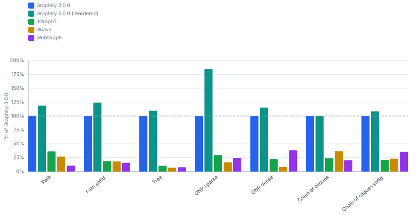

#### Times @ 100k nodes (ms/op, lower is better)

| Shape | Graphity 3.0.0 | Graphity 3.0.0<br>(reordered) | JGraphT | Guava | WebGraph |
|---|---:|---:|---:|---:|---:|
| Path<br><sub>100k nodes, 100k edges</sub> | 0.569 ms | 0.569 ms (1.0×) | 6.257 ms (11×) | 5.693 ms (10×) | 3.301 ms (5.8×) |
| Path shfld.<br><sub>100k nodes, 100k edges</sub> | 1.130 ms | 0.553 ms (0.5×) | 23.32 ms (21×) | 15.49 ms (14×) | 5.017 ms (4.4×) |
| Tree<br><sub>100k nodes, 100k edges</sub> | 1.175 ms | 0.963 ms (0.8×) | 26.66 ms (23×) | 20.59 ms (18×) | 14.48 ms (12×) |
| GNP sparse<br><sub>100k nodes, 300k edges</sub> | 3.283 ms | 2.030 ms (0.6×) | 44.84 ms (14×) | 43.34 ms (13×) | 10.88 ms (3.3×) |
| GNP dense<br><sub>100k nodes, 3M edges</sub> | 18.27 ms | 9.700 ms (0.5×) | 135.9 ms (7.4×) | 204.1 ms (11×) | 43.18 ms (2.4×) |
| Chain of cliques<br><sub>100k nodes, 3.1M edges</sub> | 8.973 ms | 8.970 ms (1.0×) | 77.86 ms (8.7×) | 62.76 ms (7.0×) | 46.98 ms (5.2×) |
| Chain of cliques shfld.<br><sub>100k nodes, 3.1M edges</sub> | 17.43 ms | 9.152 ms (0.5×) | 138.9 ms (8.0×) | 110.1 ms (6.3×) | 42.60 ms (2.4×) |

#### Throughput @ 100k nodes (op/s, higher is better)

| Shape | Graphity 3.0.0 | Graphity 3.0.0<br>(reordered) | JGraphT | Guava | WebGraph |
|---|---:|---:|---:|---:|---:|
| Path<br><sub>100k nodes, 100k edges</sub> | 1 757 op/s | 1 757 op/s (100%) | 159.8 op/s (9.1%) | 175.7 op/s (10.0%) | 302.9 op/s (17.2%) |
| Path shfld.<br><sub>100k nodes, 100k edges</sub> | 885.0 op/s | 1 808 op/s (204%) | 42.88 op/s (4.8%) | 64.57 op/s (7.3%) | 199.3 op/s (22.5%) |
| Tree<br><sub>100k nodes, 100k edges</sub> | 851.1 op/s | 1 038 op/s (122%) | 37.51 op/s (4.4%) | 48.57 op/s (5.7%) | 69.05 op/s (8.1%) |
| GNP sparse<br><sub>100k nodes, 300k edges</sub> | 304.6 op/s | 492.6 op/s (162%) | 22.30 op/s (7.3%) | 23.07 op/s (7.6%) | 91.88 op/s (30.2%) |
| GNP dense<br><sub>100k nodes, 3M edges</sub> | 54.75 op/s | 103.1 op/s (188%) | 7.358 op/s (13.4%) | 4.900 op/s (8.9%) | 23.16 op/s (42.3%) |
| Chain of cliques<br><sub>100k nodes, 3.1M edges</sub> | 111.4 op/s | 111.5 op/s (100%) | 12.84 op/s (11.5%) | 15.93 op/s (14.3%) | 21.29 op/s (19.1%) |
| Chain of cliques shfld.<br><sub>100k nodes, 3.1M edges</sub> | 57.36 op/s | 109.3 op/s (191%) | 7.199 op/s (12.6%) | 9.083 op/s (15.8%) | 23.47 op/s (40.9%) |

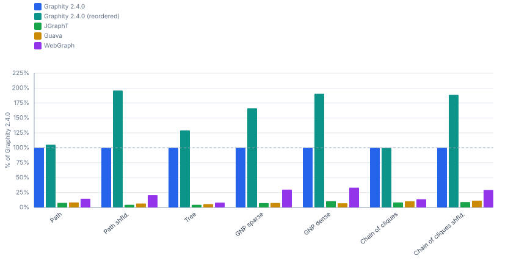

#### Times @ 1M nodes (ms/op, lower is better)

| Shape | Graphity 3.0.0 | Graphity 3.0.0<br>(reordered) |
|---|---:|---:|
| GNP sparse<br><sub>1M nodes, 3M edges</sub> | 52.34 ms | 21.42 ms (0.4×) |
| GNP dense<br><sub>1M nodes, 30M edges</sub> | 296.3 ms | 124.9 ms (0.4×) |
| Chain of cliques<br><sub>1M nodes, 31.1M edges</sub> | 111.4 ms | 111.4 ms (1.0×) |

#### Throughput @ 1M nodes (op/s, higher is better)

| Shape | Graphity 3.0.0 | Graphity 3.0.0<br>(reordered) |
|---|---:|---:|
| GNP sparse<br><sub>1M nodes, 3M edges</sub> | 19.11 op/s | 46.68 op/s (244%) |
| GNP dense<br><sub>1M nodes, 30M edges</sub> | 3.375 op/s | 8.006 op/s (237%) |
| Chain of cliques<br><sub>1M nodes, 31.1M edges</sub> | 8.977 op/s | 8.977 op/s (100%) |

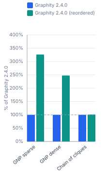

#### Times @ 10M nodes (ms/op, lower is better)

| Shape | Graphity 3.0.0 | Graphity 3.0.0<br>(reordered) |
|---|---:|---:|
| GNP sparse<br><sub>10M nodes, 30M edges</sub> | 2045.0 ms | 271.1 ms (0.1×) |
| GNP dense<br><sub>10M nodes, 299.6M edges</sub> | 4003.5 ms | 1245.4 ms (0.3×) |
| Chain of cliques<br><sub>10M nodes, 310.8M edges</sub> | 1018.0 ms | 1023.3 ms (1.0×) |

#### Throughput @ 10M nodes (op/s, higher is better)

| Shape | Graphity 3.0.0 | Graphity 3.0.0<br>(reordered) |
|---|---:|---:|
| GNP sparse<br><sub>10M nodes, 30M edges</sub> | 0.489 op/s | 3.689 op/s (754%) |
| GNP dense<br><sub>10M nodes, 299.6M edges</sub> | 0.250 op/s | 0.803 op/s (321%) |
| Chain of cliques<br><sub>10M nodes, 310.8M edges</sub> | 0.982 op/s | 0.977 op/s (99.5%) |

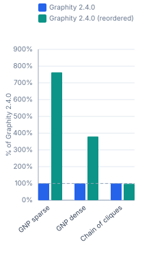

#### Times @ 100M nodes (ms/op, lower is better)

| Shape | Graphity 3.0.0 | Graphity 3.0.0<br>(reordered) |
|---|---:|---:|
| GNP sparse<br><sub>100M nodes, 300M edges</sub> | 28587 ms | 2938.6 ms (0.1×) |

#### Throughput @ 100M nodes (op/s, higher is better)

| Shape | Graphity 3.0.0 | Graphity 3.0.0<br>(reordered) |
|---|---:|---:|
| GNP sparse<br><sub>100M nodes, 300M edges</sub> | 0.035 op/s | 0.340 op/s (973%) |

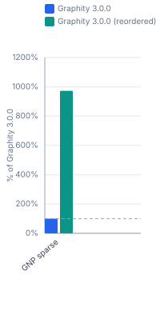

### 1.11 EdgeTypes

#### Times @ 10k nodes (ms/op, lower is better)

| Shape | Graphity 3.0.0 | Graphity 3.0.0<br>(reordered) | JGraphT | Guava | WebGraph |
|---|---:|---:|---:|---:|---:|
| Path<br><sub>10k nodes, 10k edges</sub> | 0.072 ms | 0.072 ms (1.0×) | 0.187 ms (2.6×) | 0.243 ms (3.4×) | 0.610 ms (8.5×) |
| Path shfld.<br><sub>10k nodes, 10k edges</sub> | 0.082 ms | 0.067 ms (0.8×) | 0.382 ms (4.7×) | 0.410 ms (5.0×) | 0.505 ms (6.2×) |
| Tree<br><sub>10k nodes, 10k edges</sub> | 0.049 ms | 0.039 ms (0.8×) | 0.501 ms (10×) | 0.681 ms (14×) | 0.653 ms (13×) |
| GNP sparse<br><sub>10k nodes, 30k edges</sub> | 0.183 ms | 0.072 ms (0.4×) | 0.656 ms (3.6×) | 1.388 ms (7.6×) | 0.917 ms (5.0×) |
| GNP dense<br><sub>10k nodes, 299.6k edges</sub> | 0.507 ms | 0.364 ms (0.7×) | 8.162 ms (16×) | 13.61 ms (27×) | 3.287 ms (6.5×) |
| Chain of cliques<br><sub>10k nodes, 310.8k edges</sub> | 0.254 ms | 0.254 ms (1.0×) | 5.143 ms (20×) | 3.720 ms (15×) | 4.633 ms (18×) |
| Chain of cliques shfld.<br><sub>10k nodes, 310.8k edges</sub> | 0.388 ms | 0.301 ms (0.8×) | 6.289 ms (16×) | 5.361 ms (14×) | 3.152 ms (8.1×) |

#### Throughput @ 10k nodes (op/s, higher is better)

| Shape | Graphity 3.0.0 | Graphity 3.0.0<br>(reordered) | JGraphT | Guava | WebGraph |
|---|---:|---:|---:|---:|---:|
| Path<br><sub>10k nodes, 10k edges</sub> | 13 889 op/s | 13 889 op/s (100%) | 5 348 op/s (38.5%) | 4 115 op/s (29.6%) | 1 639 op/s (11.8%) |
| Path shfld.<br><sub>10k nodes, 10k edges</sub> | 12 195 op/s | 14 925 op/s (122%) | 2 618 op/s (21.5%) | 2 439 op/s (20.0%) | 1 980 op/s (16.2%) |
| Tree<br><sub>10k nodes, 10k edges</sub> | 20 408 op/s | 25 641 op/s (126%) | 1 996 op/s (9.8%) | 1 468 op/s (7.2%) | 1 531 op/s (7.5%) |
| GNP sparse<br><sub>10k nodes, 30k edges</sub> | 5 464 op/s | 13 889 op/s (254%) | 1 524 op/s (27.9%) | 720.5 op/s (13.2%) | 1 091 op/s (20.0%) |
| GNP dense<br><sub>10k nodes, 299.6k edges</sub> | 1 972 op/s | 2 747 op/s (139%) | 122.5 op/s (6.2%) | 73.50 op/s (3.7%) | 304.2 op/s (15.4%) |
| Chain of cliques<br><sub>10k nodes, 310.8k edges</sub> | 3 937 op/s | 3 937 op/s (100%) | 194.4 op/s (4.9%) | 268.8 op/s (6.8%) | 215.8 op/s (5.5%) |
| Chain of cliques shfld.<br><sub>10k nodes, 310.8k edges</sub> | 2 577 op/s | 3 322 op/s (129%) | 159.0 op/s (6.2%) | 186.5 op/s (7.2%) | 317.3 op/s (12.3%) |

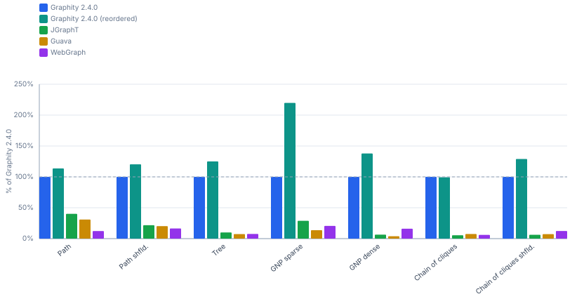

#### Times @ 100k nodes (ms/op, lower is better)

| Shape | Graphity 3.0.0 | Graphity 3.0.0<br>(reordered) | JGraphT | Guava | WebGraph |
|---|---:|---:|---:|---:|---:|
| Path<br><sub>100k nodes, 100k edges</sub> | 0.686 ms | 0.691 ms (1.0×) | 9.131 ms (13×) | 8.504 ms (12×) | 4.627 ms (6.7×) |
| Path shfld.<br><sub>100k nodes, 100k edges</sub> | 1.387 ms | 0.611 ms (0.4×) | 20.39 ms (15×) | 17.50 ms (13×) | 6.072 ms (4.4×) |
| Tree<br><sub>100k nodes, 100k edges</sub> | 1.328 ms | 0.860 ms (0.6×) | 32.24 ms (24×) | 21.79 ms (16×) | 17.55 ms (13×) |
| GNP sparse<br><sub>100k nodes, 300k edges</sub> | 3.440 ms | 1.870 ms (0.5×) | 46.91 ms (14×) | 48.17 ms (14×) | 13.27 ms (3.9×) |
| GNP dense<br><sub>100k nodes, 3M edges</sub> | 6.783 ms | 4.121 ms (0.6×) | 158.3 ms (23×) | 218.7 ms (32×) | 54.56 ms (8.0×) |
| Chain of cliques<br><sub>100k nodes, 3.1M edges</sub> | 2.580 ms | 2.552 ms (1.0×) | 88.85 ms (34×) | 74.75 ms (29×) | 58.03 ms (22×) |
| Chain of cliques shfld.<br><sub>100k nodes, 3.1M edges</sub> | 5.182 ms | 2.872 ms (0.6×) | 164.0 ms (32×) | 127.1 ms (25×) | 54.12 ms (10×) |

#### Throughput @ 100k nodes (op/s, higher is better)

| Shape | Graphity 3.0.0 | Graphity 3.0.0<br>(reordered) | JGraphT | Guava | WebGraph |
|---|---:|---:|---:|---:|---:|
| Path<br><sub>100k nodes, 100k edges</sub> | 1 458 op/s | 1 447 op/s (99.3%) | 109.5 op/s (7.5%) | 117.6 op/s (8.1%) | 216.1 op/s (14.8%) |
| Path shfld.<br><sub>100k nodes, 100k edges</sub> | 721.0 op/s | 1 637 op/s (227%) | 49.04 op/s (6.8%) | 57.15 op/s (7.9%) | 164.7 op/s (22.8%) |
| Tree<br><sub>100k nodes, 100k edges</sub> | 753.0 op/s | 1 163 op/s (154%) | 31.01 op/s (4.1%) | 45.89 op/s (6.1%) | 56.97 op/s (7.6%) |
| GNP sparse<br><sub>100k nodes, 300k edges</sub> | 290.7 op/s | 534.8 op/s (184%) | 21.32 op/s (7.3%) | 20.76 op/s (7.1%) | 75.35 op/s (25.9%) |
| GNP dense<br><sub>100k nodes, 3M edges</sub> | 147.4 op/s | 242.7 op/s (165%) | 6.317 op/s (4.3%) | 4.572 op/s (3.1%) | 18.33 op/s (12.4%) |
| Chain of cliques<br><sub>100k nodes, 3.1M edges</sub> | 387.6 op/s | 391.8 op/s (101%) | 11.26 op/s (2.9%) | 13.38 op/s (3.5%) | 17.23 op/s (4.4%) |
| Chain of cliques shfld.<br><sub>100k nodes, 3.1M edges</sub> | 193.0 op/s | 348.2 op/s (180%) | 6.098 op/s (3.2%) | 7.868 op/s (4.1%) | 18.48 op/s (9.6%) |

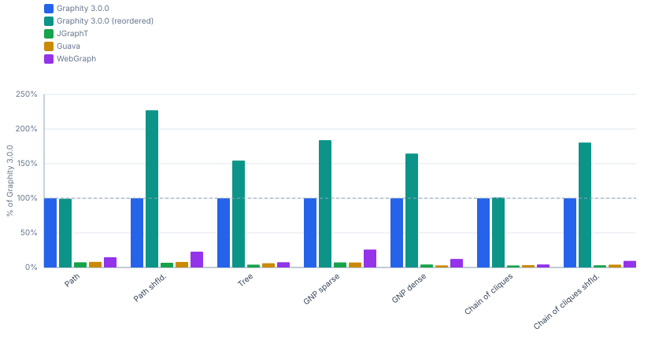

#### Times @ 1M nodes (ms/op, lower is better)

| Shape | Graphity 3.0.0 | Graphity 3.0.0<br>(reordered) |
|---|---:|---:|
| GNP sparse<br><sub>1M nodes, 3M edges</sub> | 52.66 ms | 20.77 ms (0.4×) |
| GNP dense<br><sub>1M nodes, 30M edges</sub> | 239.6 ms | 59.50 ms (0.2×) |
| Chain of cliques<br><sub>1M nodes, 31.1M edges</sub> | 25.87 ms | 25.90 ms (1.0×) |

#### Throughput @ 1M nodes (op/s, higher is better)

| Shape | Graphity 3.0.0 | Graphity 3.0.0<br>(reordered) |
|---|---:|---:|
| GNP sparse<br><sub>1M nodes, 3M edges</sub> | 18.99 op/s | 48.14 op/s (254%) |
| GNP dense<br><sub>1M nodes, 30M edges</sub> | 4.174 op/s | 16.81 op/s (403%) |
| Chain of cliques<br><sub>1M nodes, 31.1M edges</sub> | 38.66 op/s | 38.61 op/s (99.9%) |

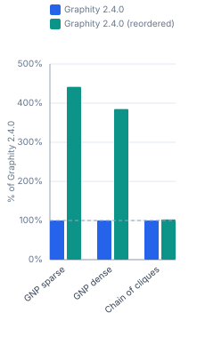

#### Times @ 10M nodes (ms/op, lower is better)

| Shape | Graphity 3.0.0 | Graphity 3.0.0<br>(reordered) |
|---|---:|---:|
| GNP sparse<br><sub>10M nodes, 30M edges</sub> | 2499.3 ms | 409.2 ms (0.2×) |
| GNP dense<br><sub>10M nodes, 299.6M edges</sub> | 4470.3 ms | 1244.1 ms (0.3×) |
| Chain of cliques<br><sub>10M nodes, 310.8M edges</sub> | 271.6 ms | 273.3 ms (1.0×) |

#### Throughput @ 10M nodes (op/s, higher is better)

| Shape | Graphity 3.0.0 | Graphity 3.0.0<br>(reordered) |
|---|---:|---:|
| GNP sparse<br><sub>10M nodes, 30M edges</sub> | 0.400 op/s | 2.444 op/s (611%) |
| GNP dense<br><sub>10M nodes, 299.6M edges</sub> | 0.224 op/s | 0.804 op/s (359%) |
| Chain of cliques<br><sub>10M nodes, 310.8M edges</sub> | 3.682 op/s | 3.659 op/s (99.4%) |

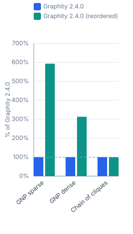

#### Times @ 100M nodes (ms/op, lower is better)

| Shape | Graphity 3.0.0 | Graphity 3.0.0<br>(reordered) |
|---|---:|---:|
| GNP sparse<br><sub>100M nodes, 300M edges</sub> | 31445 ms | 6870.6 ms (0.2×) |

#### Throughput @ 100M nodes (op/s, higher is better)

| Shape | Graphity 3.0.0 | Graphity 3.0.0<br>(reordered) |
|---|---:|---:|
| GNP sparse<br><sub>100M nodes, 300M edges</sub> | 0.032 op/s | 0.146 op/s (458%) |

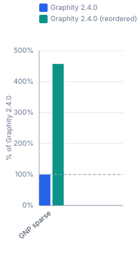

### 1.12 Reorder (DFS-preorder) cost

#### Times @ 10k nodes (ms/op, lower is better)

| Shape | Graphity 3.0.0 |
|---|---:|
| Path<br><sub>10k nodes, 10k edges</sub> | 0.109 ms |
| Path shfld.<br><sub>10k nodes, 10k edges</sub> | 0.135 ms |
| Tree<br><sub>10k nodes, 10k edges</sub> | 0.095 ms |
| GNP sparse<br><sub>10k nodes, 30k edges</sub> | 0.368 ms |
| GNP dense<br><sub>10k nodes, 299.6k edges</sub> | 0.803 ms |
| Chain of cliques<br><sub>10k nodes, 310.8k edges</sub> | 0.521 ms |
| Chain of cliques shfld.<br><sub>10k nodes, 310.8k edges</sub> | 0.619 ms |

#### Throughput @ 10k nodes (op/s, higher is better)

| Shape | Graphity 3.0.0 |
|---|---:|
| Path<br><sub>10k nodes, 10k edges</sub> | 9 174 op/s |
| Path shfld.<br><sub>10k nodes, 10k edges</sub> | 7 407 op/s |
| Tree<br><sub>10k nodes, 10k edges</sub> | 10 526 op/s |
| GNP sparse<br><sub>10k nodes, 30k edges</sub> | 2 717 op/s |
| GNP dense<br><sub>10k nodes, 299.6k edges</sub> | 1 245 op/s |
| Chain of cliques<br><sub>10k nodes, 310.8k edges</sub> | 1 919 op/s |
| Chain of cliques shfld.<br><sub>10k nodes, 310.8k edges</sub> | 1 616 op/s |

#### Times @ 100k nodes (ms/op, lower is better)

| Shape | Graphity 3.0.0 |
|---|---:|
| Path<br><sub>100k nodes, 100k edges</sub> | 1.108 ms |
| Path shfld.<br><sub>100k nodes, 100k edges</sub> | 1.768 ms |
| Tree<br><sub>100k nodes, 100k edges</sub> | 2.366 ms |
| GNP sparse<br><sub>100k nodes, 300k edges</sub> | 5.415 ms |
| GNP dense<br><sub>100k nodes, 3M edges</sub> | 10.60 ms |
| Chain of cliques<br><sub>100k nodes, 3.1M edges</sub> | 5.544 ms |
| Chain of cliques shfld.<br><sub>100k nodes, 3.1M edges</sub> | 8.652 ms |

#### Throughput @ 100k nodes (op/s, higher is better)

| Shape | Graphity 3.0.0 |
|---|---:|
| Path<br><sub>100k nodes, 100k edges</sub> | 902.5 op/s |
| Path shfld.<br><sub>100k nodes, 100k edges</sub> | 565.6 op/s |
| Tree<br><sub>100k nodes, 100k edges</sub> | 422.7 op/s |
| GNP sparse<br><sub>100k nodes, 300k edges</sub> | 184.7 op/s |
| GNP dense<br><sub>100k nodes, 3M edges</sub> | 94.36 op/s |
| Chain of cliques<br><sub>100k nodes, 3.1M edges</sub> | 180.4 op/s |
| Chain of cliques shfld.<br><sub>100k nodes, 3.1M edges</sub> | 115.6 op/s |

#### Times @ 1M nodes (ms/op, lower is better)

| Shape | Graphity 3.0.0 |
|---|---:|
| GNP sparse<br><sub>1M nodes, 3M edges</sub> | 74.73 ms |
| GNP dense<br><sub>1M nodes, 30M edges</sub> | 312.5 ms |
| Chain of cliques<br><sub>1M nodes, 31.1M edges</sub> | 54.81 ms |

#### Throughput @ 1M nodes (op/s, higher is better)

| Shape | Graphity 3.0.0 |
|---|---:|
| GNP sparse<br><sub>1M nodes, 3M edges</sub> | 13.38 op/s |
| GNP dense<br><sub>1M nodes, 30M edges</sub> | 3.200 op/s |
| Chain of cliques<br><sub>1M nodes, 31.1M edges</sub> | 18.25 op/s |

#### Times @ 10M nodes (ms/op, lower is better)

| Shape | Graphity 3.0.0 |
|---|---:|
| GNP sparse<br><sub>10M nodes, 30M edges</sub> | 3260.0 ms |
| GNP dense<br><sub>10M nodes, 299.6M edges</sub> | 7334.3 ms |
| Chain of cliques<br><sub>10M nodes, 310.8M edges</sub> | 566.8 ms |

#### Throughput @ 10M nodes (op/s, higher is better)

| Shape | Graphity 3.0.0 |
|---|---:|
| GNP sparse<br><sub>10M nodes, 30M edges</sub> | 0.307 op/s |
| GNP dense<br><sub>10M nodes, 299.6M edges</sub> | 0.136 op/s |
| Chain of cliques<br><sub>10M nodes, 310.8M edges</sub> | 1.764 op/s |

#### Times @ 100M nodes (ms/op, lower is better)

| Shape | Graphity 3.0.0 |
|---|---:|
| GNP sparse<br><sub>100M nodes, 300M edges</sub> | 41292 ms |

#### Throughput @ 100M nodes (op/s, higher is better)

| Shape | Graphity 3.0.0 |
|---|---:|
| GNP sparse<br><sub>100M nodes, 300M edges</sub> | 0.024 op/s |

### 1.13 BiAdjacency (in-adjacency) cost

#### Times @ 10k nodes (ms/op, lower is better)

| Shape | Graphity 3.0.0 |
|---|---:|
| Path<br><sub>10k nodes, 10k edges</sub> | 0.019 ms |
| Path shfld.<br><sub>10k nodes, 10k edges</sub> | 0.020 ms |
| Tree<br><sub>10k nodes, 10k edges</sub> | 0.017 ms |
| GNP sparse<br><sub>10k nodes, 30k edges</sub> | 0.038 ms |
| GNP dense<br><sub>10k nodes, 299.6k edges</sub> | 0.335 ms |
| Chain of cliques<br><sub>10k nodes, 310.8k edges</sub> | 0.336 ms |
| Chain of cliques shfld.<br><sub>10k nodes, 310.8k edges</sub> | 0.368 ms |

#### Throughput @ 10k nodes (op/s, higher is better)

| Shape | Graphity 3.0.0 |
|---|---:|
| Path<br><sub>10k nodes, 10k edges</sub> | 52 632 op/s |
| Path shfld.<br><sub>10k nodes, 10k edges</sub> | 50 000 op/s |
| Tree<br><sub>10k nodes, 10k edges</sub> | 58 824 op/s |
| GNP sparse<br><sub>10k nodes, 30k edges</sub> | 26 316 op/s |
| GNP dense<br><sub>10k nodes, 299.6k edges</sub> | 2 985 op/s |
| Chain of cliques<br><sub>10k nodes, 310.8k edges</sub> | 2 976 op/s |
| Chain of cliques shfld.<br><sub>10k nodes, 310.8k edges</sub> | 2 717 op/s |

#### Times @ 100k nodes (ms/op, lower is better)

| Shape | Graphity 3.0.0 |
|---|---:|
| Path<br><sub>100k nodes, 100k edges</sub> | 0.182 ms |
| Path shfld.<br><sub>100k nodes, 100k edges</sub> | 0.239 ms |
| Tree<br><sub>100k nodes, 100k edges</sub> | 0.505 ms |
| GNP sparse<br><sub>100k nodes, 300k edges</sub> | 0.906 ms |
| GNP dense<br><sub>100k nodes, 3M edges</sub> | 6.177 ms |
| Chain of cliques<br><sub>100k nodes, 3.1M edges</sub> | 2.667 ms |
| Chain of cliques shfld.<br><sub>100k nodes, 3.1M edges</sub> | 6.284 ms |

#### Throughput @ 100k nodes (op/s, higher is better)

| Shape | Graphity 3.0.0 |
|---|---:|
| Path<br><sub>100k nodes, 100k edges</sub> | 5 495 op/s |
| Path shfld.<br><sub>100k nodes, 100k edges</sub> | 4 184 op/s |
| Tree<br><sub>100k nodes, 100k edges</sub> | 1 980 op/s |
| GNP sparse<br><sub>100k nodes, 300k edges</sub> | 1 104 op/s |
| GNP dense<br><sub>100k nodes, 3M edges</sub> | 161.9 op/s |
| Chain of cliques<br><sub>100k nodes, 3.1M edges</sub> | 375.0 op/s |
| Chain of cliques shfld.<br><sub>100k nodes, 3.1M edges</sub> | 159.1 op/s |

### 1.14 Symmetrize (WebGraph) cost

#### Times @ 10k nodes (ms/op, lower is better)

| Shape | WebGraph |
|---|---:|
| Path<br><sub>10k nodes, 10k edges</sub> | 5.437 ms |
| Path shfld.<br><sub>10k nodes, 10k edges</sub> | 8.017 ms |
| Tree<br><sub>10k nodes, 10k edges</sub> | 8.057 ms |
| GNP sparse<br><sub>10k nodes, 30k edges</sub> | 18.51 ms |
| GNP dense<br><sub>10k nodes, 299.6k edges</sub> | 111.5 ms |
| Chain of cliques<br><sub>10k nodes, 310.8k edges</sub> | 14.95 ms |
| Chain of cliques shfld.<br><sub>10k nodes, 310.8k edges</sub> | 58.27 ms |

#### Throughput @ 10k nodes (op/s, higher is better)

| Shape | WebGraph |
|---|---:|
| Path<br><sub>10k nodes, 10k edges</sub> | 183.9 op/s |
| Path shfld.<br><sub>10k nodes, 10k edges</sub> | 124.7 op/s |
| Tree<br><sub>10k nodes, 10k edges</sub> | 124.1 op/s |
| GNP sparse<br><sub>10k nodes, 30k edges</sub> | 54.04 op/s |
| GNP dense<br><sub>10k nodes, 299.6k edges</sub> | 8.969 op/s |
| Chain of cliques<br><sub>10k nodes, 310.8k edges</sub> | 66.88 op/s |
| Chain of cliques shfld.<br><sub>10k nodes, 310.8k edges</sub> | 17.16 op/s |

#### Times @ 100k nodes (ms/op, lower is better)

| Shape | WebGraph |
|---|---:|
| Path<br><sub>100k nodes, 100k edges</sub> | 38.47 ms |
| Path shfld.<br><sub>100k nodes, 100k edges</sub> | 62.81 ms |
| Tree<br><sub>100k nodes, 100k edges</sub> | 69.78 ms |
| GNP sparse<br><sub>100k nodes, 300k edges</sub> | 183.9 ms |
| GNP dense<br><sub>100k nodes, 3M edges</sub> | 1111.0 ms |
| Chain of cliques<br><sub>100k nodes, 3.1M edges</sub> | 122.3 ms |
| Chain of cliques shfld.<br><sub>100k nodes, 3.1M edges</sub> | 667.5 ms |

#### Throughput @ 100k nodes (op/s, higher is better)

| Shape | WebGraph |
|---|---:|
| Path<br><sub>100k nodes, 100k edges</sub> | 26.00 op/s |
| Path shfld.<br><sub>100k nodes, 100k edges</sub> | 15.92 op/s |
| Tree<br><sub>100k nodes, 100k edges</sub> | 14.33 op/s |
| GNP sparse<br><sub>100k nodes, 300k edges</sub> | 5.438 op/s |
| GNP dense<br><sub>100k nodes, 3M edges</sub> | 0.900 op/s |
| Chain of cliques<br><sub>100k nodes, 3.1M edges</sub> | 8.177 op/s |
| Chain of cliques shfld.<br><sub>100k nodes, 3.1M edges</sub> | 1.498 op/s |

### 1.15 Dominators

#### Times @ 10k nodes (ms/op, lower is better)

| Shape | Graphity 3.0.0 |
|---|---:|
| Structured | 0.162 ms |
| Irreducible | 0.181 ms |
| Ladder | 0.154 ms |
| Chain | 0.115 ms |
| Fan behind chain | 0.140 ms |
| Small methods | 0.202 ms |

#### Throughput @ 10k nodes (op/s, higher is better)

| Shape | Graphity 3.0.0 |
|---|---:|
| Structured | 6 173 op/s |
| Irreducible | 5 525 op/s |
| Ladder | 6 494 op/s |
| Chain | 8 696 op/s |
| Fan behind chain | 7 143 op/s |
| Small methods | 4 950 op/s |

#### Times @ 100k nodes (ms/op, lower is better)

| Shape | Graphity 3.0.0 |
|---|---:|
| Structured | 3.446 ms |
| Irreducible | 3.583 ms |
| Ladder | 1.500 ms |
| Chain | 1.096 ms |
| Fan behind chain | 1.381 ms |
| Small methods | 2.912 ms |

#### Throughput @ 100k nodes (op/s, higher is better)

| Shape | Graphity 3.0.0 |
|---|---:|
| Structured | 290.2 op/s |
| Irreducible | 279.1 op/s |
| Ladder | 666.7 op/s |
| Chain | 912.4 op/s |
| Fan behind chain | 724.1 op/s |
| Small methods | 343.4 op/s |

### 1.16 Dominance frontiers

#### Times @ 10k nodes (ms/op, lower is better)

| Shape | Graphity 3.0.0 |
|---|---:|
| Structured | 0.111 ms |
| Irreducible | 0.159 ms |
| Ladder | 50.65 ms |
| Chain | 0.042 ms |
| Fan behind chain | 114.2 ms |
| Small methods | 0.087 ms |

#### Throughput @ 10k nodes (op/s, higher is better)

| Shape | Graphity 3.0.0 |
|---|---:|
| Structured | 9 009 op/s |
| Irreducible | 6 289 op/s |
| Ladder | 19.74 op/s |
| Chain | 23 810 op/s |
| Fan behind chain | 8.757 op/s |
| Small methods | 11 494 op/s |

#### Times @ 100k nodes (ms/op, lower is better)

| Shape | Graphity 3.0.0 |
|---|---:|
| Structured | 2.322 ms |
| Irreducible | 2.761 ms |
| Chain | 0.407 ms |
| Small methods | 1.820 ms |

#### Throughput @ 100k nodes (op/s, higher is better)

| Shape | Graphity 3.0.0 |
|---|---:|
| Structured | 430.7 op/s |
| Irreducible | 362.2 op/s |
| Chain | 2 457 op/s |
| Small methods | 549.5 op/s |

### 1.17 Iterated dominance frontier (build + one query per variable)

#### Times @ 10k nodes (ms/op, lower is better)

| Shape | Graphity 3.0.0 |
|---|---:|
| Structured | 30.90 ms |
| Irreducible | 41.03 ms |
| Ladder | 36.18 ms |
| Chain | 21.14 ms |
| Fan behind chain | 34.53 ms |
| Small methods | 0.424 ms |

#### Throughput @ 10k nodes (op/s, higher is better)

| Shape | Graphity 3.0.0 |
|---|---:|
| Structured | 32.36 op/s |
| Irreducible | 24.37 op/s |
| Ladder | 27.64 op/s |
| Chain | 47.30 op/s |
| Fan behind chain | 28.96 op/s |
| Small methods | 2 358 op/s |

#### Times @ 100k nodes (ms/op, lower is better)

| Shape | Graphity 3.0.0 |
|---|---:|
| Structured | 431.4 ms |
| Irreducible | 575.3 ms |
| Ladder | 373.0 ms |
| Chain | 226.4 ms |
| Fan behind chain | 411.1 ms |
| Small methods | 4.318 ms |

#### Throughput @ 100k nodes (op/s, higher is better)

| Shape | Graphity 3.0.0 |
|---|---:|
| Structured | 2.318 op/s |
| Irreducible | 1.738 op/s |
| Ladder | 2.681 op/s |
| Chain | 4.417 op/s |
| Fan behind chain | 2.432 op/s |
| Small methods | 231.6 op/s |

### 1.18 Loops

#### Times @ 10k nodes (ms/op, lower is better)

| Shape | Graphity 3.0.0 |
|---|---:|
| Structured | 0.388 ms |
| Irreducible | 0.413 ms |
| Ladder | 0.100 ms |
| Chain | 0.101 ms |
| Fan behind chain | 0.101 ms |
| Small methods | 0.452 ms |

#### Throughput @ 10k nodes (op/s, higher is better)

| Shape | Graphity 3.0.0 |
|---|---:|
| Structured | 2 577 op/s |
| Irreducible | 2 421 op/s |
| Ladder | 10 000 op/s |
| Chain | 9 901 op/s |
| Fan behind chain | 9 901 op/s |
| Small methods | 2 212 op/s |

#### Times @ 100k nodes (ms/op, lower is better)

| Shape | Graphity 3.0.0 |
|---|---:|
| Structured | 5.422 ms |
| Irreducible | 7.059 ms |
| Ladder | 0.997 ms |
| Chain | 0.974 ms |
| Fan behind chain | 0.984 ms |
| Small methods | 4.925 ms |

#### Throughput @ 100k nodes (op/s, higher is better)

| Shape | Graphity 3.0.0 |
|---|---:|
| Structured | 184.4 op/s |
| Irreducible | 141.7 op/s |
| Ladder | 1 003 op/s |
| Chain | 1 027 op/s |
| Fan behind chain | 1 016 op/s |
| Small methods | 203.0 op/s |

### 1.19 Ancestry of the dominator tree

#### Times @ 10k nodes (ms/op, lower is better)

| Shape | Graphity 3.0.0 |
|---|---:|
| Structured | 0.058 ms |
| Irreducible | 0.059 ms |
| Ladder | 0.047 ms |
| Chain | 0.049 ms |
| Fan behind chain | 0.044 ms |
| Small methods | 0.053 ms |

#### Throughput @ 10k nodes (op/s, higher is better)

| Shape | Graphity 3.0.0 |
|---|---:|
| Structured | 17 241 op/s |
| Irreducible | 16 949 op/s |
| Ladder | 21 277 op/s |
| Chain | 20 408 op/s |
| Fan behind chain | 22 727 op/s |
| Small methods | 18 868 op/s |

#### Times @ 100k nodes (ms/op, lower is better)

| Shape | Graphity 3.0.0 |
|---|---:|
| Structured | 1.720 ms |
| Irreducible | 1.713 ms |
| Ladder | 0.406 ms |
| Chain | 0.462 ms |
| Fan behind chain | 0.406 ms |
| Small methods | 1.546 ms |

#### Throughput @ 100k nodes (op/s, higher is better)

| Shape | Graphity 3.0.0 |
|---|---:|
| Structured | 581.4 op/s |
| Irreducible | 583.8 op/s |
| Ladder | 2 463 op/s |
| Chain | 2 165 op/s |
| Fan behind chain | 2 463 op/s |
| Small methods | 646.8 op/s |

### 1.20 PreorderAncestry of the dominator tree

#### Times @ 10k nodes (ms/op, lower is better)

| Shape | Graphity 3.0.0 |
|---|---:|
| Structured | 0.053 ms |
| Irreducible | 0.052 ms |
| Ladder | 0.045 ms |
| Chain | 0.047 ms |
| Fan behind chain | 0.045 ms |
| Small methods | 0.048 ms |

#### Throughput @ 10k nodes (op/s, higher is better)

| Shape | Graphity 3.0.0 |
|---|---:|
| Structured | 18 868 op/s |
| Irreducible | 19 231 op/s |
| Ladder | 22 222 op/s |
| Chain | 21 277 op/s |
| Fan behind chain | 22 222 op/s |
| Small methods | 20 833 op/s |

#### Times @ 100k nodes (ms/op, lower is better)

| Shape | Graphity 3.0.0 |
|---|---:|
| Structured | 1.063 ms |
| Irreducible | 1.040 ms |
| Ladder | 0.358 ms |
| Chain | 0.425 ms |
| Fan behind chain | 0.361 ms |
| Small methods | 0.836 ms |

#### Throughput @ 100k nodes (op/s, higher is better)

| Shape | Graphity 3.0.0 |
|---|---:|
| Structured | 940.7 op/s |
| Irreducible | 961.5 op/s |
| Ladder | 2 793 op/s |
| Chain | 2 353 op/s |
| Fan behind chain | 2 770 op/s |
| Small methods | 1 196 op/s |

## 2 Memory Footprint

Retained heap in bytes for a fully built graph. Lower is better. Baseline (= 100%): **Graphity 3.0.0**, or the newest version present in a table it is missing from. Two charts per section: *Graphity & WebGraph* (same league) and *All libraries*.

### 2.1 Total Graph Size

**Memory footprint in bytes (lower is better)**

| Shape | Graphity 3.0.0 | JGraphT | Guava | WebGraph |
|---|---:|---:|---:|---:|
| Path<br><sub>10k nodes, 10k edges</sub> | 80.1 kB | 4.0 MB (5037%) | 2.7 MB (3375%) | 18.8 kB (23.4%) |
| Path shfld.<br><sub>10k nodes, 10k edges</sub> | 80.1 kB | 4.0 MB (5037%) | 2.7 MB (3375%) | 37.8 kB (47.2%) |
| Tree<br><sub>10k nodes, 10k edges</sub> | 80.1 kB | 4.0 MB (5043%) | 2.7 MB (3378%) | 31.9 kB (39.8%) |
| GNP sparse<br><sub>10k nodes, 30k edges</sub> | 160 kB | 8.6 MB (5343%) | 4.8 MB (2984%) | 78.8 kB (49.2%) |
| GNP dense<br><sub>10k nodes, 299.6k edges</sub> | 1.2 MB | 68.6 MB (5544%) | 33.4 MB (2700%) | 475 kB (38.4%) |
| Chain of cliques<br><sub>10k nodes, 310.8k edges</sub> | 1.3 MB | 71.3 MB (5558%) | 22.7 MB (1769%) | 50.6 kB (3.9%) |
| Chain of cliques shfld.<br><sub>10k nodes, 310.8k edges</sub> | 1.3 MB | 71.3 MB (5559%) | 22.7 MB (1769%) | 482 kB (37.6%) |
| Path<br><sub>100k nodes, 100k edges</sub> | 800 kB | 41.5 MB (5192%) | 27.4 MB (3430%) | 181 kB (22.6%) |
| Path shfld.<br><sub>100k nodes, 100k edges</sub> | 800 kB | 41.5 MB (5192%) | 27.4 MB (3430%) | 430 kB (53.7%) |
| Tree<br><sub>100k nodes, 100k edges</sub> | 800 kB | 41.7 MB (5208%) | 27.5 MB (3443%) | 372 kB (46.4%) |
| GNP sparse<br><sub>100k nodes, 300k edges</sub> | 1.6 MB | 85.0 MB (5310%) | 48.3 MB (3016%) | 952 kB (59.5%) |
| GNP dense<br><sub>100k nodes, 3M edges</sub> | 12.4 MB | 680 MB (5488%) | 337 MB (2716%) | 6.4 MB (51.7%) |
| Chain of cliques<br><sub>100k nodes, 3.1M edges</sub> | 12.8 MB | 706 MB (5506%) | 228 MB (1777%) | 499 kB (3.9%) |
| Chain of cliques shfld.<br><sub>100k nodes, 3.1M edges</sub> | 12.8 MB | 706 MB (5506%) | 228 MB (1777%) | 6.6 MB (51.6%) |
| GNP sparse<br><sub>1M nodes, 3M edges</sub> | 16.0 MB | — | — | — |
| GNP sparse<br><sub>10M nodes, 30M edges</sub> | 160 MB | — | — | — |
| GNP sparse<br><sub>100M nodes, 300M edges</sub> | 1600 MB | — | — | — |

**Graphity & WebGraph**

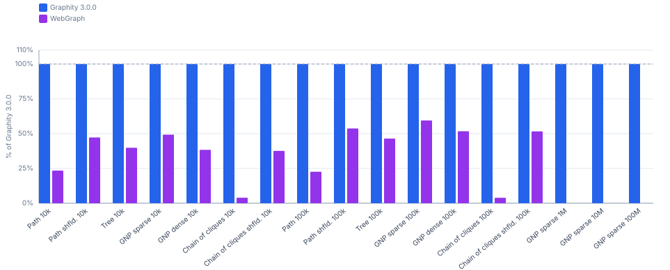

**All libraries**

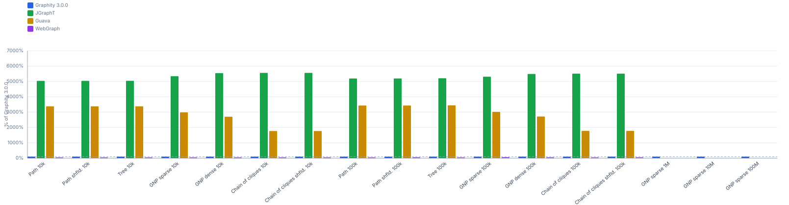

### 2.2 Bytes per Element  `totalBytes / (Nodes + Edges)`

**Memory footprint in bytes (lower is better)**

| Shape | Graphity 3.0.0 | JGraphT | Guava | WebGraph |
|---|---:|---:|---:|---:|
| Path<br><sub>10k nodes, 10k edges</sub> | 4 B | 201.65 B (5041%) | 135.10 B (3378%) | 0.94 B (23.5%) |
| Path shfld.<br><sub>10k nodes, 10k edges</sub> | 4 B | 201.65 B (5041%) | 135.10 B (3378%) | 1.89 B (47.2%) |
| Tree<br><sub>10k nodes, 10k edges</sub> | 4 B | 201.90 B (5048%) | 135.24 B (3381%) | 1.60 B (40.0%) |
| GNP sparse<br><sub>10k nodes, 30k edges</sub> | 4 B | 213.79 B (5345%) | 119.42 B (2986%) | 1.97 B (49.2%) |
| GNP dense<br><sub>10k nodes, 299.6k edges</sub> | 4 B | 221.75 B (5544%) | 108.02 B (2700%) | 1.54 B (38.5%) |
| Chain of cliques<br><sub>10k nodes, 310.8k edges</sub> | 4 B | 222.34 B (5558%) | 70.78 B (1770%) | 0.16 B (4.0%) |
| Chain of cliques shfld.<br><sub>10k nodes, 310.8k edges</sub> | 4 B | 222.36 B (5559%) | 70.78 B (1770%) | 1.50 B (37.5%) |
| Path<br><sub>100k nodes, 100k edges</sub> | 4 B | 207.71 B (5193%) | 137.23 B (3431%) | 0.90 B (22.5%) |
| Path shfld.<br><sub>100k nodes, 100k edges</sub> | 4 B | 207.71 B (5193%) | 137.22 B (3430%) | 2.15 B (53.8%) |
| Tree<br><sub>100k nodes, 100k edges</sub> | 4 B | 208.34 B (5208%) | 137.73 B (3443%) | 1.86 B (46.5%) |
| GNP sparse<br><sub>100k nodes, 300k edges</sub> | 4 B | 212.40 B (5310%) | 120.65 B (3016%) | 2.38 B (59.5%) |
| GNP dense<br><sub>100k nodes, 3M edges</sub> | 4 B | 219.51 B (5488%) | 108.63 B (2716%) | 2.07 B (51.7%) |
| Chain of cliques<br><sub>100k nodes, 3.1M edges</sub> | 4 B | 220.25 B (5506%) | 71.08 B (1777%) | 0.16 B (4.0%) |
| Chain of cliques shfld.<br><sub>100k nodes, 3.1M edges</sub> | 4 B | 220.25 B (5506%) | 71.08 B (1777%) | 2.06 B (51.5%) |
| GNP sparse<br><sub>1M nodes, 3M edges</sub> | 4 B | — | — | — |
| GNP sparse<br><sub>10M nodes, 30M edges</sub> | 4 B | — | — | — |
| GNP sparse<br><sub>100M nodes, 300M edges</sub> | 4 B | — | — | — |

**Graphity & WebGraph**


**All libraries**


## 3 Allocations

Bytes allocated per algorithm invocation (JMH `-prof gc`). Lower is better. Baseline (= 100%): **Graphity 3.0.0**, or the newest version present in a table it is missing from.

### 3.1 Build

**Allocations @ 10k nodes in bytes (lower is better)**

| Shape | Graphity 3.0.0 | JGraphT | Guava | WebGraph |
|---|---:|---:|---:|---:|
| Path<br><sub>10k nodes, 10k edges</sub> | 458 kB | 5.3 MB (1163%) | 2.8 MB (604%) | 4.3 MB (950%) |
| Path shfld.<br><sub>10k nodes, 10k edges</sub> | 458 kB | 5.2 MB (1133%) | 2.8 MB (604%) | 4.4 MB (955%) |
| Tree<br><sub>10k nodes, 10k edges</sub> | 458 kB | 5.3 MB (1161%) | 2.8 MB (609%) | 4.1 MB (888%) |
| GNP sparse<br><sub>10k nodes, 30k edges</sub> | 960 kB | 13.1 MB (1360%) | 5.1 MB (536%) | 4.5 MB (464%) |
| GNP dense<br><sub>10k nodes, 299.6k edges</sub> | 9.9 MB | 111 MB (1116%) | 37.3 MB (376%) | 9.8 MB (98.5%) |
| Chain of cliques<br><sub>10k nodes, 310.8k edges</sub> | 10.0 MB | 116 MB (1159%) | 29.3 MB (294%) | 8.9 MB (89.7%) |
| Chain of cliques shfld.<br><sub>10k nodes, 310.8k edges</sub> | 10.0 MB | 116 MB (1159%) | 29.3 MB (294%) | 9.4 MB (94.5%) |

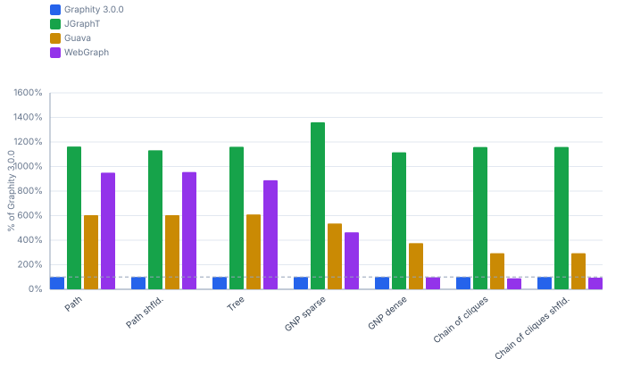

**Allocations @ 100k nodes in bytes (lower is better)**

| Shape | Graphity 3.0.0 | JGraphT | Guava | WebGraph |
|---|---:|---:|---:|---:|
| Path<br><sub>100k nodes, 100k edges</sub> | 3.8 MB | 54.4 MB (1447%) | 28.5 MB (757%) | 14.3 MB (379%) |
| Path shfld.<br><sub>100k nodes, 100k edges</sub> | 3.8 MB | 54.3 MB (1443%) | 28.5 MB (757%) | 14.5 MB (386%) |
| Tree<br><sub>100k nodes, 100k edges</sub> | 3.8 MB | 55.7 MB (1479%) | 28.8 MB (766%) | 11.4 MB (303%) |
| GNP sparse<br><sub>100k nodes, 300k edges</sub> | 10.6 MB | 129 MB (1215%) | 52.3 MB (492%) | 15.4 MB (145%) |
| GNP dense<br><sub>100k nodes, 3M edges</sub> | 111 MB | 1094 MB (983%) | 376 MB (338%) | 69.9 MB (62.8%) |
| Chain of cliques<br><sub>100k nodes, 3.1M edges</sub> | 112 MB | 1139 MB (1020%) | 294 MB (264%) | 60.2 MB (53.9%) |
| Chain of cliques shfld.<br><sub>100k nodes, 3.1M edges</sub> | 112 MB | 1139 MB (1020%) | 294 MB (264%) | 66.4 MB (59.5%) |

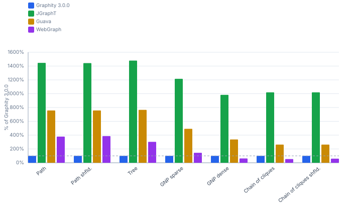

### 3.2 SCC

**Allocations @ 10k nodes in bytes (lower is better)**

| Shape | Graphity 3.0.0 | JGraphT | Guava | WebGraph |
|---|---:|---:|---:|---:|
| Path<br><sub>10k nodes, 10k edges</sub> | 483 kB | 5.2 MB (1078%) | 2.6 MB (540%) | 1.4 MB (297%) |
| Path shfld.<br><sub>10k nodes, 10k edges</sub> | 483 kB | 5.2 MB (1068%) | 2.6 MB (528%) | 1.3 MB (274%) |
| Tree<br><sub>10k nodes, 10k edges</sub> | 288 kB | 5.0 MB (1746%) | 2.3 MB (799%) | 908 kB (315%) |
| GNP sparse<br><sub>10k nodes, 30k edges</sub> | 371 kB | 3.2 MB (854%) | 2.6 MB (703%) | 1.3 MB (346%) |
| GNP dense<br><sub>10k nodes, 299.6k edges</sub> | 446 kB | 6.4 MB (1422%) | 4.6 MB (1020%) | 1.5 MB (329%) |
| Chain of cliques<br><sub>10k nodes, 310.8k edges</sub> | 444 kB | 4.8 MB (1075%) | 7.1 MB (1593%) | 6.1 MB (1379%) |
| Chain of cliques shfld.<br><sub>10k nodes, 310.8k edges</sub> | 364 kB | 6.0 MB (1634%) | 7.2 MB (1982%) | 1.3 MB (348%) |

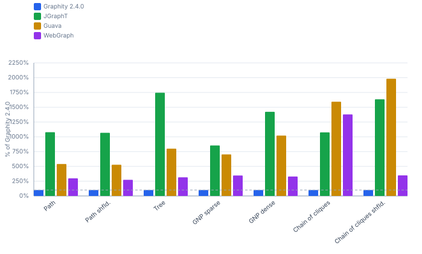

**Allocations @ 100k nodes in bytes (lower is better)**

| Shape | Graphity 3.0.0 | JGraphT | Guava | WebGraph |
|---|---:|---:|---:|---:|
| Path<br><sub>100k nodes, 100k edges</sub> | 4.6 MB | 51.6 MB (1113%) | 28.9 MB (622%) | 13.3 MB (287%) |
| Path shfld.<br><sub>100k nodes, 100k edges</sub> | 4.6 MB | 51.7 MB (1114%) | 27.4 MB (591%) | 13.5 MB (290%) |
| Tree<br><sub>100k nodes, 100k edges</sub> | 2.8 MB | 50.3 MB (1792%) | 25.5 MB (907%) | 8.8 MB (314%) |
| GNP sparse<br><sub>100k nodes, 300k edges</sub> | 3.5 MB | 32.2 MB (916%) | 28.5 MB (812%) | 12.3 MB (351%) |
| GNP dense<br><sub>100k nodes, 3M edges</sub> | 4.3 MB | 70.1 MB (1642%) | 45.2 MB (1060%) | 13.5 MB (315%) |
| Chain of cliques<br><sub>100k nodes, 3.1M edges</sub> | 4.3 MB | 48.5 MB (1141%) | 76.8 MB (1806%) | 60.3 MB (1417%) |
| Chain of cliques shfld.<br><sub>100k nodes, 3.1M edges</sub> | 3.5 MB | 61.4 MB (1777%) | 75.3 MB (2181%) | 12.3 MB (356%) |

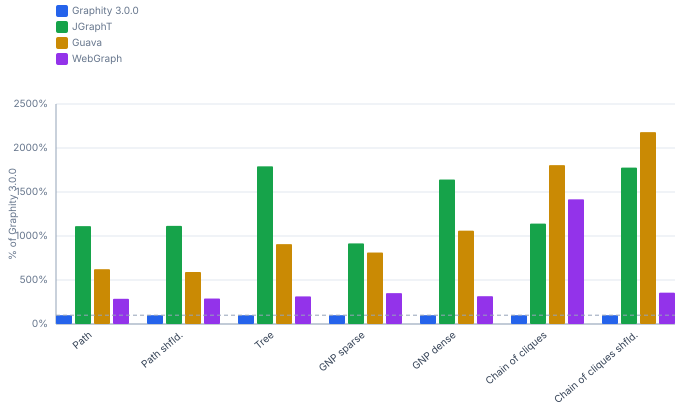

### 3.3 WCC

**Allocations @ 10k nodes in bytes (lower is better)**

| Shape | Graphity 3.0.0 | JGraphT | Guava | WebGraph |
|---|---:|---:|---:|---:|
| Path<br><sub>10k nodes, 10k edges</sub> | 170 kB | 3.0 MB (1784%) | 2.4 MB (1407%) | 2.0 MB (1164%) |
| Path shfld.<br><sub>10k nodes, 10k edges</sub> | 170 kB | 2.3 MB (1360%) | 2.4 MB (1407%) | 1.9 MB (1093%) |
| Tree<br><sub>10k nodes, 10k edges</sub> | 170 kB | 3.1 MB (1818%) | 2.4 MB (1407%) | 1.2 MB (719%) |
| GNP sparse<br><sub>10k nodes, 30k edges</sub> | 170 kB | 3.1 MB (1825%) | 2.9 MB (1689%) | 1.2 MB (706%) |
| GNP dense<br><sub>10k nodes, 299.6k edges</sub> | 170 kB | 10.3 MB (6080%) | 9.3 MB (5491%) | 1.3 MB (765%) |
| Chain of cliques<br><sub>10k nodes, 310.8k edges</sub> | 170 kB | 9.4 MB (5552%) | 9.6 MB (5649%) | 6.1 MB (3611%) |
| Chain of cliques shfld.<br><sub>10k nodes, 310.8k edges</sub> | 170 kB | 9.8 MB (5787%) | 9.6 MB (5649%) | 1.3 MB (755%) |

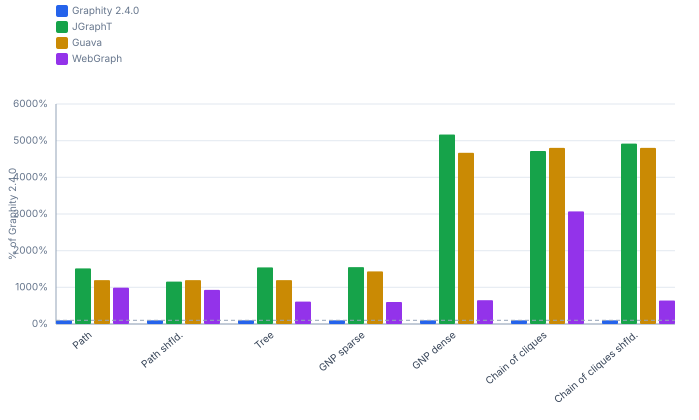

**Allocations @ 100k nodes in bytes (lower is better)**

| Shape | Graphity 3.0.0 | JGraphT | Guava | WebGraph |
|---|---:|---:|---:|---:|
| Path<br><sub>100k nodes, 100k edges</sub> | 1.7 MB | 32.7 MB (1923%) | 26.3 MB (1546%) | 19.3 MB (1135%) |
| Path shfld.<br><sub>100k nodes, 100k edges</sub> | 1.7 MB | 32.7 MB (1923%) | 26.3 MB (1547%) | 16.5 MB (969%) |
| Tree<br><sub>100k nodes, 100k edges</sub> | 1.7 MB | 33.2 MB (1954%) | 26.3 MB (1547%) | 11.1 MB (656%) |
| GNP sparse<br><sub>100k nodes, 300k edges</sub> | 1.7 MB | 37.5 MB (2207%) | 31.1 MB (1829%) | 11.0 MB (649%) |
| GNP dense<br><sub>100k nodes, 3M edges</sub> | 1.7 MB | 106 MB (6239%) | 95.9 MB (5639%) | 11.7 MB (690%) |
| Chain of cliques<br><sub>100k nodes, 3.1M edges</sub> | 1.7 MB | 101 MB (5925%) | 98.4 MB (5785%) | 61.4 MB (3612%) |
| Chain of cliques shfld.<br><sub>100k nodes, 3.1M edges</sub> | 1.7 MB | 96.8 MB (5689%) | 98.4 MB (5785%) | 12.5 MB (733%) |

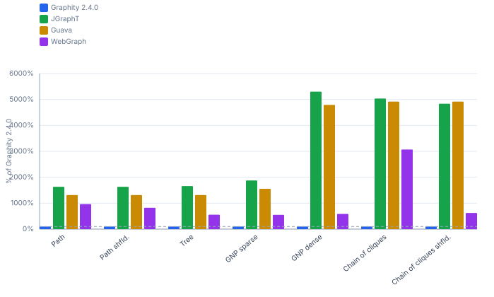

### 3.4 CCs

**Allocations @ 10k nodes in bytes (lower is better)**

| Shape | Graphity 3.0.0 |
|---|---:|
| Path<br><sub>10k nodes, 10k edges</sub> | 170 kB |
| Path shfld.<br><sub>10k nodes, 10k edges</sub> | 170 kB |
| Tree<br><sub>10k nodes, 10k edges</sub> | 170 kB |
| GNP sparse<br><sub>10k nodes, 30k edges</sub> | 170 kB |
| GNP dense<br><sub>10k nodes, 299.6k edges</sub> | 170 kB |
| Chain of cliques<br><sub>10k nodes, 310.8k edges</sub> | 170 kB |
| Chain of cliques shfld.<br><sub>10k nodes, 310.8k edges</sub> | 170 kB |

**Allocations @ 100k nodes in bytes (lower is better)**

| Shape | Graphity 3.0.0 |
|---|---:|
| Path<br><sub>100k nodes, 100k edges</sub> | 1.7 MB |
| Path shfld.<br><sub>100k nodes, 100k edges</sub> | 1.7 MB |
| Tree<br><sub>100k nodes, 100k edges</sub> | 1.7 MB |
| GNP sparse<br><sub>100k nodes, 300k edges</sub> | 1.7 MB |
| GNP dense<br><sub>100k nodes, 3M edges</sub> | 1.7 MB |
| Chain of cliques<br><sub>100k nodes, 3.1M edges</sub> | 1.7 MB |
| Chain of cliques shfld.<br><sub>100k nodes, 3.1M edges</sub> | 1.7 MB |

### 3.5 Condense

**Allocations @ 1k nodes in bytes (lower is better)**

| Shape | Graphity 3.0.0 |
|---|---:|
| Path<br><sub>1k nodes, 1k edges</sub> | 23.2 kB |
| GNP dense<br><sub>1k nodes, 30k edges</sub> | 97 B |
| Chain of cliques<br><sub>1k nodes, 31.1k edges</sub> | 762 B |
| DAG GNP sparse<br><sub>1k nodes</sub> | 66.4 kB |

**Allocations @ 10k nodes in bytes (lower is better)**

| Shape | Graphity 3.0.0 |
|---|---:|
| Path<br><sub>10k nodes, 10k edges</sub> | 250 kB |
| GNP dense<br><sub>10k nodes, 299.6k edges</sub> | 102 B |
| Chain of cliques<br><sub>10k nodes, 310.8k edges</sub> | 7.2 kB |
| DAG GNP sparse<br><sub>10k nodes</sub> | 541 kB |

**Allocations @ 100k nodes in bytes (lower is better)**

| Shape | Graphity 3.0.0 |
|---|---:|
| Path<br><sub>100k nodes, 100k edges</sub> | 2.1 MB |
| GNP dense<br><sub>100k nodes, 3M edges</sub> | 203 B |
| Chain of cliques<br><sub>100k nodes, 3.1M edges</sub> | 75.9 kB |
| DAG GNP sparse<br><sub>100k nodes</sub> | 5.9 MB |

### 3.6 TopOrder

**Allocations @ 10k nodes in bytes (lower is better)**

| Shape | Graphity 3.0.0 | JGraphT | Guava | WebGraph |
|---|---:|---:|---:|---:|
| Path<br><sub>10k nodes, 10k edges</sub> | 246 kB | 1.3 MB (510%) | 943 kB (384%) | 1.5 MB (597%) |
| Path shfld.<br><sub>10k nodes, 10k edges</sub> | 246 kB | 1.3 MB (510%) | 1.1 MB (449%) | 1.0 MB (417%) |
| Tree<br><sub>10k nodes, 10k edges</sub> | 50.8 kB | 1.3 MB (2508%) | 812 kB (1598%) | 885 kB (1743%) |
| Tree shfld.<br><sub>10k nodes</sub> | 50.8 kB | 1.3 MB (2508%) | 812 kB (1598%) | 845 kB (1664%) |
| DAG GNP sparse<br><sub>10k nodes</sub> | 50.8 kB | 1.3 MB (2508%) | 930 kB (1831%) | 984 kB (1937%) |
| DAG GNP dense<br><sub>10k nodes</sub> | 50.8 kB | 1.3 MB (2469%) | 812 kB (1597%) | 1.1 MB (2161%) |
| DAG GNP dense shfld.<br><sub>10k nodes</sub> | 50.9 kB | 1.3 MB (2469%) | 812 kB (1597%) | 1.1 MB (2118%) |

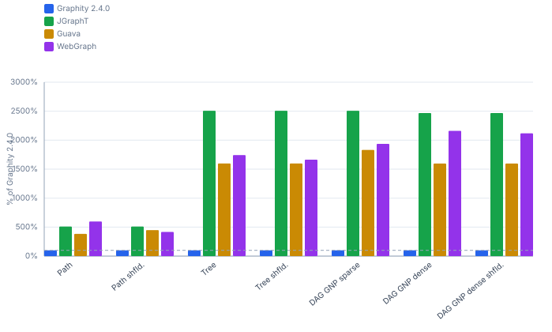

**Allocations @ 100k nodes in bytes (lower is better)**

| Shape | Graphity 3.0.0 | JGraphT | Guava | WebGraph |
|---|---:|---:|---:|---:|
| Path<br><sub>100k nodes, 100k edges</sub> | 2.3 MB | 13.3 MB (587%) | 9.9 MB (439%) | 10.5 MB (463%) |
| Path shfld.<br><sub>100k nodes, 100k edges</sub> | 2.3 MB | 13.3 MB (587%) | 8.9 MB (393%) | 10.0 MB (443%) |
| Tree<br><sub>100k nodes, 100k edges</sub> | 433 kB | 13.5 MB (3108%) | 7.9 MB (1811%) | 8.5 MB (1953%) |
| Tree shfld.<br><sub>100k nodes</sub> | 433 kB | 13.5 MB (3108%) | 7.9 MB (1811%) | 8.4 MB (1945%) |
| DAG GNP sparse<br><sub>100k nodes</sub> | 433 kB | 13.6 MB (3128%) | 9.6 MB (2210%) | 9.5 MB (2203%) |
| DAG GNP dense<br><sub>100k nodes</sub> | 434 kB | 13.3 MB (3073%) | 7.9 MB (1812%) | 10.3 MB (2374%) |
| DAG GNP dense shfld.<br><sub>100k nodes</sub> | 434 kB | 13.3 MB (3073%) | 7.9 MB (1812%) | 10.2 MB (2360%) |

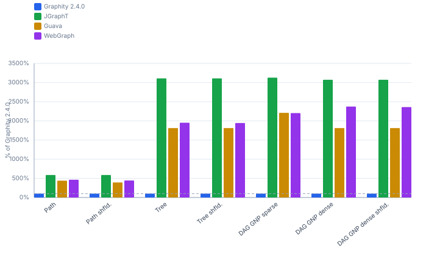

### 3.7 TopOrderAndLevels

**Allocations @ 10k nodes in bytes (lower is better)**

| Shape | Graphity 3.0.0 | Graphity 3.0.0<br>(bi-adjacent) | JGraphT | Guava | WebGraph |
|---|---:|---:|---:|---:|---:|
| Path<br><sub>10k nodes, 10k edges</sub> | 160 kB | 160 kB (100%) | 476 kB (297%) | 476 kB (297%) | 1.7 MB (1088%) |
| Path shfld.<br><sub>10k nodes, 10k edges</sub> | 160 kB | 160 kB (100%) | 476 kB (297%) | 476 kB (297%) | 1.7 MB (1070%) |
| Tree<br><sub>10k nodes, 10k edges</sub> | 160 kB | 160 kB (100%) | 476 kB (297%) | 476 kB (297%) | 1.3 MB (829%) |
| Tree shfld.<br><sub>10k nodes</sub> | 160 kB | 160 kB (100%) | 476 kB (297%) | 476 kB (297%) | 1.3 MB (796%) |
| DAG GNP sparse<br><sub>10k nodes</sub> | 160 kB | 160 kB (100.0%) | 476 kB (297%) | 476 kB (297%) | 1.6 MB (1016%) |
| DAG GNP dense<br><sub>10k nodes</sub> | 160 kB | 160 kB (100.0%) | 476 kB (297%) | 477 kB (297%) | 1.8 MB (1126%) |
| DAG GNP dense shfld.<br><sub>10k nodes</sub> | 160 kB | 160 kB (100.0%) | 476 kB (297%) | 477 kB (297%) | 1.8 MB (1140%) |

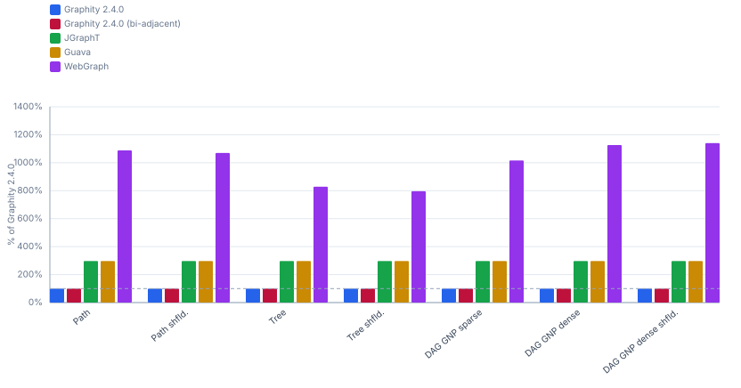

**Allocations @ 100k nodes in bytes (lower is better)**

| Shape | Graphity 3.0.0 | Graphity 3.0.0<br>(bi-adjacent) | JGraphT | Guava | WebGraph |
|---|---:|---:|---:|---:|---:|
| Path<br><sub>100k nodes, 100k edges</sub> | 1.6 MB | 1.6 MB (100.0%) | 4.8 MB (300%) | 4.8 MB (300%) | 16.9 MB (1054%) |
| Path shfld.<br><sub>100k nodes, 100k edges</sub> | 1.6 MB | 1.6 MB (100.0%) | 4.8 MB (300%) | 4.8 MB (300%) | 16.8 MB (1052%) |
| Tree<br><sub>100k nodes, 100k edges</sub> | 1.6 MB | 1.6 MB (100.0%) | 4.8 MB (300%) | 4.8 MB (300%) | 12.5 MB (780%) |
| Tree shfld.<br><sub>100k nodes</sub> | 1.6 MB | 1.6 MB (100.0%) | 4.8 MB (300%) | 4.8 MB (300%) | 12.4 MB (777%) |
| DAG GNP sparse<br><sub>100k nodes</sub> | 1.6 MB | 1.6 MB (100.0%) | 4.8 MB (300%) | 4.8 MB (300%) | 15.5 MB (967%) |
| DAG GNP dense<br><sub>100k nodes</sub> | 1.6 MB | 1.6 MB (100.0%) | 4.8 MB (300%) | 4.8 MB (300%) | 17.1 MB (1070%) |
| DAG GNP dense shfld.<br><sub>100k nodes</sub> | 1.6 MB | 1.6 MB (100.0%) | 4.8 MB (300%) | 4.8 MB (300%) | 17.1 MB (1069%) |

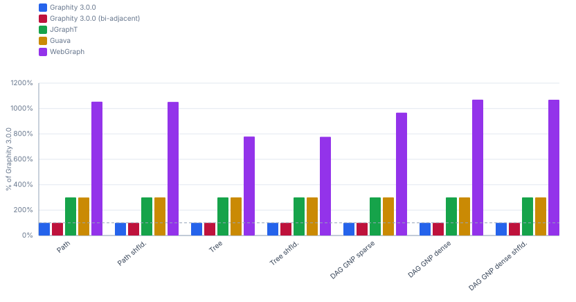

### 3.8 BackEdges

**Allocations @ 10k nodes in bytes (lower is better)**

| Shape | Graphity 3.0.0 | JGraphT | Guava | WebGraph |
|---|---:|---:|---:|---:|
| Path<br><sub>10k nodes, 10k edges</sub> | 206 kB | 161 kB (78.1%) | 161 kB (78.1%) | 1.4 MB (693%) |
| Path shfld.<br><sub>10k nodes, 10k edges</sub> | 206 kB | 161 kB (78.1%) | 161 kB (78.1%) | 985 kB (479%) |
| Tree<br><sub>10k nodes, 10k edges</sub> | 10.9 kB | 161 kB (1470%) | 161 kB (1470%) | 845 kB (7732%) |
| GNP sparse<br><sub>10k nodes, 30k edges</sub> | 564 kB | 386 kB (68.4%) | 386 kB (68.4%) | 1.2 MB (209%) |
| GNP dense<br><sub>10k nodes, 299.6k edges</sub> | 7.8 MB | 4.0 MB (51.6%) | 4.8 MB (61.9%) | 4.9 MB (63.3%) |
| Chain of cliques<br><sub>10k nodes, 310.8k edges</sub> | 7.8 MB | 4.0 MB (51.1%) | 4.0 MB (51.1%) | 9.7 MB (123%) |
| Chain of cliques shfld.<br><sub>10k nodes, 310.8k edges</sub> | 7.8 MB | 4.0 MB (51.6%) | 4.0 MB (51.6%) | 4.9 MB (63.4%) |

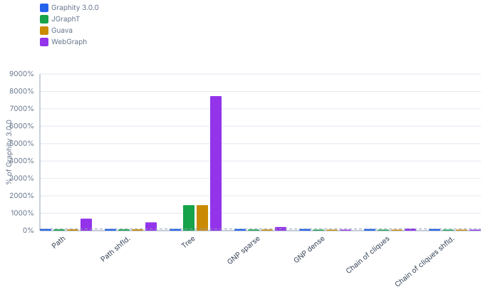

**Allocations @ 100k nodes in bytes (lower is better)**

| Shape | Graphity 3.0.0 | JGraphT | Guava | WebGraph |
|---|---:|---:|---:|---:|
| Path<br><sub>100k nodes, 100k edges</sub> | 1.9 MB | 1.6 MB (87.0%) | 1.6 MB (87.0%) | 10.1 MB (541%) |
| Path shfld.<br><sub>100k nodes, 100k edges</sub> | 1.9 MB | 1.6 MB (87.1%) | 3.2 MB (173%) | 9.6 MB (517%) |
| Tree<br><sub>100k nodes, 100k edges</sub> | 33.5 kB | 1.6 MB (4848%) | 1.6 MB (4847%) | 8.1 MB (24055%) |
| GNP sparse<br><sub>100k nodes, 300k edges</sub> | 5.9 MB | 4.2 MB (70.7%) | 4.2 MB (70.7%) | 12.1 MB (204%) |
| GNP dense<br><sub>100k nodes, 3M edges</sub> | 85.4 MB | 45.4 MB (53.1%) | 53.4 MB (62.5%) | 53.6 MB (62.7%) |
| Chain of cliques<br><sub>100k nodes, 3.1M edges</sub> | 86.1 MB | 45.4 MB (52.7%) | 45.4 MB (52.7%) | 101 MB (117%) |
| Chain of cliques shfld.<br><sub>100k nodes, 3.1M edges</sub> | 85.3 MB | 45.4 MB (53.2%) | 45.4 MB (53.2%) | 53.5 MB (62.7%) |

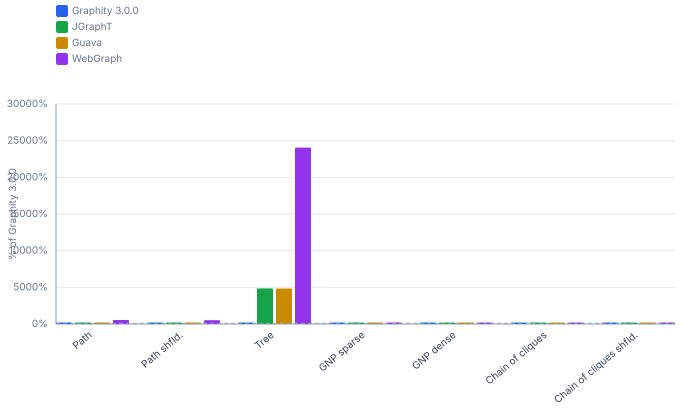

### 3.9 EdgeTypes

**Allocations @ 10k nodes in bytes (lower is better)**

| Shape | Graphity 3.0.0 | JGraphT | Guava | WebGraph |
|---|---:|---:|---:|---:|
| Path<br><sub>10k nodes, 10k edges</sub> | 256 kB | 581 kB (227%) | 581 kB (227%) | 1.8 MB (722%) |
| Path shfld.<br><sub>10k nodes, 10k edges</sub> | 256 kB | 581 kB (227%) | 581 kB (227%) | 1.4 MB (550%) |
| Tree<br><sub>10k nodes, 10k edges</sub> | 60.8 kB | 581 kB (956%) | 581 kB (956%) | 1.3 MB (2081%) |
| GNP sparse<br><sub>10k nodes, 30k edges</sub> | 196 kB | 1.1 MB (540%) | 1.5 MB (756%) | 1.8 MB (945%) |
| GNP dense<br><sub>10k nodes, 299.6k edges</sub> | 545 kB | 9.9 MB (1821%) | 10.7 MB (1968%) | 10.8 MB (1988%) |
| Chain of cliques<br><sub>10k nodes, 310.8k edges</sub> | 556 kB | 9.9 MB (1784%) | 9.9 MB (1784%) | 15.6 MB (2801%) |
| Chain of cliques shfld.<br><sub>10k nodes, 310.8k edges</sub> | 476 kB | 9.9 MB (2084%) | 9.9 MB (2084%) | 10.8 MB (2275%) |


**Allocations @ 100k nodes in bytes (lower is better)**

| Shape | Graphity 3.0.0 | JGraphT | Guava | WebGraph |
|---|---:|---:|---:|---:|
| Path<br><sub>100k nodes, 100k edges</sub> | 2.4 MB | 4.9 MB (207%) | 4.9 MB (207%) | 13.4 MB (565%) |
| Path shfld.<br><sub>100k nodes, 100k edges</sub> | 2.4 MB | 4.9 MB (207%) | 4.9 MB (207%) | 12.9 MB (547%) |
| Tree<br><sub>100k nodes, 100k edges</sub> | 533 kB | 4.9 MB (920%) | 4.9 MB (920%) | 11.3 MB (2127%) |
| GNP sparse<br><sub>100k nodes, 300k edges</sub> | 1.8 MB | 11.8 MB (666%) | 16.0 MB (903%) | 19.6 MB (1111%) |
| GNP dense<br><sub>100k nodes, 3M edges</sub> | 5.3 MB | 113 MB (2142%) | 121 MB (2294%) | 121 MB (2298%) |
| Chain of cliques<br><sub>100k nodes, 3.1M edges</sub> | 5.4 MB | 113 MB (2101%) | 113 MB (2101%) | 168 MB (3128%) |
| Chain of cliques shfld.<br><sub>100k nodes, 3.1M edges</sub> | 4.6 MB | 113 MB (2469%) | 113 MB (2469%) | 121 MB (2646%) |


### 3.10 Dominators

**Allocations @ 10k nodes in bytes (lower is better)**

| Shape | Graphity 3.0.0 |
|---|---:|
| Structured<br><sub>10k nodes</sub> | 371 kB |
| Irreducible<br><sub>10k nodes</sub> | 371 kB |
| Ladder<br><sub>10k nodes</sub> | 486 kB |
| Chain<br><sub>10k nodes</sub> | 566 kB |
| Fan behind chain<br><sub>10k nodes</sub> | 486 kB |
| Small methods<br><sub>10k nodes</sub> | 475 kB |

**Allocations @ 100k nodes in bytes (lower is better)**

| Shape | Graphity 3.0.0 |
|---|---:|
| Structured<br><sub>100k nodes</sub> | 3.7 MB |
| Irreducible<br><sub>100k nodes</sub> | 3.7 MB |
| Ladder<br><sub>100k nodes</sub> | 4.7 MB |
| Chain<br><sub>100k nodes</sub> | 5.5 MB |
| Fan behind chain<br><sub>100k nodes</sub> | 4.7 MB |
| Small methods<br><sub>100k nodes</sub> | 4.7 MB |

### 3.11 Dominance frontiers

**Allocations @ 10k nodes in bytes (lower is better)**

| Shape | Graphity 3.0.0 |
|---|---:|
| Structured<br><sub>10k nodes</sub> | 268 kB |
| Irreducible<br><sub>10k nodes</sub> | 288 kB |
| Ladder<br><sub>10k nodes</sub> | 100 MB |
| Chain<br><sub>10k nodes</sub> | 160 kB |
| Fan behind chain<br><sub>10k nodes</sub> | 200 MB |
| Small methods<br><sub>10k nodes</sub> | 277 kB |

**Allocations @ 100k nodes in bytes (lower is better)**

| Shape | Graphity 3.0.0 |
|---|---:|
| Structured<br><sub>100k nodes</sub> | 2.7 MB |
| Irreducible<br><sub>100k nodes</sub> | 2.9 MB |
| Chain<br><sub>100k nodes</sub> | 1.6 MB |
| Small methods<br><sub>100k nodes</sub> | 2.7 MB |

### 3.12 Iterated dominance frontier (build + one query per variable)

**Allocations @ 10k nodes in bytes (lower is better)**

| Shape | Graphity 3.0.0 |
|---|---:|
| Structured<br><sub>10k nodes</sub> | 25.4 MB |
| Irreducible<br><sub>10k nodes</sub> | 28.9 MB |
| Ladder<br><sub>10k nodes</sub> | 53.8 MB |
| Chain<br><sub>10k nodes</sub> | 21.4 MB |
| Fan behind chain<br><sub>10k nodes</sub> | 65.4 MB |
| Small methods<br><sub>10k nodes</sub> | 604 kB |

**Allocations @ 100k nodes in bytes (lower is better)**

| Shape | Graphity 3.0.0 |
|---|---:|
| Structured<br><sub>100k nodes</sub> | 370 MB |
| Irreducible<br><sub>100k nodes</sub> | 451 MB |
| Ladder<br><sub>100k nodes</sub> | 504 MB |
| Chain<br><sub>100k nodes</sub> | 198 MB |
| Fan behind chain<br><sub>100k nodes</sub> | 662 MB |
| Small methods<br><sub>100k nodes</sub> | 5.8 MB |

### 3.13 Loops

**Allocations @ 10k nodes in bytes (lower is better)**

| Shape | Graphity 3.0.0 |
|---|---:|
| Structured<br><sub>10k nodes</sub> | 772 kB |
| Irreducible<br><sub>10k nodes</sub> | 812 kB |
| Ladder<br><sub>10k nodes</sub> | 675 kB |
| Chain<br><sub>10k nodes</sub> | 735 kB |
| Fan behind chain<br><sub>10k nodes</sub> | 675 kB |
| Small methods<br><sub>10k nodes</sub> | 897 kB |

**Allocations @ 100k nodes in bytes (lower is better)**

| Shape | Graphity 3.0.0 |
|---|---:|
| Structured<br><sub>100k nodes</sub> | 7.5 MB |
| Irreducible<br><sub>100k nodes</sub> | 13.5 MB |
| Ladder<br><sub>100k nodes</sub> | 6.6 MB |
| Chain<br><sub>100k nodes</sub> | 7.2 MB |
| Fan behind chain<br><sub>100k nodes</sub> | 6.6 MB |
| Small methods<br><sub>100k nodes</sub> | 8.9 MB |

### 3.14 Ancestry of the dominator tree

**Allocations @ 10k nodes in bytes (lower is better)**

| Shape | Graphity 3.0.0 |
|---|---:|
| Structured<br><sub>10k nodes</sub> | 280 kB |
| Irreducible<br><sub>10k nodes</sub> | 280 kB |
| Ladder<br><sub>10k nodes</sub> | 280 kB |
| Chain<br><sub>10k nodes</sub> | 280 kB |
| Fan behind chain<br><sub>10k nodes</sub> | 280 kB |
| Small methods<br><sub>10k nodes</sub> | 299 kB |

**Allocations @ 100k nodes in bytes (lower is better)**

| Shape | Graphity 3.0.0 |
|---|---:|
| Structured<br><sub>100k nodes</sub> | 2.8 MB |
| Irreducible<br><sub>100k nodes</sub> | 2.8 MB |
| Ladder<br><sub>100k nodes</sub> | 2.8 MB |
| Chain<br><sub>100k nodes</sub> | 2.8 MB |
| Fan behind chain<br><sub>100k nodes</sub> | 2.8 MB |
| Small methods<br><sub>100k nodes</sub> | 2.9 MB |

### 3.15 PreorderAncestry of the dominator tree

**Allocations @ 10k nodes in bytes (lower is better)**

| Shape | Graphity 3.0.0 |
|---|---:|
| Structured<br><sub>10k nodes</sub> | 200 kB |
| Irreducible<br><sub>10k nodes</sub> | 200 kB |
| Ladder<br><sub>10k nodes</sub> | 200 kB |
| Chain<br><sub>10k nodes</sub> | 200 kB |
| Fan behind chain<br><sub>10k nodes</sub> | 200 kB |
| Small methods<br><sub>10k nodes</sub> | 216 kB |

**Allocations @ 100k nodes in bytes (lower is better)**

| Shape | Graphity 3.0.0 |
|---|---:|
| Structured<br><sub>100k nodes</sub> | 2.0 MB |
| Irreducible<br><sub>100k nodes</sub> | 2.0 MB |
| Ladder<br><sub>100k nodes</sub> | 2.0 MB |
| Chain<br><sub>100k nodes</sub> | 2.0 MB |
| Fan behind chain<br><sub>100k nodes</sub> | 2.0 MB |
| Small methods<br><sub>100k nodes</sub> | 2.1 MB |
