# Graphity Benchmark Comparison — synthetic / ubuntu-ryzen-9950x

Benchmarked versions: `1.0`, `2.0.0`

```
Profile:      synthetic
Timestamp:    2026-07-22 18:53:31
JDK:          OpenJDK 64-Bit Server VM 25.0.2 (Amazon.com Inc.)
OS:           Ubuntu 25.10, kernel 6.17.0-41-generic (amd64)
CPU:          AMD Ryzen 9 9950X 16-Core Processor (32 logical cores)
RAM:          89.7 GiB
```

## Contents

- [1 Performance](#1-performance)
  - [1.1 Build](#11-build)
  - [1.2 SCC](#12-scc)
  - [1.3 WCC](#13-wcc)
  - [1.4 CCs](#14-ccs)
  - [1.5 TopOrder](#15-toporder)
  - [1.6 TopOrderAndLevels](#16-toporderandlevels)
  - [1.7 BackEdges](#17-backedges)
  - [1.8 EdgeTypes](#18-edgetypes)
  - [1.9 Reorder (DFS-preorder) cost](#19-reorder-dfs-preorder-cost)
- [2 Memory Footprint](#2-memory-footprint)
  - [2.1 Total Graph Size](#21-total-graph-size)
  - [2.2 Bytes per Element  `totalBytes / (Nodes + Edges)`](#22-bytes-per-element-totalbytes-nodes-edges)
- [3 Allocations](#3-allocations)
  - [3.1 Build](#31-build)
  - [3.2 SCC](#32-scc)
  - [3.3 WCC](#33-wcc)
  - [3.4 CCs](#34-ccs)
  - [3.5 TopOrder](#35-toporder)
  - [3.6 TopOrderAndLevels](#36-toporderandlevels)
  - [3.7 BackEdges](#37-backedges)
  - [3.8 EdgeTypes](#38-edgetypes)

## 1 Performance

Times (ms/op, lower is better) and throughput (op/s, higher is better) for each algorithm and graph size. Non-baseline cells show the factor relative to **Graphity 2.0.0** (= 100% in the throughput table).

### 1.1 Build

#### Times @ 10k nodes (ms/op, lower is better)

| Shape | Graphity 1.0 | Graphity 2.0.0 | JGraphT | Guava | WebGraph |
|---|---:|---:|---:|---:|---:|
| Path<br><sub>10k nodes, 10k edges</sub> | 0.083 ms (1.0×) | 0.082 ms | 1.059 ms (13×) | 0.362 ms (4.4×) | 2.162 ms (26×) |
| Path shfld.<br><sub>10k nodes, 10k edges</sub> | 0.083 ms (1.0×) | 0.082 ms | 1.083 ms (13×) | 0.541 ms (6.6×) | 2.787 ms (34×) |
| Tree<br><sub>10k nodes, 10k edges</sub> | 0.092 ms (1.0×) | 0.092 ms | 1.170 ms (13×) | 0.512 ms (5.6×) | 2.548 ms (28×) |
| GNP sparse<br><sub>10k nodes, 30k edges</sub> | 0.164 ms (1.0×) | 0.162 ms | 4.233 ms (26×) | 2.119 ms (13×) | 7.932 ms (49×) |
| GNP dense<br><sub>10k nodes, 299.6k edges</sub> | 1.597 ms (1.0×) | 1.573 ms | 57.13 ms (36×) | 31.26 ms (20×) | 45.30 ms (29×) |
| GNP dense shfld.<br><sub>10k nodes, 299.6k edges</sub> | 1.572 ms (1.0×) | 1.546 ms | 56.32 ms (36×) | 33.30 ms (22×) | 43.91 ms (28×) |
| Chain of cliques<br><sub>10k nodes, 310.8k edges</sub> | 1.550 ms (1.0×) | 1.588 ms | 41.74 ms (26×) | 8.225 ms (5.2×) | 6.460 ms (4.1×) |
| Chain of cliques shfld.<br><sub>10k nodes, 310.8k edges</sub> | 1.551 ms (1.0×) | 1.553 ms | 56.93 ms (37×) | 19.09 ms (12×) | 44.19 ms (28×) |

#### Throughput @ 10k nodes (op/s, higher is better)

| Shape | Graphity 1.0 | Graphity 2.0.0 | JGraphT | Guava | WebGraph |
|---|---:|---:|---:|---:|---:|
| Path<br><sub>10k nodes, 10k edges</sub> | 12 048 op/s (98.8%) | 12 195 op/s | 944.3 op/s (7.7%) | 2 762 op/s (22.7%) | 462.5 op/s (3.8%) |
| Path shfld.<br><sub>10k nodes, 10k edges</sub> | 12 048 op/s (98.8%) | 12 195 op/s | 923.4 op/s (7.6%) | 1 848 op/s (15.2%) | 358.8 op/s (2.9%) |
| Tree<br><sub>10k nodes, 10k edges</sub> | 10 870 op/s (100%) | 10 870 op/s | 854.7 op/s (7.9%) | 1 953 op/s (18.0%) | 392.5 op/s (3.6%) |
| GNP sparse<br><sub>10k nodes, 30k edges</sub> | 6 098 op/s (98.8%) | 6 173 op/s | 236.2 op/s (3.8%) | 471.9 op/s (7.6%) | 126.1 op/s (2.0%) |
| GNP dense<br><sub>10k nodes, 299.6k edges</sub> | 626.2 op/s (98.5%) | 635.7 op/s | 17.50 op/s (2.8%) | 31.99 op/s (5.0%) | 22.07 op/s (3.5%) |
| GNP dense shfld.<br><sub>10k nodes, 299.6k edges</sub> | 636.1 op/s (98.3%) | 646.8 op/s | 17.75 op/s (2.7%) | 30.03 op/s (4.6%) | 22.78 op/s (3.5%) |
| Chain of cliques<br><sub>10k nodes, 310.8k edges</sub> | 645.2 op/s (102%) | 629.7 op/s | 23.96 op/s (3.8%) | 121.6 op/s (19.3%) | 154.8 op/s (24.6%) |
| Chain of cliques shfld.<br><sub>10k nodes, 310.8k edges</sub> | 644.7 op/s (100%) | 643.9 op/s | 17.57 op/s (2.7%) | 52.38 op/s (8.1%) | 22.63 op/s (3.5%) |

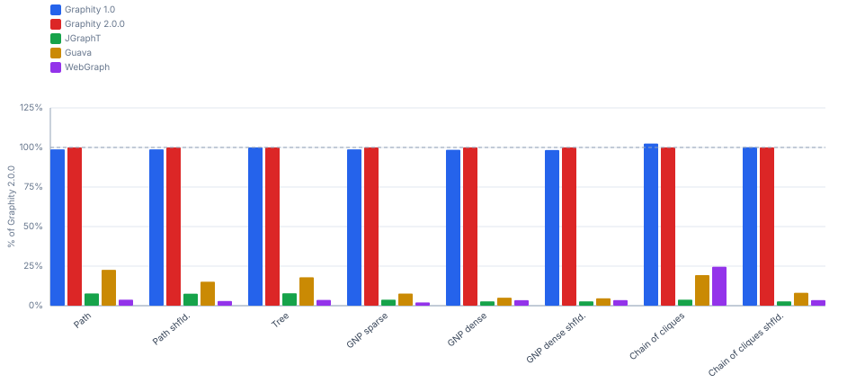

#### Times @ 100k nodes (ms/op, lower is better)

| Shape | Graphity 1.0 | Graphity 2.0.0 | JGraphT | Guava | WebGraph |
|---|---:|---:|---:|---:|---:|
| Path<br><sub>100k nodes, 100k edges</sub> | 0.686 ms (1.0×) | 0.680 ms | 14.57 ms (21×) | 5.162 ms (7.6×) | 19.77 ms (29×) |
| Path shfld.<br><sub>100k nodes, 100k edges</sub> | 0.687 ms (1.0×) | 0.682 ms | 25.25 ms (37×) | 8.508 ms (12×) | 27.86 ms (41×) |
| Tree<br><sub>100k nodes, 100k edges</sub> | 1.093 ms (1.0×) | 1.091 ms | 24.69 ms (23×) | 9.400 ms (8.6×) | 28.96 ms (27×) |
| GNP sparse<br><sub>100k nodes, 300k edges</sub> | 2.249 ms (1.0×) | 2.257 ms | 92.55 ms (41×) | 46.94 ms (21×) | 86.38 ms (38×) |
| GNP dense<br><sub>100k nodes, 3M edges</sub> | 17.27 ms (1.0×) | 16.93 ms | 1535.0 ms (91×) | 1018.1 ms (60×) | 563.3 ms (33×) |
| GNP dense shfld.<br><sub>100k nodes, 3M edges</sub> | 16.99 ms (1.0×) | 16.74 ms | 1497.0 ms (89×) | 1021.4 ms (61×) | 541.8 ms (32×) |
| Chain of cliques<br><sub>100k nodes, 3.1M edges</sub> | 16.96 ms (1.0×) | 16.82 ms | 846.0 ms (50×) | 116.3 ms (6.9×) | 62.13 ms (3.7×) |
| Chain of cliques shfld.<br><sub>100k nodes, 3.1M edges</sub> | 17.04 ms (1.1×) | 16.06 ms | 1527.1 ms (95×) | 714.0 ms (44×) | 535.9 ms (33×) |

#### Throughput @ 100k nodes (op/s, higher is better)

| Shape | Graphity 1.0 | Graphity 2.0.0 | JGraphT | Guava | WebGraph |
|---|---:|---:|---:|---:|---:|
| Path<br><sub>100k nodes, 100k edges</sub> | 1 458 op/s (99.1%) | 1 471 op/s | 68.65 op/s (4.7%) | 193.7 op/s (13.2%) | 50.57 op/s (3.4%) |
| Path shfld.<br><sub>100k nodes, 100k edges</sub> | 1 456 op/s (99.3%) | 1 466 op/s | 39.60 op/s (2.7%) | 117.5 op/s (8.0%) | 35.89 op/s (2.4%) |
| Tree<br><sub>100k nodes, 100k edges</sub> | 914.9 op/s (99.8%) | 916.6 op/s | 40.51 op/s (4.4%) | 106.4 op/s (11.6%) | 34.53 op/s (3.8%) |
| GNP sparse<br><sub>100k nodes, 300k edges</sub> | 444.6 op/s (100%) | 443.1 op/s | 10.80 op/s (2.4%) | 21.31 op/s (4.8%) | 11.58 op/s (2.6%) |
| GNP dense<br><sub>100k nodes, 3M edges</sub> | 57.90 op/s (98.0%) | 59.06 op/s | 0.651 op/s (1.1%) | 0.982 op/s (1.7%) | 1.775 op/s (3.0%) |
| GNP dense shfld.<br><sub>100k nodes, 3M edges</sub> | 58.85 op/s (98.5%) | 59.74 op/s | 0.668 op/s (1.1%) | 0.979 op/s (1.6%) | 1.846 op/s (3.1%) |
| Chain of cliques<br><sub>100k nodes, 3.1M edges</sub> | 58.96 op/s (99.2%) | 59.46 op/s | 1.182 op/s (2.0%) | 8.598 op/s (14.5%) | 16.10 op/s (27.1%) |
| Chain of cliques shfld.<br><sub>100k nodes, 3.1M edges</sub> | 58.70 op/s (94.2%) | 62.28 op/s | 0.655 op/s (1.1%) | 1.401 op/s (2.2%) | 1.866 op/s (3.0%) |

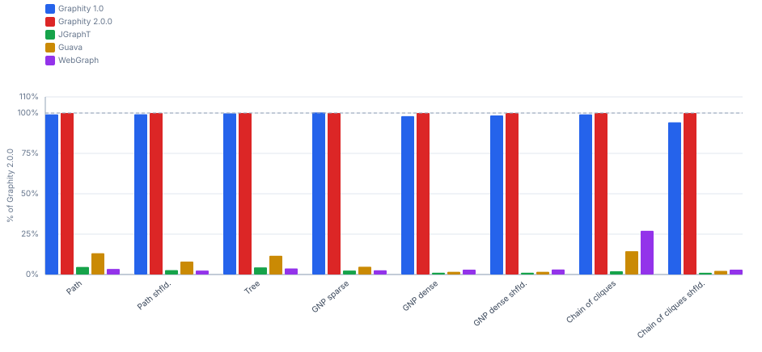

#### Times @ 1M nodes (ms/op, lower is better)

| Shape | Graphity 2.0.0 |
|---|---:|
| GNP sparse<br><sub>1M nodes, 3M edges</sub> | 22.97 ms |
| GNP dense<br><sub>1M nodes, 30M edges</sub> | 170.6 ms |
| GNP dense shfld.<br><sub>1M nodes, 30M edges</sub> | 167.6 ms |
| Chain of cliques<br><sub>1M nodes, 31.1M edges</sub> | 173.2 ms |

#### Throughput @ 1M nodes (op/s, higher is better)

| Shape | Graphity 2.0.0 |
|---|---:|
| GNP sparse<br><sub>1M nodes, 3M edges</sub> | 43.54 op/s |
| GNP dense<br><sub>1M nodes, 30M edges</sub> | 5.862 op/s |
| GNP dense shfld.<br><sub>1M nodes, 30M edges</sub> | 5.967 op/s |
| Chain of cliques<br><sub>1M nodes, 31.1M edges</sub> | 5.774 op/s |


#### Times @ 10M nodes (ms/op, lower is better)

| Shape | Graphity 2.0.0 |
|---|---:|
| GNP sparse<br><sub>10M nodes, 30M edges</sub> | 248.6 ms |
| GNP dense<br><sub>10M nodes, 299.6M edges</sub> | 2052.8 ms |
| GNP dense shfld.<br><sub>10M nodes, 299.6M edges</sub> | 1806.0 ms |
| Chain of cliques<br><sub>10M nodes, 310.8M edges</sub> | 1784.0 ms |

#### Throughput @ 10M nodes (op/s, higher is better)

| Shape | Graphity 2.0.0 |
|---|---:|
| GNP sparse<br><sub>10M nodes, 30M edges</sub> | 4.023 op/s |
| GNP dense<br><sub>10M nodes, 299.6M edges</sub> | 0.487 op/s |
| GNP dense shfld.<br><sub>10M nodes, 299.6M edges</sub> | 0.554 op/s |
| Chain of cliques<br><sub>10M nodes, 310.8M edges</sub> | 0.561 op/s |


#### Times @ 100M nodes (ms/op, lower is better)

| Shape | Graphity 2.0.0 |
|---|---:|
| GNP sparse<br><sub>100M nodes, 300M edges</sub> | 2945.8 ms |

#### Throughput @ 100M nodes (op/s, higher is better)

| Shape | Graphity 2.0.0 |
|---|---:|
| GNP sparse<br><sub>100M nodes, 300M edges</sub> | 0.339 op/s |


### 1.2 SCC

#### Times @ 10k nodes (ms/op, lower is better)

| Shape | Graphity 1.0 | Graphity 2.0.0 | Graphity 2.0.0<br>(reordered) | JGraphT | Guava | WebGraph |
|---|---:|---:|---:|---:|---:|---:|
| Path<br><sub>10k nodes, 10k edges</sub> | 0.106 ms (0.9×) | 0.113 ms | 0.112 ms (1.0×) | 0.737 ms (6.5×) | 0.813 ms (7.2×) | 0.345 ms (3.1×) |
| Path shfld.<br><sub>10k nodes, 10k edges</sub> | 0.129 ms (1.0×) | 0.134 ms | 0.108 ms (0.8×) | 1.234 ms (9.2×) | 1.184 ms (8.8×) | 0.483 ms (3.6×) |
| Tree<br><sub>10k nodes, 10k edges</sub> | 0.271 ms (2.5×) | 0.107 ms | 0.095 ms (0.9×) | 1.116 ms (10×) | 1.106 ms (10×) | 0.472 ms (4.4×) |
| GNP sparse<br><sub>10k nodes, 30k edges</sub> | 0.245 ms (1.0×) | 0.239 ms | 0.111 ms (0.5×) | 2.203 ms (9.2×) | 2.518 ms (11×) | 0.847 ms (3.5×) |
| GNP dense<br><sub>10k nodes, 299.6k edges</sub> | 0.730 ms (1.4×) | 0.539 ms | 0.378 ms (0.7×) | 25.42 ms (47×) | 18.50 ms (34×) | 2.365 ms (4.4×) |
| GNP dense shfld.<br><sub>10k nodes, 299.6k edges</sub> | 0.730 ms (1.4×) | 0.531 ms | 0.384 ms (0.7×) | 25.66 ms (48×) | 22.08 ms (42×) | 2.340 ms (4.4×) |
| Chain of cliques<br><sub>10k nodes, 310.8k edges</sub> | 0.563 ms (2.2×) | 0.260 ms | 0.259 ms (1.0×) | 16.73 ms (64×) | 5.993 ms (23×) | 3.297 ms (13×) |
| Chain of cliques shfld.<br><sub>10k nodes, 310.8k edges</sub> | 0.639 ms (1.9×) | 0.338 ms | 0.250 ms (0.7×) | 19.91 ms (59×) | 7.881 ms (23×) | 2.072 ms (6.1×) |

#### Throughput @ 10k nodes (op/s, higher is better)

| Shape | Graphity 1.0 | Graphity 2.0.0 | Graphity 2.0.0<br>(reordered) | JGraphT | Guava | WebGraph |
|---|---:|---:|---:|---:|---:|---:|
| Path<br><sub>10k nodes, 10k edges</sub> | 9 434 op/s (107%) | 8 850 op/s | 8 929 op/s (101%) | 1 357 op/s (15.3%) | 1 230 op/s (13.9%) | 2 899 op/s (32.8%) |
| Path shfld.<br><sub>10k nodes, 10k edges</sub> | 7 752 op/s (104%) | 7 463 op/s | 9 259 op/s (124%) | 810.4 op/s (10.9%) | 844.6 op/s (11.3%) | 2 070 op/s (27.7%) |
| Tree<br><sub>10k nodes, 10k edges</sub> | 3 690 op/s (39.5%) | 9 346 op/s | 10 526 op/s (113%) | 896.1 op/s (9.6%) | 904.2 op/s (9.7%) | 2 119 op/s (22.7%) |
| GNP sparse<br><sub>10k nodes, 30k edges</sub> | 4 082 op/s (97.6%) | 4 184 op/s | 9 009 op/s (215%) | 453.9 op/s (10.8%) | 397.1 op/s (9.5%) | 1 181 op/s (28.2%) |
| GNP dense<br><sub>10k nodes, 299.6k edges</sub> | 1 370 op/s (73.8%) | 1 855 op/s | 2 646 op/s (143%) | 39.33 op/s (2.1%) | 54.06 op/s (2.9%) | 422.8 op/s (22.8%) |
| GNP dense shfld.<br><sub>10k nodes, 299.6k edges</sub> | 1 370 op/s (72.7%) | 1 883 op/s | 2 604 op/s (138%) | 38.97 op/s (2.1%) | 45.30 op/s (2.4%) | 427.4 op/s (22.7%) |
| Chain of cliques<br><sub>10k nodes, 310.8k edges</sub> | 1 776 op/s (46.2%) | 3 846 op/s | 3 861 op/s (100%) | 59.77 op/s (1.6%) | 166.9 op/s (4.3%) | 303.3 op/s (7.9%) |
| Chain of cliques shfld.<br><sub>10k nodes, 310.8k edges</sub> | 1 565 op/s (52.9%) | 2 959 op/s | 4 000 op/s (135%) | 50.23 op/s (1.7%) | 126.9 op/s (4.3%) | 482.6 op/s (16.3%) |

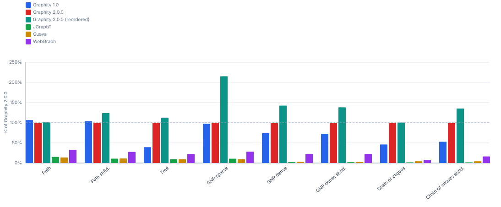

#### Times @ 100k nodes (ms/op, lower is better)

| Shape | Graphity 1.0 | Graphity 2.0.0 | Graphity 2.0.0<br>(reordered) | JGraphT | Guava | WebGraph |
|---|---:|---:|---:|---:|---:|---:|
| Path<br><sub>100k nodes, 100k edges</sub> | — | 1.130 ms | 1.117 ms (1.0×) | 12.00 ms (11×) | 22.17 ms (20×) | 3.297 ms (2.9×) |
| Path shfld.<br><sub>100k nodes, 100k edges</sub> | 2.415 ms (1.1×) | 2.192 ms | 1.038 ms (0.5×) | 45.25 ms (21×) | 50.26 ms (23×) | 5.470 ms (2.5×) |
| Tree<br><sub>100k nodes, 100k edges</sub> | 11.69 ms (5.2×) | 2.240 ms | 1.413 ms (0.6×) | 42.50 ms (19×) | 41.79 ms (19×) | 5.657 ms (2.5×) |
| GNP sparse<br><sub>100k nodes, 300k edges</sub> | 4.872 ms (1.1×) | 4.329 ms | 2.247 ms (0.5×) | 109.1 ms (25×) | 103.4 ms (24×) | 10.40 ms (2.4×) |
| GNP dense<br><sub>100k nodes, 3M edges</sub> | 9.957 ms (1.3×) | 7.389 ms | 4.475 ms (0.6×) | 493.6 ms (67×) | 428.8 ms (58×) | 35.66 ms (4.8×) |
| GNP dense shfld.<br><sub>100k nodes, 3M edges</sub> | — | 7.595 ms | 4.423 ms (0.6×) | 500.2 ms (66×) | 386.0 ms (51×) | 36.15 ms (4.8×) |
| Chain of cliques<br><sub>100k nodes, 3.1M edges</sub> | 5.702 ms (2.2×) | 2.623 ms | 2.625 ms (1.0×) | 185.5 ms (71×) | 112.8 ms (43×) | 36.60 ms (14×) |
| Chain of cliques shfld.<br><sub>100k nodes, 3.1M edges</sub> | 7.381 ms (1.6×) | 4.697 ms | 2.542 ms (0.5×) | 371.5 ms (79×) | 161.8 ms (34×) | 29.89 ms (6.4×) |

#### Throughput @ 100k nodes (op/s, higher is better)

| Shape | Graphity 1.0 | Graphity 2.0.0 | Graphity 2.0.0<br>(reordered) | JGraphT | Guava | WebGraph |
|---|---:|---:|---:|---:|---:|---:|
| Path<br><sub>100k nodes, 100k edges</sub> | — | 885.0 op/s | 895.3 op/s (101%) | 83.36 op/s (9.4%) | 45.10 op/s (5.1%) | 303.3 op/s (34.3%) |
| Path shfld.<br><sub>100k nodes, 100k edges</sub> | 414.1 op/s (90.8%) | 456.2 op/s | 963.4 op/s (211%) | 22.10 op/s (4.8%) | 19.90 op/s (4.4%) | 182.8 op/s (40.1%) |
| Tree<br><sub>100k nodes, 100k edges</sub> | 85.56 op/s (19.2%) | 446.4 op/s | 707.7 op/s (159%) | 23.53 op/s (5.3%) | 23.93 op/s (5.4%) | 176.8 op/s (39.6%) |
| GNP sparse<br><sub>100k nodes, 300k edges</sub> | 205.3 op/s (88.9%) | 231.0 op/s | 445.0 op/s (193%) | 9.166 op/s (4.0%) | 9.671 op/s (4.2%) | 96.18 op/s (41.6%) |
| GNP dense<br><sub>100k nodes, 3M edges</sub> | 100.4 op/s (74.2%) | 135.3 op/s | 223.5 op/s (165%) | 2.026 op/s (1.5%) | 2.332 op/s (1.7%) | 28.04 op/s (20.7%) |
| GNP dense shfld.<br><sub>100k nodes, 3M edges</sub> | — | 131.7 op/s | 226.1 op/s (172%) | 1.999 op/s (1.5%) | 2.591 op/s (2.0%) | 27.67 op/s (21.0%) |
| Chain of cliques<br><sub>100k nodes, 3.1M edges</sub> | 175.4 op/s (46.0%) | 381.2 op/s | 381.0 op/s (99.9%) | 5.391 op/s (1.4%) | 8.865 op/s (2.3%) | 27.32 op/s (7.2%) |
| Chain of cliques shfld.<br><sub>100k nodes, 3.1M edges</sub> | 135.5 op/s (63.6%) | 212.9 op/s | 393.4 op/s (185%) | 2.692 op/s (1.3%) | 6.180 op/s (2.9%) | 33.46 op/s (15.7%) |

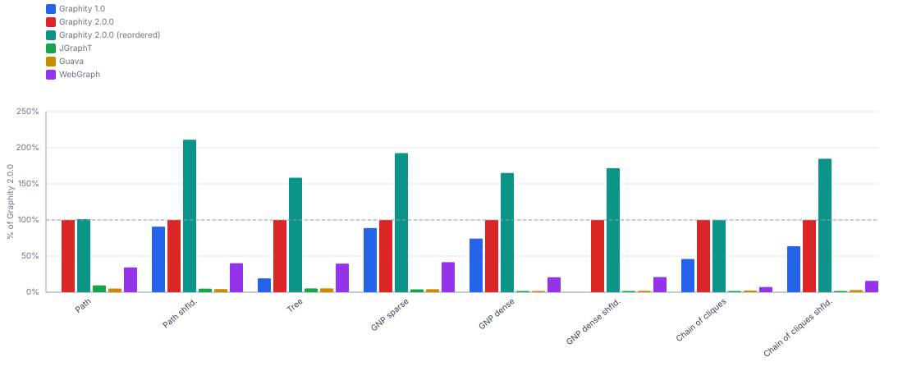

#### Times @ 1M nodes (ms/op, lower is better)

| Shape | Graphity 2.0.0 | Graphity 2.0.0<br>(reordered) |
|---|---:|---:|
| GNP sparse<br><sub>1M nodes, 3M edges</sub> | 77.49 ms | 26.75 ms (0.3×) |
| GNP dense<br><sub>1M nodes, 30M edges</sub> | 238.7 ms | — |
| GNP dense shfld.<br><sub>1M nodes, 30M edges</sub> | 232.9 ms | 66.11 ms (0.3×) |
| Chain of cliques<br><sub>1M nodes, 31.1M edges</sub> | 25.36 ms | — |

#### Throughput @ 1M nodes (op/s, higher is better)

| Shape | Graphity 2.0.0 | Graphity 2.0.0<br>(reordered) |
|---|---:|---:|
| GNP sparse<br><sub>1M nodes, 3M edges</sub> | 12.91 op/s | 37.38 op/s (290%) |
| GNP dense<br><sub>1M nodes, 30M edges</sub> | 4.189 op/s | — |
| GNP dense shfld.<br><sub>1M nodes, 30M edges</sub> | 4.294 op/s | 15.13 op/s (352%) |
| Chain of cliques<br><sub>1M nodes, 31.1M edges</sub> | 39.43 op/s | — |

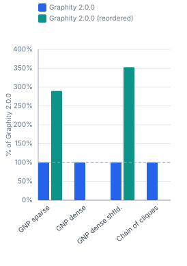

#### Times @ 10M nodes (ms/op, lower is better)

| Shape | Graphity 2.0.0 | Graphity 2.0.0<br>(reordered) |
|---|---:|---:|
| GNP sparse<br><sub>10M nodes, 30M edges</sub> | 3085.1 ms | 739.3 ms (0.2×) |
| GNP dense<br><sub>10M nodes, 299.6M edges</sub> | 6301.4 ms | — |
| GNP dense shfld.<br><sub>10M nodes, 299.6M edges</sub> | 6297.6 ms | 2740.8 ms (0.4×) |
| Chain of cliques<br><sub>10M nodes, 310.8M edges</sub> | 268.4 ms | — |

#### Throughput @ 10M nodes (op/s, higher is better)

| Shape | Graphity 2.0.0 | Graphity 2.0.0<br>(reordered) |
|---|---:|---:|
| GNP sparse<br><sub>10M nodes, 30M edges</sub> | 0.324 op/s | 1.353 op/s (417%) |
| GNP dense<br><sub>10M nodes, 299.6M edges</sub> | 0.159 op/s | — |
| GNP dense shfld.<br><sub>10M nodes, 299.6M edges</sub> | 0.159 op/s | 0.365 op/s (230%) |
| Chain of cliques<br><sub>10M nodes, 310.8M edges</sub> | 3.726 op/s | — |

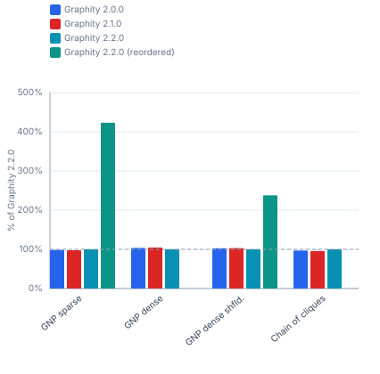

#### Times @ 100M nodes (ms/op, lower is better)

| Shape | Graphity 2.0.0 | Graphity 2.0.0<br>(reordered) |
|---|---:|---:|
| GNP sparse<br><sub>100M nodes, 300M edges</sub> | 36814 ms | 9963.5 ms (0.3×) |

#### Throughput @ 100M nodes (op/s, higher is better)

| Shape | Graphity 2.0.0 | Graphity 2.0.0<br>(reordered) |
|---|---:|---:|
| GNP sparse<br><sub>100M nodes, 300M edges</sub> | 0.027 op/s | 0.100 op/s (369%) |

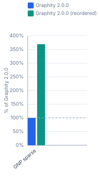

### 1.3 WCC

#### Times @ 10k nodes (ms/op, lower is better)

| Shape | Graphity 1.0 | Graphity 2.0.0 | Graphity 2.0.0<br>(reordered) |
|---|---:|---:|---:|
| Path<br><sub>10k nodes, 10k edges</sub> | 0.037 ms (1.0×) | 0.036 ms | 0.042 ms (1.2×) |
| Path shfld.<br><sub>10k nodes, 10k edges</sub> | 0.046 ms (1.0×) | 0.046 ms | 0.042 ms (0.9×) |
| Tree<br><sub>10k nodes, 10k edges</sub> | 0.038 ms (1.0×) | 0.038 ms | 0.038 ms (1.0×) |
| GNP sparse<br><sub>10k nodes, 30k edges</sub> | 0.095 ms (1.1×) | 0.083 ms | 0.086 ms (1.0×) |
| GNP dense<br><sub>10k nodes, 299.6k edges</sub> | 0.530 ms (1.0×) | 0.524 ms | 0.524 ms (1.0×) |
| GNP dense shfld.<br><sub>10k nodes, 299.6k edges</sub> | 0.525 ms (1.0×) | 0.524 ms | 0.527 ms (1.0×) |
| Chain of cliques<br><sub>10k nodes, 310.8k edges</sub> | 0.578 ms (1.0×) | 0.578 ms | 0.578 ms (1.0×) |
| Chain of cliques shfld.<br><sub>10k nodes, 310.8k edges</sub> | 0.640 ms (1.0×) | 0.640 ms | 0.581 ms (0.9×) |

#### Throughput @ 10k nodes (op/s, higher is better)

| Shape | Graphity 1.0 | Graphity 2.0.0 | Graphity 2.0.0<br>(reordered) |
|---|---:|---:|---:|
| Path<br><sub>10k nodes, 10k edges</sub> | 27 027 op/s (97.3%) | 27 778 op/s | 23 810 op/s (85.7%) |
| Path shfld.<br><sub>10k nodes, 10k edges</sub> | 21 739 op/s (100%) | 21 739 op/s | 23 810 op/s (110%) |
| Tree<br><sub>10k nodes, 10k edges</sub> | 26 316 op/s (100%) | 26 316 op/s | 26 316 op/s (100%) |
| GNP sparse<br><sub>10k nodes, 30k edges</sub> | 10 526 op/s (87.4%) | 12 048 op/s | 11 628 op/s (96.5%) |
| GNP dense<br><sub>10k nodes, 299.6k edges</sub> | 1 887 op/s (98.9%) | 1 908 op/s | 1 908 op/s (100%) |
| GNP dense shfld.<br><sub>10k nodes, 299.6k edges</sub> | 1 905 op/s (99.8%) | 1 908 op/s | 1 898 op/s (99.4%) |
| Chain of cliques<br><sub>10k nodes, 310.8k edges</sub> | 1 730 op/s (100%) | 1 730 op/s | 1 730 op/s (100%) |
| Chain of cliques shfld.<br><sub>10k nodes, 310.8k edges</sub> | 1 562 op/s (100%) | 1 562 op/s | 1 721 op/s (110%) |

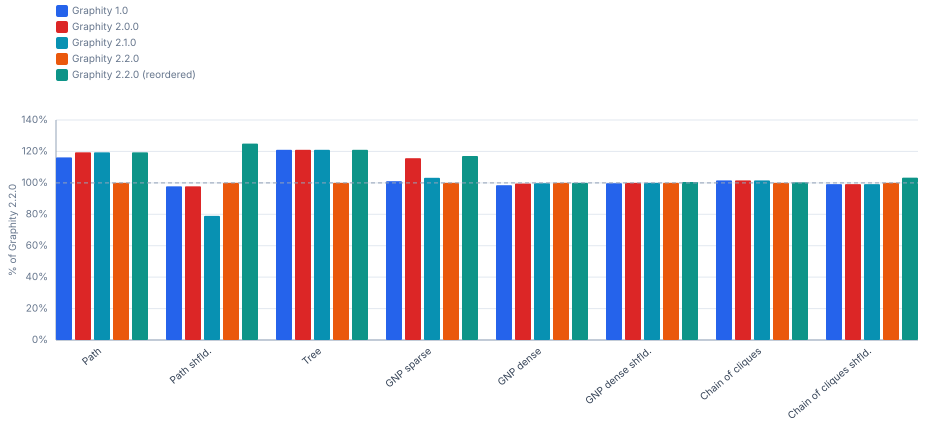

#### Times @ 100k nodes (ms/op, lower is better)

| Shape | Graphity 1.0 | Graphity 2.0.0 | Graphity 2.0.0<br>(reordered) |
|---|---:|---:|---:|
| Path<br><sub>100k nodes, 100k edges</sub> | 0.393 ms (1.0×) | 0.398 ms | 0.400 ms (1.0×) |
| Path shfld.<br><sub>100k nodes, 100k edges</sub> | 1.229 ms (1.0×) | 1.228 ms | 0.390 ms (0.3×) |
| Tree<br><sub>100k nodes, 100k edges</sub> | 0.661 ms (1.0×) | 0.636 ms | 0.732 ms (1.2×) |
| GNP sparse<br><sub>100k nodes, 300k edges</sub> | 1.769 ms (1.0×) | 1.767 ms | 1.550 ms (0.9×) |
| GNP dense<br><sub>100k nodes, 3M edges</sub> | 6.082 ms (1.0×) | 6.090 ms | 6.069 ms (1.0×) |
| GNP dense shfld.<br><sub>100k nodes, 3M edges</sub> | 6.163 ms (1.0×) | 6.091 ms | 6.163 ms (1.0×) |
| Chain of cliques<br><sub>100k nodes, 3.1M edges</sub> | 5.858 ms (1.0×) | 6.000 ms | 5.927 ms (1.0×) |
| Chain of cliques shfld.<br><sub>100k nodes, 3.1M edges</sub> | 5.955 ms (1.0×) | 5.953 ms | 6.021 ms (1.0×) |

#### Throughput @ 100k nodes (op/s, higher is better)

| Shape | Graphity 1.0 | Graphity 2.0.0 | Graphity 2.0.0<br>(reordered) |
|---|---:|---:|---:|
| Path<br><sub>100k nodes, 100k edges</sub> | 2 545 op/s (101%) | 2 513 op/s | 2 500 op/s (99.5%) |
| Path shfld.<br><sub>100k nodes, 100k edges</sub> | 813.7 op/s (99.9%) | 814.3 op/s | 2 564 op/s (315%) |
| Tree<br><sub>100k nodes, 100k edges</sub> | 1 513 op/s (96.2%) | 1 572 op/s | 1 366 op/s (86.9%) |
| GNP sparse<br><sub>100k nodes, 300k edges</sub> | 565.3 op/s (99.9%) | 565.9 op/s | 645.2 op/s (114%) |
| GNP dense<br><sub>100k nodes, 3M edges</sub> | 164.4 op/s (100%) | 164.2 op/s | 164.8 op/s (100%) |
| GNP dense shfld.<br><sub>100k nodes, 3M edges</sub> | 162.3 op/s (98.8%) | 164.2 op/s | 162.3 op/s (98.8%) |
| Chain of cliques<br><sub>100k nodes, 3.1M edges</sub> | 170.7 op/s (102%) | 166.7 op/s | 168.7 op/s (101%) |
| Chain of cliques shfld.<br><sub>100k nodes, 3.1M edges</sub> | 167.9 op/s (100.0%) | 168.0 op/s | 166.1 op/s (98.9%) |

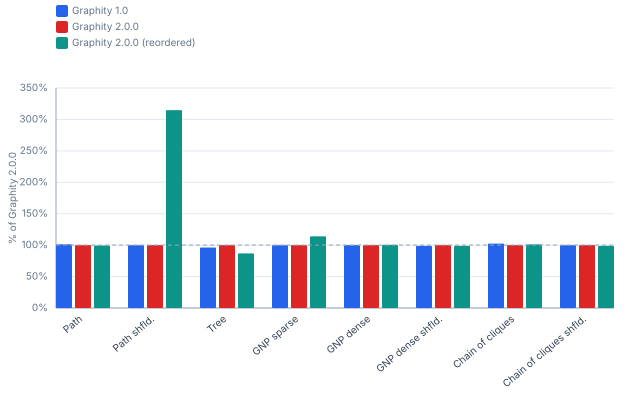

#### Times @ 1M nodes (ms/op, lower is better)

| Shape | Graphity 2.0.0 | Graphity 2.0.0<br>(reordered) |
|---|---:|---:|
| GNP sparse<br><sub>1M nodes, 3M edges</sub> | 21.74 ms | 17.26 ms (0.8×) |
| GNP dense<br><sub>1M nodes, 30M edges</sub> | 65.50 ms | — |
| GNP dense shfld.<br><sub>1M nodes, 30M edges</sub> | 70.47 ms | 69.61 ms (1.0×) |
| Chain of cliques<br><sub>1M nodes, 31.1M edges</sub> | 50.95 ms | — |

#### Throughput @ 1M nodes (op/s, higher is better)

| Shape | Graphity 2.0.0 | Graphity 2.0.0<br>(reordered) |
|---|---:|---:|
| GNP sparse<br><sub>1M nodes, 3M edges</sub> | 46.00 op/s | 57.94 op/s (126%) |
| GNP dense<br><sub>1M nodes, 30M edges</sub> | 15.27 op/s | — |
| GNP dense shfld.<br><sub>1M nodes, 30M edges</sub> | 14.19 op/s | 14.37 op/s (101%) |
| Chain of cliques<br><sub>1M nodes, 31.1M edges</sub> | 19.63 op/s | — |

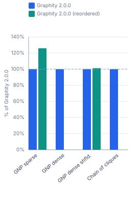

#### Times @ 10M nodes (ms/op, lower is better)

| Shape | Graphity 2.0.0 | Graphity 2.0.0<br>(reordered) |
|---|---:|---:|
| GNP sparse<br><sub>10M nodes, 30M edges</sub> | 615.6 ms | 410.6 ms (0.7×) |
| GNP dense<br><sub>10M nodes, 299.6M edges</sub> | 4094.7 ms | — |
| GNP dense shfld.<br><sub>10M nodes, 299.6M edges</sub> | 3899.0 ms | 3844.9 ms (1.0×) |
| Chain of cliques<br><sub>10M nodes, 310.8M edges</sub> | 754.7 ms | — |

#### Throughput @ 10M nodes (op/s, higher is better)

| Shape | Graphity 2.0.0 | Graphity 2.0.0<br>(reordered) |
|---|---:|---:|
| GNP sparse<br><sub>10M nodes, 30M edges</sub> | 1.624 op/s | 2.435 op/s (150%) |
| GNP dense<br><sub>10M nodes, 299.6M edges</sub> | 0.244 op/s | — |
| GNP dense shfld.<br><sub>10M nodes, 299.6M edges</sub> | 0.256 op/s | 0.260 op/s (101%) |
| Chain of cliques<br><sub>10M nodes, 310.8M edges</sub> | 1.325 op/s | — |

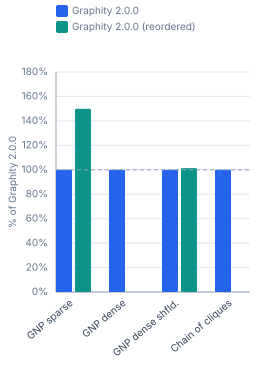

#### Times @ 100M nodes (ms/op, lower is better)

| Shape | Graphity 2.0.0 | Graphity 2.0.0<br>(reordered) |
|---|---:|---:|
| GNP sparse<br><sub>100M nodes, 300M edges</sub> | 8231.6 ms | 6807.7 ms (0.8×) |

#### Throughput @ 100M nodes (op/s, higher is better)

| Shape | Graphity 2.0.0 | Graphity 2.0.0<br>(reordered) |
|---|---:|---:|
| GNP sparse<br><sub>100M nodes, 300M edges</sub> | 0.121 op/s | 0.147 op/s (121%) |

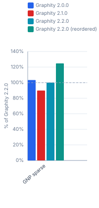

### 1.4 CCs

#### Times @ 10k nodes (ms/op, lower is better)

| Shape | Graphity 1.0 | Graphity 2.0.0 | Graphity 2.0.0<br>(reordered) |
|---|---:|---:|---:|
| Path<br><sub>10k nodes, 10k edges</sub> | 0.037 ms (0.9×) | 0.042 ms | 0.036 ms (0.9×) |
| Path shfld.<br><sub>10k nodes, 10k edges</sub> | 0.053 ms (1.0×) | 0.053 ms | 0.036 ms (0.7×) |
| Tree<br><sub>10k nodes, 10k edges</sub> | 0.044 ms (1.2×) | 0.038 ms | 0.043 ms (1.1×) |
| GNP sparse<br><sub>10k nodes, 30k edges</sub> | 0.106 ms (1.2×) | 0.090 ms | 0.088 ms (1.0×) |
| GNP dense<br><sub>10k nodes, 299.6k edges</sub> | 0.518 ms (1.0×) | 0.526 ms | 0.520 ms (1.0×) |
| GNP dense shfld.<br><sub>10k nodes, 299.6k edges</sub> | 0.522 ms (1.0×) | 0.524 ms | 0.534 ms (1.0×) |
| Chain of cliques<br><sub>10k nodes, 310.8k edges</sub> | 0.586 ms (1.0×) | 0.580 ms | 0.584 ms (1.0×) |
| Chain of cliques shfld.<br><sub>10k nodes, 310.8k edges</sub> | 0.639 ms (1.0×) | 0.640 ms | 0.625 ms (1.0×) |

#### Throughput @ 10k nodes (op/s, higher is better)

| Shape | Graphity 1.0 | Graphity 2.0.0 | Graphity 2.0.0<br>(reordered) |
|---|---:|---:|---:|
| Path<br><sub>10k nodes, 10k edges</sub> | 27 027 op/s (114%) | 23 810 op/s | 27 778 op/s (117%) |
| Path shfld.<br><sub>10k nodes, 10k edges</sub> | 18 868 op/s (100%) | 18 868 op/s | 27 778 op/s (147%) |
| Tree<br><sub>10k nodes, 10k edges</sub> | 22 727 op/s (86.4%) | 26 316 op/s | 23 256 op/s (88.4%) |
| GNP sparse<br><sub>10k nodes, 30k edges</sub> | 9 434 op/s (84.9%) | 11 111 op/s | 11 364 op/s (102%) |
| GNP dense<br><sub>10k nodes, 299.6k edges</sub> | 1 931 op/s (102%) | 1 901 op/s | 1 923 op/s (101%) |
| GNP dense shfld.<br><sub>10k nodes, 299.6k edges</sub> | 1 916 op/s (100%) | 1 908 op/s | 1 873 op/s (98.1%) |
| Chain of cliques<br><sub>10k nodes, 310.8k edges</sub> | 1 706 op/s (99.0%) | 1 724 op/s | 1 712 op/s (99.3%) |
| Chain of cliques shfld.<br><sub>10k nodes, 310.8k edges</sub> | 1 565 op/s (100%) | 1 562 op/s | 1 600 op/s (102%) |

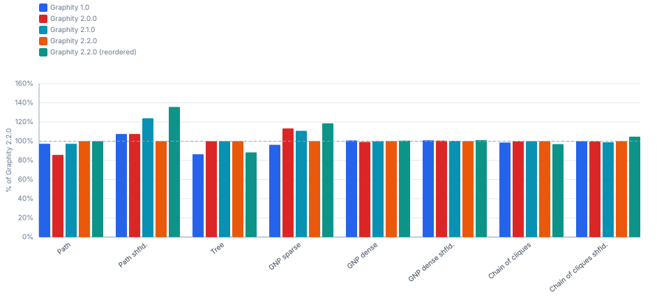

#### Times @ 100k nodes (ms/op, lower is better)

| Shape | Graphity 1.0 | Graphity 2.0.0 | Graphity 2.0.0<br>(reordered) |
|---|---:|---:|---:|
| Path<br><sub>100k nodes, 100k edges</sub> | 0.396 ms (1.0×) | 0.403 ms | 0.392 ms (1.0×) |
| Path shfld.<br><sub>100k nodes, 100k edges</sub> | 1.229 ms (0.9×) | 1.326 ms | 0.369 ms (0.3×) |
| Tree<br><sub>100k nodes, 100k edges</sub> | 0.665 ms (1.0×) | 0.649 ms | 0.728 ms (1.1×) |
| GNP sparse<br><sub>100k nodes, 300k edges</sub> | 1.762 ms (1.0×) | 1.769 ms | 1.501 ms (0.8×) |
| GNP dense<br><sub>100k nodes, 3M edges</sub> | 6.173 ms (1.0×) | 6.095 ms | 6.057 ms (1.0×) |
| GNP dense shfld.<br><sub>100k nodes, 3M edges</sub> | 6.157 ms (1.0×) | 6.186 ms | 6.029 ms (1.0×) |
| Chain of cliques<br><sub>100k nodes, 3.1M edges</sub> | 5.806 ms (1.0×) | 5.871 ms | 5.856 ms (1.0×) |
| Chain of cliques shfld.<br><sub>100k nodes, 3.1M edges</sub> | 5.999 ms (1.0×) | 5.949 ms | 6.055 ms (1.0×) |

#### Throughput @ 100k nodes (op/s, higher is better)

| Shape | Graphity 1.0 | Graphity 2.0.0 | Graphity 2.0.0<br>(reordered) |
|---|---:|---:|---:|
| Path<br><sub>100k nodes, 100k edges</sub> | 2 525 op/s (102%) | 2 481 op/s | 2 551 op/s (103%) |
| Path shfld.<br><sub>100k nodes, 100k edges</sub> | 813.7 op/s (108%) | 754.1 op/s | 2 710 op/s (359%) |
| Tree<br><sub>100k nodes, 100k edges</sub> | 1 504 op/s (97.6%) | 1 541 op/s | 1 374 op/s (89.1%) |
| GNP sparse<br><sub>100k nodes, 300k edges</sub> | 567.5 op/s (100%) | 565.3 op/s | 666.2 op/s (118%) |
| GNP dense<br><sub>100k nodes, 3M edges</sub> | 162.0 op/s (98.7%) | 164.1 op/s | 165.1 op/s (101%) |
| GNP dense shfld.<br><sub>100k nodes, 3M edges</sub> | 162.4 op/s (100%) | 161.7 op/s | 165.9 op/s (103%) |
| Chain of cliques<br><sub>100k nodes, 3.1M edges</sub> | 172.2 op/s (101%) | 170.3 op/s | 170.8 op/s (100%) |
| Chain of cliques shfld.<br><sub>100k nodes, 3.1M edges</sub> | 166.7 op/s (99.2%) | 168.1 op/s | 165.2 op/s (98.2%) |

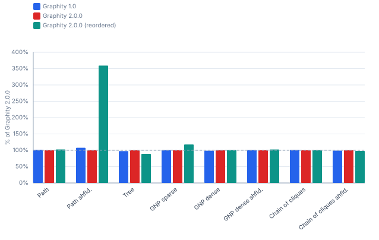

#### Times @ 1M nodes (ms/op, lower is better)

| Shape | Graphity 2.0.0 | Graphity 2.0.0<br>(reordered) |
|---|---:|---:|
| GNP sparse<br><sub>1M nodes, 3M edges</sub> | 19.83 ms | 17.28 ms (0.9×) |
| GNP dense<br><sub>1M nodes, 30M edges</sub> | 79.11 ms | — |
| GNP dense shfld.<br><sub>1M nodes, 30M edges</sub> | 67.63 ms | 66.60 ms (1.0×) |
| Chain of cliques<br><sub>1M nodes, 31.1M edges</sub> | 50.35 ms | — |

#### Throughput @ 1M nodes (op/s, higher is better)

| Shape | Graphity 2.0.0 | Graphity 2.0.0<br>(reordered) |
|---|---:|---:|
| GNP sparse<br><sub>1M nodes, 3M edges</sub> | 50.44 op/s | 57.86 op/s (115%) |
| GNP dense<br><sub>1M nodes, 30M edges</sub> | 12.64 op/s | — |
| GNP dense shfld.<br><sub>1M nodes, 30M edges</sub> | 14.79 op/s | 15.02 op/s (102%) |
| Chain of cliques<br><sub>1M nodes, 31.1M edges</sub> | 19.86 op/s | — |

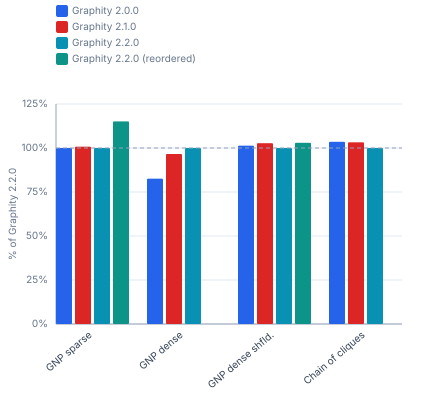

#### Times @ 10M nodes (ms/op, lower is better)

| Shape | Graphity 2.0.0 | Graphity 2.0.0<br>(reordered) |
|---|---:|---:|
| GNP sparse<br><sub>10M nodes, 30M edges</sub> | 576.6 ms | 410.4 ms (0.7×) |
| GNP dense<br><sub>10M nodes, 299.6M edges</sub> | 4122.2 ms | — |
| GNP dense shfld.<br><sub>10M nodes, 299.6M edges</sub> | 3909.4 ms | 4002.5 ms (1.0×) |
| Chain of cliques<br><sub>10M nodes, 310.8M edges</sub> | 569.9 ms | — |

#### Throughput @ 10M nodes (op/s, higher is better)

| Shape | Graphity 2.0.0 | Graphity 2.0.0<br>(reordered) |
|---|---:|---:|
| GNP sparse<br><sub>10M nodes, 30M edges</sub> | 1.734 op/s | 2.437 op/s (140%) |
| GNP dense<br><sub>10M nodes, 299.6M edges</sub> | 0.243 op/s | — |
| GNP dense shfld.<br><sub>10M nodes, 299.6M edges</sub> | 0.256 op/s | 0.250 op/s (97.7%) |
| Chain of cliques<br><sub>10M nodes, 310.8M edges</sub> | 1.755 op/s | — |

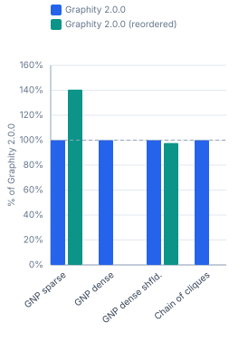

#### Times @ 100M nodes (ms/op, lower is better)

| Shape | Graphity 2.0.0 | Graphity 2.0.0<br>(reordered) |
|---|---:|---:|
| GNP sparse<br><sub>100M nodes, 300M edges</sub> | 8479.6 ms | 6840.6 ms (0.8×) |

#### Throughput @ 100M nodes (op/s, higher is better)

| Shape | Graphity 2.0.0 | Graphity 2.0.0<br>(reordered) |
|---|---:|---:|
| GNP sparse<br><sub>100M nodes, 300M edges</sub> | 0.118 op/s | 0.146 op/s (124%) |


### 1.5 TopOrder

#### Times @ 10k nodes (ms/op, lower is better)

| Shape | Graphity 1.0 | Graphity 2.0.0 | Graphity 2.0.0<br>(reordered) | JGraphT | Guava | WebGraph |
|---|---:|---:|---:|---:|---:|---:|
| Path<br><sub>10k nodes, 10k edges</sub> | 0.058 ms (0.9×) | 0.067 ms | 0.067 ms (1.0×) | 0.423 ms (6.3×) | 0.420 ms (6.3×) | 0.552 ms (8.2×) |
| Path shfld.<br><sub>10k nodes, 10k edges</sub> | 0.099 ms (1.4×) | 0.072 ms | 0.056 ms (0.8×) | 0.656 ms (9.1×) | 0.859 ms (12×) | 0.426 ms (5.9×) |
| Tree<br><sub>10k nodes, 10k edges</sub> | 0.198 ms (4.5×) | 0.044 ms | 0.039 ms (0.9×) | 0.710 ms (16×) | 0.781 ms (18×) | 0.608 ms (14×) |
| Tree shfld. | 0.088 ms (1.7×) | 0.052 ms | 0.047 ms (0.9×) | 0.699 ms (13×) | 0.699 ms (13×) | 0.514 ms (9.9×) |
| DAG GNP sparse | 0.279 ms (4.0×) | 0.070 ms | 0.061 ms (0.9×) | 1.134 ms (16×) | 1.533 ms (22×) | 0.842 ms (12×) |
| DAG GNP dense | 0.448 ms (1.3×) | 0.337 ms | 0.245 ms (0.7×) | 15.45 ms (46×) | 9.509 ms (28×) | 2.078 ms (6.2×) |
| DAG GNP dense shfld. | 0.560 ms (1.4×) | 0.387 ms | 0.244 ms (0.6×) | 19.05 ms (49×) | 13.08 ms (34×) | 2.273 ms (5.9×) |

#### Throughput @ 10k nodes (op/s, higher is better)

| Shape | Graphity 1.0 | Graphity 2.0.0 | Graphity 2.0.0<br>(reordered) | JGraphT | Guava | WebGraph |
|---|---:|---:|---:|---:|---:|---:|
| Path<br><sub>10k nodes, 10k edges</sub> | 17 241 op/s (116%) | 14 925 op/s | 14 925 op/s (100%) | 2 364 op/s (15.8%) | 2 381 op/s (16.0%) | 1 812 op/s (12.1%) |
| Path shfld.<br><sub>10k nodes, 10k edges</sub> | 10 101 op/s (72.7%) | 13 889 op/s | 17 857 op/s (129%) | 1 524 op/s (11.0%) | 1 164 op/s (8.4%) | 2 347 op/s (16.9%) |
| Tree<br><sub>10k nodes, 10k edges</sub> | 5 051 op/s (22.2%) | 22 727 op/s | 25 641 op/s (113%) | 1 408 op/s (6.2%) | 1 280 op/s (5.6%) | 1 645 op/s (7.2%) |
| Tree shfld. | 11 364 op/s (59.1%) | 19 231 op/s | 21 277 op/s (111%) | 1 431 op/s (7.4%) | 1 431 op/s (7.4%) | 1 946 op/s (10.1%) |
| DAG GNP sparse | 3 584 op/s (25.1%) | 14 286 op/s | 16 393 op/s (115%) | 881.8 op/s (6.2%) | 652.3 op/s (4.6%) | 1 188 op/s (8.3%) |
| DAG GNP dense | 2 232 op/s (75.2%) | 2 967 op/s | 4 082 op/s (138%) | 64.72 op/s (2.2%) | 105.2 op/s (3.5%) | 481.2 op/s (16.2%) |
| DAG GNP dense shfld. | 1 786 op/s (69.1%) | 2 584 op/s | 4 098 op/s (159%) | 52.50 op/s (2.0%) | 76.45 op/s (3.0%) | 439.9 op/s (17.0%) |

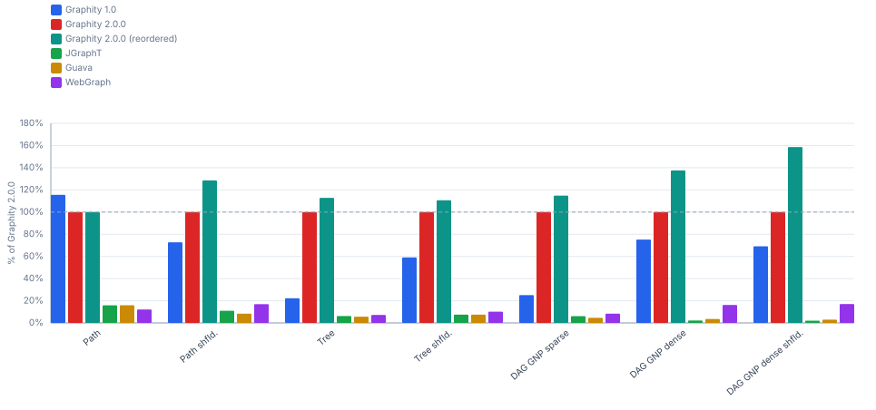

#### Times @ 100k nodes (ms/op, lower is better)

| Shape | Graphity 1.0 | Graphity 2.0.0 | Graphity 2.0.0<br>(reordered) | JGraphT | Guava | WebGraph |
|---|---:|---:|---:|---:|---:|---:|
| Path<br><sub>100k nodes, 100k edges</sub> | 0.539 ms (0.8×) | 0.656 ms | 0.662 ms (1.0×) | 8.304 ms (13×) | 14.73 ms (22×) | 3.240 ms (4.9×) |
| Path shfld.<br><sub>100k nodes, 100k edges</sub> | 1.287 ms (1.2×) | 1.051 ms | 0.566 ms (0.5×) | 27.20 ms (26×) | 31.52 ms (30×) | 5.080 ms (4.8×) |
| Tree<br><sub>100k nodes, 100k edges</sub> | 9.963 ms (7.6×) | 1.311 ms | 1.023 ms (0.8×) | 30.98 ms (24×) | 19.34 ms (15×) | 14.60 ms (11×) |
| Tree shfld. | 5.091 ms (3.4×) | 1.487 ms | 1.212 ms (0.8×) | 26.43 ms (18×) | 19.59 ms (13×) | 10.15 ms (6.8×) |
| DAG GNP sparse | 9.521 ms (4.2×) | 2.251 ms | 1.480 ms (0.7×) | 65.56 ms (29×) | 55.78 ms (25×) | 17.53 ms (7.8×) |
| DAG GNP dense | 6.487 ms (1.4×) | 4.533 ms | 3.208 ms (0.7×) | 237.7 ms (52×) | 311.6 ms (69×) | 25.12 ms (5.5×) |
| DAG GNP dense shfld. | 8.053 ms (1.5×) | 5.303 ms | 3.254 ms (0.6×) | 265.9 ms (50×) | 296.5 ms (56×) | 31.92 ms (6.0×) |

#### Throughput @ 100k nodes (op/s, higher is better)

| Shape | Graphity 1.0 | Graphity 2.0.0 | Graphity 2.0.0<br>(reordered) | JGraphT | Guava | WebGraph |
|---|---:|---:|---:|---:|---:|---:|
| Path<br><sub>100k nodes, 100k edges</sub> | 1 855 op/s (122%) | 1 524 op/s | 1 511 op/s (99.1%) | 120.4 op/s (7.9%) | 67.87 op/s (4.5%) | 308.6 op/s (20.2%) |
| Path shfld.<br><sub>100k nodes, 100k edges</sub> | 777.0 op/s (81.7%) | 951.5 op/s | 1 767 op/s (186%) | 36.77 op/s (3.9%) | 31.72 op/s (3.3%) | 196.9 op/s (20.7%) |
| Tree<br><sub>100k nodes, 100k edges</sub> | 100.4 op/s (13.2%) | 762.8 op/s | 977.5 op/s (128%) | 32.28 op/s (4.2%) | 51.71 op/s (6.8%) | 68.49 op/s (9.0%) |
| Tree shfld. | 196.4 op/s (29.2%) | 672.5 op/s | 825.1 op/s (123%) | 37.84 op/s (5.6%) | 51.04 op/s (7.6%) | 98.52 op/s (14.7%) |
| DAG GNP sparse | 105.0 op/s (23.6%) | 444.2 op/s | 675.7 op/s (152%) | 15.25 op/s (3.4%) | 17.93 op/s (4.0%) | 57.04 op/s (12.8%) |
| DAG GNP dense | 154.2 op/s (69.9%) | 220.6 op/s | 311.7 op/s (141%) | 4.207 op/s (1.9%) | 3.209 op/s (1.5%) | 39.82 op/s (18.0%) |
| DAG GNP dense shfld. | 124.2 op/s (65.9%) | 188.6 op/s | 307.3 op/s (163%) | 3.761 op/s (2.0%) | 3.373 op/s (1.8%) | 31.32 op/s (16.6%) |

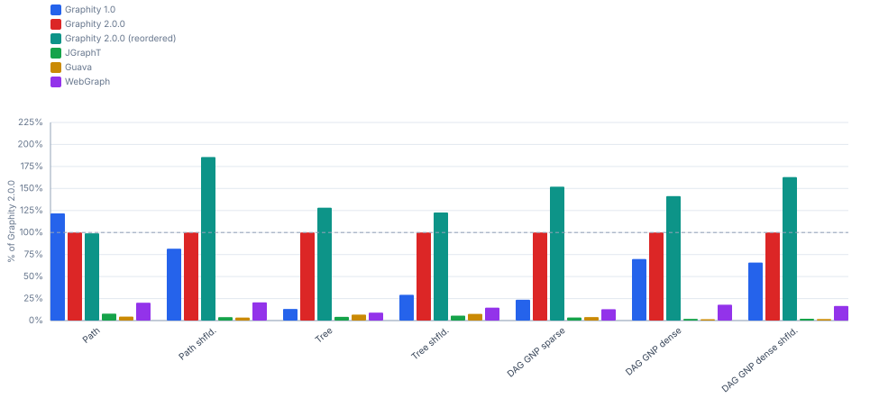

#### Times @ 1M nodes (ms/op, lower is better)

| Shape | Graphity 2.0.0 | Graphity 2.0.0<br>(reordered) |
|---|---:|---:|
| DAG GNP sparse | 30.49 ms | 15.46 ms (0.5×) |
| DAG GNP dense | 103.7 ms | — |
| DAG GNP dense shfld. | 176.2 ms | 39.69 ms (0.2×) |

#### Throughput @ 1M nodes (op/s, higher is better)

| Shape | Graphity 2.0.0 | Graphity 2.0.0<br>(reordered) |
|---|---:|---:|
| DAG GNP sparse | 32.80 op/s | 64.68 op/s (197%) |
| DAG GNP dense | 9.643 op/s | — |
| DAG GNP dense shfld. | 5.675 op/s | 25.20 op/s (444%) |

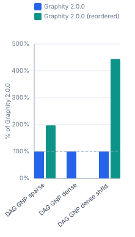

#### Times @ 10M nodes (ms/op, lower is better)

| Shape | Graphity 2.0.0 | Graphity 2.0.0<br>(reordered) |
|---|---:|---:|
| DAG GNP sparse | 1170.9 ms | 160.8 ms (0.1×) |
| DAG GNP dense | 1966.4 ms | — |
| DAG GNP dense shfld. | 2823.5 ms | 414.3 ms (0.1×) |

#### Throughput @ 10M nodes (op/s, higher is better)

| Shape | Graphity 2.0.0 | Graphity 2.0.0<br>(reordered) |
|---|---:|---:|
| DAG GNP sparse | 0.854 op/s | 6.219 op/s (728%) |
| DAG GNP dense | 0.509 op/s | — |
| DAG GNP dense shfld. | 0.354 op/s | 2.414 op/s (682%) |

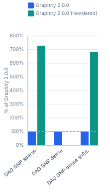

#### Times @ 100M nodes (ms/op, lower is better)

| Shape | Graphity 2.0.0 | Graphity 2.0.0<br>(reordered) |
|---|---:|---:|
| DAG GNP sparse | 17135 ms | 1810.4 ms (0.1×) |

#### Throughput @ 100M nodes (op/s, higher is better)

| Shape | Graphity 2.0.0 | Graphity 2.0.0<br>(reordered) |
|---|---:|---:|
| DAG GNP sparse | 0.058 op/s | 0.552 op/s (946%) |

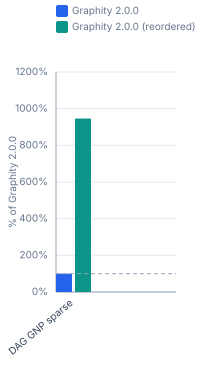

### 1.6 TopOrderAndLevels

#### Times @ 10k nodes (ms/op, lower is better)

| Shape | Graphity 1.0 | Graphity 2.0.0 | Graphity 2.0.0<br>(reordered) |
|---|---:|---:|---:|
| Path<br><sub>10k nodes, 10k edges</sub> | 0.039 ms (1.0×) | 0.039 ms | 0.037 ms (0.9×) |
| Path shfld.<br><sub>10k nodes, 10k edges</sub> | 0.055 ms (1.0×) | 0.056 ms | 0.038 ms (0.7×) |
| Tree<br><sub>10k nodes, 10k edges</sub> | 0.031 ms (1.0×) | 0.031 ms | 0.030 ms (1.0×) |
| Tree shfld. | 0.034 ms (1.1×) | 0.031 ms | 0.031 ms (1.0×) |
| DAG GNP sparse | 0.052 ms (0.9×) | 0.057 ms | 0.050 ms (0.9×) |
| DAG GNP dense | 0.364 ms (1.0×) | 0.358 ms | 0.326 ms (0.9×) |
| DAG GNP dense shfld. | 0.393 ms (1.0×) | 0.396 ms | 0.323 ms (0.8×) |

#### Throughput @ 10k nodes (op/s, higher is better)

| Shape | Graphity 1.0 | Graphity 2.0.0 | Graphity 2.0.0<br>(reordered) |
|---|---:|---:|---:|
| Path<br><sub>10k nodes, 10k edges</sub> | 25 641 op/s (100%) | 25 641 op/s | 27 027 op/s (105%) |
| Path shfld.<br><sub>10k nodes, 10k edges</sub> | 18 182 op/s (102%) | 17 857 op/s | 26 316 op/s (147%) |
| Tree<br><sub>10k nodes, 10k edges</sub> | 32 258 op/s (100%) | 32 258 op/s | 33 333 op/s (103%) |
| Tree shfld. | 29 412 op/s (91.2%) | 32 258 op/s | 32 258 op/s (100%) |
| DAG GNP sparse | 19 231 op/s (110%) | 17 544 op/s | 20 000 op/s (114%) |
| DAG GNP dense | 2 747 op/s (98.4%) | 2 793 op/s | 3 067 op/s (110%) |
| DAG GNP dense shfld. | 2 545 op/s (101%) | 2 525 op/s | 3 096 op/s (123%) |

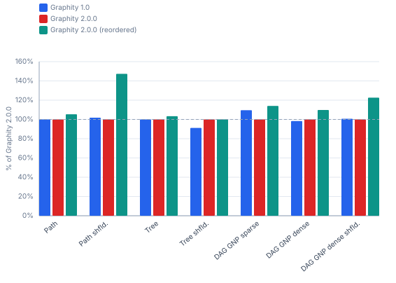

#### Times @ 100k nodes (ms/op, lower is better)

| Shape | Graphity 1.0 | Graphity 2.0.0 | Graphity 2.0.0<br>(reordered) |
|---|---:|---:|---:|
| Path<br><sub>100k nodes, 100k edges</sub> | 0.562 ms (1.2×) | 0.456 ms | 0.560 ms (1.2×) |
| Path shfld.<br><sub>100k nodes, 100k edges</sub> | 1.463 ms (1.1×) | 1.378 ms | 0.559 ms (0.4×) |
| Tree<br><sub>100k nodes, 100k edges</sub> | 0.934 ms (1.0×) | 0.929 ms | 0.863 ms (0.9×) |
| Tree shfld. | 1.048 ms (1.1×) | 0.945 ms | 0.829 ms (0.9×) |
| DAG GNP sparse | 2.167 ms (1.0×) | 2.211 ms | 1.974 ms (0.9×) |
| DAG GNP dense | 5.160 ms (1.0×) | 5.093 ms | 4.574 ms (0.9×) |
| DAG GNP dense shfld. | 5.877 ms (1.0×) | 5.806 ms | 4.496 ms (0.8×) |

#### Throughput @ 100k nodes (op/s, higher is better)

| Shape | Graphity 1.0 | Graphity 2.0.0 | Graphity 2.0.0<br>(reordered) |
|---|---:|---:|---:|
| Path<br><sub>100k nodes, 100k edges</sub> | 1 779 op/s (81.1%) | 2 193 op/s | 1 786 op/s (81.4%) |
| Path shfld.<br><sub>100k nodes, 100k edges</sub> | 683.5 op/s (94.2%) | 725.7 op/s | 1 789 op/s (247%) |
| Tree<br><sub>100k nodes, 100k edges</sub> | 1 071 op/s (99.5%) | 1 076 op/s | 1 159 op/s (108%) |
| Tree shfld. | 954.2 op/s (90.2%) | 1 058 op/s | 1 206 op/s (114%) |
| DAG GNP sparse | 461.5 op/s (102%) | 452.3 op/s | 506.6 op/s (112%) |
| DAG GNP dense | 193.8 op/s (98.7%) | 196.3 op/s | 218.6 op/s (111%) |
| DAG GNP dense shfld. | 170.2 op/s (98.8%) | 172.2 op/s | 222.4 op/s (129%) |

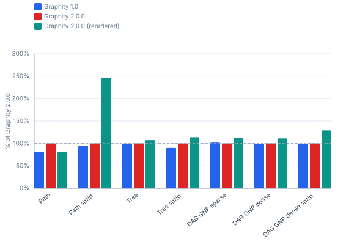

#### Times @ 1M nodes (ms/op, lower is better)

| Shape | Graphity 2.0.0 | Graphity 2.0.0<br>(reordered) |
|---|---:|---:|
| DAG GNP sparse | 29.60 ms | 26.85 ms (0.9×) |
| DAG GNP dense | 112.1 ms | — |
| DAG GNP dense shfld. | 191.1 ms | 89.45 ms (0.5×) |

#### Throughput @ 1M nodes (op/s, higher is better)

| Shape | Graphity 2.0.0 | Graphity 2.0.0<br>(reordered) |
|---|---:|---:|
| DAG GNP sparse | 33.78 op/s | 37.24 op/s (110%) |
| DAG GNP dense | 8.921 op/s | — |
| DAG GNP dense shfld. | 5.233 op/s | 11.18 op/s (214%) |

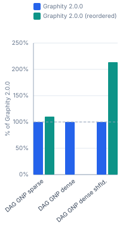

#### Times @ 10M nodes (ms/op, lower is better)

| Shape | Graphity 2.0.0 | Graphity 2.0.0<br>(reordered) |
|---|---:|---:|
| DAG GNP sparse | 856.2 ms | 751.9 ms (0.9×) |
| DAG GNP dense | 3085.9 ms | — |
| DAG GNP dense shfld. | 4398.5 ms | 2631.0 ms (0.6×) |

#### Throughput @ 10M nodes (op/s, higher is better)

| Shape | Graphity 2.0.0 | Graphity 2.0.0<br>(reordered) |
|---|---:|---:|
| DAG GNP sparse | 1.168 op/s | 1.330 op/s (114%) |
| DAG GNP dense | 0.324 op/s | — |
| DAG GNP dense shfld. | 0.227 op/s | 0.380 op/s (167%) |

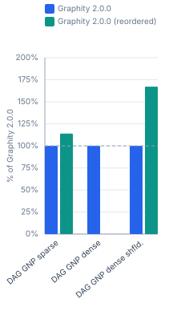

#### Times @ 100M nodes (ms/op, lower is better)

| Shape | Graphity 2.0.0 | Graphity 2.0.0<br>(reordered) |
|---|---:|---:|
| DAG GNP sparse | 11384 ms | 9441.1 ms (0.8×) |

#### Throughput @ 100M nodes (op/s, higher is better)

| Shape | Graphity 2.0.0 | Graphity 2.0.0<br>(reordered) |
|---|---:|---:|
| DAG GNP sparse | 0.088 op/s | 0.106 op/s (121%) |

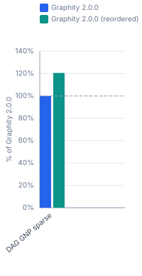

### 1.7 BackEdges

#### Times @ 10k nodes (ms/op, lower is better)

| Shape | Graphity 1.0 | Graphity 2.0.0 | Graphity 2.0.0<br>(reordered) | JGraphT | Guava | WebGraph |
|---|---:|---:|---:|---:|---:|---:|
| Path<br><sub>10k nodes, 10k edges</sub> | 0.047 ms (0.8×) | 0.061 ms | 0.061 ms (1.0×) | 0.169 ms (2.8×) | 0.219 ms (3.6×) | 0.559 ms (9.2×) |
| Path shfld.<br><sub>10k nodes, 10k edges</sub> | 0.058 ms (0.9×) | 0.067 ms | 0.051 ms (0.8×) | 0.361 ms (5.4×) | 0.498 ms (7.4×) | 0.444 ms (6.6×) |
| Tree<br><sub>10k nodes, 10k edges</sub> | 0.223 ms (4.6×) | 0.049 ms | 0.048 ms (1.0×) | 0.459 ms (9.4×) | 0.726 ms (15×) | 0.591 ms (12×) |
| GNP sparse<br><sub>10k nodes, 30k edges</sub> | 0.207 ms (1.7×) | 0.119 ms | 0.090 ms (0.8×) | 0.630 ms (5.3×) | 1.371 ms (12×) | 0.790 ms (6.6×) |
| GNP dense<br><sub>10k nodes, 299.6k edges</sub> | 0.797 ms (1.0×) | 0.776 ms | 0.647 ms (0.8×) | 3.672 ms (4.7×) | 11.78 ms (15×) | 2.576 ms (3.3×) |
| GNP dense shfld.<br><sub>10k nodes, 299.6k edges</sub> | 0.811 ms (1.0×) | 0.779 ms | 0.669 ms (0.9×) | 3.860 ms (5.0×) | 12.92 ms (17×) | 2.522 ms (3.2×) |
| Chain of cliques<br><sub>10k nodes, 310.8k edges</sub> | 0.512 ms (0.9×) | 0.592 ms | 0.592 ms (1.0×) | 3.172 ms (5.4×) | 3.138 ms (5.3×) | 3.840 ms (6.5×) |
| Chain of cliques shfld.<br><sub>10k nodes, 310.8k edges</sub> | 0.619 ms (1.0×) | 0.644 ms | 0.588 ms (0.9×) | 4.903 ms (7.6×) | 4.796 ms (7.4×) | 2.420 ms (3.8×) |

#### Throughput @ 10k nodes (op/s, higher is better)

| Shape | Graphity 1.0 | Graphity 2.0.0 | Graphity 2.0.0<br>(reordered) | JGraphT | Guava | WebGraph |
|---|---:|---:|---:|---:|---:|---:|
| Path<br><sub>10k nodes, 10k edges</sub> | 21 277 op/s (130%) | 16 393 op/s | 16 393 op/s (100%) | 5 917 op/s (36.1%) | 4 566 op/s (27.9%) | 1 789 op/s (10.9%) |
| Path shfld.<br><sub>10k nodes, 10k edges</sub> | 17 241 op/s (116%) | 14 925 op/s | 19 608 op/s (131%) | 2 770 op/s (18.6%) | 2 008 op/s (13.5%) | 2 252 op/s (15.1%) |
| Tree<br><sub>10k nodes, 10k edges</sub> | 4 484 op/s (22.0%) | 20 408 op/s | 20 833 op/s (102%) | 2 179 op/s (10.7%) | 1 377 op/s (6.7%) | 1 692 op/s (8.3%) |
| GNP sparse<br><sub>10k nodes, 30k edges</sub> | 4 831 op/s (57.5%) | 8 403 op/s | 11 111 op/s (132%) | 1 587 op/s (18.9%) | 729.4 op/s (8.7%) | 1 266 op/s (15.1%) |
| GNP dense<br><sub>10k nodes, 299.6k edges</sub> | 1 255 op/s (97.4%) | 1 289 op/s | 1 546 op/s (120%) | 272.3 op/s (21.1%) | 84.88 op/s (6.6%) | 388.2 op/s (30.1%) |
| GNP dense shfld.<br><sub>10k nodes, 299.6k edges</sub> | 1 233 op/s (96.1%) | 1 284 op/s | 1 495 op/s (116%) | 259.1 op/s (20.2%) | 77.41 op/s (6.0%) | 396.5 op/s (30.9%) |
| Chain of cliques<br><sub>10k nodes, 310.8k edges</sub> | 1 953 op/s (116%) | 1 689 op/s | 1 689 op/s (100%) | 315.3 op/s (18.7%) | 318.7 op/s (18.9%) | 260.4 op/s (15.4%) |
| Chain of cliques shfld.<br><sub>10k nodes, 310.8k edges</sub> | 1 616 op/s (104%) | 1 553 op/s | 1 701 op/s (110%) | 204.0 op/s (13.1%) | 208.5 op/s (13.4%) | 413.2 op/s (26.6%) |

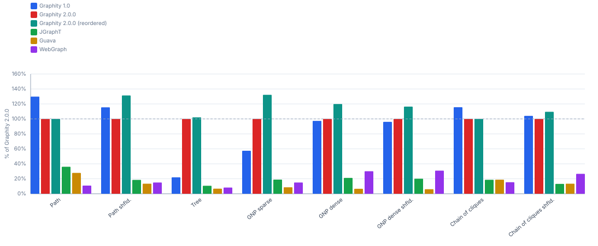

#### Times @ 100k nodes (ms/op, lower is better)

| Shape | Graphity 1.0 | Graphity 2.0.0 | Graphity 2.0.0<br>(reordered) | JGraphT | Guava | WebGraph |
|---|---:|---:|---:|---:|---:|---:|
| Path<br><sub>100k nodes, 100k edges</sub> | 0.507 ms (0.8×) | 0.606 ms | 0.605 ms (1.0×) | 5.104 ms (8.4×) | 8.083 ms (13×) | 3.853 ms (6.4×) |
| Path shfld.<br><sub>100k nodes, 100k edges</sub> | 1.351 ms (1.4×) | 0.945 ms | 0.510 ms (0.5×) | 20.44 ms (22×) | 18.16 ms (19×) | 5.048 ms (5.3×) |
| Tree<br><sub>100k nodes, 100k edges</sub> | 9.871 ms (7.4×) | 1.327 ms | 1.083 ms (0.8×) | 26.45 ms (20×) | 19.45 ms (15×) | 15.34 ms (12×) |
| GNP sparse<br><sub>100k nodes, 300k edges</sub> | 4.691 ms (1.5×) | 3.177 ms | 1.962 ms (0.6×) | 42.23 ms (13×) | 46.85 ms (15×) | 11.38 ms (3.6×) |
| GNP dense<br><sub>100k nodes, 3M edges</sub> | 17.38 ms (1.3×) | 12.91 ms | 7.303 ms (0.6×) | 133.5 ms (10×) | 262.5 ms (20×) | 43.74 ms (3.4×) |
| GNP dense shfld.<br><sub>100k nodes, 3M edges</sub> | 17.38 ms (1.4×) | 12.63 ms | 7.353 ms (0.6×) | 131.0 ms (10×) | 220.7 ms (17×) | 46.73 ms (3.7×) |
| Chain of cliques<br><sub>100k nodes, 3.1M edges</sub> | 8.563 ms (1.3×) | 6.365 ms | 6.292 ms (1.0×) | 80.39 ms (13×) | 78.27 ms (12×) | 49.41 ms (7.8×) |
| Chain of cliques shfld.<br><sub>100k nodes, 3.1M edges</sub> | 13.28 ms (1.2×) | 11.15 ms | 6.545 ms (0.6×) | 126.9 ms (11×) | 88.15 ms (7.9×) | 39.49 ms (3.5×) |

#### Throughput @ 100k nodes (op/s, higher is better)

| Shape | Graphity 1.0 | Graphity 2.0.0 | Graphity 2.0.0<br>(reordered) | JGraphT | Guava | WebGraph |
|---|---:|---:|---:|---:|---:|---:|
| Path<br><sub>100k nodes, 100k edges</sub> | 1 972 op/s (120%) | 1 650 op/s | 1 653 op/s (100%) | 195.9 op/s (11.9%) | 123.7 op/s (7.5%) | 259.5 op/s (15.7%) |
| Path shfld.<br><sub>100k nodes, 100k edges</sub> | 740.2 op/s (69.9%) | 1 058 op/s | 1 961 op/s (185%) | 48.93 op/s (4.6%) | 55.08 op/s (5.2%) | 198.1 op/s (18.7%) |
| Tree<br><sub>100k nodes, 100k edges</sub> | 101.3 op/s (13.4%) | 753.6 op/s | 923.4 op/s (123%) | 37.80 op/s (5.0%) | 51.40 op/s (6.8%) | 65.18 op/s (8.6%) |
| GNP sparse<br><sub>100k nodes, 300k edges</sub> | 213.2 op/s (67.7%) | 314.8 op/s | 509.7 op/s (162%) | 23.68 op/s (7.5%) | 21.35 op/s (6.8%) | 87.89 op/s (27.9%) |
| GNP dense<br><sub>100k nodes, 3M edges</sub> | 57.53 op/s (74.3%) | 77.44 op/s | 136.9 op/s (177%) | 7.491 op/s (9.7%) | 3.810 op/s (4.9%) | 22.86 op/s (29.5%) |
| GNP dense shfld.<br><sub>100k nodes, 3M edges</sub> | 57.53 op/s (72.6%) | 79.20 op/s | 136.0 op/s (172%) | 7.634 op/s (9.6%) | 4.531 op/s (5.7%) | 21.40 op/s (27.0%) |
| Chain of cliques<br><sub>100k nodes, 3.1M edges</sub> | 116.8 op/s (74.3%) | 157.1 op/s | 158.9 op/s (101%) | 12.44 op/s (7.9%) | 12.78 op/s (8.1%) | 20.24 op/s (12.9%) |
| Chain of cliques shfld.<br><sub>100k nodes, 3.1M edges</sub> | 75.31 op/s (84.0%) | 89.65 op/s | 152.8 op/s (170%) | 7.880 op/s (8.8%) | 11.34 op/s (12.7%) | 25.32 op/s (28.2%) |

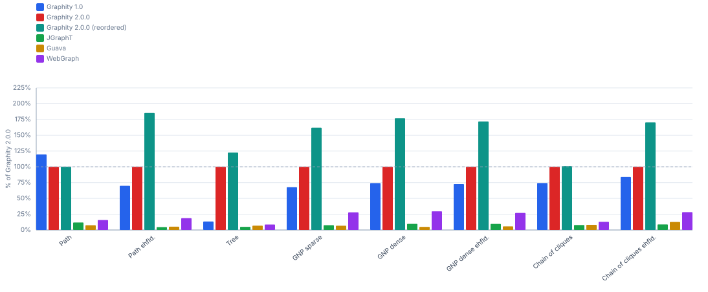

#### Times @ 1M nodes (ms/op, lower is better)

| Shape | Graphity 2.0.0 | Graphity 2.0.0<br>(reordered) |
|---|---:|---:|
| GNP sparse<br><sub>1M nodes, 3M edges</sub> | 49.47 ms | 20.62 ms (0.4×) |
| GNP dense<br><sub>1M nodes, 30M edges</sub> | 240.2 ms | — |
| GNP dense shfld.<br><sub>1M nodes, 30M edges</sub> | 241.4 ms | 94.11 ms (0.4×) |
| Chain of cliques<br><sub>1M nodes, 31.1M edges</sub> | 75.32 ms | — |

#### Throughput @ 1M nodes (op/s, higher is better)

| Shape | Graphity 2.0.0 | Graphity 2.0.0<br>(reordered) |
|---|---:|---:|
| GNP sparse<br><sub>1M nodes, 3M edges</sub> | 20.22 op/s | 48.50 op/s (240%) |
| GNP dense<br><sub>1M nodes, 30M edges</sub> | 4.163 op/s | — |
| GNP dense shfld.<br><sub>1M nodes, 30M edges</sub> | 4.143 op/s | 10.63 op/s (256%) |
| Chain of cliques<br><sub>1M nodes, 31.1M edges</sub> | 13.28 op/s | — |

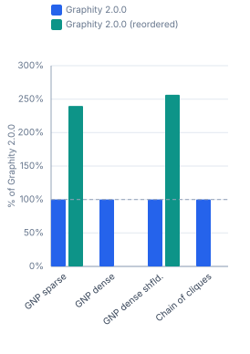

#### Times @ 10M nodes (ms/op, lower is better)

| Shape | Graphity 2.0.0 | Graphity 2.0.0<br>(reordered) |
|---|---:|---:|
| GNP sparse<br><sub>10M nodes, 30M edges</sub> | 1984.9 ms | 254.0 ms (0.1×) |
| GNP dense<br><sub>10M nodes, 299.6M edges</sub> | 3708.4 ms | — |
| GNP dense shfld.<br><sub>10M nodes, 299.6M edges</sub> | 3672.0 ms | 930.6 ms (0.3×) |
| Chain of cliques<br><sub>10M nodes, 310.8M edges</sub> | 815.0 ms | — |

#### Throughput @ 10M nodes (op/s, higher is better)

| Shape | Graphity 2.0.0 | Graphity 2.0.0<br>(reordered) |
|---|---:|---:|
| GNP sparse<br><sub>10M nodes, 30M edges</sub> | 0.504 op/s | 3.937 op/s (781%) |
| GNP dense<br><sub>10M nodes, 299.6M edges</sub> | 0.270 op/s | — |
| GNP dense shfld.<br><sub>10M nodes, 299.6M edges</sub> | 0.272 op/s | 1.075 op/s (395%) |
| Chain of cliques<br><sub>10M nodes, 310.8M edges</sub> | 1.227 op/s | — |

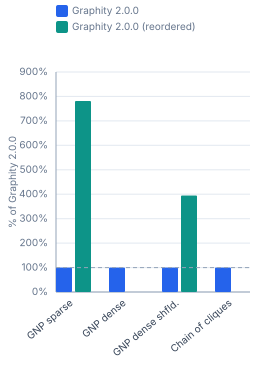

#### Times @ 100M nodes (ms/op, lower is better)

| Shape | Graphity 2.0.0 | Graphity 2.0.0<br>(reordered) |
|---|---:|---:|
| GNP sparse<br><sub>100M nodes, 300M edges</sub> | 27110 ms | 2988.7 ms (0.1×) |

#### Throughput @ 100M nodes (op/s, higher is better)

| Shape | Graphity 2.0.0 | Graphity 2.0.0<br>(reordered) |
|---|---:|---:|
| GNP sparse<br><sub>100M nodes, 300M edges</sub> | 0.037 op/s | 0.335 op/s (907%) |

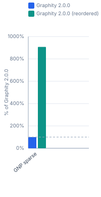

### 1.8 EdgeTypes

#### Times @ 10k nodes (ms/op, lower is better)

| Shape | Graphity 1.0 | Graphity 2.0.0 | Graphity 2.0.0<br>(reordered) | JGraphT | Guava | WebGraph |
|---|---:|---:|---:|---:|---:|---:|
| Path<br><sub>10k nodes, 10k edges</sub> | 0.051 ms (0.8×) | 0.064 ms | 0.064 ms (1.0×) | 0.198 ms (3.1×) | 0.377 ms (5.9×) | 0.612 ms (9.6×) |
| Path shfld.<br><sub>10k nodes, 10k edges</sub> | 0.066 ms (0.9×) | 0.077 ms | 0.059 ms (0.8×) | 0.380 ms (4.9×) | 0.565 ms (7.3×) | 0.504 ms (6.5×) |
| Tree<br><sub>10k nodes, 10k edges</sub> | 0.196 ms (3.7×) | 0.053 ms | 0.046 ms (0.9×) | 0.509 ms (9.6×) | 0.773 ms (15×) | 0.669 ms (13×) |
| GNP sparse<br><sub>10k nodes, 30k edges</sub> | 0.222 ms (1.2×) | 0.183 ms | 0.093 ms (0.5×) | 0.693 ms (3.8×) | 1.425 ms (7.8×) | 0.926 ms (5.1×) |
| GNP dense<br><sub>10k nodes, 299.6k edges</sub> | 0.653 ms (1.3×) | 0.511 ms | 0.373 ms (0.7×) | 6.421 ms (13×) | 13.12 ms (26×) | 3.204 ms (6.3×) |
| GNP dense shfld.<br><sub>10k nodes, 299.6k edges</sub> | 0.658 ms (1.3×) | 0.514 ms | 0.372 ms (0.7×) | 6.583 ms (13×) | 14.56 ms (28×) | 3.152 ms (6.1×) |
| Chain of cliques<br><sub>10k nodes, 310.8k edges</sub> | 0.375 ms (1.3×) | 0.282 ms | 0.285 ms (1.0×) | 4.588 ms (16×) | 4.525 ms (16×) | 4.694 ms (17×) |
| Chain of cliques shfld.<br><sub>10k nodes, 310.8k edges</sub> | 0.499 ms (1.3×) | 0.383 ms | 0.276 ms (0.7×) | 6.038 ms (16×) | 6.048 ms (16×) | 3.100 ms (8.1×) |

#### Throughput @ 10k nodes (op/s, higher is better)

| Shape | Graphity 1.0 | Graphity 2.0.0 | Graphity 2.0.0<br>(reordered) | JGraphT | Guava | WebGraph |
|---|---:|---:|---:|---:|---:|---:|
| Path<br><sub>10k nodes, 10k edges</sub> | 19 608 op/s (125%) | 15 625 op/s | 15 625 op/s (100%) | 5 051 op/s (32.3%) | 2 653 op/s (17.0%) | 1 634 op/s (10.5%) |
| Path shfld.<br><sub>10k nodes, 10k edges</sub> | 15 152 op/s (117%) | 12 987 op/s | 16 949 op/s (131%) | 2 632 op/s (20.3%) | 1 770 op/s (13.6%) | 1 984 op/s (15.3%) |
| Tree<br><sub>10k nodes, 10k edges</sub> | 5 102 op/s (27.0%) | 18 868 op/s | 21 739 op/s (115%) | 1 965 op/s (10.4%) | 1 294 op/s (6.9%) | 1 495 op/s (7.9%) |
| GNP sparse<br><sub>10k nodes, 30k edges</sub> | 4 505 op/s (82.4%) | 5 464 op/s | 10 753 op/s (197%) | 1 443 op/s (26.4%) | 701.8 op/s (12.8%) | 1 080 op/s (19.8%) |
| GNP dense<br><sub>10k nodes, 299.6k edges</sub> | 1 531 op/s (78.3%) | 1 957 op/s | 2 681 op/s (137%) | 155.7 op/s (8.0%) | 76.24 op/s (3.9%) | 312.1 op/s (15.9%) |
| GNP dense shfld.<br><sub>10k nodes, 299.6k edges</sub> | 1 520 op/s (78.1%) | 1 946 op/s | 2 688 op/s (138%) | 151.9 op/s (7.8%) | 68.70 op/s (3.5%) | 317.3 op/s (16.3%) |
| Chain of cliques<br><sub>10k nodes, 310.8k edges</sub> | 2 667 op/s (75.2%) | 3 546 op/s | 3 509 op/s (98.9%) | 218.0 op/s (6.1%) | 221.0 op/s (6.2%) | 213.0 op/s (6.0%) |
| Chain of cliques shfld.<br><sub>10k nodes, 310.8k edges</sub> | 2 004 op/s (76.8%) | 2 611 op/s | 3 623 op/s (139%) | 165.6 op/s (6.3%) | 165.3 op/s (6.3%) | 322.6 op/s (12.4%) |

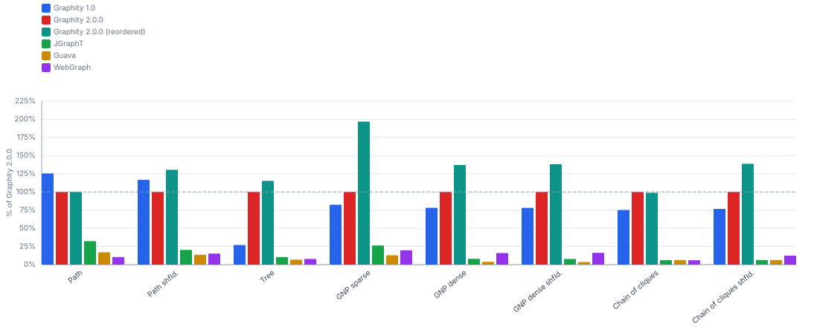

#### Times @ 100k nodes (ms/op, lower is better)

| Shape | Graphity 1.0 | Graphity 2.0.0 | Graphity 2.0.0<br>(reordered) | JGraphT | Guava | WebGraph |
|---|---:|---:|---:|---:|---:|---:|
| Path<br><sub>100k nodes, 100k edges</sub> | 0.554 ms (0.9×) | 0.647 ms | 0.642 ms (1.0×) | 8.671 ms (13×) | 9.555 ms (15×) | 4.747 ms (7.3×) |
| Path shfld.<br><sub>100k nodes, 100k edges</sub> | 1.563 ms (1.1×) | 1.365 ms | 0.615 ms (0.5×) | 23.29 ms (17×) | 21.32 ms (16×) | 6.185 ms (4.5×) |
| Tree<br><sub>100k nodes, 100k edges</sub> | 10.29 ms (8.0×) | 1.288 ms | 1.022 ms (0.8×) | 23.11 ms (18×) | 24.86 ms (19×) | 17.84 ms (14×) |
| GNP sparse<br><sub>100k nodes, 300k edges</sub> | 5.006 ms (1.4×) | 3.626 ms | 1.957 ms (0.5×) | 44.21 ms (12×) | 52.72 ms (15×) | 13.34 ms (3.7×) |
| GNP dense<br><sub>100k nodes, 3M edges</sub> | 9.351 ms (1.3×) | 7.009 ms | 4.296 ms (0.6×) | 162.6 ms (23×) | 255.8 ms (36×) | 55.22 ms (7.9×) |
| GNP dense shfld.<br><sub>100k nodes, 3M edges</sub> | 9.400 ms (1.3×) | 7.103 ms | 4.185 ms (0.6×) | 170.5 ms (24×) | 224.9 ms (32×) | 57.67 ms (8.1×) |
| Chain of cliques<br><sub>100k nodes, 3.1M edges</sub> | 4.372 ms (1.6×) | 2.812 ms | 2.815 ms (1.0×) | 103.0 ms (37×) | 89.77 ms (32×) | 57.89 ms (21×) |
| Chain of cliques shfld.<br><sub>100k nodes, 3.1M edges</sub> | 6.766 ms (1.3×) | 5.303 ms | 3.053 ms (0.6×) | 159.0 ms (30×) | 110.1 ms (21×) | 53.15 ms (10×) |

#### Throughput @ 100k nodes (op/s, higher is better)

| Shape | Graphity 1.0 | Graphity 2.0.0 | Graphity 2.0.0<br>(reordered) | JGraphT | Guava | WebGraph |
|---|---:|---:|---:|---:|---:|---:|
| Path<br><sub>100k nodes, 100k edges</sub> | 1 805 op/s (117%) | 1 546 op/s | 1 558 op/s (101%) | 115.3 op/s (7.5%) | 104.7 op/s (6.8%) | 210.7 op/s (13.6%) |
| Path shfld.<br><sub>100k nodes, 100k edges</sub> | 639.8 op/s (87.3%) | 732.6 op/s | 1 626 op/s (222%) | 42.93 op/s (5.9%) | 46.90 op/s (6.4%) | 161.7 op/s (22.1%) |
| Tree<br><sub>100k nodes, 100k edges</sub> | 97.17 op/s (12.5%) | 776.4 op/s | 978.5 op/s (126%) | 43.27 op/s (5.6%) | 40.23 op/s (5.2%) | 56.07 op/s (7.2%) |
| GNP sparse<br><sub>100k nodes, 300k edges</sub> | 199.8 op/s (72.4%) | 275.8 op/s | 511.0 op/s (185%) | 22.62 op/s (8.2%) | 18.97 op/s (6.9%) | 74.95 op/s (27.2%) |
| GNP dense<br><sub>100k nodes, 3M edges</sub> | 106.9 op/s (75.0%) | 142.7 op/s | 232.8 op/s (163%) | 6.150 op/s (4.3%) | 3.909 op/s (2.7%) | 18.11 op/s (12.7%) |
| GNP dense shfld.<br><sub>100k nodes, 3M edges</sub> | 106.4 op/s (75.6%) | 140.8 op/s | 238.9 op/s (170%) | 5.865 op/s (4.2%) | 4.446 op/s (3.2%) | 17.34 op/s (12.3%) |
| Chain of cliques<br><sub>100k nodes, 3.1M edges</sub> | 228.7 op/s (64.3%) | 355.6 op/s | 355.2 op/s (99.9%) | 9.709 op/s (2.7%) | 11.14 op/s (3.1%) | 17.27 op/s (4.9%) |
| Chain of cliques shfld.<br><sub>100k nodes, 3.1M edges</sub> | 147.8 op/s (78.4%) | 188.6 op/s | 327.5 op/s (174%) | 6.289 op/s (3.3%) | 9.083 op/s (4.8%) | 18.82 op/s (10.0%) |

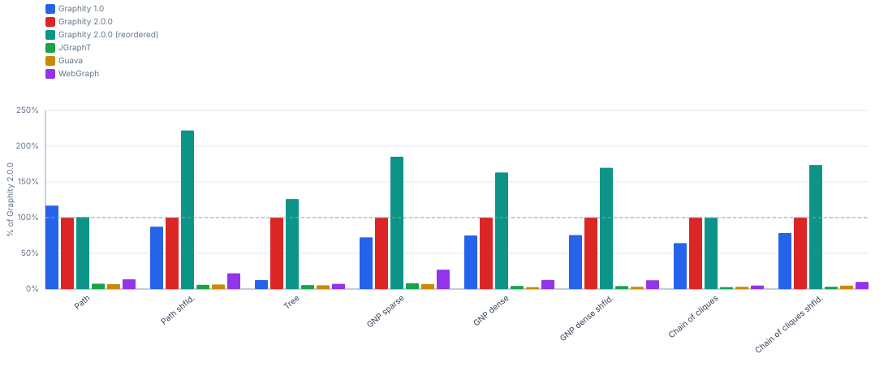

#### Times @ 1M nodes (ms/op, lower is better)

| Shape | Graphity 2.0.0 | Graphity 2.0.0<br>(reordered) |
|---|---:|---:|
| GNP sparse<br><sub>1M nodes, 3M edges</sub> | 60.41 ms | 23.47 ms (0.4×) |
| GNP dense<br><sub>1M nodes, 30M edges</sub> | 235.5 ms | — |
| GNP dense shfld.<br><sub>1M nodes, 30M edges</sub> | 231.9 ms | 60.28 ms (0.3×) |
| Chain of cliques<br><sub>1M nodes, 31.1M edges</sub> | 25.97 ms | — |

#### Throughput @ 1M nodes (op/s, higher is better)

| Shape | Graphity 2.0.0 | Graphity 2.0.0<br>(reordered) |
|---|---:|---:|
| GNP sparse<br><sub>1M nodes, 3M edges</sub> | 16.55 op/s | 42.60 op/s (257%) |
| GNP dense<br><sub>1M nodes, 30M edges</sub> | 4.246 op/s | — |
| GNP dense shfld.<br><sub>1M nodes, 30M edges</sub> | 4.312 op/s | 16.59 op/s (385%) |
| Chain of cliques<br><sub>1M nodes, 31.1M edges</sub> | 38.51 op/s | — |

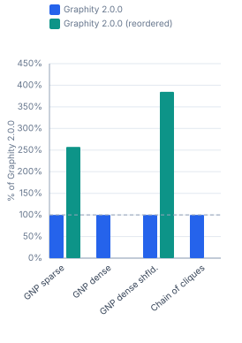

#### Times @ 10M nodes (ms/op, lower is better)

| Shape | Graphity 2.0.0 | Graphity 2.0.0<br>(reordered) |
|---|---:|---:|
| GNP sparse<br><sub>10M nodes, 30M edges</sub> | 2629.9 ms | 422.5 ms (0.2×) |
| GNP dense<br><sub>10M nodes, 299.6M edges</sub> | 4515.8 ms | — |
| GNP dense shfld.<br><sub>10M nodes, 299.6M edges</sub> | 4526.0 ms | 1383.2 ms (0.3×) |
| Chain of cliques<br><sub>10M nodes, 310.8M edges</sub> | 276.6 ms | — |

#### Throughput @ 10M nodes (op/s, higher is better)

| Shape | Graphity 2.0.0 | Graphity 2.0.0<br>(reordered) |
|---|---:|---:|
| GNP sparse<br><sub>10M nodes, 30M edges</sub> | 0.380 op/s | 2.367 op/s (622%) |
| GNP dense<br><sub>10M nodes, 299.6M edges</sub> | 0.221 op/s | — |
| GNP dense shfld.<br><sub>10M nodes, 299.6M edges</sub> | 0.221 op/s | 0.723 op/s (327%) |
| Chain of cliques<br><sub>10M nodes, 310.8M edges</sub> | 3.615 op/s | — |

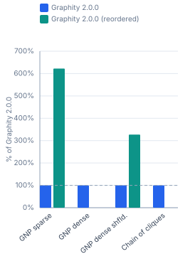

#### Times @ 100M nodes (ms/op, lower is better)

| Shape | Graphity 2.0.0 | Graphity 2.0.0<br>(reordered) |
|---|---:|---:|
| GNP sparse<br><sub>100M nodes, 300M edges</sub> | 31792 ms | 7181.5 ms (0.2×) |

#### Throughput @ 100M nodes (op/s, higher is better)

| Shape | Graphity 2.0.0 | Graphity 2.0.0<br>(reordered) |
|---|---:|---:|
| GNP sparse<br><sub>100M nodes, 300M edges</sub> | 0.031 op/s | 0.139 op/s (443%) |

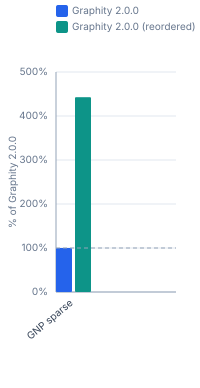

### 1.9 Reorder (DFS-preorder) cost

#### Times @ 10k nodes (ms/op, lower is better)

| Shape | Graphity 2.0.0 |
|---|---:|
| Path<br><sub>10k nodes, 10k edges</sub> | 0.121 ms |
| Path shfld.<br><sub>10k nodes, 10k edges</sub> | 0.145 ms |
| Tree<br><sub>10k nodes, 10k edges</sub> | 0.185 ms |
| GNP sparse<br><sub>10k nodes, 30k edges</sub> | 0.483 ms |
| GNP dense<br><sub>10k nodes, 299.6k edges</sub> | 1.127 ms |
| GNP dense shfld.<br><sub>10k nodes, 299.6k edges</sub> | 1.114 ms |
| Chain of cliques<br><sub>10k nodes, 310.8k edges</sub> | 0.715 ms |
| Chain of cliques shfld.<br><sub>10k nodes, 310.8k edges</sub> | 0.867 ms |

#### Throughput @ 10k nodes (op/s, higher is better)

| Shape | Graphity 2.0.0 |
|---|---:|
| Path<br><sub>10k nodes, 10k edges</sub> | 8 264 op/s |
| Path shfld.<br><sub>10k nodes, 10k edges</sub> | 6 897 op/s |
| Tree<br><sub>10k nodes, 10k edges</sub> | 5 405 op/s |
| GNP sparse<br><sub>10k nodes, 30k edges</sub> | 2 070 op/s |
| GNP dense<br><sub>10k nodes, 299.6k edges</sub> | 887.3 op/s |
| GNP dense shfld.<br><sub>10k nodes, 299.6k edges</sub> | 897.7 op/s |
| Chain of cliques<br><sub>10k nodes, 310.8k edges</sub> | 1 399 op/s |
| Chain of cliques shfld.<br><sub>10k nodes, 310.8k edges</sub> | 1 153 op/s |

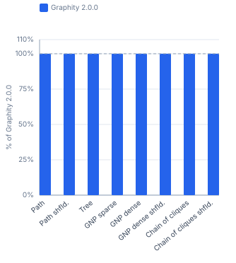

#### Times @ 100k nodes (ms/op, lower is better)

| Shape | Graphity 2.0.0 |
|---|---:|
| Path<br><sub>100k nodes, 100k edges</sub> | 1.259 ms |
| Path shfld.<br><sub>100k nodes, 100k edges</sub> | 2.144 ms |
| Tree<br><sub>100k nodes, 100k edges</sub> | 3.144 ms |
| GNP sparse<br><sub>100k nodes, 300k edges</sub> | 6.609 ms |
| GNP dense<br><sub>100k nodes, 3M edges</sub> | 15.07 ms |
| GNP dense shfld.<br><sub>100k nodes, 3M edges</sub> | 15.00 ms |
| Chain of cliques<br><sub>100k nodes, 3.1M edges</sub> | 7.332 ms |
| Chain of cliques shfld.<br><sub>100k nodes, 3.1M edges</sub> | 11.95 ms |

#### Throughput @ 100k nodes (op/s, higher is better)

| Shape | Graphity 2.0.0 |
|---|---:|
| Path<br><sub>100k nodes, 100k edges</sub> | 794.3 op/s |
| Path shfld.<br><sub>100k nodes, 100k edges</sub> | 466.4 op/s |
| Tree<br><sub>100k nodes, 100k edges</sub> | 318.1 op/s |
| GNP sparse<br><sub>100k nodes, 300k edges</sub> | 151.3 op/s |
| GNP dense<br><sub>100k nodes, 3M edges</sub> | 66.37 op/s |
| GNP dense shfld.<br><sub>100k nodes, 3M edges</sub> | 66.66 op/s |
| Chain of cliques<br><sub>100k nodes, 3.1M edges</sub> | 136.4 op/s |
| Chain of cliques shfld.<br><sub>100k nodes, 3.1M edges</sub> | 83.70 op/s |


#### Times @ 1M nodes (ms/op, lower is better)

| Shape | Graphity 2.0.0 |
|---|---:|
| GNP sparse<br><sub>1M nodes, 3M edges</sub> | 95.36 ms |
| GNP dense shfld.<br><sub>1M nodes, 30M edges</sub> | 414.3 ms |

#### Throughput @ 1M nodes (op/s, higher is better)

| Shape | Graphity 2.0.0 |
|---|---:|
| GNP sparse<br><sub>1M nodes, 3M edges</sub> | 10.49 op/s |
| GNP dense shfld.<br><sub>1M nodes, 30M edges</sub> | 2.414 op/s |


#### Times @ 10M nodes (ms/op, lower is better)

| Shape | Graphity 2.0.0 |
|---|---:|
| GNP sparse<br><sub>10M nodes, 30M edges</sub> | 4011.1 ms |
| GNP dense shfld.<br><sub>10M nodes, 299.6M edges</sub> | 10805 ms |

#### Throughput @ 10M nodes (op/s, higher is better)

| Shape | Graphity 2.0.0 |
|---|---:|
| GNP sparse<br><sub>10M nodes, 30M edges</sub> | 0.249 op/s |
| GNP dense shfld.<br><sub>10M nodes, 299.6M edges</sub> | 0.093 op/s |

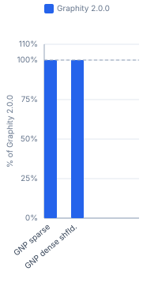

#### Times @ 100M nodes (ms/op, lower is better)

| Shape | Graphity 2.0.0 |
|---|---:|
| GNP sparse<br><sub>100M nodes, 300M edges</sub> | 49550 ms |

#### Throughput @ 100M nodes (op/s, higher is better)

| Shape | Graphity 2.0.0 |
|---|---:|
| GNP sparse<br><sub>100M nodes, 300M edges</sub> | 0.020 op/s |


## 2 Memory Footprint

Retained heap in bytes for a fully built graph. Lower is better. Baseline: **Graphity 2.0.0** = 100%. Two charts per section: *Graphity & WebGraph* (same league) and *All libraries*.

### 2.1 Total Graph Size

**Memory footprint in bytes (lower is better)**

| Shape | Graphity 1.0 | Graphity 2.0.0 | JGraphT | Guava | WebGraph |
|---|---:|---:|---:|---:|---:|
| Path<br><sub>10k nodes, 10k edges</sub> | 80.1 kB (100%) | 80.1 kB | 4.0 MB (5037%) | 2.7 MB (3375%) | 18.8 kB (23.5%) |
| Path shfld.<br><sub>10k nodes, 10k edges</sub> | 80.1 kB (100%) | 80.1 kB | 4.0 MB (5037%) | 2.7 MB (3375%) | 37.8 kB (47.3%) |
| Tree<br><sub>10k nodes, 10k edges</sub> | 80.1 kB (100%) | 80.1 kB | 4.0 MB (5043%) | 2.7 MB (3378%) | 31.9 kB (39.9%) |
| GNP sparse<br><sub>10k nodes, 30k edges</sub> | 160 kB (100%) | 160 kB | 8.6 MB (5343%) | 4.8 MB (2984%) | 78.8 kB (49.2%) |
| GNP dense<br><sub>10k nodes, 299.6k edges</sub> | 1.2 MB (100%) | 1.2 MB | 68.6 MB (5544%) | 33.4 MB (2700%) | 475 kB (38.4%) |
| GNP dense shfld.<br><sub>10k nodes, 299.6k edges</sub> | 1.2 MB (100%) | 1.2 MB | 68.6 MB (5543%) | 33.4 MB (2700%) | 475 kB (38.4%) |
| Chain of cliques<br><sub>10k nodes, 310.8k edges</sub> | 1.3 MB (100%) | 1.3 MB | 71.3 MB (5558%) | 22.7 MB (1769%) | 50.6 kB (3.9%) |
| Chain of cliques shfld.<br><sub>10k nodes, 310.8k edges</sub> | 1.3 MB (100%) | 1.3 MB | 71.3 MB (5559%) | 22.7 MB (1769%) | 482 kB (37.6%) |
| Path<br><sub>100k nodes, 100k edges</sub> | 800 kB (100%) | 800 kB | 41.5 MB (5192%) | 27.4 MB (3430%) | 181 kB (22.6%) |
| Path shfld.<br><sub>100k nodes, 100k edges</sub> | 800 kB (100%) | 800 kB | 41.5 MB (5192%) | 27.4 MB (3430%) | 430 kB (53.7%) |
| Tree<br><sub>100k nodes, 100k edges</sub> | 800 kB (100%) | 800 kB | 41.7 MB (5208%) | 27.5 MB (3443%) | 372 kB (46.4%) |
| GNP sparse<br><sub>100k nodes, 300k edges</sub> | 1.6 MB (100%) | 1.6 MB | 85.0 MB (5310%) | 48.3 MB (3016%) | 952 kB (59.5%) |
| GNP dense<br><sub>100k nodes, 3M edges</sub> | 12.4 MB (100%) | 12.4 MB | 680 MB (5488%) | 337 MB (2716%) | 6.4 MB (51.7%) |
| GNP dense shfld.<br><sub>100k nodes, 3M edges</sub> | 12.4 MB (100%) | 12.4 MB | 680 MB (5488%) | 337 MB (2716%) | 6.4 MB (51.7%) |
| Chain of cliques<br><sub>100k nodes, 3.1M edges</sub> | 12.8 MB (100%) | 12.8 MB | 706 MB (5506%) | 228 MB (1777%) | 499 kB (3.9%) |
| Chain of cliques shfld.<br><sub>100k nodes, 3.1M edges</sub> | 12.8 MB (100%) | 12.8 MB | 706 MB (5506%) | 228 MB (1777%) | 6.6 MB (51.6%) |
| GNP sparse<br><sub>1M nodes, 3M edges</sub> | — | 16.0 MB | — | — | — |
| GNP sparse<br><sub>10M nodes, 30M edges</sub> | — | 160 MB | — | — | — |
| GNP sparse<br><sub>100M nodes, 300M edges</sub> | — | 1600 MB | — | — | — |

**Graphity & WebGraph**

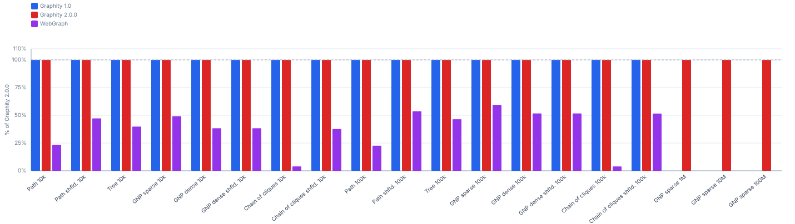

**All libraries**

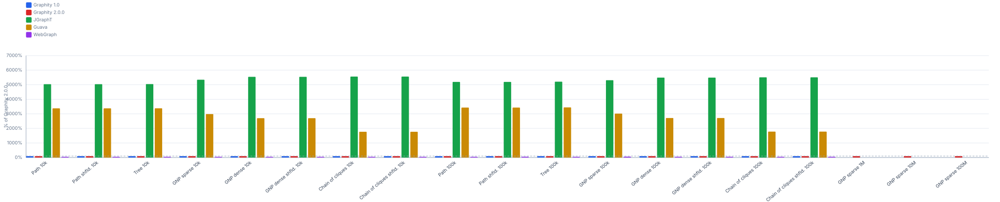

### 2.2 Bytes per Element  `totalBytes / (Nodes + Edges)`

**Memory footprint in bytes (lower is better)**

| Shape | Graphity 1.0 | Graphity 2.0.0 | JGraphT | Guava | WebGraph |
|---|---:|---:|---:|---:|---:|
| Path<br><sub>10k nodes, 10k edges</sub> | 4 B (100%) | 4 B | 201.65 B (5041%) | 135.10 B (3378%) | 0.94 B (23.5%) |
| Path shfld.<br><sub>10k nodes, 10k edges</sub> | 4 B (100%) | 4 B | 201.65 B (5041%) | 135.10 B (3378%) | 1.89 B (47.2%) |
| Tree<br><sub>10k nodes, 10k edges</sub> | 4 B (100%) | 4 B | 201.90 B (5048%) | 135.24 B (3381%) | 1.60 B (40.0%) |
| GNP sparse<br><sub>10k nodes, 30k edges</sub> | 4 B (100%) | 4 B | 213.79 B (5345%) | 119.42 B (2986%) | 1.97 B (49.2%) |
| GNP dense<br><sub>10k nodes, 299.6k edges</sub> | 4 B (100%) | 4 B | 221.75 B (5544%) | 108.02 B (2700%) | 1.54 B (38.5%) |
| GNP dense shfld.<br><sub>10k nodes, 299.6k edges</sub> | 4 B (100%) | 4 B | 221.75 B (5544%) | 108.01 B (2700%) | 1.53 B (38.2%) |
| Chain of cliques<br><sub>10k nodes, 310.8k edges</sub> | 4 B (100%) | 4 B | 222.34 B (5558%) | 70.78 B (1770%) | 0.16 B (4.0%) |
| Chain of cliques shfld.<br><sub>10k nodes, 310.8k edges</sub> | 4 B (100%) | 4 B | 222.36 B (5559%) | 70.78 B (1770%) | 1.50 B (37.5%) |
| Path<br><sub>100k nodes, 100k edges</sub> | 4 B (100%) | 4 B | 207.71 B (5193%) | 137.23 B (3431%) | 0.90 B (22.5%) |
| Path shfld.<br><sub>100k nodes, 100k edges</sub> | 4 B (100%) | 4 B | 207.71 B (5193%) | 137.22 B (3430%) | 2.15 B (53.8%) |
| Tree<br><sub>100k nodes, 100k edges</sub> | 4 B (100%) | 4 B | 208.34 B (5208%) | 137.73 B (3443%) | 1.86 B (46.5%) |
| GNP sparse<br><sub>100k nodes, 300k edges</sub> | 4 B (100%) | 4 B | 212.40 B (5310%) | 120.65 B (3016%) | 2.38 B (59.5%) |
| GNP dense<br><sub>100k nodes, 3M edges</sub> | 4 B (100%) | 4 B | 219.51 B (5488%) | 108.63 B (2716%) | 2.07 B (51.7%) |
| GNP dense shfld.<br><sub>100k nodes, 3M edges</sub> | 4 B (100%) | 4 B | 219.52 B (5488%) | 108.63 B (2716%) | 2.07 B (51.7%) |
| Chain of cliques<br><sub>100k nodes, 3.1M edges</sub> | 4 B (100%) | 4 B | 220.25 B (5506%) | 71.08 B (1777%) | 0.16 B (4.0%) |
| Chain of cliques shfld.<br><sub>100k nodes, 3.1M edges</sub> | 4 B (100%) | 4 B | 220.25 B (5506%) | 71.08 B (1777%) | 2.06 B (51.5%) |
| GNP sparse<br><sub>1M nodes, 3M edges</sub> | — | 4 B | — | — | — |
| GNP sparse<br><sub>10M nodes, 30M edges</sub> | — | 4 B | — | — | — |
| GNP sparse<br><sub>100M nodes, 300M edges</sub> | — | 4 B | — | — | — |

**Graphity & WebGraph**


**All libraries**


## 3 Allocations

Bytes allocated per algorithm invocation (JMH `-prof gc`). Lower is better. Baseline: **Graphity 2.0.0** = 100%.

### 3.1 Build

**Allocations @ 10k nodes in bytes (lower is better)**

| Shape | Graphity 1.0 | Graphity 2.0.0 | JGraphT | Guava | WebGraph |
|---|---:|---:|---:|---:|---:|
| Path<br><sub>10k nodes, 10k edges</sub> | 458 kB (100%) | 458 kB | 5.3 MB (1163%) | 2.8 MB (604%) | 4.3 MB (948%) |
| Path shfld.<br><sub>10k nodes, 10k edges</sub> | 458 kB (100%) | 458 kB | 5.2 MB (1133%) | 2.8 MB (604%) | 4.4 MB (954%) |
| Tree<br><sub>10k nodes, 10k edges</sub> | 458 kB (100%) | 458 kB | 5.3 MB (1161%) | 2.8 MB (609%) | 4.1 MB (887%) |
| GNP sparse<br><sub>10k nodes, 30k edges</sub> | 960 kB (100%) | 960 kB | 13.1 MB (1360%) | 5.1 MB (536%) | 4.4 MB (463%) |
| GNP dense<br><sub>10k nodes, 299.6k edges</sub> | 9.9 MB (100%) | 9.9 MB | 111 MB (1116%) | 37.3 MB (376%) | 9.7 MB (98.2%) |
| GNP dense shfld.<br><sub>10k nodes, 299.6k edges</sub> | 9.9 MB (100%) | 9.9 MB | 111 MB (1116%) | 37.3 MB (376%) | 9.7 MB (98.1%) |
| Chain of cliques<br><sub>10k nodes, 310.8k edges</sub> | 10.0 MB (100%) | 10.0 MB | 116 MB (1159%) | 29.3 MB (294%) | 8.9 MB (89.7%) |
| Chain of cliques shfld.<br><sub>10k nodes, 310.8k edges</sub> | 10.0 MB (100%) | 10.0 MB | 116 MB (1159%) | 29.3 MB (294%) | 9.4 MB (94.1%) |

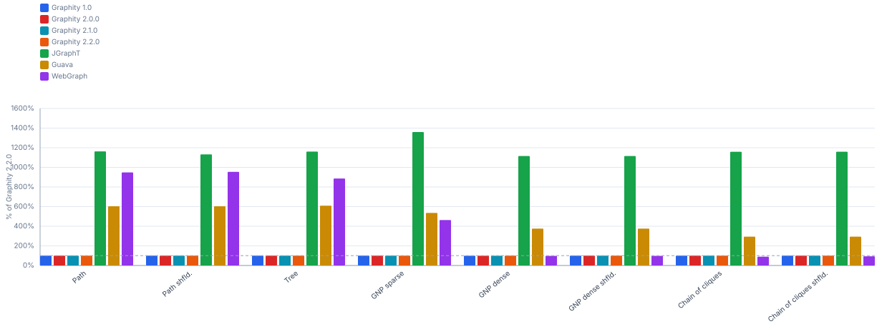

**Allocations @ 100k nodes in bytes (lower is better)**

| Shape | Graphity 1.0 | Graphity 2.0.0 | JGraphT | Guava | WebGraph |
|---|---:|---:|---:|---:|---:|
| Path<br><sub>100k nodes, 100k edges</sub> | 3.8 MB (100%) | 3.8 MB | 54.4 MB (1447%) | 28.5 MB (757%) | 14.2 MB (378%) |
| Path shfld.<br><sub>100k nodes, 100k edges</sub> | 3.8 MB (100%) | 3.8 MB | 54.3 MB (1443%) | 28.5 MB (757%) | 14.5 MB (385%) |
| Tree<br><sub>100k nodes, 100k edges</sub> | 3.8 MB (100%) | 3.8 MB | 55.6 MB (1479%) | 28.8 MB (766%) | 11.4 MB (302%) |
| GNP sparse<br><sub>100k nodes, 300k edges</sub> | 10.6 MB (100%) | 10.6 MB | 129 MB (1215%) | 52.3 MB (492%) | 15.3 MB (144%) |
| GNP dense<br><sub>100k nodes, 3M edges</sub> | 111 MB (100%) | 111 MB | 1094 MB (983%) | 376 MB (338%) | 69.8 MB (62.8%) |
| GNP dense shfld.<br><sub>100k nodes, 3M edges</sub> | 111 MB (100%) | 111 MB | 1094 MB (983%) | 376 MB (338%) | 69.8 MB (62.7%) |
| Chain of cliques<br><sub>100k nodes, 3.1M edges</sub> | 112 MB (100%) | 112 MB | 1139 MB (1020%) | 294 MB (264%) | 60.2 MB (53.9%) |
| Chain of cliques shfld.<br><sub>100k nodes, 3.1M edges</sub> | 112 MB (100.0%) | 112 MB | 1139 MB (1020%) | 294 MB (264%) | 66.3 MB (59.4%) |

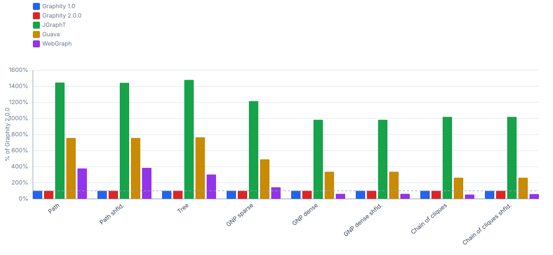

### 3.2 SCC

**Allocations @ 10k nodes in bytes (lower is better)**

| Shape | Graphity 1.0 | Graphity 2.0.0 | JGraphT | Guava | WebGraph |
|---|---:|---:|---:|---:|---:|
| Path<br><sub>10k nodes, 10k edges</sub> | 283 kB (52.0%) | 544 kB | 5.2 MB (957%) | 4.0 MB (744%) | 1.4 MB (264%) |
| Path shfld.<br><sub>10k nodes, 10k edges</sub> | 283 kB (52.0%) | 544 kB | 5.2 MB (949%) | 4.0 MB (734%) | 1.3 MB (243%) |
| Tree<br><sub>10k nodes, 10k edges</sub> | 283 kB (98.1%) | 288 kB | 5.0 MB (1746%) | 2.3 MB (799%) | 908 kB (315%) |
| GNP sparse<br><sub>10k nodes, 30k edges</sub> | 250 kB (70.4%) | 356 kB | 3.2 MB (890%) | 4.0 MB (1137%) | 1.3 MB (360%) |
| GNP dense<br><sub>10k nodes, 299.6k edges</sub> | 246 kB (48.5%) | 507 kB | 6.3 MB (1252%) | 5.2 MB (1024%) | 1.5 MB (289%) |
| GNP dense shfld.<br><sub>10k nodes, 299.6k edges</sub> | 246 kB (48.5%) | 507 kB | 6.3 MB (1252%) | 5.2 MB (1024%) | 1.5 MB (288%) |
| Chain of cliques<br><sub>10k nodes, 310.8k edges</sub> | 244 kB (48.3%) | 505 kB | 4.8 MB (945%) | 8.5 MB (1687%) | 6.1 MB (1213%) |
| Chain of cliques shfld.<br><sub>10k nodes, 310.8k edges</sub> | 244 kB (69.8%) | 350 kB | 6.0 MB (1703%) | 8.7 MB (2478%) | 1.3 MB (362%) |

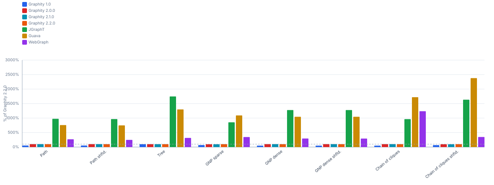

**Allocations @ 100k nodes in bytes (lower is better)**

| Shape | Graphity 1.0 | Graphity 2.0.0 | JGraphT | Guava | WebGraph |
|---|---:|---:|---:|---:|---:|
| Path<br><sub>100k nodes, 100k edges</sub> | — | 6.0 MB | 51.6 MB (865%) | 28.9 MB (484%) | 13.3 MB (223%) |
| Path shfld.<br><sub>100k nodes, 100k edges</sub> | 2.8 MB (57.5%) | 4.9 MB | 51.7 MB (1053%) | 27.4 MB (558%) | 13.5 MB (274%) |
| Tree<br><sub>100k nodes, 100k edges</sub> | 2.8 MB (101%) | 2.8 MB | 50.3 MB (1792%) | 25.5 MB (907%) | 8.8 MB (314%) |
| GNP sparse<br><sub>100k nodes, 300k edges</sub> | 2.5 MB (64.5%) | 3.9 MB | 32.1 MB (830%) | 42.9 MB (1108%) | 12.3 MB (318%) |
| GNP dense<br><sub>100k nodes, 3M edges</sub> | 2.5 MB (43.8%) | 5.6 MB | 70.9 MB (1266%) | 53.2 MB (951%) | 13.5 MB (240%) |
| GNP dense shfld.<br><sub>100k nodes, 3M edges</sub> | 2.5 MB (43.8%) | 5.6 MB | 71.7 MB (1280%) | 53.3 MB (952%) | 13.5 MB (241%) |
| Chain of cliques<br><sub>100k nodes, 3.1M edges</sub> | 2.4 MB (43.6%) | 5.6 MB | 48.5 MB (869%) | 76.8 MB (1375%) | 60.3 MB (1079%) |
| Chain of cliques shfld.<br><sub>100k nodes, 3.1M edges</sub> | 2.4 MB (73.0%) | 3.3 MB | 61.4 MB (1837%) | 89.7 MB (2685%) | 12.3 MB (368%) |

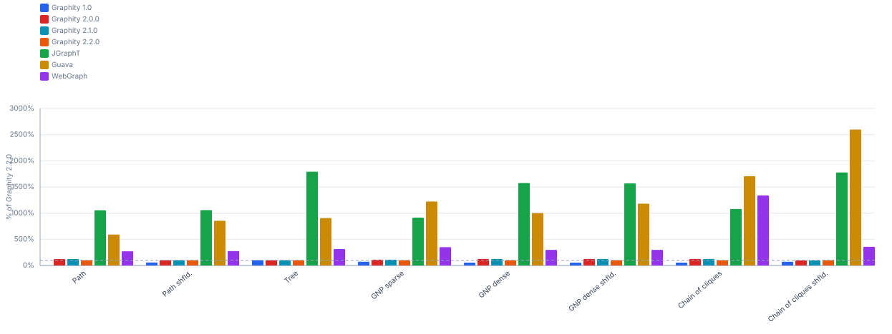

### 3.3 WCC

**Allocations @ 10k nodes in bytes (lower is better)**

| Shape | Graphity 1.0 | Graphity 2.0.0 |
|---|---:|---:|
| Path<br><sub>10k nodes, 10k edges</sub> | 200 kB (100%) | 200 kB |
| Path shfld.<br><sub>10k nodes, 10k edges</sub> | 200 kB (100%) | 200 kB |
| Tree<br><sub>10k nodes, 10k edges</sub> | 200 kB (100%) | 200 kB |
| GNP sparse<br><sub>10k nodes, 30k edges</sub> | 200 kB (100%) | 200 kB |
| GNP dense<br><sub>10k nodes, 299.6k edges</sub> | 200 kB (100%) | 200 kB |
| GNP dense shfld.<br><sub>10k nodes, 299.6k edges</sub> | 200 kB (100%) | 200 kB |
| Chain of cliques<br><sub>10k nodes, 310.8k edges</sub> | 200 kB (100%) | 200 kB |
| Chain of cliques shfld.<br><sub>10k nodes, 310.8k edges</sub> | 200 kB (100.0%) | 200 kB |

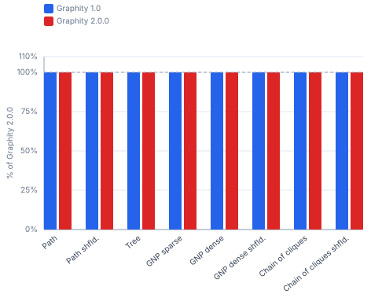

**Allocations @ 100k nodes in bytes (lower is better)**

| Shape | Graphity 1.0 | Graphity 2.0.0 |
|---|---:|---:|
| Path<br><sub>100k nodes, 100k edges</sub> | 2.0 MB (100%) | 2.0 MB |
| Path shfld.<br><sub>100k nodes, 100k edges</sub> | 2.0 MB (100%) | 2.0 MB |
| Tree<br><sub>100k nodes, 100k edges</sub> | 2.0 MB (100%) | 2.0 MB |
| GNP sparse<br><sub>100k nodes, 300k edges</sub> | 2.0 MB (100%) | 2.0 MB |
| GNP dense<br><sub>100k nodes, 3M edges</sub> | 2.0 MB (100%) | 2.0 MB |
| GNP dense shfld.<br><sub>100k nodes, 3M edges</sub> | 2.0 MB (100%) | 2.0 MB |
| Chain of cliques<br><sub>100k nodes, 3.1M edges</sub> | 2.0 MB (100.0%) | 2.0 MB |
| Chain of cliques shfld.<br><sub>100k nodes, 3.1M edges</sub> | 2.0 MB (100%) | 2.0 MB |


### 3.4 CCs

**Allocations @ 10k nodes in bytes (lower is better)**

| Shape | Graphity 1.0 | Graphity 2.0.0 |
|---|---:|---:|
| Path<br><sub>10k nodes, 10k edges</sub> | 200 kB (100%) | 200 kB |
| Path shfld.<br><sub>10k nodes, 10k edges</sub> | 200 kB (100%) | 200 kB |
| Tree<br><sub>10k nodes, 10k edges</sub> | 200 kB (100%) | 200 kB |
| GNP sparse<br><sub>10k nodes, 30k edges</sub> | 200 kB (100%) | 200 kB |
| GNP dense<br><sub>10k nodes, 299.6k edges</sub> | 200 kB (100%) | 200 kB |
| GNP dense shfld.<br><sub>10k nodes, 299.6k edges</sub> | 200 kB (100%) | 200 kB |
| Chain of cliques<br><sub>10k nodes, 310.8k edges</sub> | 200 kB (100%) | 200 kB |
| Chain of cliques shfld.<br><sub>10k nodes, 310.8k edges</sub> | 200 kB (100%) | 200 kB |


**Allocations @ 100k nodes in bytes (lower is better)**

| Shape | Graphity 1.0 | Graphity 2.0.0 |
|---|---:|---:|
| Path<br><sub>100k nodes, 100k edges</sub> | 2.0 MB (100%) | 2.0 MB |
| Path shfld.<br><sub>100k nodes, 100k edges</sub> | 2.0 MB (100%) | 2.0 MB |
| Tree<br><sub>100k nodes, 100k edges</sub> | 2.0 MB (100.0%) | 2.0 MB |
| GNP sparse<br><sub>100k nodes, 300k edges</sub> | 2.0 MB (100%) | 2.0 MB |
| GNP dense<br><sub>100k nodes, 3M edges</sub> | 2.0 MB (100%) | 2.0 MB |
| GNP dense shfld.<br><sub>100k nodes, 3M edges</sub> | 2.0 MB (100%) | 2.0 MB |
| Chain of cliques<br><sub>100k nodes, 3.1M edges</sub> | 2.0 MB (100%) | 2.0 MB |
| Chain of cliques shfld.<br><sub>100k nodes, 3.1M edges</sub> | 2.0 MB (100.0%) | 2.0 MB |


### 3.5 TopOrder

**Allocations @ 10k nodes in bytes (lower is better)**

| Shape | Graphity 1.0 | Graphity 2.0.0 | JGraphT | Guava | WebGraph |
|---|---:|---:|---:|---:|---:|
| Path<br><sub>10k nodes, 10k edges</sub> | 42.7 kB (13.9%) | 306 kB | 1.3 MB (409%) | 943 kB (308%) | 1.5 MB (479%) |
| Path shfld.<br><sub>10k nodes, 10k edges</sub> | 42.7 kB (13.9%) | 306 kB | 1.3 MB (409%) | 2.4 MB (778%) | 1.0 MB (335%) |
| Tree<br><sub>10k nodes, 10k edges</sub> | 42.7 kB (84.0%) | 50.8 kB | 1.3 MB (2507%) | 2.3 MB (4430%) | 885 kB (1742%) |
| Tree shfld.<br><sub>10k nodes</sub> | 42.7 kB (84.0%) | 50.8 kB | 1.3 MB (2507%) | 2.3 MB (4430%) | 845 kB (1663%) |
| DAG GNP sparse<br><sub>10k nodes</sub> | 42.7 kB (84.0%) | 50.8 kB | 1.3 MB (2507%) | 2.3 MB (4430%) | 984 kB (1936%) |
| DAG GNP dense<br><sub>10k nodes</sub> | 42.7 kB (84.0%) | 50.8 kB | 1.3 MB (2468%) | 812 kB (1597%) | 1.1 MB (2162%) |
| DAG GNP dense shfld.<br><sub>10k nodes</sub> | 42.7 kB (84.0%) | 50.8 kB | 1.3 MB (2468%) | 2.3 MB (4430%) | 1.1 MB (2119%) |

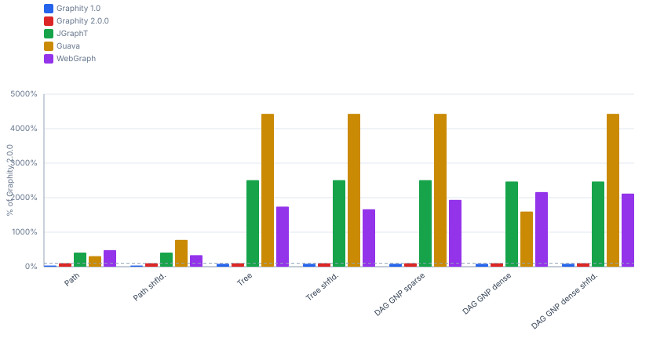

**Allocations @ 100k nodes in bytes (lower is better)**

| Shape | Graphity 1.0 | Graphity 2.0.0 | JGraphT | Guava | WebGraph |
|---|---:|---:|---:|---:|---:|
| Path<br><sub>100k nodes, 100k edges</sub> | 425 kB (11.8%) | 3.6 MB | 13.3 MB (370%) | 24.3 MB (677%) | 10.5 MB (292%) |
| Path shfld.<br><sub>100k nodes, 100k edges</sub> | 425 kB (16.8%) | 2.5 MB | 13.3 MB (525%) | 23.3 MB (919%) | 10.0 MB (396%) |
| Tree<br><sub>100k nodes, 100k edges</sub> | 425 kB (98.1%) | 433 kB | 13.5 MB (3108%) | 7.8 MB (1811%) | 8.5 MB (1953%) |
| Tree shfld.<br><sub>100k nodes</sub> | 425 kB (98.1%) | 433 kB | 13.5 MB (3108%) | 22.2 MB (5134%) | 8.4 MB (1945%) |
| DAG GNP sparse<br><sub>100k nodes</sub> | 425 kB (98.1%) | 433 kB | 13.6 MB (3128%) | 22.2 MB (5134%) | 9.5 MB (2203%) |
| DAG GNP dense<br><sub>100k nodes</sub> | 425 kB (98.1%) | 433 kB | 13.3 MB (3074%) | 7.9 MB (1812%) | 10.3 MB (2375%) |
| DAG GNP dense shfld.<br><sub>100k nodes</sub> | 425 kB (98.1%) | 433 kB | 13.3 MB (3074%) | 7.9 MB (1812%) | 10.2 MB (2361%) |

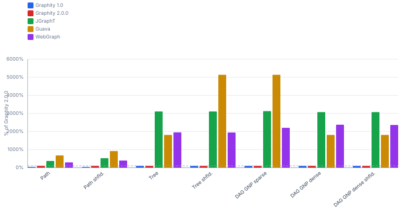

### 3.6 TopOrderAndLevels

**Allocations @ 10k nodes in bytes (lower is better)**

| Shape | Graphity 1.0 | Graphity 2.0.0 |
|---|---:|---:|
| Path<br><sub>10k nodes, 10k edges</sub> | 160 kB (100%) | 160 kB |
| Path shfld.<br><sub>10k nodes, 10k edges</sub> | 160 kB (100%) | 160 kB |
| Tree<br><sub>10k nodes, 10k edges</sub> | 160 kB (100%) | 160 kB |
| Tree shfld.<br><sub>10k nodes</sub> | 160 kB (100%) | 160 kB |
| DAG GNP sparse<br><sub>10k nodes</sub> | 160 kB (100%) | 160 kB |
| DAG GNP dense<br><sub>10k nodes</sub> | 160 kB (100%) | 160 kB |
| DAG GNP dense shfld.<br><sub>10k nodes</sub> | 160 kB (100%) | 160 kB |

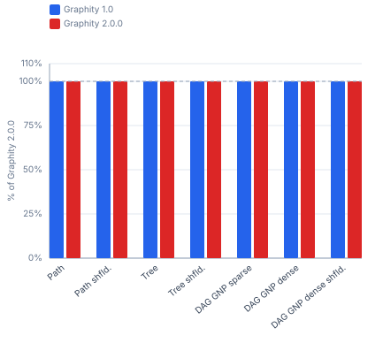

**Allocations @ 100k nodes in bytes (lower is better)**

| Shape | Graphity 1.0 | Graphity 2.0.0 |
|---|---:|---:|
| Path<br><sub>100k nodes, 100k edges</sub> | 1.6 MB (100%) | 1.6 MB |
| Path shfld.<br><sub>100k nodes, 100k edges</sub> | 1.6 MB (100%) | 1.6 MB |
| Tree<br><sub>100k nodes, 100k edges</sub> | 1.6 MB (100%) | 1.6 MB |
| Tree shfld.<br><sub>100k nodes</sub> | 1.6 MB (100%) | 1.6 MB |
| DAG GNP sparse<br><sub>100k nodes</sub> | 1.6 MB (100%) | 1.6 MB |
| DAG GNP dense<br><sub>100k nodes</sub> | 1.6 MB (100%) | 1.6 MB |
| DAG GNP dense shfld.<br><sub>100k nodes</sub> | 1.6 MB (100%) | 1.6 MB |


### 3.7 BackEdges

**Allocations @ 10k nodes in bytes (lower is better)**

| Shape | Graphity 1.0 | Graphity 2.0.0 | JGraphT | Guava | WebGraph |
|---|---:|---:|---:|---:|---:|
| Path<br><sub>10k nodes, 10k edges</sub> | 2.7 kB (1.0%) | 266 kB | 161 kB (60.3%) | 161 kB (60.4%) | 1.4 MB (535%) |
| Path shfld.<br><sub>10k nodes, 10k edges</sub> | 2.7 kB (1.0%) | 266 kB | 161 kB (60.3%) | 1.6 MB (601%) | 985 kB (370%) |
| Tree<br><sub>10k nodes, 10k edges</sub> | 2.7 kB (25.2%) | 10.9 kB | 161 kB (1476%) | 161 kB (1476%) | 845 kB (7768%) |
| GNP sparse<br><sub>10k nodes, 30k edges</sub> | 228 kB (67.9%) | 336 kB | 386 kB (115%) | 1.8 MB (543%) | 1.2 MB (351%) |
| GNP dense<br><sub>10k nodes, 299.6k edges</sub> | 3.8 MB (93.6%) | 4.1 MB | 4.0 MB (97.4%) | 5.4 MB (132%) | 4.9 MB (120%) |
| GNP dense shfld.<br><sub>10k nodes, 299.6k edges</sub> | 3.8 MB (93.6%) | 4.1 MB | 4.0 MB (97.4%) | 5.4 MB (132%) | 4.8 MB (118%) |
| Chain of cliques<br><sub>10k nodes, 310.8k edges</sub> | 3.8 MB (93.6%) | 4.1 MB | 4.0 MB (97.4%) | 5.4 MB (132%) | 9.7 MB (235%) |
| Chain of cliques shfld.<br><sub>10k nodes, 310.8k edges</sub> | 3.8 MB (97.3%) | 4.0 MB | 4.0 MB (101%) | 5.4 MB (138%) | 4.9 MB (124%) |

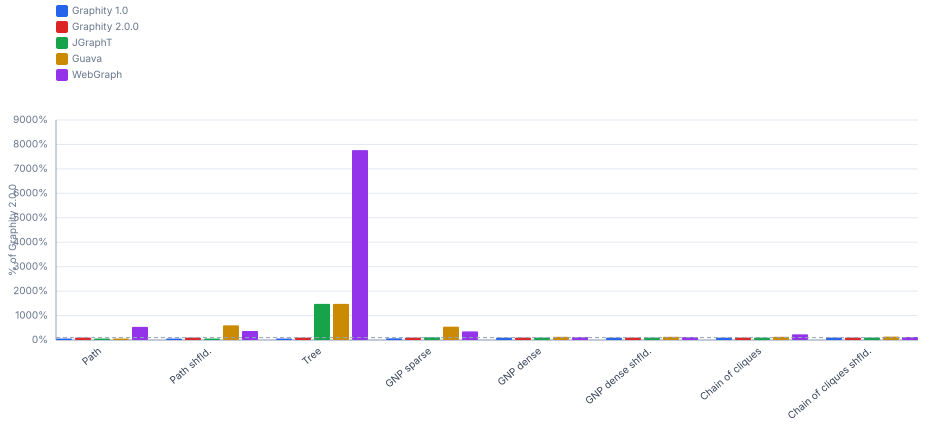

**Allocations @ 100k nodes in bytes (lower is better)**

| Shape | Graphity 1.0 | Graphity 2.0.0 | JGraphT | Guava | WebGraph |
|---|---:|---:|---:|---:|---:|
| Path<br><sub>100k nodes, 100k edges</sub> | 25.2 kB (0.8%) | 3.2 MB | 1.6 MB (50.8%) | 16.0 MB (501%) | 10.1 MB (315%) |
| Path shfld.<br><sub>100k nodes, 100k edges</sub> | 25.2 kB (1.2%) | 2.1 MB | 1.6 MB (76.0%) | 16.0 MB (751%) | 9.6 MB (452%) |
| Tree<br><sub>100k nodes, 100k edges</sub> | 25.3 kB (75.8%) | 33.4 kB | 1.6 MB (4861%) | 16.0 MB (47984%) | 8.1 MB (24141%) |
| GNP sparse<br><sub>100k nodes, 300k edges</sub> | 2.6 MB (64.9%) | 4.0 MB | 4.2 MB (105%) | 18.6 MB (466%) | 12.1 MB (302%) |
| GNP dense<br><sub>100k nodes, 3M edges</sub> | 43.8 MB (93.2%) | 47.0 MB | 45.4 MB (96.6%) | 53.7 MB (114%) | 53.6 MB (114%) |
| GNP dense shfld.<br><sub>100k nodes, 3M edges</sub> | 43.8 MB (93.2%) | 47.0 MB | 45.4 MB (96.6%) | 53.7 MB (114%) | 53.6 MB (114%) |
| Chain of cliques<br><sub>100k nodes, 3.1M edges</sub> | 43.8 MB (93.2%) | 47.0 MB | 45.4 MB (96.6%) | 59.8 MB (127%) | 101 MB (214%) |
| Chain of cliques shfld.<br><sub>100k nodes, 3.1M edges</sub> | 43.8 MB (97.9%) | 44.7 MB | 45.4 MB (101%) | 45.4 MB (101%) | 53.5 MB (120%) |

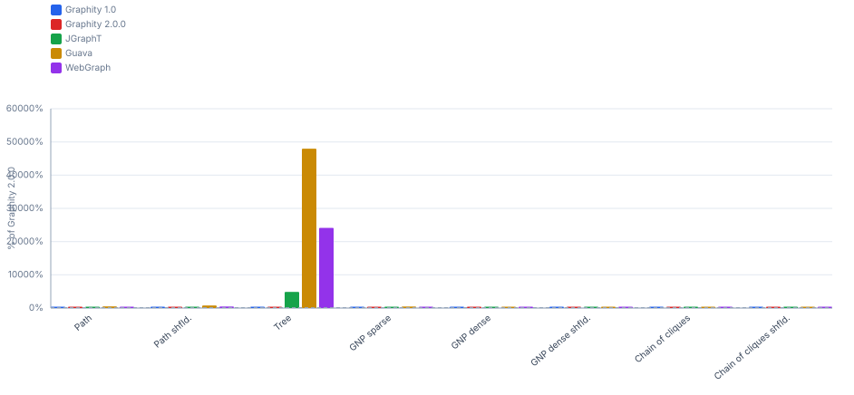

### 3.8 EdgeTypes

**Allocations @ 10k nodes in bytes (lower is better)**

| Shape | Graphity 1.0 | Graphity 2.0.0 | JGraphT | Guava | WebGraph |
|---|---:|---:|---:|---:|---:|
| Path<br><sub>10k nodes, 10k edges</sub> | 52.7 kB (16.7%) | 316 kB | 581 kB (184%) | 2.0 MB (639%) | 1.8 MB (584%) |
| Path shfld.<br><sub>10k nodes, 10k edges</sub> | 52.7 kB (16.7%) | 316 kB | 581 kB (184%) | 2.0 MB (639%) | 1.4 MB (444%) |
| Tree<br><sub>10k nodes, 10k edges</sub> | 52.7 kB (86.6%) | 60.8 kB | 581 kB (956%) | 2.0 MB (3323%) | 1.3 MB (2081%) |
| GNP sparse<br><sub>10k nodes, 30k edges</sub> | 72.7 kB (40.2%) | 181 kB | 1.1 MB (584%) | 1.5 MB (818%) | 1.8 MB (1023%) |
| GNP dense<br><sub>10k nodes, 299.6k edges</sub> | 342 kB (56.5%) | 606 kB | 9.9 MB (1638%) | 11.4 MB (1876%) | 10.8 MB (1789%) |
| GNP dense shfld.<br><sub>10k nodes, 299.6k edges</sub> | 342 kB (56.5%) | 606 kB | 9.9 MB (1638%) | 11.4 MB (1876%) | 10.8 MB (1777%) |
| Chain of cliques<br><sub>10k nodes, 310.8k edges</sub> | 354 kB (57.3%) | 617 kB | 9.9 MB (1608%) | 11.4 MB (1842%) | 15.6 MB (2525%) |
| Chain of cliques shfld.<br><sub>10k nodes, 310.8k edges</sub> | 354 kB (76.6%) | 462 kB | 9.9 MB (2151%) | 11.4 MB (2463%) | 10.8 MB (2348%) |


**Allocations @ 100k nodes in bytes (lower is better)**

| Shape | Graphity 1.0 | Graphity 2.0.0 | JGraphT | Guava | WebGraph |
|---|---:|---:|---:|---:|---:|
| Path<br><sub>100k nodes, 100k edges</sub> | 525 kB (14.2%) | 3.7 MB | 4.9 MB (133%) | 19.3 MB (522%) | 13.4 MB (362%) |
| Path shfld.<br><sub>100k nodes, 100k edges</sub> | 525 kB (19.9%) | 2.6 MB | 4.9 MB (186%) | 19.3 MB (733%) | 12.9 MB (491%) |
| Tree<br><sub>100k nodes, 100k edges</sub> | 525 kB (98.5%) | 533 kB | 4.9 MB (920%) | 19.3 MB (3620%) | 11.3 MB (2127%) |
| GNP sparse<br><sub>100k nodes, 300k edges</sub> | 725 kB (34.1%) | 2.1 MB | 11.7 MB (553%) | 26.1 MB (1230%) | 19.6 MB (923%) |
| GNP dense<br><sub>100k nodes, 3M edges</sub> | 3.4 MB (51.9%) | 6.6 MB | 113 MB (1710%) | 121 MB (1831%) | 121 MB (1834%) |
| GNP dense shfld.<br><sub>100k nodes, 3M edges</sub> | 3.4 MB (51.9%) | 6.6 MB | 113 MB (1710%) | 127 MB (1928%) | 121 MB (1834%) |
| Chain of cliques<br><sub>100k nodes, 3.1M edges</sub> | 3.5 MB (52.7%) | 6.7 MB | 113 MB (1683%) | 127 MB (1898%) | 168 MB (2506%) |
| Chain of cliques shfld.<br><sub>100k nodes, 3.1M edges</sub> | 3.5 MB (79.2%) | 4.5 MB | 113 MB (2531%) | 117 MB (2620%) | 121 MB (2712%) |


